# Manual de usuario

Este manual explica cómo usar el **Sistema de programas de PROBOSQUE** en su versión completa (las 26 historias de
usuario, módulos M1 a M7) y la **Calculadora forestal**. Para ponerlos a funcionar, sigue primero la
[Guía de inicio](GUIA_DE_INICIO.md).

**Qué cubre**

- **Sistema de programas**, para los seis programas: Capturando Carbono (CC), Manejo Forestal Sustentable (MFS),
  Plantaciones Sustentables (PS), Restauración Hidrológico-Forestal (RHF), Pago por Servicios Ambientales
  Hidrológicos del Estado de México (PSAHEM) y Programa Estatal de Guardabosques (PEG). Va de la solicitud en la
  Delegación hasta el padrón público y el informe anual, pasando por las seis unidades que intervienen:
  - Recepción (M1), Dictamen y Comité (M2), Publicación y contrato (M3), Pagos (M5), Ejecución (M4) y Seguimiento y
    cierre (M6).
  - El **portal de personas beneficiarias** y dos páginas públicas sin cuenta (resultados y padrón).
- **Calculadora forestal** (M7): la masa forestal del Estado de México por año, el balance entre dos años, los
  incendios, el uso al que pasó el terreno perdido y las especies por municipio.

El manual sigue el orden del trámite. Cada sección dice **quién** hace el paso, **dónde** lo encuentra y **qué botón**
pulsa; los botones y pestañas se escriben en **negritas** con el texto que ves en pantalla. Las imágenes son capturas
del propio sistema, tomadas por las pruebas automáticas (`entregas/sprint_1/capturas/`, `sprint_2/` y `sprint_3/`).

> Es un **prototipo con datos de demostración**. Los plazos y los textos salen de las Reglas de Operación (ROP) 2026;
> donde las ROP no dicen algo (por ejemplo, el formato del oficio de pago o el texto jurídico de los contratos), el
> sistema lo marca como «borrador» o «supuesto» en pantalla.

---

## 1. Ideas básicas

| Término | Qué es |
| --- | --- |
| **Expediente** | Todo lo de una solicitud a un programa: datos, requisitos, documentos, polígono, dictámenes, contrato, pagos, comprobaciones, seguimiento, acuses y bitácora. Su folio tiene la forma `CC-2026-AME-0001` (programa, ejercicio, Delegación y número). |
| **Folio del predio** | El predio tiene su propio folio (`PRED-000001`), que conserva si vuelve a solicitar en otro programa o ejercicio. |
| **Estado** | En qué paso va el expediente. Cada estado tiene una unidad que lo atiende; el sistema solo permite los pasos de las reglas y a la unidad que le toca. |
| **Unidad** | Quien usa el sistema: Delegación, Dirección del programa, Unidad Jurídica, Secretaría Técnica del Comité, Administración y Finanzas, Vivero y Fiduciaria. Cada usuario pertenece a una. |
| **Bandeja** | La pantalla de inicio de cada usuario: los expedientes que le toca atender a su unidad, con paneles de avisos. |
| **Acuse** | Comprobante en PDF con folio (`AC-2026-000001`), fecha y hora, que se genera en cada envío, entrega o registro importante. Queda en el expediente. |
| **Bitácora** | Registro de todo lo que pasó en el expediente: quién, qué y cuándo. No se puede borrar. |
| **Días hábiles** | Los plazos de las ROP se cuentan sin sábados, domingos ni días inhábiles del calendario 2026 de demostración. |
| **Persona beneficiaria** | Quien recibe el apoyo. En PEG solicita el núcleo agrario y la persona beneficiaria es el **Guardabosque**. |
| **Instancia Ejecutora / área responsable** | La Dirección que lleva el programa: de Restauración y Fomento Forestal (CC, MFS, PS, RHF y PSAHEM) o de Protección Forestal (PEG). |
| **CASPEG** | El comité que valida la evaluación de reportes de los Guardabosques (PEG). |

### Los estados del trámite

La tabla completa del sistema tiene 39 estados. Este diagrama es el **camino principal** de un trámite sin
complicaciones; abajo están los flujos alternos.

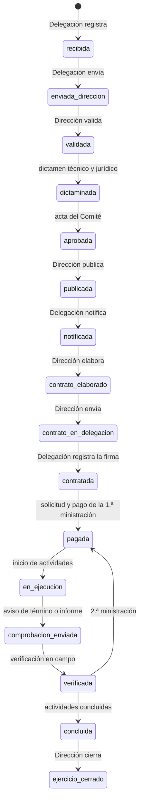

Los pasos que ves en el diagrama tienen estas variantes según el programa:

- **PS y RHF** pasan por el Vale de Planta (`vale_entregado`, `planta_entregada`) entre la firma y la solicitud de pago.
- **PSAHEM** paga con cheque: `ministracion_solicitada → remitida_fiduciaria → cheque_emitido → cheque_enviado →
  cheque_entregado`.
- **PEG** no tiene verificación en campo: sus reportes mensuales se evalúan (`reporte_entregado`,
  `reportes_evaluados`) y el expediente sigue en ejecución mientras cobra sus ministraciones.

**Flujos alternos** (cada uno se explica en su sección):

| Flujo | Estados | Dónde |
| --- | --- | --- |
| Faltantes en la recepción | `faltantes`, `desechada` | 3.4 |
| Lista de espera y no factible | `lista_espera`, `no_factible` | 4.3 y 8.1 |
| Contrato sin firma en plazo | `sin_firma_en_plazo`, `recurso_liberado` | 5.3 |
| Devolución de la solicitud de pago | vuelve a `contratada` | 6.2 |
| Caso fortuito o fuerza mayor | `caso_fortuito` | 8.1 |
| Sustitución o desistimiento | `sustitucion`, `recurso_liberado`, `cancelada` | 8.1 |
| Prórroga por causa externa (MFS) | `prorroga_solicitada` | 8.1 |
| Omisiones, suspensión y cancelación | `omisiones_por_subsanar`, `suspendida`, `cancelada` | 8.2 |
| Requerimiento y reintegro | `en_devolucion`, `reintegrada` | 8.2 |

Quién atiende los estados principales:

| Estado en pantalla | Quién lo atiende |
| --- | --- |
| Solicitud recibida · Aviso de faltantes | Delegación |
| En revisión de la Dirección | Dirección del programa |
| Validado · en dictamen | Dirección (dictamen técnico) y Unidad Jurídica (dictamen jurídico), al mismo tiempo |
| Dictaminada | Secretaría Técnica del Comité |
| Aprobada (persona beneficiaria) | Dirección (publica los resultados) |
| Resultados publicados · por notificar | Delegación |
| Persona beneficiaria notificada · Contrato elaborado | Dirección |
| Contrato en la Delegación · por firmar | Delegación |
| Contrato firmado · en ejecución | Dirección (solicita la ministración); Delegación (vale, oficio) |
| Vale de Planta entregado · por surtir | Vivero |
| Ministración solicitada | Administración y Finanzas |
| Remitida a la Fiduciaria · Cheque emitido | Fiduciaria |
| Cheque en la Delegación · por entregar | Delegación |
| Comprobación enviada · por verificar | Delegación y Dirección |
| Actividades concluidas · Reintegro registrado | Dirección (cierra el ejercicio) |
| Apoyo cancelado | Unidad Jurídica |
| En devolución · requerimiento emitido | Administración y Finanzas |
| Solicitud desechada · Ejercicio cerrado | Termina el trámite |

---

## 2. Entrar, la bandeja y el expediente

### Entrar y salir

Abre **http://localhost:8080/entrar/**, escribe tu usuario y contraseña y pulsa **Entrar**. Para cambiar de unidad
pulsa **Salir** (arriba a la derecha) y entra con otro usuario. Los usuarios de demostración están en la Guía de
inicio (sección 1.4); la contraseña de todos es `Probosque2026`.

Las personas beneficiarias **no** entran por aquí: tienen su propio portal (sección 9). Cada entrada rechaza a las
cuentas de la otra y trae un enlace hacia ella. La pantalla de entrada del personal también enlaza a los resultados
publicados, al padrón y al portal.

### La bandeja

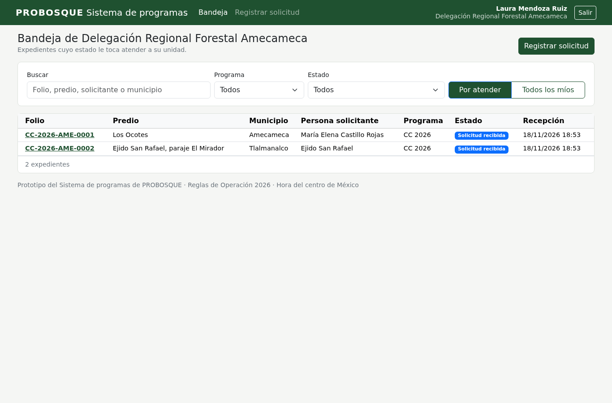

- **Por atender**: lo que tu unidad debe hacer ahora. **Todos los míos**: también lo que ya pasó a otra unidad pero
  sigue siendo de tu Delegación o programa.
- **Buscar**, **Programa** y **Estado** filtran la lista. El folio abre el expediente.
- Una Delegación ve solo sus expedientes; una Dirección, los de los programas que tiene a su cargo.
- **Paneles de la bandeja.** Arriba de la lista aparecen, si los hay, paneles con lo pendiente de tu unidad; cada uno
  trae un botón que abre la pantalla donde se hace. Algunos ejemplos: «Contratos firmados por entregar su Vale de
  Planta», «Contratos firmados por emitir el oficio de solicitud de pago», «Ministraciones por solicitar»,
  «Comprobaciones recibidas por el portal, por revisar», «Reportes de Guardabosques por revisar», «Evaluación de
  reportes por periodo», «Pagos por solicitar a la Fiduciaria» y «Vales de Planta vigentes por surtir».
- **Acuerdos del Comité** que le toca cumplir a tu unidad (sección 4.4).

#### El panel «Por vencer»

Avisa los plazos de ejecución y seguimiento que vencen en **5 días hábiles o menos**, o que ya vencieron: la fecha
límite de conclusión, la entrega de comprobaciones, los reportes mensuales, el aviso de caso fortuito, las omisiones
por subsanar, el cobro de un cheque, entre otros. Cada renglón trae el folio (que abre el expediente), el plazo, su
situación (**por vencer** o **vencido**) y la fecha. **Solo es aviso**: el sistema no cambia nada por sí mismo.

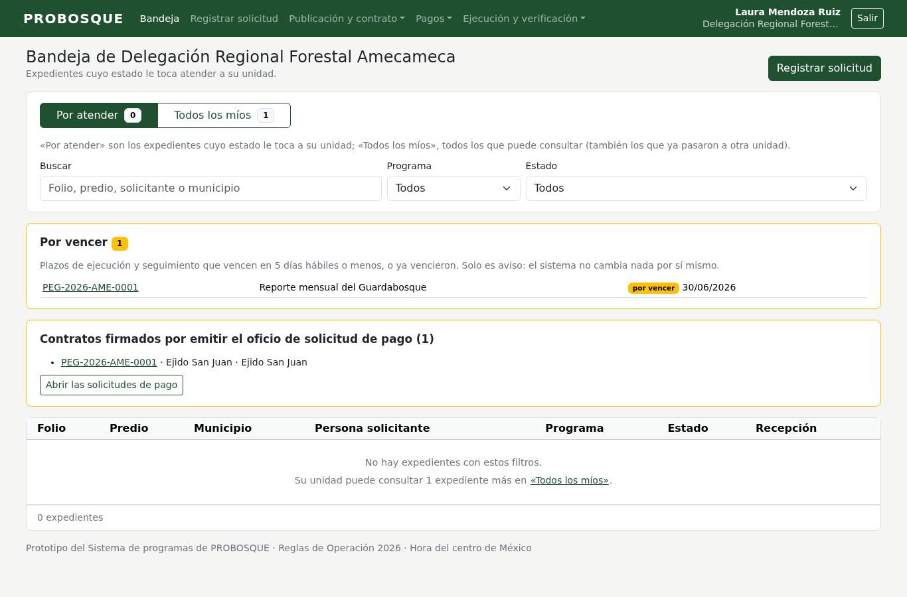

#### El menú

El menú superior se agrupa por módulo y cambia según la unidad (solo ves lo que te toca):

| Grupo del menú | Enlaces |
| --- | --- |
| **Recepción** | Registrar solicitud (Delegación) |
| **Dictamen y Comité** | Listado preliminar, Sesiones del Comité, Incumplidas |
| **Publicación y contrato** | Publicación, Notificaciones, Modelos, Contratos, Firmas, Vales, Planta (Vivero) |
| **Pagos** | Pagos, Cheques |
| **Ejecución y verificación** | Ejecución, Evaluación de reportes |
| **Seguimiento y cierre** | Seguimiento, Incumplimientos y reintegros, Cierre del ejercicio |

Un grupo con un solo enlace para tu unidad se muestra como enlace simple. En un teléfono el menú queda colapsado.

### El expediente

Arriba están el programa, el folio, el predio, la persona solicitante, el estado y la fecha y hora de recepción;
debajo, **el siguiente paso** que le toca a tu unidad, con su botón. Abajo, las pestañas:

| Pestaña | Qué contiene | Sección |
| --- | --- | --- |
| **Solicitud** | Los datos registrados en ventanilla y el acuse de recepción | 3.1 |
| **Requisitos** | Los requisitos del programa y su revisión | 3.2 |
| **Ubicación** | El mapa con el polígono del predio y su historial (no aparece en Guardabosques) | 3.3 |
| **Validación** | Las revisiones de la Dirección, sus avisos de faltantes y fechas límite | 3.4 |
| **Dictámenes** | El dictamen técnico y el jurídico | 4.1 y 4.2 |
| **Contrato** | Publicación, notificación, contrato, firma, vale de planta | 5 |
| **Pagos** | Oficio, comprobante de la cuenta, cada ministración con sus soportes, pagos y cheques | 6 |
| **Ejecución** | Comprobaciones, verificación en campo, reportes de Guardabosques | 7 |
| **Seguimiento** | Sustituciones, desistimientos, casos especiales, prórroga, omisiones, requerimiento, resultados finales y cierre | 8 |
| **Documentos y acuses** | Todos los archivos y acuses en PDF | 12 |
| **Bitácora** | El registro de todo lo ocurrido | 12 |

Los botones de cada pestaña aparecen solo cuando a tu unidad le toca ese paso.

---

## 3. Recepción (M1): Delegación y Dirección

### 3.1 Registrar la solicitud

Usuario de ejemplo: `del_amecameca`. En la bandeja, pulsa **Registrar solicitud** y llena:

- **Programa y solicitud**: programa y ejercicio, tipo de persona, modalidad, si es refrendo, si se solicita por medio
  de representante legal y observaciones de la ventanilla.
- **Predio**: folio de predio ya registrado (si ya tuvo expediente en PROBOSQUE), municipio, nombre del predio,
  superficie solicitada en hectáreas y localidad o paraje.
- **Persona solicitante**: nombre o razón social, CURP, RFC, teléfono, correo y representante legal o comisariado.
- **Persona beneficiaria** (solo en PEG): nombre, CURP y teléfono del Guardabosque. Sin ellos no se recibe la
  solicitud del núcleo agrario.

Pulsa **Registrar y generar acuse**. El expediente queda en «Solicitud recibida» y se genera el **acuse de
recepción** en PDF, con el folio, la fecha, la hora y el plazo para completar la documentación (5 días hábiles en CC).

> Si el municipio del predio lo atiende otra Delegación, el formulario lo avisa al elegirlo y el sistema no deja
> registrar: dice qué Delegación corresponde.

### 3.2 Revisar los requisitos

En la pestaña **Requisitos** está la lista que piden las reglas para el tipo de persona y la modalidad, cada uno con
su numeral de las ROP. Arriba, un resumen: entregados, faltantes, «no aplican» y sin revisar.

En cada renglón pulsa **Revisar** y elige **Entregado** (con su archivo digitalizado, **Elegir archivo**) o
**Faltante**; en los requisitos opcionales o condicionales aparece también **No aplica**, y en los que son condiciones
y no documentos, **Cumple** o **No cumple**. Pulsa **Guardar**: el renglón cambia sin recargar la página.

**Enviar a la Dirección.** El botón **Enviar expediente digital a la Dirección** se habilita cuando todos los
requisitos están revisados, ninguno está faltante y cada entregado tiene su archivo (en un refrendo, la documentación
vigente que ya obra en PROBOSQUE vale sin volver a subirla). Si falta algo, la pantalla dice qué. Al enviar se genera
un acuse y el expediente pasa a la bandeja de la Dirección.

Si la persona no completó su documentación en el plazo, la Delegación puede **Tener por desechada la solicitud**
(pide un motivo).

### 3.3 Ubicar el predio

En la pestaña **Ubicación** se registra el polígono del predio, levantado en campo (los programas con polígono; no
aplica a Guardabosques). No es requisito para enviar el expediente.

1. Sube el archivo del polígono (**GeoJSON, KML o Shapefile en .zip**) o dibújalo en el mapa con la herramienta de
   polígono.
2. Indica quién lo levantó (personal de la Delegación o prestador de servicios forestales, con su RFN), su nombre y
   la fecha del levantamiento.
3. Si ya había un polígono, escribe el motivo del cambio.
4. Pulsa **Registrar polígono**.

El sistema calcula la superficie en hectáreas y avisa si el polígono cae fuera del municipio. Rechaza una geometría
inválida. Cada cambio conserva el polígono anterior en el **Historial de polígonos**, marcado como «corrección» o
«cambio de lugar» según cuánto se traslapan.

### 3.4 Dirección: validar el expediente

Usuario de ejemplo: `dir_drff`.

1. En la bandeja aparecen los expedientes «En revisión de la Dirección». Abre uno, ve a la pestaña **Validación** y
   pulsa **Abrir pantalla de validación**.
2. La pantalla muestra cada requisito con la revisión de la Delegación y una **revisión automática con las reglas**.
   Marca como **Faltante** lo que no cumpla (ilegible, incompleto, no vigente) y escribe observaciones.
3. Sin faltantes, pulsa **Validar expediente**: queda «Validado · en dictamen», con su constancia en PDF.
4. Con faltantes, pulsa **Emitir aviso de faltantes**: se genera el aviso con su **fecha límite** (5 días hábiles
   desde el aviso en CC; en PEG las reglas no dan plazo y el aviso dice «sin plazo en las reglas») y el expediente
   regresa a la Delegación.

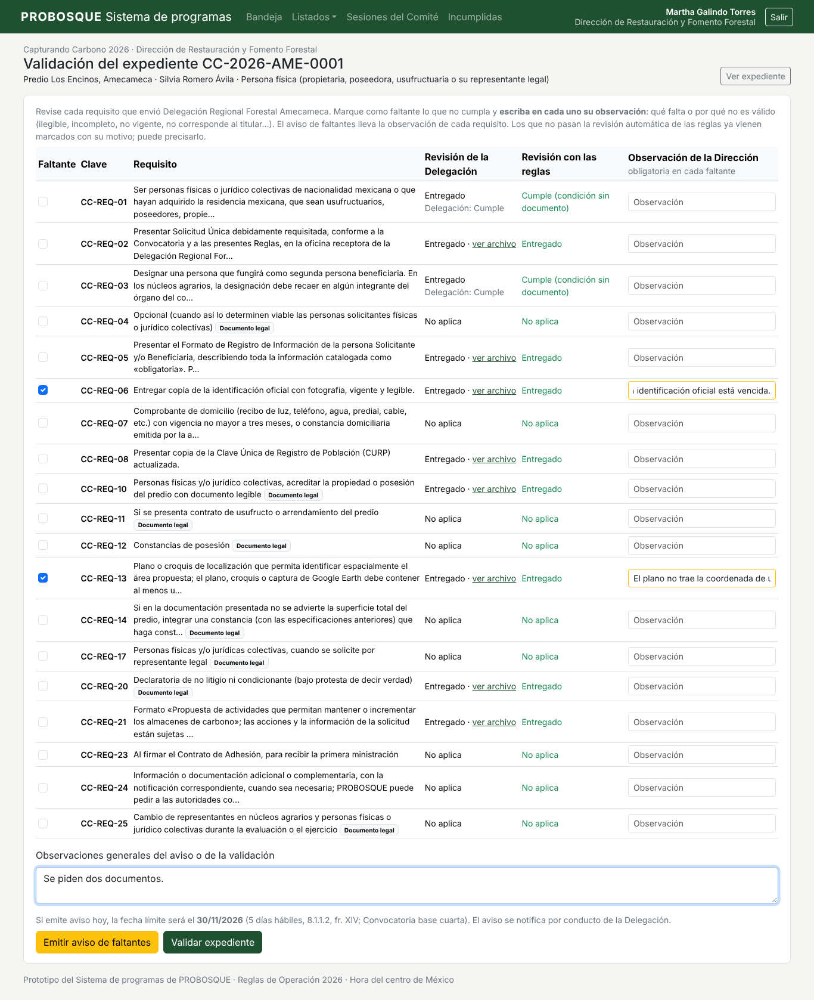

**En un refrendo**, la documentación que ya obra en PROBOSQUE vale si no tiene más de 3 años desde la recepción; si
es más vieja, se marca como faltante.

**Del lado de la Delegación: atender el aviso.** El aviso va dirigido a la persona solicitante por conducto de la
Delegación:

1. En la pestaña **Validación** aparece el aviso con la lista de faltantes y su fecha límite. Cuando lo entregues,
   pulsa **Registrar notificación a la persona solicitante**: queda la fecha y la hora con su acuse.
2. Cuando la persona entregue lo faltante, márcalo como entregado en **Requisitos** y pulsa **Reenviar a la
   Dirección con los faltantes**.

Si vence la fecha límite sin respuesta, la Dirección puede tener la solicitud por desechada. El sistema también
**señala** los faltantes vencidos en «Incumplimientos y reintegros» (sección 8.2), sin ejecutar nada solo.

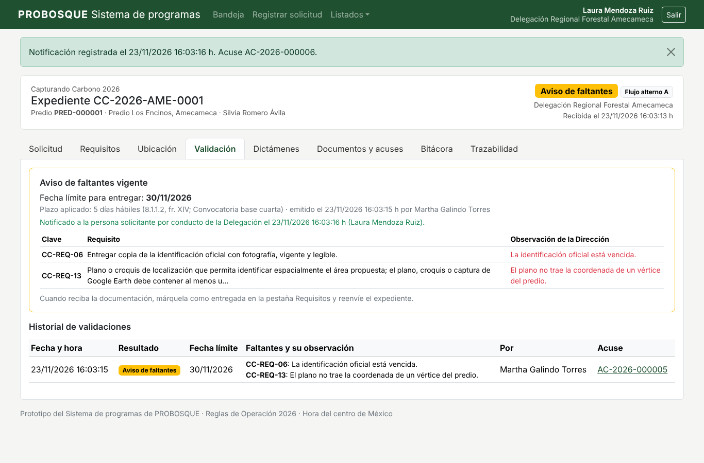

---

## 4. Dictamen y Comité (M2)

Con el expediente validado, la Dirección y la Unidad Jurídica dictaminan al mismo tiempo. Cuando ya están los dos
dictámenes, el expediente pasa a «Dictaminada», en la bandeja de la Secretaría Técnica.

### 4.1 Dictamen técnico y listado preliminar

Usuario de ejemplo: `dir_drff`. En la pestaña **Dictámenes**, pulsa **Elaborar dictamen técnico**. La pantalla tiene:

- **Análisis cartográfico**: el mapa con el polígono vigente, los de otros expedientes que se traslapan y el
  municipio; la superficie, si está dentro del rango del programa (1 a 200 ha en Capturando Carbono), si cae dentro
  del municipio y los traslapes con otras solicitudes del mismo ejercicio, en hectáreas.
- **Plazo de dictaminación**: en Capturando Carbono, la fecha límite de la Convocatoria (30 de junio de 2026); en
  PEG, 45 días hábiles desde la recepción. Dice si va en plazo, por vencer o vencido.
- **Lista de verificación** con los criterios del programa: **Cumple**, **No cumple** o **No aplica**, con una nota.
  Un criterio que no se cumple impide el dictamen factible.
- **Resultado**: **Factible** (con la superficie factible en hectáreas) o **No factible** (con su motivo).

Pulsa **Registrar dictamen técnico**. Queda con su acuse.

En el menú, **Listado preliminar** reúne el resultado técnico y jurídico de cada solicitud validada. **Exportar CSV
(Excel)** lo descarga para abrirlo en Excel con acentos.

### 4.2 Unidad Jurídica: Listado de Incumplidas y dictamen jurídico

Usuario de ejemplo: `juridica`.

**Listado de Personas Beneficiarias Incumplidas.** En el menú, **Incumplidas** muestra el listado y los predios con
procedimiento o sanción. Se agregan con **Inscribir** y se retiran con **Baja**, que desactiva el registro pero no lo
borra: queda su historial. (Las cancelaciones de la sección 8.2 inscriben a la persona aquí automáticamente.)

**Dictamen jurídico.** En la pestaña **Dictámenes** de un expediente validado, pulsa **Elaborar dictamen jurídico**.
El sistema **coteja automáticamente** a la persona (CURP, RFC y nombre) y al predio contra el Listado de Incumplidas y
muestra las coincidencias. Si hay una coincidencia, no permite el dictamen procedente. Elige **Procedente** o **No
procedente**, escribe el motivo y pulsa **Registrar dictamen jurídico**. El cotejo queda también en el acuse.

### 4.3 Secretaría Técnica: sesión de aprobación del Comité

Usuario de ejemplo: `comite`. En el menú, **Dictamen y Comité → Sesiones del Comité**.

1. **Nueva sesión de aprobación**: programa y ejercicio, carácter (ordinaria o extraordinaria), fecha y hora, lugar o
   plataforma digital y orden del día (un punto por renglón). Pulsa **Crear sesión**.
2. **Agregar documento**: al menos uno (por ejemplo, el listado preliminar y los dictámenes).
3. **Enviar convocatoria a los integrantes**: el sistema exige la anticipación de las reglas (en CC, 3 días hábiles
   antes de la sesión, 24 horas si es extraordinaria; en PEG, 5 días hábiles o 1 día) y genera el acuse con la
   fecha, la hora, el orden del día y los integrantes del Comité (en PEG, los del CASPEG).
4. **Generar propuesta** de listados: ordena las solicitudes factibles por los criterios de priorización que se
   pueden leer del expediente (reforestaciones primero, luego refrendos, y por fecha y hora de registro) y asigna
   hasta donde alcance el recurso disponible; las demás van a la lista de espera con su lugar. Las no factibles van a
   su propia lista.
5. Si el Comité decide otra cosa, **Ajustar** mueve una solicitud de lista o de lugar, con un motivo obligatorio que
   queda en el acta. Una no factible no puede pasar a las listas de apoyo.
6. **Registrar acta con los listados aprobados**: genera el acta en PDF con la Lista de Personas Beneficiarias, la
   Lista de espera, la Lista de solicitudes No factibles y la autorización de publicación, y mueve cada expediente a
   «Aprobada», «Lista de espera» o «No factible». **Cerrar la sesión (acta registrada)** deja la sesión como
   celebrada.

### 4.4 Sesiones de seguimiento y acuerdos

1. La Secretaría Técnica crea una **Nueva sesión de seguimiento** igual que la de aprobación.
2. En la sesión, **Registrar acuerdo**: tipo de acuerdo, el texto, los expedientes a los que aplica y el área que debe
   cumplirlo. Los tipos son: reasignación del recurso liberado, sustitución, caso fortuito, suspensión, cancelación,
   baja e inscripción en el Listado de Incumplidas, reintegro, **instrucción de pago a la Fiduciaria (por
   ministración)** (PSAHEM), **validación de la evaluación de reportes mensuales (por periodo)** (PEG), baja por
   desistimiento o fallecimiento y liberación del recurso, caso especial (sobrevivencia menor por causas no
   imputables, PS y RHF) y otro.
3. El área responsable ve el acuerdo en su bandeja, lo atiende y pulsa **Marcar cumplido**.

Desde el sprint 3, **cumplir un acuerdo ejecuta el efecto**: una reasignación pasa a las personas de la lista de
espera a «Aprobada»; una cancelación cancela el apoyo e inscribe a la persona en el Listado de Incumplidas; la
validación de reportes cuenta para el pago de los Guardabosques; la instrucción de pago habilita la solicitud de
PSAHEM (sección 6). Un acuerdo sin propuesta asociada solo deja constancia.

---

## 5. Publicación y contrato (M3)

### 5.1 Publicación de resultados y notificaciones (HU-3.1)

**Publicar (Dirección del programa).** Usuario de ejemplo: `dir_drff`. Cuando el acta del Comité autorizó la
publicación, el panel de la bandeja y el menú **Publicación y contrato → Publicación** muestran los listados por
publicar. Abre la sesión, indica **Dónde se publica** y pulsa **Publicar los listados**.

- Solo se puede publicar una sesión **con acta que autorizó la publicación**, y una sola vez.
- Las ROP no fijan fecha ni días para publicar: la pantalla dice «Sin fecha en las reglas» y registra la fecha y hora
  reales. Queda el **acuse de la publicación**.
- Las solicitudes aprobadas pasan a «Resultados publicados · por notificar»; las de lista de espera y no factibles no
  cambian de estado. A cada Delegación se le envía el aviso del resultado de cada solicitud (en PS, también la **cita
  a firma**).

**Notificar a la persona (Delegación).** Usuario de ejemplo: `del_amecameca`. En **Publicación y contrato →
Notificaciones** están los avisos **Por entregar**, **Entregadas** o **Todas**. Cuando entregues el aviso a la
persona, pulsa **Registrar notificación**: indica el **Medio** y la **Fecha y hora de la notificación**. Queda el
acuse, el expediente pasa a «Persona beneficiaria notificada» y desde esa fecha corren los plazos de firma. En PS la
pantalla muestra también el plazo de la cita a firma.

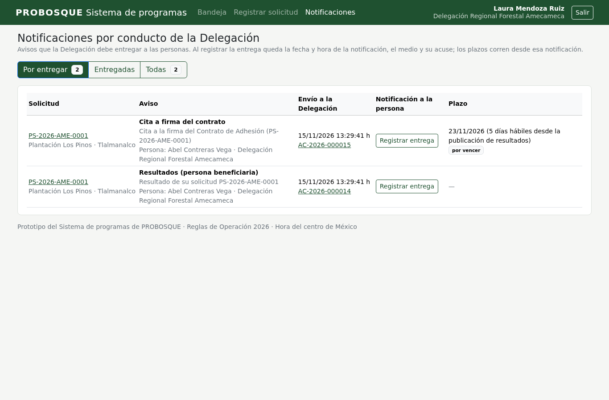

### 5.2 Elaborar el contrato (HU-3.2)

**Modelos de contrato.** Las ROP no traen el texto del Contrato de Adhesión, del Convenio de Concertación (PSAHEM
con fondos concurrentes) ni del Adendum, así que el sistema trabaja con **modelos validados por la Unidad Jurídica**:

1. La Dirección entra a **Publicación y contrato → Modelos** y registra el modelo (**Registrar modelo**) o parte de la
   **plantilla base propia** con **Crear plantilla base**. La plantilla trae la marca «BORRADOR – modelo por
   validar»; hay que quitarla (con **Guardar versión nueva**) antes de usarla. El texto usa campos entre llaves
   dobles; un campo desconocido se rechaza.
2. La Unidad Jurídica (`juridica`) abre el modelo, lo revisa y pulsa **Registrar la revisión**: lo **valida** o lo
   devuelve con observaciones. Queda fecha, hora, quién y las observaciones.
3. Cualquier cambio de texto crea una versión nueva **por validar**; la anterior se conserva y los contratos ya
   elaborados guardan la suya.

**Elaborar (Dirección).** Con la persona notificada y un modelo validado del mismo programa y ejercicio, el siguiente
paso del expediente es **Elaborar el contrato**. La pantalla muestra los datos que llevará (persona, predio,
modalidad, superficie aprobada, monto y ministraciones). Solo aparecen modelos validados; si no hay, la pantalla lo
dice. El PDF lleva el plazo de firma y la leyenda del modelo y su validación. Mientras no se envíe, **Rehacer** lo
vuelve a generar con el mismo folio.

Pulsa **Enviar a la Delegación**: queda fecha, hora y acuse, y el expediente pasa a «Contrato en la Delegación · por
firmar». La Delegación solo ve el PDF desde el envío.

### 5.3 Firma del contrato (HU-3.3)

**Registrar la firma (Delegación).** Menú **Publicación y contrato → Firmas** (o el panel de la bandeja). La pantalla
muestra los contratos **por firmar** con **dos fechas**: la **fecha programada de firma** y el **vencimiento para
liberar el recurso**, con los días hábiles que faltan. Pulsa **Registrar la firma** e indica:

- **Fecha y hora de la firma** (por omisión, ahora; no puede ser futura ni anterior al envío del contrato).
- **Firma**: quién firma (la persona o su representante) y **Nombre de quien firma**.
- **Contrato firmado, digitalizado (PDF, JPG o PNG)**, obligatorio.
- **Verificación de firmas y sello**: una lista por tipo de persona (por ejemplo, en un núcleo agrario, Presidencia,
  Secretaría, Tesorería y sello). **Todos los puntos deben marcarse**; si no, el contrato no se recibe.
- En MFS y PEG, los elementos de formalización propios: contrato de servicios técnicos con el prestador (con su RFN)
  y carta compromiso en MFS; credencial del Guardabosque entregada, con su folio, en PEG.

Pulsa **Registrar la firma**. El expediente pasa a «Contrato firmado · en ejecución», queda el acuse y se da de alta
el acceso de la persona al portal (sección 9): la Delegación le entrega en persona el acuse «Acceso al portal de
personas beneficiarias» con sus códigos.

Una firma posterior a la fecha programada y anterior al vencimiento es válida y queda marcada «fuera de la fecha
programada». Una posterior al vencimiento no se recibe.

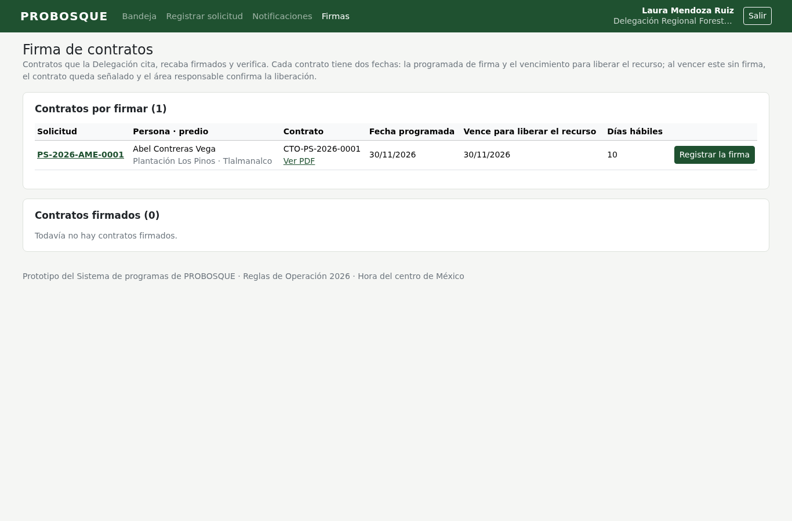

**Contrato sin firma en plazo (Dirección).** Al vencer el plazo, el sistema **señala** el contrato («Sin firma en
plazo · recurso por liberar») y aparece el panel «Sin firma en plazo» en la bandeja de la Dirección. **Liberar el
recurso no es automático**: una persona de la Dirección abre el contrato señalado, pulsa **Liberar el recurso**,
escribe el motivo y queda el acuse. El recurso liberado pasa a la lista de espera (sección 8.1).

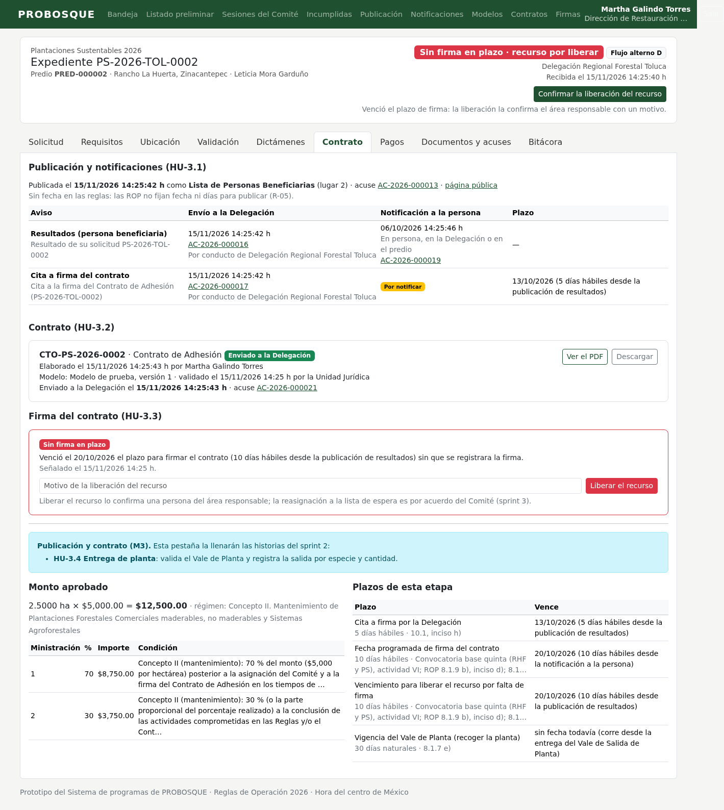

### 5.4 Vale de Planta y salida de planta del vivero (HU-3.4)

Solo en **PS y RHF** (CC, MFS, PEG y PSAHEM no usan vale; RHF Modalidad uno tampoco recibe planta).

**Entregar el vale (Delegación).** Menú **Publicación y contrato → Vales** (o el panel «Contratos firmados por
entregar su Vale de Planta»). Pulsa **Entregar el vale**:

- El sistema **propone la planta** (especie y cantidad) según la superficie aprobada; si la cambias, escribe el
  **Motivo del ajuste a la propuesta**.
- Elige el **Vivero que entrega la planta** y la **Fecha y hora de entrega del vale**.
- **Antes de la firma** del contrato se exige la **Carta compromiso (archivo)**: el vale se entrega de manera
  voluntaria y bajo responsabilidad de la persona.

Queda el acuse y el PDF del vale con su **vigencia** (PS, 30 días naturales desde la entrega; RHF, 15 días hábiles).
**Un vale vencido no es válido.** En RHF, la Delegación puede **Reponer el vale**: el nuevo cubre solo lo no entregado
y pide confirmar que el vivero tiene planta disponible. En PS las reglas no prevén la reposición y la pantalla lo
dice.

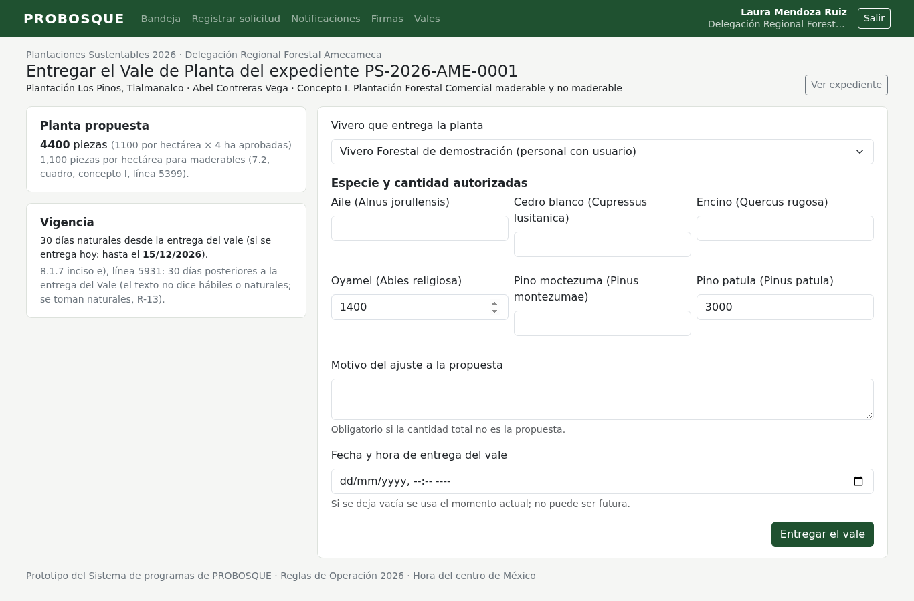

**Salida de planta (Vivero).** Usuario de ejemplo: `vivero`. En **Publicación y contrato → Planta**:

1. Escribe el **Folio del vale** y pulsa **Validar el vale**: solo vale uno vigente.
2. En «Vales vigentes por surtir», pulsa **Entregar planta** e indica la **Especie**, la **Cantidad (piezas)** y la
   **Fecha y hora de la salida**; pulsa **Registrar la salida**.
3. Las salidas pueden ser parciales, pero nunca más de lo autorizado por especie. Al completarse, el expediente pasa a
   «Planta entregada».

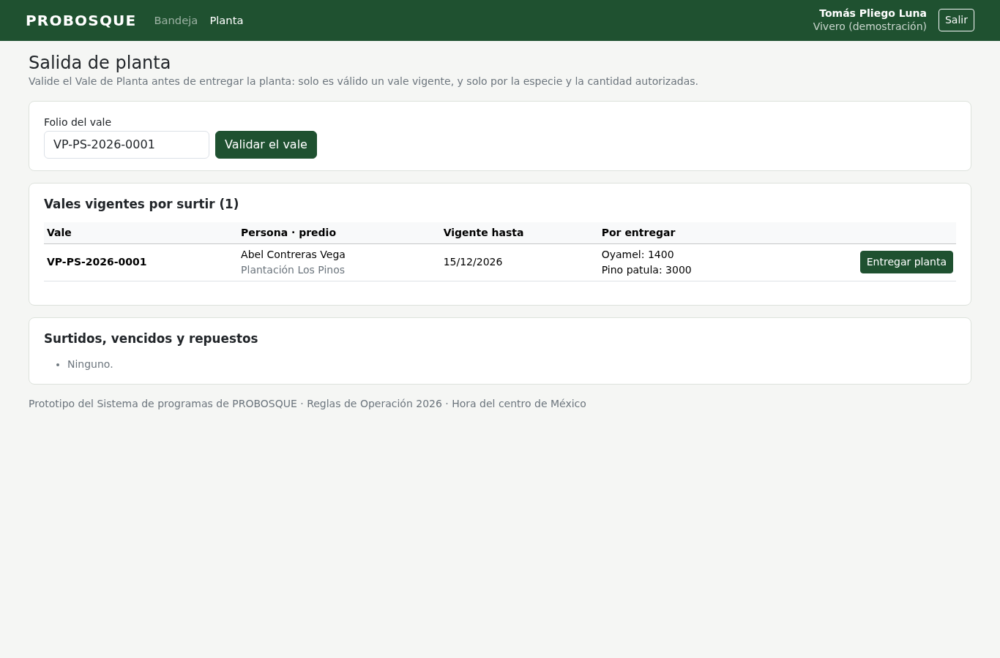

---

## 6. Pagos (M5)

### 6.1 Oficio y solicitud de pago (HU-5.1)

Todo se ve en la pestaña **Pagos** del expediente y en el menú **Pagos → Pagos**.

1. **Oficio de la Delegación.** Con el contrato firmado, la Delegación pulsa **Emitir el oficio de solicitud de
   pago** (también en el panel «Contratos firmados por emitir el oficio de solicitud de pago»). El PDF lleva la
   marca «BORRADOR» porque las ROP no traen el formato. En PEG no hay oficio: la solicitud la genera la Dirección.
2. **Comprobante de la cuenta bancaria.** La Delegación (o el área) sube el comprobante (**PDF, JPG o PNG**) y pulsa
   **Guardar**. Lo piden CC, PS, RHF y MFS para la primera ministración, y PEG; PSAHEM no (paga con cheque). Un cambio
   de cuenta es un comprobante nuevo.
3. **Solicitar la ministración (Dirección).** En la ministración que toca, la pestaña muestra la **lista de soportes**
   con su estado (**Completo** o **Falta**) y el detalle de cada uno. Si todo está completo, pulsa **Enviar la
   solicitud a Administración y Finanzas**; si no, **Dejarla por enviar**. **El sistema impide el envío si falta un
   soporte y dice cuál.**

Los importes salen del programa: CC paga el 100 % en una sola ministración hasta 5 ha y 70 y 30 % arriba de esa
superficie; PS, RHF y PSAHEM, 70 y 30 %; PEG, cuatro ministraciones del 25 % (un supuesto del archivo de reglas, marcado
«supuesto» en pantalla). La **segunda ministración** pide además la verificación en campo o la evaluación de
reportes (sección 7) y solo se solicita cuando la anterior está pagada.

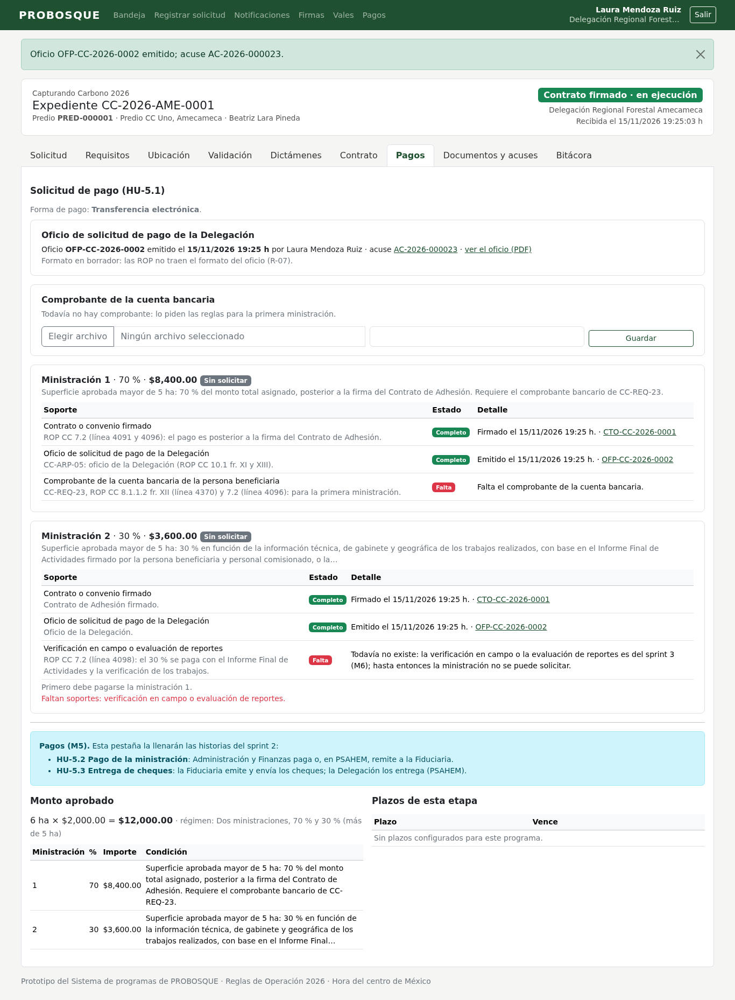

### 6.2 Revisión y pago por Administración y Finanzas (HU-5.2)

Usuario de ejemplo: `finanzas`. En **Pagos → Pagos** (o en la pestaña **Pagos** del expediente):

1. **Aceptar la solicitud**: vuelve a comprobar los soportes y el importe; se paga solo lo comprobado. O
   **Devolver con observaciones** (obligatorias): el expediente vuelve a «Contrato firmado · en ejecución», la
   Dirección ve la solicitud devuelta, la corrige y la reenvía. Se conserva cada revisión.
2. **Registrar el pago**: forma de pago (transferencia en CC, MFS, PS y RHF; depósito en PEG), **Referencia del
   pago**, **Fecha del pago** e **Importe pagado**, que debe ser **igual al solicitado**. No puede ser futuro ni
   anterior al envío. Queda el acuse y el expediente pasa a «Ministración pagada».
3. **Aviso de pago.** La Delegación lo entrega a la persona desde **Notificaciones** (queda con acuse).

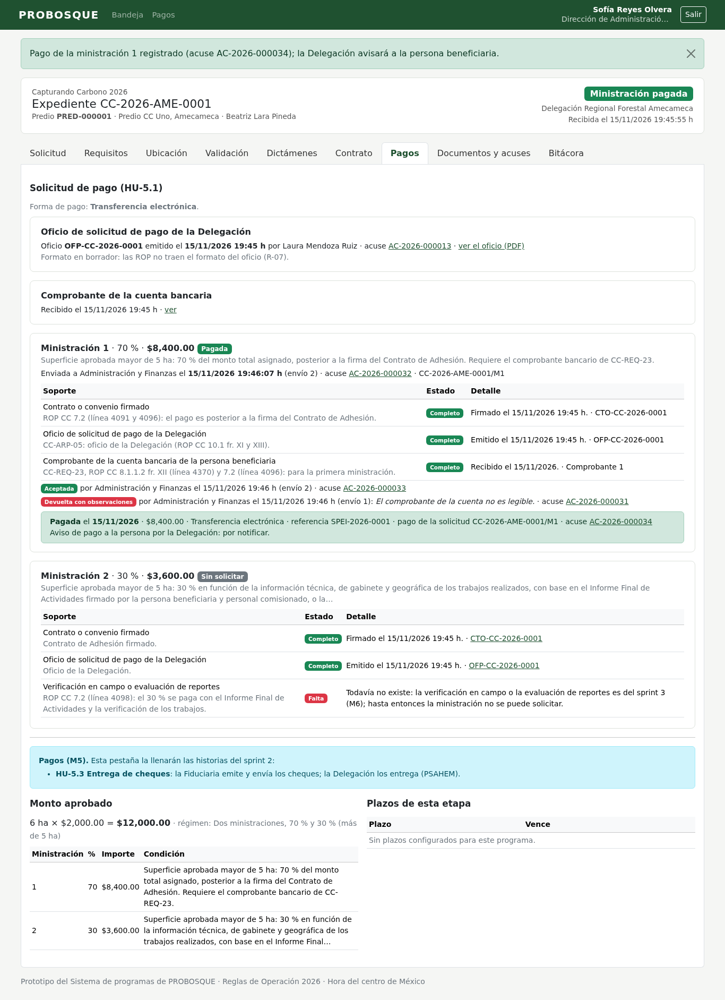

**PSAHEM: la remisión de la Secretaría Técnica a la Fiduciaria.** PSAHEM paga con cheque. Antes de solicitar cada
ministración hace falta el acuerdo del Comité de tipo «Instrucción de pago a la Fiduciaria (por ministración)»
(sección 4.4). Después de que Administración y Finanzas **acepta** la solicitud, la **Secretaría Técnica** pulsa
**Solicitar el pago a la Fiduciaria** (`comite`; opcionalmente indica el oficio o la referencia). La pestaña muestra
su plazo de **5 días hábiles** desde que recibe la solicitud del área y si se cumplió en plazo o fuera de plazo (se
acepta igual; queda señalado). Las ROP dicen en dos lugares quién solicita el pago a la Fiduciaria; el sistema aplica que remite la Secretaría
Técnica y deja la duda abierta para el cliente.

### 6.3 Entrega de cheques (PSAHEM, HU-5.3)

Menú **Pagos → Cheques** (Fiduciaria, Delegación y Administración y Finanzas).

1. **Fiduciaria** (`fiduciaria`): ve la solicitud remitida y pulsa **Emitir el cheque** con el **Número de cheque**
   (único), el **Importe** (igual al solicitado) y la **Fecha de emisión**. Es un cheque por persona y ministración.
2. **Fiduciaria**: **Enviar el cheque a la Delegación**; queda fecha, hora y acuse. Se genera el aviso de que el pago
   está listo, que la Delegación notifica a la persona.
3. **Delegación**: **Registrar la entrega** con **Quién recibe el cheque** y **Fecha y hora de la entrega**. La
   ministración queda pagada («Cheque entregado») y la Dirección puede solicitar la siguiente.
4. **Cobro en 3 meses.** El plazo corre desde la entrega y se muestra en la pestaña y en **Cheques**. La Fiduciaria o
   la Delegación pulsan **Registrar que fue cobrado** (con **Fecha del cobro**). Un cheque vencido ya no se cobra. El
   sistema avisa los que están **por vencer** o **vencidos** (panel «Cheques entregados por vencer o vencidos sin
   cobro»); la baja es una propuesta que se confirma (sección 8.2).

---

## 7. Ejecución (M4)

### 7.1 Envíos de la persona beneficiaria: por el portal o en ventanilla (HU-4.1)

La persona beneficiaria entrega sus comprobaciones **por el portal** (sección 9) o **en la ventanilla de la
Delegación**. Los dos medios dejan el **mismo registro**: fecha y hora, documento, acuse y si llegó en plazo. Lo que
llega **fuera de plazo se registra igual y queda señalado**.

Lo que se puede enviar depende del programa (campo **Qué envía**):

| Programa | Envíos |
| --- | --- |
| CC | Aviso de término de actividades; Informe Final de Actividades; Aviso de caso fortuito, siniestro o conflicto |
| PS | Aviso de término; Aviso de cambio del lugar del polígono (antes de plantar); Justificación de actividades no concluidas (ajuste); Aviso de caso fortuito |
| RHF | Aviso de término; Aviso de caso fortuito |
| PSAHEM | Informe Final de Actividades (con la comprobación de gastos); Aviso de caso fortuito |
| MFS | Copia de la Bitácora para la autorización del Programa de Manejo (régimen ETF) o Copia de la solicitud de auditoría o Plan de auditoría (régimen FSC) |
| PEG | Reporte mensual de actividades del Guardabosque (con su periodo); Acuse de recibo del depósito; Evidencia de que informó a su núcleo agrario |

**En el portal.** La persona abre su expediente y usa la sección **Mis envíos a la Delegación**: elige **Qué envía**,
escribe la fecha del hecho o el periodo si se le pide, adjunta el documento (**PDF, JPG o PNG**) y pulsa **Enviar a la
Delegación**. Queda el acuse, que ella misma puede descargar.

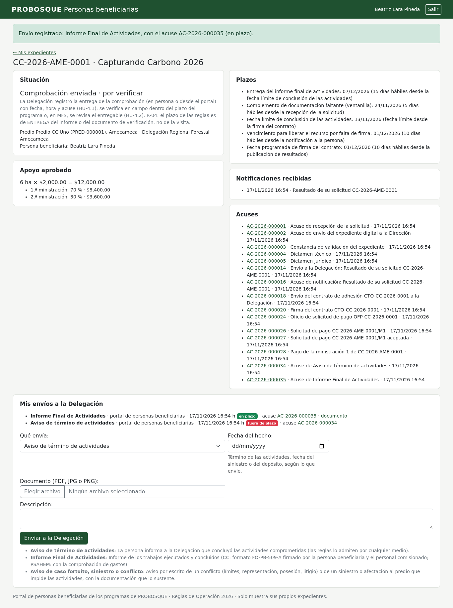

**En ventanilla (Delegación).** En la pestaña **Ejecución** del expediente, sección «Registrar una entrega recibida
en ventanilla», elige el envío, anota quién lo entrega y pulsa **Registrar la entrega con su acuse**. La Delegación
queda como quien lo recibió.

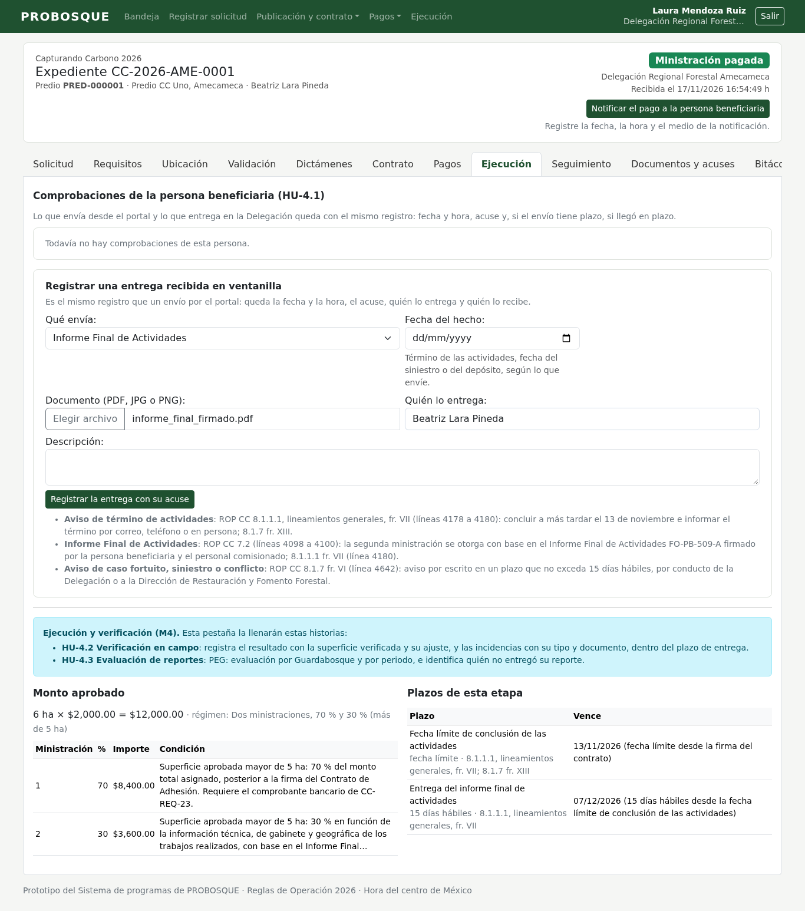

**Lo recibido por el portal, por revisar.** Aparece en la bandeja de la Delegación (panel «Comprobaciones recibidas por
el portal, por revisar») y en el menú **Ejecución y verificación → Ejecución**. La Delegación abre el envío y pulsa
**Marcar como revisado**; queda quién y cuándo.

El primer envío pasa el expediente a «Comprobación enviada · por verificar» (el aviso de término, el Informe Final,
la Bitácora o la solicitud de auditoría); si llega antes de iniciar la ejecución, el sistema registra solo el inicio
de actividades. El aviso de caso fortuito pasa el expediente a «Caso fortuito o fuerza mayor · en revisión» (sección
8.1).

**Prestador de servicios forestales (MFS).** En la pestaña **Ejecución** la Delegación puede **dar acceso al portal
al prestador que atiende el predio**: escribe su **Nombre**, **CURP** y **RFN** y pulsa **Dar acceso con su acuse**.
El prestador entra con su CURP y ve ese expediente para enviar, por ejemplo, la Bitácora; su código de primer acceso
va en el acuse.

### 7.2 Verificación en campo y segunda ministración (HU-4.2)

Con la comprobación entregada («Comprobación enviada · por verificar»), la Delegación registra el resultado de la
visita (en CC con el Informe Final FO-PB-509-A firmado o la minuta; en PS y RHF con el formato de verificación; en
PSAHEM con la minuta). **En MFS no hay visita**: el área responsable revisa el entregable. **PEG no tiene
verificación en campo.**

En la pestaña **Ejecución**, sección **Verificación en campo**, llena:

- **Documento del resultado** (**Documento firmado (PDF, JPG o PNG)**) y la **Fecha de la visita**.
- **Superficie verificada (ha)**, que no puede ser mayor que la aprobada.
- **Sobrevivencia (%)** en PS y RHF.
- **Incidencia** (hasta dos): su tipo (caso fortuito o incumplimiento; en MFS, incumplimiento o causa externa), su
  descripción y el **Documento que la avala**. Sin documento no se registra.

Pulsa **Registrar el resultado con su acuse**. El sistema calcula el **ajuste** (superficie verificada entre
aprobada) y el resultado: **cumple**, **cumple con ajuste** (se verificó menos de lo aprobado) o **incumplimiento**
(ajuste menor al 70 %, sobrevivencia bajo el mínimo o una incidencia de incumplimiento). Queda la fecha y hora de la
entrega del documento, con la que se mide el plazo de las reglas (fuera de plazo se registra igual). El expediente
pasa a «Verificada».

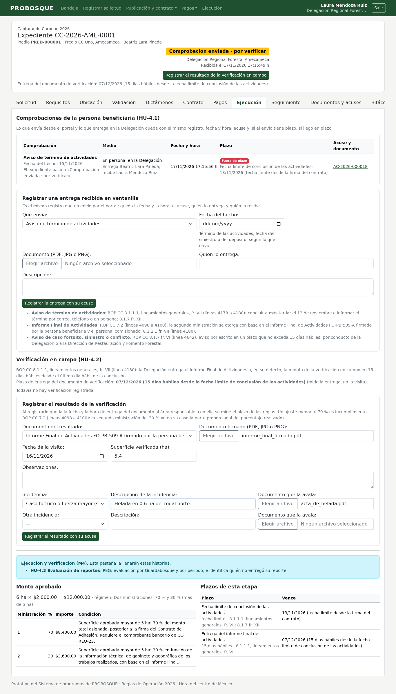

El área responsable también puede **Devolver la comprobación** (con observaciones para la persona beneficiaria; la
Delegación las notifica) o **Dar por concluidas las actividades** cuando no queda ministración por pagar (por
ejemplo, el pago único de CC).

**Segunda ministración: pago proporcional.** Donde las ROP dicen «la parte proporcional del porcentaje realizado» (CC,
PS y RHF), la ministración que depende de la verificación paga la superficie verificada por el monto por hectárea
**menos lo ya ministrado**. Ejemplo de la propia pantalla: CC de 6 ha verificada en 5.4 ha, 10,800 − 8,400 = 2,400
pesos en lugar de 3,600. PSAHEM paga el 30 % completo (duda abierta para el cliente). Sin verificación, o con
incumplimiento, la ministración no se solicita y el sistema dice por qué. Lo ministrado de más queda anotado para el
reintegro (sección 8.2).

### 7.3 Reportes y evaluación de Guardabosques con el CASPEG (HU-4.3)

Solo en **PEG**. El Guardabosque entrega su reporte mensual (por el portal o en ventanilla) desde el mes de la firma de
su contrato; los periodos son los meses del ejercicio. Menú **Ejecución y verificación → Evaluación de reportes**:

1. **Delegación** (`del_amecameca`): revisa cada reporte mensual y cada acuse de depósito. En **Registrar la
   revisión** elige el **Resultado de la revisión**: revisado, revisado con observaciones o devuelto para corregir
   (se notifica a la persona, que lo vuelve a enviar; cuenta el envío más reciente).
2. **Dirección de Protección Forestal** (`dir_dpf`): ve la **tabla por periodo** (Guardabosques por estado) y evalúa a
   cada uno: **Evaluación** «cumple» o «no cumple» con su **Motivo**, y pulsa **Guardar la evaluación**. Un periodo
   ya terminado sin reporte queda **«No entregó» en automático**.
3. Cuando el periodo terminó y no hay reportes por revisar o evaluar, pulsa **Enviar la evaluación de <periodo> al
   CASPEG**: queda fecha, hora y acuse.
4. **Secretaría Técnica** (`comite`): el CASPEG **valida** la evaluación con un acuerdo de su sesión de seguimiento,
   tipo «Validación de la evaluación de reportes mensuales (por periodo)», con el periodo y los expedientes
   (sección 4.4).

La ministración N pide que **cada periodo que cubre** esté evaluado «cumple», enviado al CASPEG y validado por él.
Quien **no cumplió o no entregó** queda **señalado** y su ministración no se solicita; el seguimiento de
incumplimientos lo atiende (sección 8.2). La pantalla advierte los supuestos: qué periodos cubre cada ministración no
lo dicen las ROP.

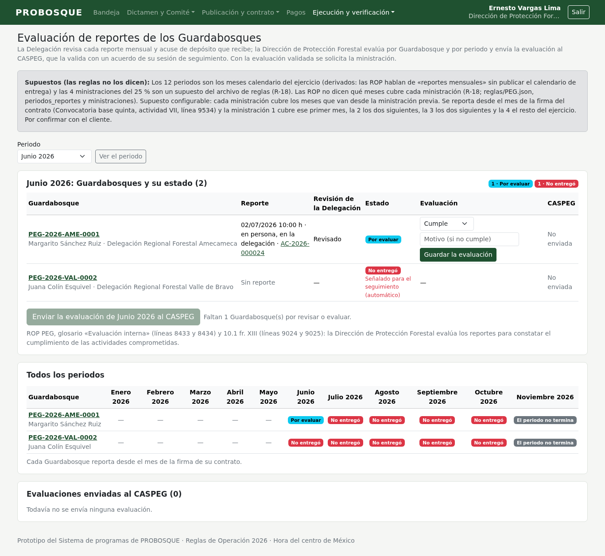

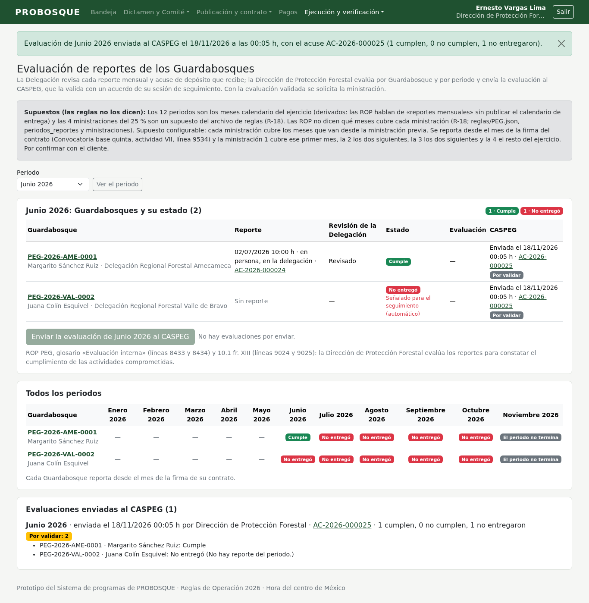

---

## 8. Seguimiento y cierre (M6)

### 8.1 Lista de espera, sustituciones, desistimientos, casos especiales y prórroga (HU-6.1)

**Recibir una solicitud de la persona (Delegación o portal).** En la pestaña **Seguimiento** del expediente, la
Delegación pulsa **Registrar con su acuse**; la persona con cuenta puede enviarla desde el portal con **Enviar con
acuse**. Hay tres solicitudes:

- **Aviso del fallecimiento** de la persona titular (con la **Fecha del fallecimiento**).
- **Sustitución** por la segunda persona beneficiaria (con **Nombre de la segunda persona beneficiaria**, **CURP**,
  **Teléfono** y **Parentesco o relación**); se mide contra los 30 días hábiles de las reglas (fuera de plazo se
  registra igual y queda señalada). PEG no tiene segunda persona beneficiaria.
- **Desistimiento** por escrito, con sus **Motivos o causa justificada** y la marca **Firmas y sello verificados en el
  escrito** (por tipo de persona).

Cada solicitud tiene su acuse con fecha y hora; el expediente pasa a «Sustitución o desistimiento · en trámite».

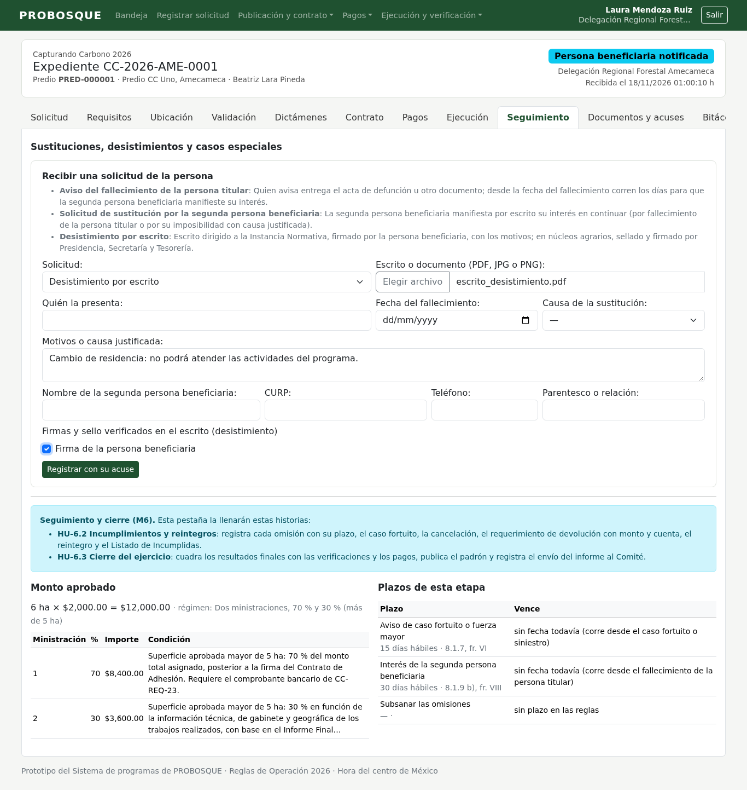

**Proponer al Comité (área responsable).** En la misma pestaña, la Dirección elige la **Propuesta** y pulsa **Enviar la
propuesta a la Secretaría Técnica**. Las propuestas son: sustitución, baja por desistimiento o por fallecimiento sin
sustitución, **caso fortuito** (continuar con la meta ajustada, o terminar sin sanción y liberar lo no ministrado) y
**sobrevivencia menor por causas no imputables** (PS y RHF). Cada una dice el **recurso liberado**.

**La página «Seguimiento»** (menú **Seguimiento y cierre → Seguimiento**: área responsable, Secretaría Técnica y
Unidad Jurídica) muestra, por programa y ejercicio:

1. El **recurso liberado** (de contratos sin firma, bajas, casos fortuitos y ajustes de superficie) y la **lista de
   espera en su orden**, con «Alcanza» o «No alcanza». Pulsa **Proponer al Comité la reasignación de ...**: la
   propuesta recorre la lista en orden y se detiene en la primera a la que ya no le alcanza.
2. Las **propuestas por llevar a sesión**: la Secretaría Técnica elige la sesión de seguimiento y pulsa **Registrar el
   acuerdo del Comité** (si no hay sesión convocada, la pantalla pide convocarla en «Sesiones del Comité»).
3. Cuando el área **cumple el acuerdo** (sección 4.4), se ejecuta: la solicitud de la lista de espera pasa a
   «Aprobada», se le notifica (desde ahí corre su plazo de firma) y el saldo queda como recurso liberado.

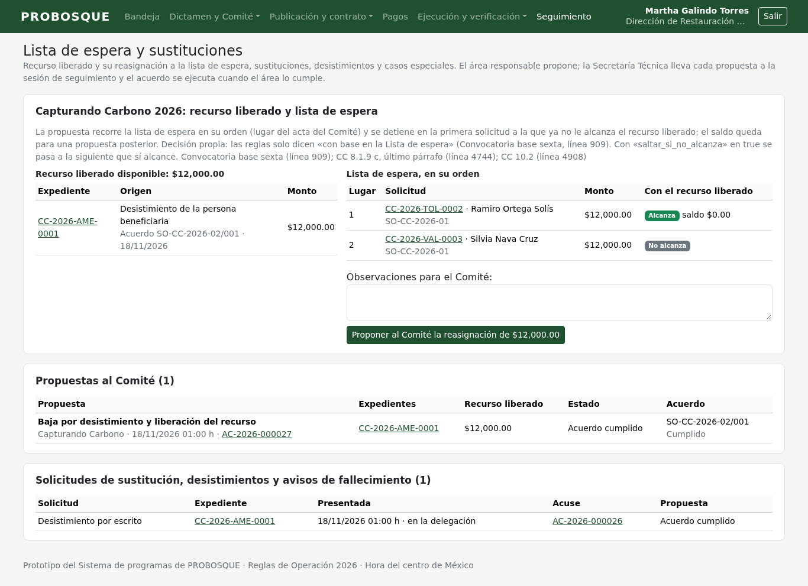

**Prórroga por causa externa (MFS).** La Delegación pulsa **Registrar la solicitud de prórroga con su acuse**
(escribe la **Causa externa por la que no se cumplió la meta**, el **Término del contrato**, el **Plazo que se
solicita** y adjunta el **Escrito de la persona**). El área responsable pulsa **Resolver la prórroga**: **autorizada**
con el **adendum** (**Plazo nuevo (adendum)** y **Adendum firmado**) o **negada**, con su motivo; la Delegación
notifica. Las ROP no dicen quién la pide ni quién la autoriza: la pantalla muestra el supuesto.

### 8.2 Omisiones, suspensión, cancelación, Listado de Incumplidas, requerimiento y depósito (HU-6.2)

Se ve en la pestaña **Seguimiento** del expediente y en la página **Seguimiento y cierre → Incumplimientos y
reintegros** (Unidad Jurídica y Administración y Finanzas; el área responsable llega desde «Seguimiento»).

**Aviso de omisiones con su plazo.** El área responsable pulsa **Enviar el aviso con su plazo**: **Omisiones que la
persona debe subsanar**, **Causa de incumplimiento de las reglas** y **Fecha límite para subsanar** (obligatoria: las
ROP dicen «el periodo que determine el Comité»; el formulario sugiere 10 días hábiles). Queda el acuse, la Delegación
notifica y el expediente pasa a «Omisiones por subsanar». Cuando la persona corrige, **Dar por subsanadas**.

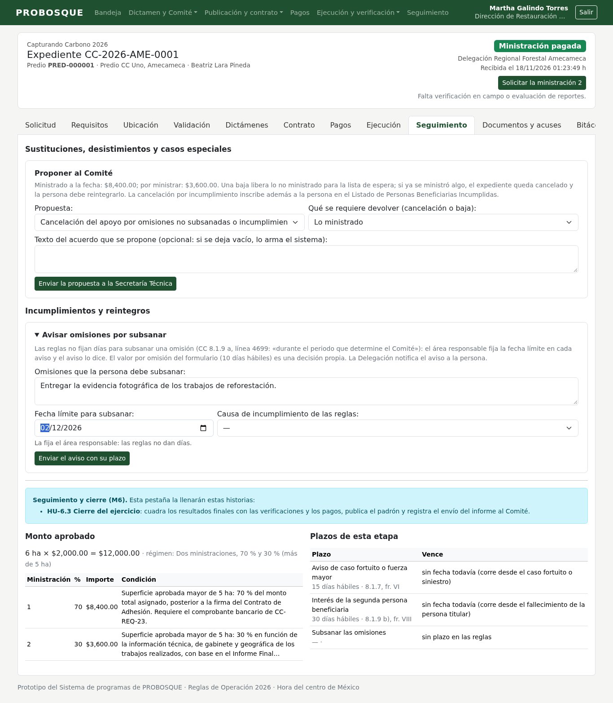

**Lo que el sistema señala y una persona confirma.** El sistema **prepara**, sin ejecutar nada, estas situaciones, y
aparecen en «Por atender: preparado por el sistema» (panel «Incumplimientos por atender» de la bandeja) con su botón:

| El sistema señala | Botón que confirma |
| --- | --- |
| Omisiones no subsanadas en el plazo | **Proponer la cancelación al Comité** |
| Cheque vencido sin cobrar (PSAHEM) | **Proponer la baja al Comité** |
| Reporte mensual no entregado o que no cumple (Guardabosques) | **Proponer la suspensión al Comité** |
| Tres reportes mensuales no presentados | **Proponer la baja al Comité** |
| Faltantes no entregados en el plazo (recepción) | **Confirmar el desecho de la solicitud** |
| Incidencia de incumplimiento en la verificación | **Avisar la omisión con su plazo** |

**Suspensión y cancelación.** Siguen el mismo camino de acuerdo del Comité (sección 4.4). Al cumplir un acuerdo de
**cancelación** la Unidad Jurídica, el apoyo queda «Cancelado», la persona se **inscribe en el Listado de Personas
Beneficiarias Incumplidas** (con el acuerdo como fundamento), lo no ministrado queda como recurso liberado y la
Delegación notifica la cancelación. Una **suspensión** se levanta con otro acuerdo.

**Requerimiento de devolución.** La Unidad Jurídica (`juridica`) pulsa **Emitir el requerimiento con monto y cuenta**.
El monto es lo ministrado o lo ministrado de más según la verificación; donde las reglas lo piden (PS y RHF) se suma
el **valor de la planta no establecida**: captura **Plantas no establecidas**, **Precio por planta ($)** y **Fuente del
precio**. Hace falta que Administración y Finanzas haya registrado la **cuenta para reintegros** del programa
(**Registrar la cuenta del programa**: **Titular de la cuenta**, **Banco**, **Cuenta o CLABE**, **Referencia**). Al
emitir queda el acuse con el desglose, la Delegación notifica y el expediente pasa a «En devolución · requerimiento
emitido». En PSAHEM, la titularidad de la cuenta es una duda abierta que la pantalla dice.

**Depósito.** Administración y Finanzas pulsa **Registrar el depósito del reintegro**: **Fecha del depósito**,
**Importe depositado ($)** (igual al requerido), **Referencia o folio del depósito** y **Comprobante (PDF, JPG o
PNG)**. El expediente pasa a «Reintegro registrado» y el importe vuelve como recurso liberado para la lista de
espera.

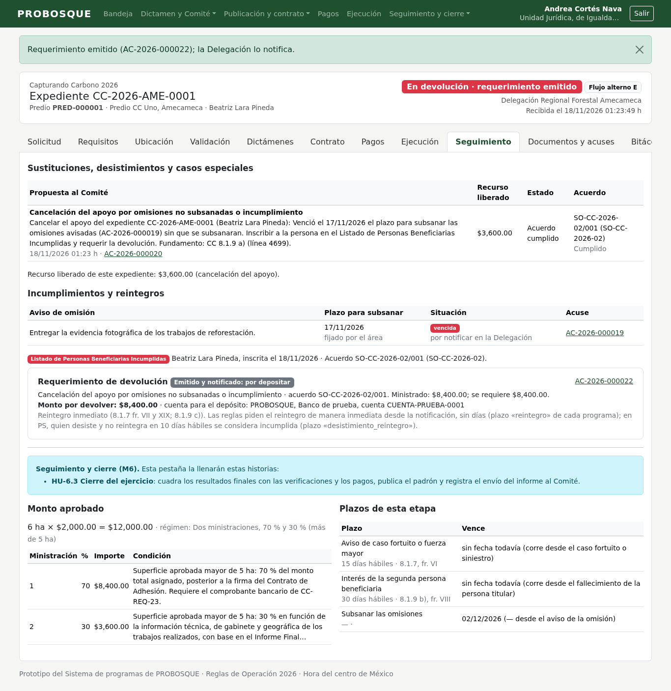

### 8.3 Cierre del ejercicio, resultados finales, padrón e informe anual (HU-6.3)

Menú **Seguimiento y cierre → Cierre del ejercicio** (Dirección, Secretaría Técnica, Unidad Jurídica y Administración
y Finanzas). Pulsa **Ver resultados finales** en el programa y ejercicio.

**Resultados finales.** Una fila por persona beneficiaria con contrato firmado: lo **aprobado** (y el ajustado a lo
verificado), lo **verificado**, lo **pagado**, lo **reintegrado**, lo **liberado** y lo **reasignado**, con sus totales.
**Exportar a CSV** lo descarga. El sistema **comprueba las diferencias** (por ejemplo, pagado mayor que lo aprobado,
un pago sin la verificación que la regla exige o una cancelación sin requerimiento resuelto); una diferencia de
gravedad «error» impide el cierre y la pantalla dice cuál.

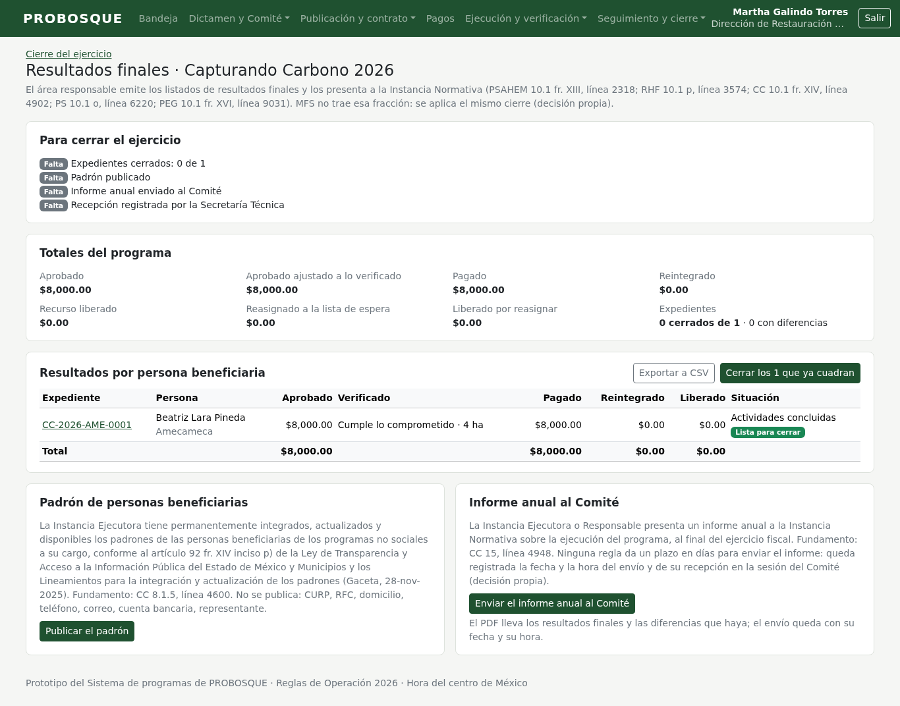

**Cerrar el expediente (Dirección).** En la pestaña **Seguimiento** del expediente, **Cerrar el expediente** (desde
«Actividades concluidas», «Reintegro registrado» o «Apoyo cancelado» sin recurso por devolver); queda «Ejercicio
cerrado» con su acuse. **Cerrar los N expedientes que ya cuadran** lo hace por ejercicio.

**Padrón público.** **Publicar el padrón** (área responsable): queda el acuse y desde entonces el padrón **se calcula
en cada consulta**, así que refleja solo las bajas, cancelaciones, desistimientos, suspensiones y sustituciones. Se
publican folio, persona, municipio, predio, modalidad, monto del apoyo, situación y alta; **nunca** CURP, RFC,
domicilio, teléfono, correo, cuenta ni representante. En **PEG** se muestra el núcleo agrario y no el nombre del
Guardabosque, con la tabla de altas, bajas y sustituciones. **Ver la página pública** abre `/padron/` (sección 10).

**Informe anual al Comité.** **Enviar el informe anual al Comité** genera el PDF con los resultados finales y las
diferencias y deja el acuse con fecha y hora (**Abrir el informe (PDF)** lo muestra). La Secretaría Técnica lo ve en
el panel «Informes anuales por recibir» y pulsa **Registrar la recepción**, eligiendo la **Sesión del Comité en que se
presenta**; el informe queda entre los documentos de la sesión. La pantalla lista lo que falta para cerrar el
ejercicio: expedientes cerrados, padrón publicado e informe enviado y recibido.

---

## 9. Portal de personas beneficiarias

Para las personas beneficiarias y los Guardabosques con contrato firmado, y para el prestador de servicios forestales
con acceso. Es una entrada **separada** de la del personal: **http://localhost:8080/portal/entrar/**. Solo ven **sus**
expedientes.

**Primer acceso.** Al registrar la firma del contrato, la Delegación entrega **en persona** el acuse «Acceso al portal
de personas beneficiarias» (no hay correo ni SMS), con dos códigos:

- El **código de primer acceso**, de un solo uso.
- El **código de consulta** del expediente.

1. En la entrada del portal, pulsa **Primer acceso**.
2. Escribe tu **CURP**, el **Código de primer acceso** del acuse, una **Contraseña nueva** y repítela.
3. Pulsa **Activar mi cuenta**. El código ya no sirve; desde ahí entras con **CURP** y **Contraseña** y el botón
   **Entrar**.

Las personas jurídico colectivas y los núcleos agrarios no tienen CURP, así que no tienen cuenta: usan la consulta
con código (abajo) y entregan sus documentos en la Delegación con el mismo registro.

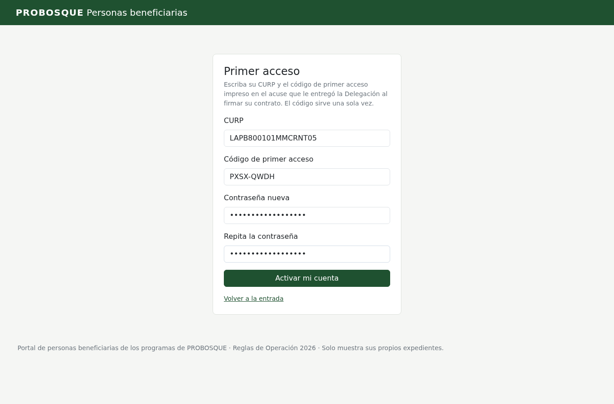

**Mis expedientes.** Lista tus expedientes con folio, programa, predio y situación. Al abrir uno ves la situación, el
apoyo aprobado y cada ministración con su porcentaje, los **plazos con fecha**, las **notificaciones recibidas** y los
**acuses**, que puedes descargar.

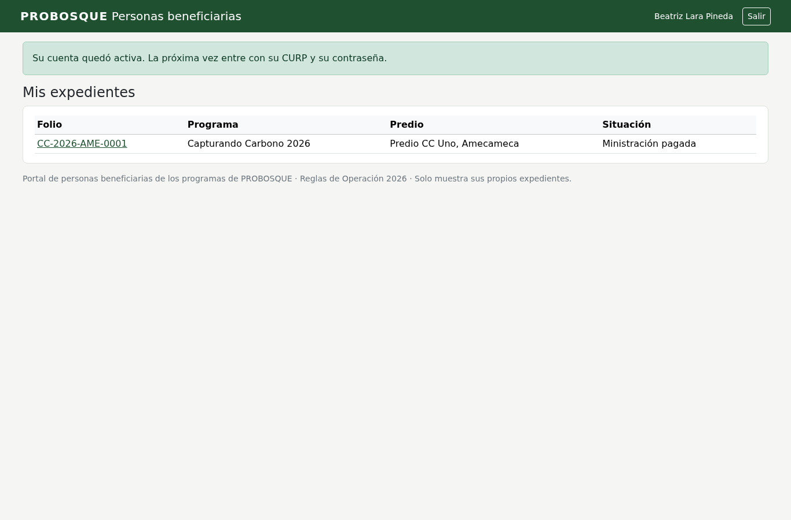

**Qué puedes enviar.** En el expediente, la sección **Mis envíos a la Delegación** (sección 7.1), con **Enviar a la
Delegación**; y **Desistimiento o sustitución** (sección 8.1), con **Enviar con acuse**. En PEG envías cada mes tu
reporte, y la Delegación lo revisa; junto a cada envío ves su revisión y, si te lo devolvieron, puedes corregirlo y
enviarlo de nuevo.

**Consulta sin cuenta.** En la entrada del portal, **Consultar sin cuenta**: escribe el **Folio del expediente** y el
**Código de consulta** del acuse y pulsa **Consultar**. Ves solo ese expediente, sus envíos y sus acuses, pero **no
puedes enviar**; para enviar, entra con tu cuenta o entrega en la Delegación. **Terminar la consulta** cierra la
sesión.

**Prestador de servicios forestales (MFS).** Entra con su CURP y la contraseña que activó con su código de primer
acceso (se lo da la Delegación, sección 7.1) y ve el expediente del predio que atiende, para enviar lo que le toca,
por ejemplo la Bitácora.

> El personal de PROBOSQUE no entra por el portal, ni las personas beneficiarias por la entrada del personal: cada
> pantalla lo dice y enlaza a la otra.

---

## 10. Páginas públicas, sin cuenta

| Página | Dirección | Qué muestra |
| --- | --- | --- |
| Resultados publicados | `/contrato/resultados/` | Los listados que el Comité aprobó y autorizó publicar, por programa y ejercicio, con búsqueda por folio |
| Padrón de personas beneficiarias | `/padron/` | La relación de personas beneficiarias por programa y ejercicio, con búsqueda por folio, exportable a CSV |

**Resultados publicados.** La persona busca con el folio de su acuse de recepción. Se ven el folio, el predio, el
municipio y el resultado; **el nombre solo en el listado de personas beneficiarias**; nunca CURP, RFC ni documentos.
Solo existe para lo ya publicado (si no, la página no se encuentra). Hay un enlace en la pantalla de entrada.

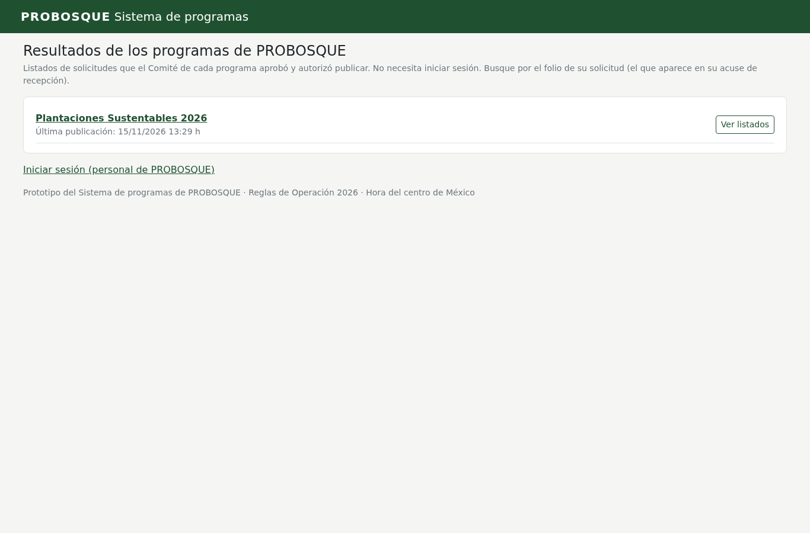

**Padrón.** Elige el programa y pulsa **Ver el padrón**; **Buscar** por folio o **Exportar a CSV**. Dice cuándo se
publicó y hasta qué movimiento está actualizado; **Altas, bajas y sustituciones** aparece en PEG.

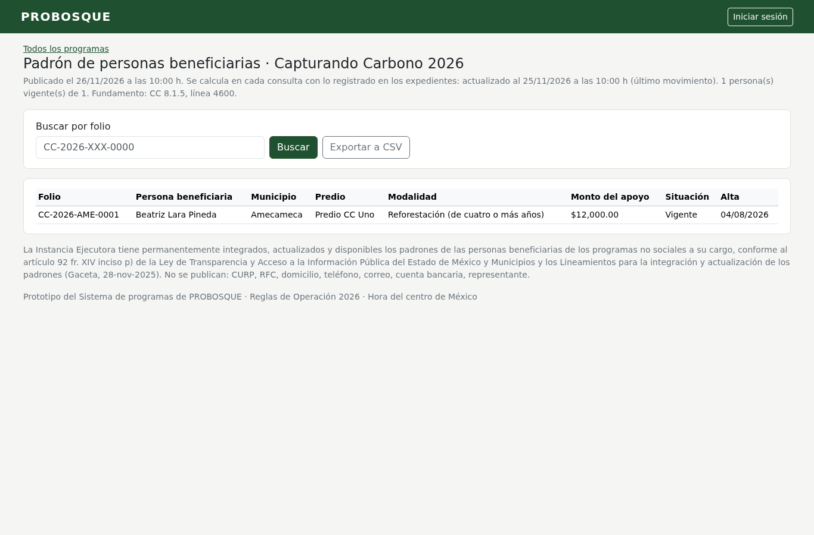

---

## 11. Diferencias por programa

| Tema | CC | MFS | PS | RHF | PSAHEM | PEG |
| --- | --- | --- | --- | --- | --- | --- |
| Persona beneficiaria | Quien solicita | Quien solicita; el prestador forestal (RFN) envía por el portal | Quien solicita | Quien solicita | Quien solicita | **El Guardabosque**; solicita el núcleo agrario |
| Polígono (pestaña **Ubicación**) | Sí | Sí | Sí | Sí | Sí | **No** |
| Dirección que lo lleva | DRFF | DRFF | DRFF | DRFF | DRFF | DPF (`dir_dpf`) |
| Vale de Planta | No | No | **Sí** | **Sí** (no en Modalidad uno) | No | No |
| Comprobante de cuenta bancaria | Sí | Sí | Sí | Sí | No | Sí |
| Oficio de solicitud de pago de la Delegación | Sí | Sí | Sí | Sí | Sí | No |
| Forma de pago | Transferencia | Transferencia | Transferencia | Transferencia | **Cheque** por la Fiduciaria | Depósito |
| Ministraciones | 100 % hasta 5 ha; 70 y 30 % arriba | Primera y segunda según régimen | 70 y 30 % | 70 y 30 % | 70 y 30 %, cada una con instrucción de pago del Comité | Cuatro del 25 % (supuesto) |
| Soporte de la segunda | Verificación en campo | Bitácora (ETF) o solicitud/Plan de auditoría (FSC) | Verificación | Verificación | Verificación | Evaluación de reportes validada por el CASPEG |
| Verificación en campo | Sí | Revisión del entregable por el área | Sí (con sobrevivencia) | Sí (con sobrevivencia) | Sí (minuta) | No |
| Informe periódico | Aviso de término e Informe Final | Bitácora o auditoría | Aviso de término | Aviso de término (en Modalidad uno, octubre) | Informe Final | **Reportes mensuales** |
| Prórroga por causa externa | No | **Sí** (con adendum) | No | No | No | No |
| Comité | Comité del programa | Comité | Comité | Comité | Comité Técnico (instrucción de pago) | CASPEG (valida reportes) |

Puntos que conviene recordar:

- **Vale de planta solo PS y RHF**; **cheques solo PSAHEM**.
- **Guardabosques** reporta cada mes, no tiene polígono ni verificación en campo, y su pago depende de la evaluación
  de la Dirección de Protección Forestal validada por el CASPEG. Quien no entrega tres reportes puede ser dado de baja
  (el sistema lo señala y el Comité acuerda).
- **MFS** entrega **Bitácora** (ETF) o **solicitud / Plan de auditoría** (FSC) en lugar de informe final, y tiene
  **prórroga** por causa externa con adendum. Su contrato de servicios técnicos y su carta compromiso son parte de la
  firma.
- En **PS y RHF**, quien desiste con ministraciones debe reintegrar; en PS el requerimiento dice que, si no
  reintegra en 10 días hábiles, se le considera incumplida.

---

## 12. Documentos, acuses y bitácora

- La pestaña **Documentos y acuses** reúne los archivos subidos y cada acuse en PDF: recepción, envío a la Dirección,
  validación, aviso de faltantes, notificación, dictámenes, convocatoria y acta, publicación, contrato, firma, acceso
  al portal, vale de planta, oficio y solicitud de pago, pago, remisión a la Fiduciaria, cheque, comprobaciones,
  verificación, evaluación de reportes, solicitudes de sustitución, aviso de omisiones, requerimiento, depósito,
  cierre e informe anual.
- Los archivos no tienen dirección pública: solo los descarga quien tiene permiso sobre el expediente.
- La pestaña **Bitácora** lista cada paso con su fecha y hora, quién lo hizo y qué hizo (con el motivo, cuando el paso
  lo pide), en orden cronológico. Los pasos que hace el propio sistema (por ejemplo, señalar un contrato sin firma en
  plazo) aparecen sin persona.

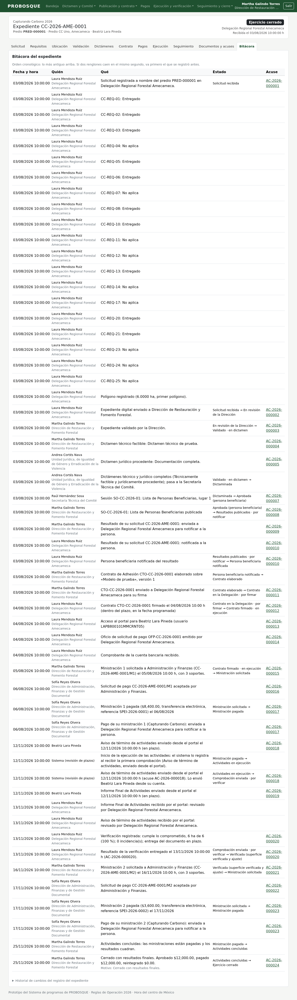

---

## 13. Calculadora forestal (M7)

Ábrela como dice la Guía de inicio, sección 2 ([`GUIA_DE_INICIO.md`](GUIA_DE_INICIO.md)). Muestra la **superficie con
cobertura arbórea** (hectáreas de bosque) dentro de la zona forestal del Estado de México, medida con imágenes
Sentinel-2 de noviembre y diciembre de cada año, de 2023 a 2025. No necesita iniciar sesión ni Docker.

**Dos modos** (arriba a la derecha):

- **Un año** (HU-7.1): el bosque de ese año, su cambio desde el año anterior y la tendencia. Siempre se ve la
  **Evolución del bosque**: la gráfica de la serie y su tabla; «ver» abre ese año en el mapa.
- **Comparar años**: dos años lado a lado. Aquí aparecen el balance, los incendios y el uso del suelo.

**El mapa** tiene vistas que se eligen en **Capas**: **Bosque**, **Tendencia por municipio**, **Año de pérdida**, en
«Comparar años» también **Incendios** y **Destino de la pérdida**, y la vista **Inventario forestal** pinta dónde hay registros de especies. **Buscar** encuentra un
municipio por nombre. Toca un municipio en el mapa o en la tabla (**Municipios**) para ver su **Detalle**.

**Balance y histograma (HU-7.2, solo al comparar).** La tarjeta del balance muestra la cascada del Estado o del
municipio elegido en hectáreas: pérdida por incendio, otras pérdidas, ganancia y cambio neto. Abajo, el
**histograma** de los municipios con 500 ha o más de bosque inicial según su cambio neto en %, con el municipio
elegido resaltado. Cada gráfica tiene su tabla equivalente (**Ver como tabla**).

**Incendios (HU-7.3, solo al comparar).** La vista **Incendios** del mapa pone un punto por incendio de CONAFOR (clave,
fecha, municipio y hectáreas); la tarjeta trae la pérdida por incendio por año y la tabla ordenable. Un año sin capa de
CONAFOR lo dice («CONAFOR aún no publica los incendios de 2025») y dice «sin dato», nunca 0.

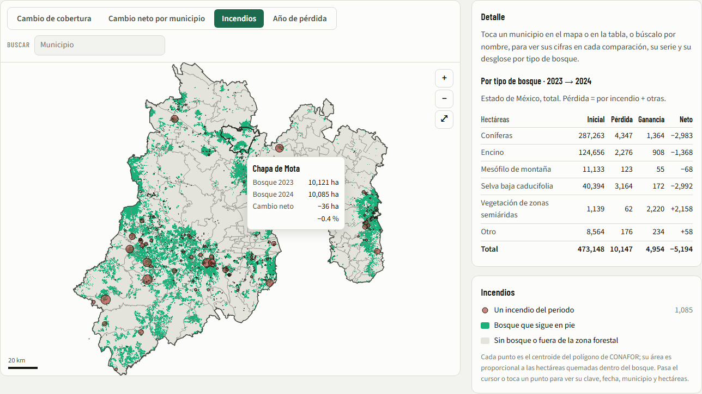

**A qué uso pasó el terreno perdido (HU-7.4, solo al comparar).** La tarjeta reparte las otras pérdidas del Estado o
del municipio en agrícola, pecuario, urbano, otro y sin dato (hectáreas y %). Es una **estimación**, no un dato
oficial: la exactitud del clasificador (alrededor de **55 %**), el año de las imágenes y la fuente (Sentinel-2
entrenado con el uso de suelo de INEGI) se ven en la propia tarjeta. Un periodo sin clasificación dice «sin dato»; la
pérdida por incendio va aparte.

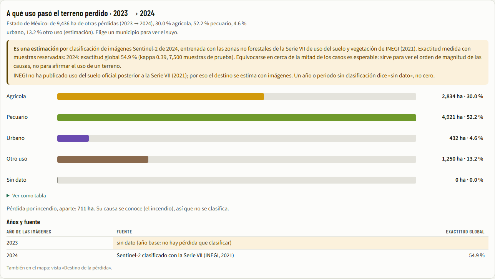

**Especies por municipio (HU-7.5, en los dos modos).** Al elegir un municipio, su **Detalle** trae la lista de especies
registradas en el INFyS 2015–2020 de CONAFOR (nombre científico, nombre común, familia y árboles, de más a menos) y,
aparte, lo identificado solo a género. Es la lista de lo registrado en una malla de muestreo de 5 km, **no un
inventario completo**. Un municipio sin registros dice «Sin registros en el inventario».

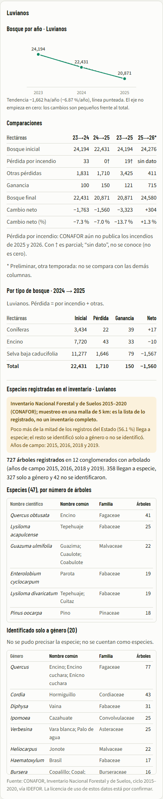

**Alcances** explica qué mide la Calculadora y qué no, de dónde salen los datos y qué no se puede afirmar todavía.
Ten en cuenta lo que la propia página advierte: el umbral de NDVI es provisional, las «otras pérdidas» no se han
verificado en campo y CONAFOR aún no publica los incendios de 2025.

---

## 14. Datos de demostración para practicar

Al levantar el sistema se cargan solicitudes de los seis programas en distintos pasos. La contraseña de todos los
usuarios es `Probosque2026`. Los nombres de predios son los de los datos de demostración (`sistema/README.md`,
«Usuarios de demostración»).

| Para practicar | Entra como | Busca |
| --- | --- | --- |
| Revisar requisitos a medias | `del_amecameca` | Los Ocotes (`CC-2026-AME-0001`) |
| Enviar a la Dirección y ver un polígono dibujado | `del_amecameca` | Ejido San Rafael (`CC-2026-AME-0002`) |
| Validar o avisar faltantes | `dir_drff` | La Cañada (`CC-2026-AME-0003`) |
| Dictamen técnico con plazo vencido | `dir_drff` | El Ocotal (`CC-2026-TOL-0009`) |
| Dictamen jurídico pendiente, con traslape | `juridica` | Los Encinos del Monte |
| Expediente listo para el Comité | `comite` | Potrero Viejo |
| Una sesión de aprobación completa y acuerdos de seguimiento | `comite`, `dir_drff`, `juridica` | Sesiones SO-CC-2026-01 y SO-CC-2026-02 |
| Una persona en el Listado de Incumplidas | `juridica` | Rogelio Bautista Núñez (Cerro de la Cruz, no factible) |
| Publicar resultados | `dir_drff` | PSAHEM y CC: actas que autorizan publicar |
| Notificar el resultado y la cita a firma | `del_amecameca` | Plantación Los Pinos (PS) |
| Modelo de contrato por validar o validado | `juridica` | Modelos de PS y RHF validados; CC, PS y PSAHEM con plantilla base por validar |
| Elaborar y enviar el contrato | `dir_drff` | Barranca Honda (RHF), Ojo de Agua (RHF) |
| Registrar la firma | `del_amecameca` | Plantación Los Pinos (PS, por firmar) |
| Contrato sin firma en plazo y liberar el recurso | `dir_drff` | Cañada Seca (PS) |
| Vale de planta: emitir, vencido, reposición; salida parcial | `del_amecameca`, `vivero` | Mirador de los Pinos (vigente, dos salidas), Ladera Verde (vencido), Cerro Gordo (reposición) |
| Cheques de PSAHEM: emitido, enviado, entregado, por vencer | `fiduciaria`, `del_amecameca` | Paraje Las Ánimas, Monte Alto, Cerro del Venado, Loma Verde; Bosque Los Cedros espera su cheque |
| Solicitudes de pago y pagos | `dir_drff`, `finanzas` | Pestaña **Pagos** de los expedientes firmados |
| Comprobaciones por el portal y en ventanilla | `del_amecameca` | Margarito Sánchez Ruiz (portal), Ejido San Bartolo (ventanilla), Predio La Ciénega |
| Verificación en campo con ajuste y caso fortuito | `del_amecameca`, `dir_drff` | Plantación La Mesa (PS), Manantial Alto (RHF) |
| MFS con Bitácora o auditoría | `del_amecameca`, `dir_drff` | Bosque Los Volcanes (ETF), Aserradero La Cumbre (FSC) |
| Evaluación de reportes y validación del CASPEG | `del_amecameca`, `dir_dpf`, `comite` | Ejido San Juan, Ejido San Bartolo, Ejido Santa Ana |
| Lista de espera, sustitución y desistimiento | `dir_drff`, `comite` | Loma del Aire, Arroyo Seco, Paraje El Rocío, Cerro La Mina (RHF) |
| Prórroga por causa externa (MFS) | `dir_drff` | Aserradero La Cumbre |
| Omisiones, cancelación, requerimiento y depósito | `dir_drff`, `juridica`, `finanzas` | Loma del Aire (RHF) |
| Cierre, padrón e informe anual | `dir_drff`, `dir_dpf`, `comite` | Menú **Cierre del ejercicio** de RHF y PEG |
| **Portal de personas beneficiarias** | `/portal/entrar/` | Usuario `SARM800101HMCNZR09` (Margarito Sánchez Ruiz, Guardabosque) |
| Portal: primer acceso o consulta sin cuenta | `/portal/primer-acceso/`, `/portal/consulta/` | El código de primer acceso y el de consulta de cada Guardabosque están en el acuse «Acceso al portal» de su expediente (pestaña **Documentos y acuses**); Margarito Sánchez Ruiz ya tiene cuenta activa |
| Páginas públicas | sin cuenta | `/contrato/resultados/` y `/padron/` |

Los datos de ejemplo están fechados en el calendario 2026 de cada convocatoria, hasta el 19 de noviembre de 2026. El
sistema usa la fecha real, así que en días posteriores verás más plazos vencidos: es lo esperado. Para empezar de cero
con los mismos datos: `docker compose down -v` y `docker compose up --build` (Guía de inicio, sección 1.5).

El orden de un trámite completo de Capturando Carbono, de la firma al padrón, con el usuario de cada paso, está en
«Recorrer el sistema completo» de [`sistema/README.md`](sistema/README.md) y en la captura siguiente.

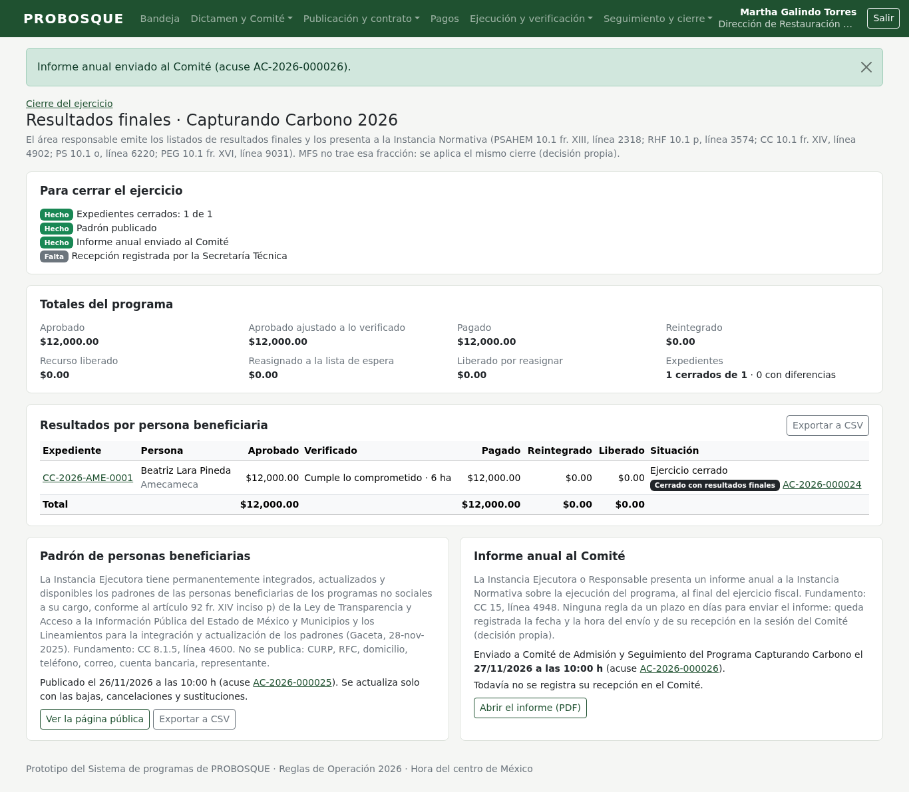

---

## 15. Preguntas frecuentes

**No veo un botón que el manual menciona.** Los botones aparecen solo a la unidad a la que le toca el paso y cuando
el expediente está en el estado que corresponde. Revisa con qué usuario entraste y el estado del expediente (el
siguiente paso se ve arriba del expediente).

**No me deja enviar el expediente a la Dirección.** La pantalla dice qué falta: requisitos sin revisar, alguno
faltante o un entregado sin archivo.

**No puedo elaborar el contrato.** Hace falta que la solicitud esté aprobada, publicada y notificada y que exista un
modelo **validado** por la Unidad Jurídica del mismo programa y ejercicio. La pantalla dice cuál falta.

**No puedo enviar la solicitud de pago.** La lista de soportes marca en rojo lo que **Falta** (oficio, comprobante,
verificación, evaluación de reportes, instrucción de pago del Comité en PSAHEM). Complétalo y vuelve a intentar.

**La persona no recuerda su código de primer acceso.** Está impreso en el acuse «Acceso al portal de personas
beneficiarias» que se entregó al firmar el contrato, en la pestaña **Documentos y acuses** del expediente. Cada código
sirve una vez; no hay correo ni SMS.

**¿Puedo deshacer un paso?** No directamente: cada paso queda en la bitácora y con su acuse. Lo que las reglas
permiten (reenviar con faltantes, rehacer un contrato antes de enviarlo, devolver una solicitud de pago o una
comprobación, cambiar el polígono con motivo, ajustar un listado con motivo) se hace con su propio botón.

**¿Por qué algo «Por vencer» no cambia solo?** El sistema solo avisa y señala. Las acciones que tienen consecuencias
(cancelar, suspender, liberar un recurso, desechar) las confirma una persona con un clic, y las que dependen del
Comité, con un acuerdo.

**¿Por qué dice «supuesto» o «borrador»?** Porque las ROP no dicen ese dato (por ejemplo, qué meses cubre cada
ministración de Guardabosques, el formato del oficio de pago o el texto del contrato). El sistema aplica una decisión
propia y la marca para que el cliente la confirme.

**¿Dónde están las fechas y plazos oficiales?** En las reglas de cada programa (`sistema/reglas/<CLAVE>.json`), con el
numeral y la línea de las ROP. El calendario de días inhábiles 2026 es de demostración.

**La Calculadora no abre o el mapa sale en blanco.** Abre `docs/mapa_edomex.html` con doble clic, o sirve
`docs/calculadora/` como dice la Guía de inicio (sección 2). Las dos necesitan internet para las bibliotecas del mapa.

**¿Qué falta?** Los pendientes con el cliente (por ejemplo: desde cuándo corre el plazo de firma, plazos en días para
publicar, pagar o reintegrar, y los formatos y el modelo de contrato que no están en las ROP) están en
[`sistema/README.md`](sistema/README.md), sección «Pendientes con el cliente», y el resumen de cada sprint en
`entregas/sprint_1/Resumen_sprint_1.pdf`, `entregas/sprint_2/Resumen_sprint_2.pdf` y
`entregas/sprint_3/Resumen_sprint_3.pdf`.
