# Manual de usuario (versión del sprint 2)

Este manual explica cómo usar el prototipo tal como quedó al cerrar el **sprint 2** (16 de noviembre de 2026), con los
ajustes por las observaciones del profesor del 23 de noviembre (observación de cada faltante, documento de los
dictámenes, propiedad del predio, candidatos y beneficiarios, reasignaciones e incidentes y trazabilidad), que también
alcanzan a la publicación, el contrato y los pagos. Para ponerlo a funcionar, sigue primero la
[Guía de inicio](GUIA_DE_INICIO.md).

**Qué cubre esta versión**

- **Sistema de programas**, para cuatro programas con reglas cargadas: **Capturando Carbono** (CC), **Plantaciones
  Sustentables** (PS), **Restauración Hidrológico-Forestal** (RHF) y **PSAHEM**; desde que la persona solicitante entrega su
  solicitud en la Delegación hasta que recibe su pago.
  - Recepción (módulo M1): registro de la solicitud, revisión de requisitos, ubicación del predio y validación.
  - Dictamen y Comité (módulo M2): dictámenes técnico y jurídico (con su documento en PDF), listado preliminar,
    candidatos y beneficiarios, sesión de aprobación, y reasignaciones e incidentes en las sesiones de seguimiento.
  - Publicación y contrato (módulo M3): publicación de resultados y página pública, notificaciones por conducto de la
    Delegación, modelos y elaboración del contrato, firma y Vale de Planta con la salida del vivero.
  - Pagos (módulo M5): solicitud de pago con sus soportes, revisión y pago de la ministración, solicitud de pago a la
    Fiduciaria y cheques (PSAHEM).
- **Calculadora forestal**: la masa forestal del Estado de México por año (2023 a 2025), el balance entre dos años con su
  histograma y la capa de incendios.

Lo que sigue después del pago (ejecución, verificación, seguimiento y cierre) llega en el sprint 3 y está en la rama
`main`. Guardabosques (PEG) y Manejo Forestal Sustentable (MFS) todavía no tienen reglas cargadas.

Las imágenes de este manual son capturas del propio sistema, tomadas por las pruebas automáticas
(`entregas/sprint_1/capturas/` y `entregas/sprint_2/capturas/`).

---

## 1. Ideas básicas

| Término | Qué es |
| --- | --- |
| **Expediente** | Todo lo de una solicitud a un programa: datos, requisitos, documentos, polígono, revisiones, dictámenes, acuses y bitácora. Su folio tiene la forma `CC-2026-AME-0001` (programa, ejercicio, Delegación y número). |
| **Folio del predio** | El predio tiene su propio folio (`PRED-000001`), que conserva si vuelve a solicitar en otro programa o ejercicio. |
| **Estado** | En qué paso va el expediente. Cada estado tiene una unidad que lo atiende; el sistema solo permite los pasos de las reglas y a la unidad que le toca. |
| **Bandeja** | La pantalla de inicio de cada usuario: los expedientes que le toca atender a su unidad. |
| **Acuse** | Comprobante en PDF con folio (`AC-2026-000001`), fecha y hora, que se genera en cada envío o entrega. Queda en el expediente. |
| **Bitácora** | Registro de todo lo que pasó en el expediente: quién, qué y cuándo. No se puede borrar. |
| **Días hábiles** | Los plazos de las Reglas de Operación se cuentan sin sábados, domingos ni días inhábiles del calendario 2026 de demostración. |

### Los estados de una solicitud

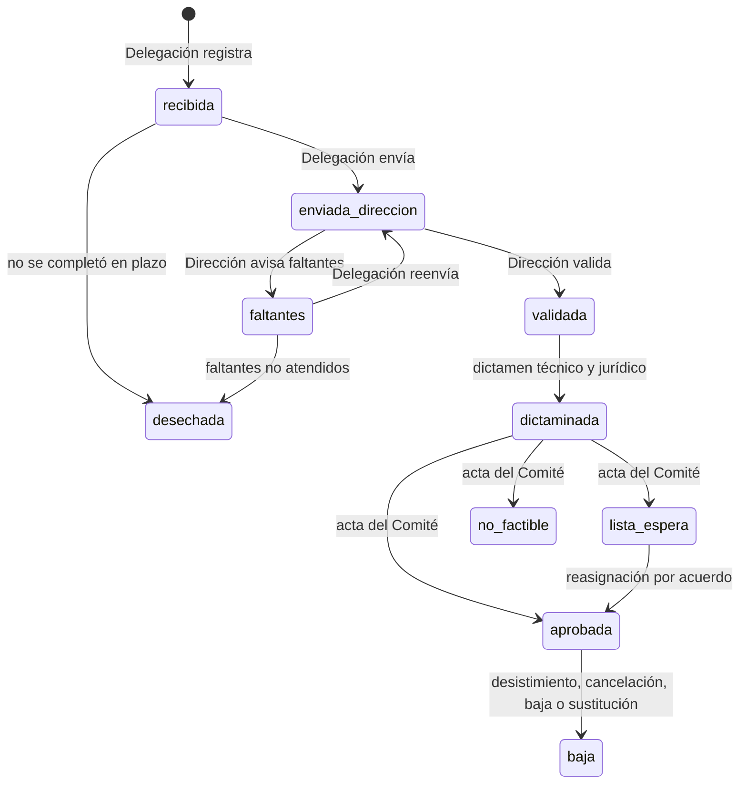

Desde la aprobación, el trámite sigue así (sprint 2):

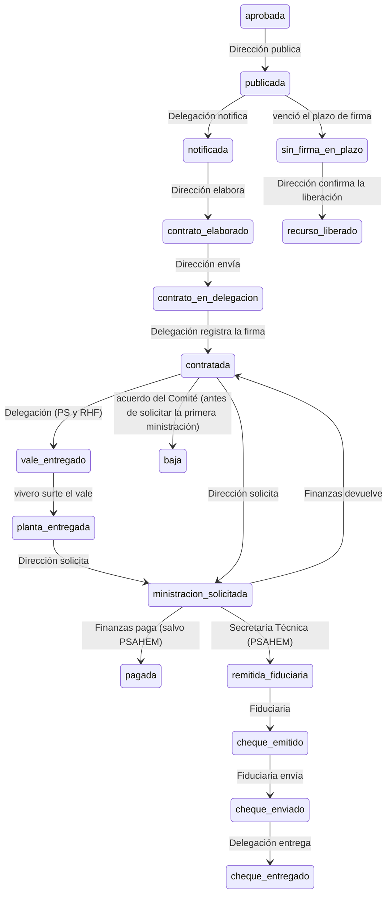

| Estado en pantalla | Quién lo atiende |
| --- | --- |
| Solicitud recibida · Aviso de faltantes | Delegación |
| En revisión de la Dirección | Dirección del programa |
| Validado · en dictamen | Dirección (dictamen técnico) y Unidad Jurídica (dictamen jurídico), al mismo tiempo |
| Dictaminada | Secretaría Técnica del Comité |
| Aprobada | Dirección (publica los resultados) |
| Lista de espera · No factible | Nadie: esperan una reasignación del Comité o terminan |
| Resultados publicados · Contrato en la Delegación | Delegación (notifica a la persona; recaba la firma) |
| Persona beneficiaria notificada · Contrato elaborado | Dirección (elabora y envía el contrato) |
| Sin firma en plazo | Dirección (confirma la liberación del recurso) |
| Contrato firmado · Planta entregada · Ministración pagada · Cheque entregado | Dirección (solicita la ministración); la Delegación emite el oficio de pago |
| Vale de Planta entregado | Vivero (surte el vale) |
| Ministración solicitada | Administración y Finanzas; en PSAHEM, una solicitud aceptada espera a la Secretaría Técnica |
| Remitida a la Fiduciaria · Cheque emitido | Fiduciaria |
| Cheque en la Delegación | Delegación (entrega el cheque) |
| Recurso liberado | Termina; su monto queda para reasignar |
| Baja · recurso liberado | Termina el apoyo por un acuerdo del Comité; su recurso se reasigna a la lista de espera |
| Solicitud desechada | Termina el trámite |

---

## 2. Entrar, la bandeja y el expediente

### Entrar y salir

Abre **http://localhost:8080/entrar/**, escribe tu usuario y contraseña y pulsa **Entrar**. Para cambiar de unidad
pulsa **Salir** (arriba a la derecha) y entra con otro usuario. Los usuarios de demostración están en la Guía de
inicio; la contraseña de todos es `Probosque2026`.

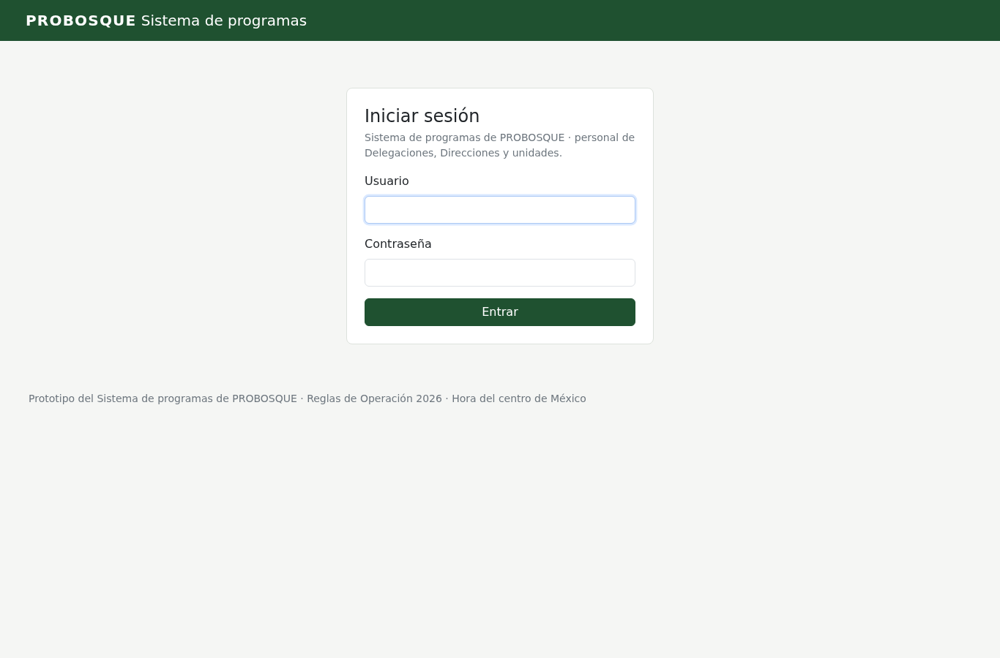

### La bandeja

- **Por atender**: lo que tu unidad debe hacer ahora. **Todos los míos**: también lo que ya pasó a otra unidad pero
  sigue siendo de tu Delegación o programa.
- **Buscar**, **Programa** y **Estado** filtran la lista. El folio abre el expediente.
- Una Delegación ve solo sus expedientes; una Dirección, los de los programas que tiene a su cargo.
- Arriba aparecen, si los hay, los **acuerdos del Comité** que le toca cumplir a tu unidad (sección 8).
- El menú superior cambia según la unidad y va agrupado por módulo (**Recepción**, **Dictamen y Comité**, **Publicación y contrato**, **Pagos**); en pantallas angostas queda colapsado. Cada unidad ve solo lo suyo: el menú **Listados** tiene **Listado preliminar** (Dirección, Unidad
  Jurídica y Secretaría Técnica), **Candidatos** y **Beneficiarios** (también la Delegación); la Unidad Jurídica ve
  **Incumplidas**; la Secretaría Técnica, **Sesiones del Comité**. Si abres una pantalla que no le toca a tu unidad,
  aparece **Acceso no permitido** con el botón para volver a la bandeja.

La bandeja también funciona en un teléfono: la tabla se acomoda al ancho de la pantalla.

### El expediente

Arriba están el programa, el folio, el predio, la persona solicitante, el estado y la fecha y hora de recepción. Abajo,
las pestañas:

| Pestaña | Qué contiene |
| --- | --- |
| **Solicitud** | Los datos registrados en ventanilla y el acuse de recepción |
| **Requisitos** | Los requisitos del programa y su revisión (sección 3.2) |
| **Ubicación** | El mapa con el polígono del predio y su historial (sección 3.3) |
| **Validación** | Las revisiones de la Dirección, sus avisos de faltantes y fechas límite (sección 4) |
| **Dictámenes** | El dictamen técnico y el jurídico (secciones 5 y 6) |
| **Documentos y acuses** | Todos los archivos, los documentos de los dictámenes y los acuses en PDF |
| **Bitácora** | El registro de todo lo ocurrido |
| **Trazabilidad** | El historial de la base de datos: quién cambió qué registro, cuándo y qué valores (sección 9) |

Los botones de cada pestaña aparecen solo cuando a tu unidad le toca ese paso.

---

## 3. Delegación: recibir la solicitud

Usuario de ejemplo: `del_amecameca`.

### 3.1 Registrar la solicitud

En la bandeja, pulsa **Registrar solicitud** y llena:

- **Datos específicos del programa**: programa y ejercicio, tipo de persona, modalidad (tipo de superficie), si es
  refrendo, si se solicita por medio de representante legal y observaciones de la ventanilla.
- **Datos del predio**: folio de predio ya registrado (si ya tuvo expediente en PROBOSQUE), municipio, nombre del
  predio, superficie solicitada en hectáreas y localidad o paraje.
- **Datos generales de la persona solicitante**: nombre o razón social, CURP, RFC, teléfono, correo y representante
  legal o comisariado.

Pulsa **Registrar y generar acuse**. Se genera el **folio único** de la solicitud (por ejemplo `CC-2026-AME-0001`:
programa, ejercicio, Delegación y un consecutivo que no se repite en el programa y ejercicio). El expediente queda en
«Solicitud recibida» y se emite el **acuse de recepción** en PDF, con el folio, la fecha, la hora y el plazo de 5 días
hábiles para completar la documentación.

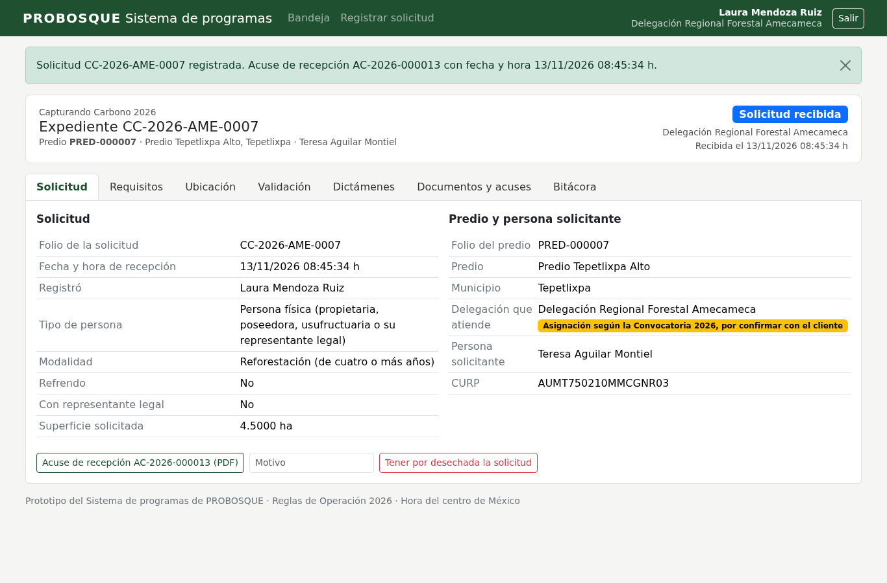

> Si el municipio del predio lo atiende otra Delegación, el formulario lo avisa al elegirlo y el sistema no deja
> registrar: dice qué Delegación corresponde.

### 3.2 Revisar los requisitos

En la pestaña **Requisitos** está la lista que piden las reglas para el tipo de persona y la modalidad de la
solicitud, cada uno con su numeral de las Reglas de Operación. Arriba, un resumen: entregados, faltantes, «no
aplican» y sin revisar.

En cada renglón pulsa **Revisar** y elige:

- **Entregado**, con su archivo digitalizado (**Elegir archivo**), o **Faltante**. En los requisitos opcionales o
  condicionales aparece también **No aplica**.
- En los requisitos que son condiciones y no documentos: **Cumple** o **No cumple**.

Pulsa **Guardar**. El renglón cambia sin recargar la página.

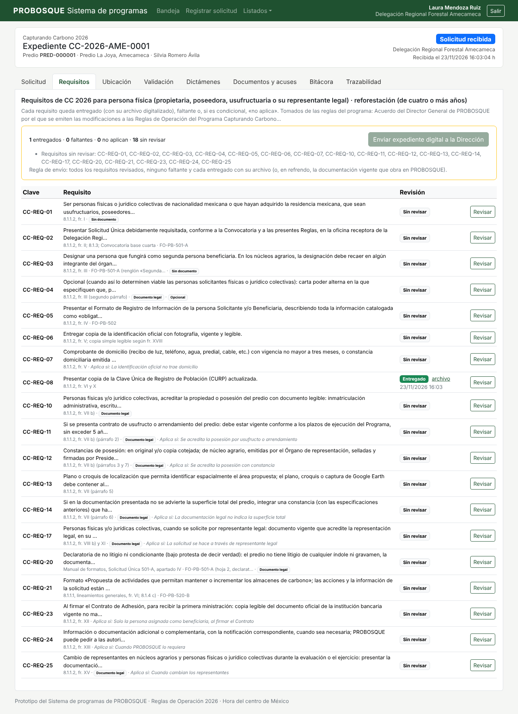

**Enviar a la Dirección.** El botón **Enviar expediente digital a la Dirección** se habilita cuando todos los
requisitos están revisados, ninguno está faltante y cada entregado tiene su archivo (en un refrendo, la documentación
vigente que ya obra en PROBOSQUE vale sin volver a subirla). Si falta algo, la pantalla dice qué. Al enviar se genera
un acuse y el expediente pasa a la bandeja de la Dirección.

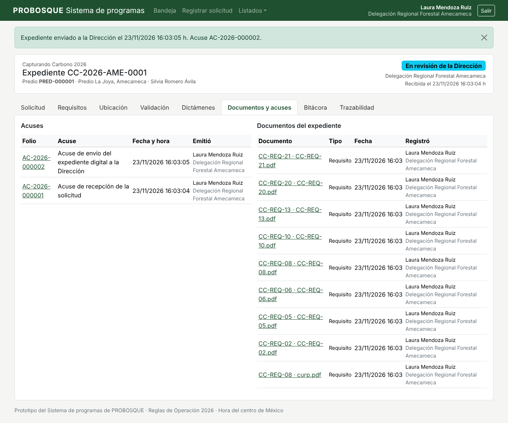

Si la persona no completó su documentación en el plazo, la Delegación puede **Tener por desechada la solicitud**
(pide un motivo).

### 3.3 Ubicar el predio

En la pestaña **Ubicación** se registra el polígono del predio, levantado en campo. No es requisito para enviar el
expediente: las reglas lo levantan después de la entrega.

1. Sube el archivo del polígono (**GeoJSON, KML o Shapefile en .zip**) o dibújalo en el mapa con la herramienta de
   polígono.
2. Indica quién lo levantó (personal de la Delegación o prestador de servicios forestales, con su RFN), su nombre y
   la fecha del levantamiento.
3. Si ya había un polígono, escribe el motivo del cambio.
4. Pulsa **Registrar polígono**.

El sistema calcula la superficie en hectáreas y avisa si el polígono cae fuera del municipio. Rechaza una geometría
inválida. Cada cambio conserva el polígono anterior en el **Historial de polígonos**, marcado como «corrección» o
«cambio de lugar» según cuánto se traslapan.

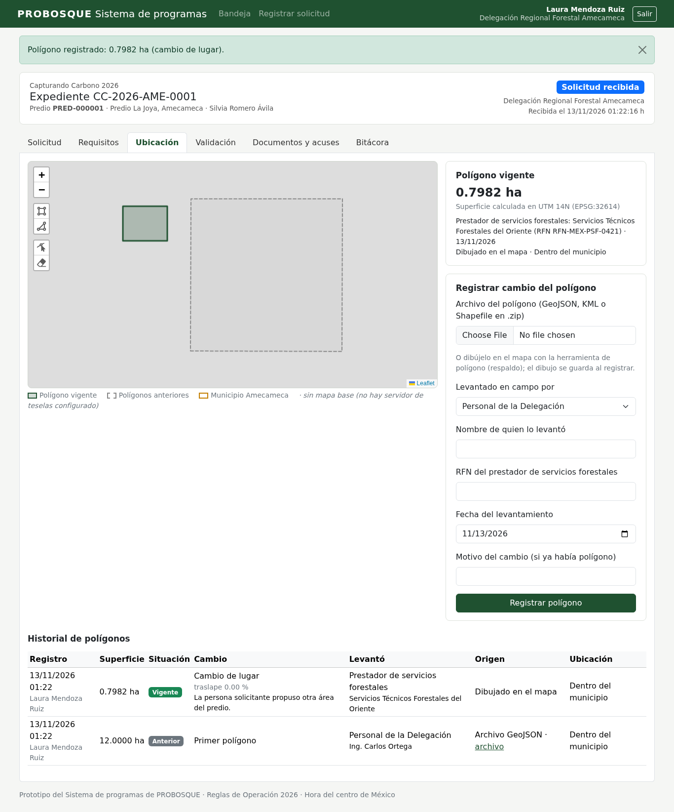

---

## 4. Dirección: validar el expediente

Usuario de ejemplo: `dir_drff`.

1. En la bandeja aparecen los expedientes «En revisión de la Dirección». Abre uno, ve a la pestaña **Validación** y
   pulsa **Abrir pantalla de validación**.
2. La pantalla muestra cada requisito con la revisión de la Delegación, una **revisión automática con las reglas** y
   una casilla para la **observación de la Dirección**. Marca como **Faltante** lo que no cumpla y escribe en ese mismo
   renglón **qué falta o por qué no es válido** (ilegible, incompleto, no vigente, no corresponde al titular…): la
   observación es **obligatoria en cada faltante**. Los que no pasan la revisión con las reglas ya vienen marcados; si
   no escribes nada, su observación es el motivo de esa revisión.
3. Sin faltantes, pulsa **Validar expediente**: queda «Validado · en dictamen», con su constancia en PDF (con el
   resultado de cada requisito).
4. Con faltantes, pulsa **Emitir aviso de faltantes**: se genera el aviso con su **fecha límite** (5 días hábiles
   desde el aviso) y **la observación de cada faltante**, y el expediente regresa a la Delegación para que lo notifique.

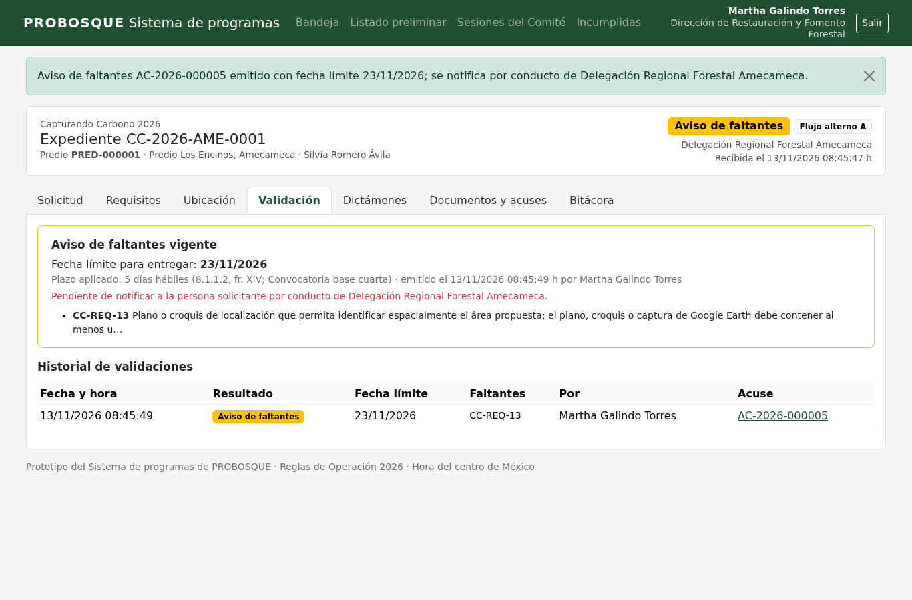

**En un refrendo**, la documentación que ya obra en PROBOSQUE vale si no tiene más de 3 años desde la recepción; si
es más vieja, se marca como faltante.

### Del lado de la Delegación: atender el aviso de faltantes

El aviso va dirigido a la persona solicitante **por conducto de la Delegación**:

1. En la pestaña **Validación** del expediente aparece el aviso con cada faltante, su observación y la fecha límite
   (la observación también aparece en el requisito, en la pestaña **Requisitos**). Cuando
   entregues el aviso a la persona, pulsa **Registrar notificación a la persona solicitante**: queda la fecha y la
   hora con su acuse.
2. Cuando la persona entregue lo faltante, márcalo como entregado en **Requisitos** y pulsa **Reenviar a la
   Dirección con los faltantes**.

Si vence la fecha límite sin respuesta, la Dirección puede tener la solicitud por desechada.

---

## 5. Dirección: dictamen técnico y listado preliminar

Con el expediente validado, la Dirección y la Unidad Jurídica dictaminan al mismo tiempo. Cuando ya están los dos
dictámenes, el expediente pasa a «Dictaminada», en la bandeja de la Secretaría Técnica.

### Dictamen técnico

En la pestaña **Dictámenes**, pulsa **Elaborar dictamen técnico**. La pantalla tiene:

- **Análisis cartográfico**: el mapa con el polígono vigente, los de otros expedientes que se traslapan y el
  municipio; la superficie, si está dentro del rango del programa (1 a 200 ha en Capturando Carbono), si cae dentro
  del municipio y los traslapes con otras solicitudes del mismo ejercicio, en hectáreas.
- **Plazo de dictaminación**: en Capturando Carbono, la fecha límite de la Convocatoria (30 de junio de 2026). Dice si
  va en plazo, por vencer o vencido.
- **Lista de verificación** con los criterios del programa: en cada uno, **Cumple**, **No cumple** o **No aplica**,
  con una nota. Un criterio que no se cumple impide el dictamen factible.
- **Resultado**: **Factible** (con la superficie factible en hectáreas) o **No factible** (con su motivo).

Pulsa **Registrar dictamen técnico**. El sistema **expide el documento «Dictamen técnico»** en PDF, con folio propio
(por ejemplo, `DT-CC-2026-0001`): datos de la solicitud, análisis cartográfico con el croquis del polígono, verificación
de los criterios, resultado y motivo, plazo, fundamento y firmas (elaboró y Vo. Bo.). El documento queda **adjunto al
expediente**: se abre con el botón de la pestaña **Dictámenes** o desde **Documentos y acuses**.

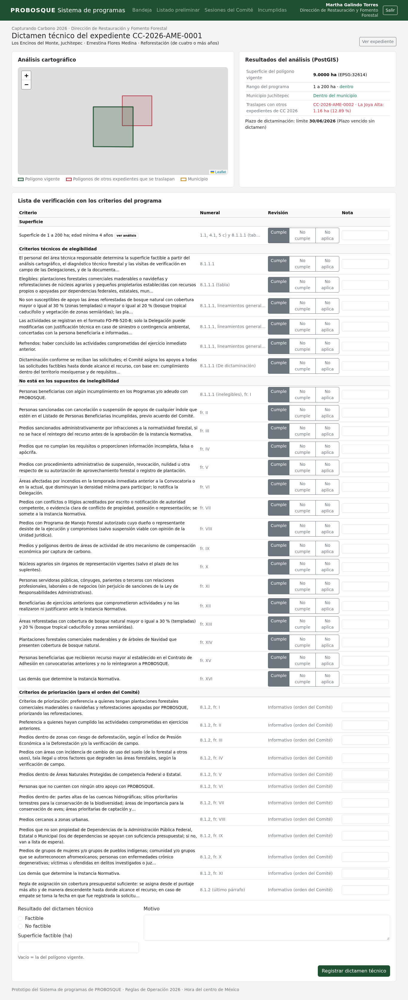

### Listado preliminar

En el menú **Listados**, **Listado preliminar** reúne el resultado técnico y jurídico de cada solicitud validada. **Exportar CSV
(Excel)** lo descarga para abrirlo en Excel con acentos.

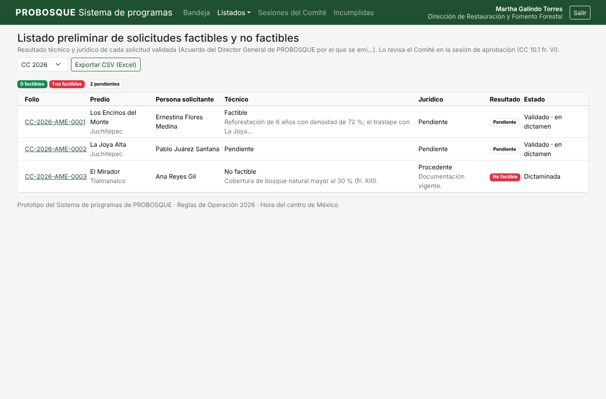

---

## 6. Unidad Jurídica: Listado de Incumplidas y dictamen jurídico

Usuario de ejemplo: `juridica`.

### Listado de Personas Beneficiarias Incumplidas

En el menú, **Incumplidas** muestra el Listado de Personas Beneficiarias Incumplidas y los predios con procedimiento
o sanción. Se agregan con **Inscribir** y se retiran con **Baja**, que desactiva el registro pero no lo borra: queda
su historial.

### Dictamen jurídico

En la pestaña **Dictámenes** de un expediente validado, pulsa **Elaborar dictamen jurídico**. El sistema **coteja
automáticamente** a la persona (CURP, RFC y nombre) con el Listado de Incumplidas y al predio con los predios con
procedimiento o sanción, y muestra las coincidencias. La pantalla tiene tres pasos:

1. **Documentación legal**: marca cada documento legal del expediente como **Válido** o **No válido**; si no es válido,
   escribe por qué. Los que no aplican no se revisan.
2. **Propiedad o legal posesión del predio** (CC 8.1.1.2 fr. VII): el documento con el que se acredita (escritura,
   certificado parcelario, carpeta básica o PHINA del núcleo agrario, constancia de posesión, contrato de usufructo o
   arrendamiento…), su número y fecha, a nombre de quién está y si coincide con el titular, la **superficie que ampara**
   (se compara con la del polígono vigente), la **vigencia** (obligatoria en constancias de posesión y contratos; el de
   usufructo o arrendamiento no puede pasar de 5 años) y si hay **evidencia de conflicto** de propiedad, posesión o
   representación.
3. **Resultado**: **Procedente** o **No procedente** con su motivo.

El sistema **no permite el dictamen procedente** si un documento legal no es válido, si no se acredita la propiedad o
legal posesión, o si hay coincidencias en los catálogos. Al registrarlo **expide el documento «Dictamen jurídico»** en PDF
(folio `DJ-…`), con la revisión de la documentación, la de la propiedad, el cotejo, el resultado y las firmas, adjunto al
expediente.

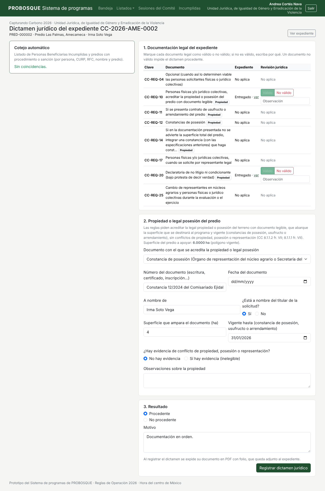

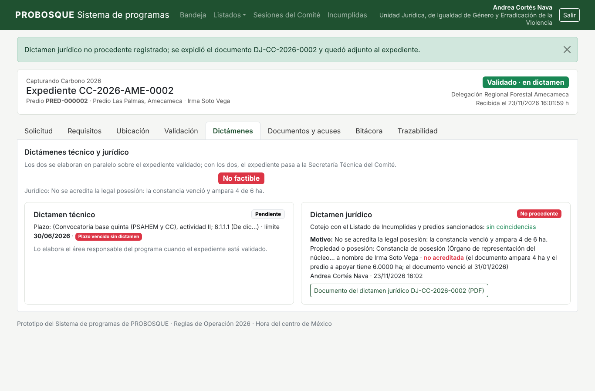

---

## 7. Secretaría Técnica: sesión de aprobación del Comité

Usuario de ejemplo: `comite`. En el menú, **Sesiones del Comité**.

1. **Nueva sesión de aprobación**: programa y ejercicio, carácter (ordinaria o extraordinaria), fecha y hora, lugar o
   plataforma digital y orden del día (un punto por renglón). Pulsa **Crear sesión**.
2. **Agregar documento**: al menos uno (por ejemplo, el listado preliminar y los dictámenes).
3. **Enviar convocatoria a los integrantes**: el sistema exige la anticipación de las reglas (3 días hábiles antes de
   la sesión; 24 horas si es extraordinaria) y genera el acuse con la fecha, la hora, el orden del día y los
   integrantes del Comité según las reglas.
4. **Generar propuesta** de listados: ordena las solicitudes factibles por los criterios de priorización que se
   pueden leer del expediente (reforestaciones primero, luego refrendos, y por fecha y hora de registro) y asigna
   hasta donde alcance el **Recurso disponible** que escribas ($2,000 por hectárea factible); las demás van a la lista
   de espera con su lugar. Las no factibles van a su propia lista.
5. Si el Comité decide otra cosa, **Ajustar** mueve una solicitud de lista o de lugar, con un motivo obligatorio que
   queda en el acta. Una no factible no puede pasar a las listas de apoyo.
6. **Registrar acta con los listados aprobados**: genera el acta en PDF con la Lista de Personas Beneficiarias, la
   Lista de espera, la Lista de solicitudes No factibles y la autorización de publicación, y mueve cada expediente a
   «Aprobada», «Lista de espera» o «No factible». **Cerrar la sesión** deja la sesión como celebrada.

### Candidatos y beneficiarios

En el menú **Listados** hay dos vistas separadas (las consultan la Delegación, con solo sus expedientes, la Dirección,
la Unidad Jurídica y la Secretaría Técnica), con su selector de programa y ejercicio y **Exportar CSV (Excel)**:

- **Candidatos**: las solicitudes que todavía compiten por el apoyo, con filtros **En dictamen**, **Dictaminada · por
  llevar a la sesión de aprobación** y **Lista de espera** (en su orden, con su lugar y su monto). Muestra el resultado
  técnico, el jurídico y el de la propiedad.
- **Beneficiarios**: las personas beneficiarias aprobadas, con su superficie, su monto y **cómo entraron** (acta de la
  sesión de aprobación o reasignación por acuerdo), con los totales; abajo, las que **salieron** por un acuerdo del
  Comité, con la causa y el recurso que liberaron.

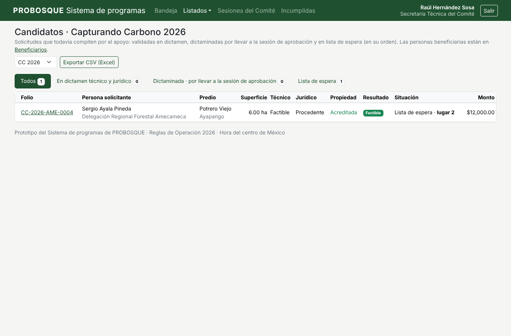

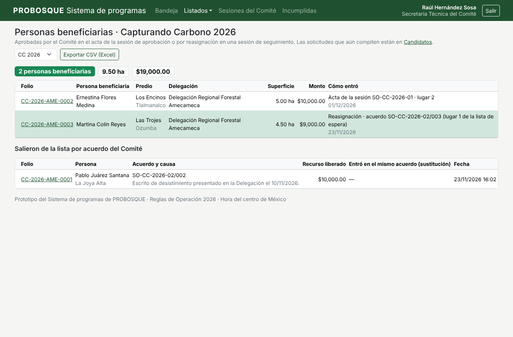

---

## 8. Reasignaciones e incidentes (sesiones de seguimiento)

1. La Secretaría Técnica crea una **Nueva sesión de seguimiento** igual que la de aprobación y envía su convocatoria.
2. La sesión muestra la **lista de espera en su orden**, el **recurso liberado sin reasignar** y los **movimientos de
   los listados** del ejercicio (quién salió y quién entró, con qué acuerdo).
3. **Registrar acuerdo**: tipo de acuerdo, **causa del incidente** (escrito de desistimiento, dictamen, aviso de la
   Delegación…; obligatoria en los incidentes), el texto del acuerdo, los expedientes a los que aplica y el área que
   debe atenderlo (si lo dejas vacío, la que corresponde al tipo). Lo que hace cada tipo:

   | Tipo de acuerdo | Qué pasa en los listados |
   | --- | --- |
   | Desistimiento, cancelación o baja | La persona beneficiaria sale de la lista (estado «Baja · recurso liberado») y su monto queda como recurso liberado |
   | Reasignación | Pasan a «Aprobada» las **primeras de la lista de espera, en su orden**, sin rebasar el recurso liberado; si se salta a alguien o no alcanza, el sistema lo impide |
   | Sustitución | Las dos cosas en un solo acuerdo: sale la persona beneficiaria y entra la siguiente de la lista de espera |
   | Caso fortuito, suspensión, reintegro u otro | Deja la constancia; el área responsable lo atiende |
   | Instrucción de pago a la Fiduciaria (PSAHEM) · validación de reportes (Guardabosques) | Deja la constancia por ministración o por periodo |

4. El área responsable ve el acuerdo en su bandeja, lo atiende y pulsa **Marcar cumplido**.

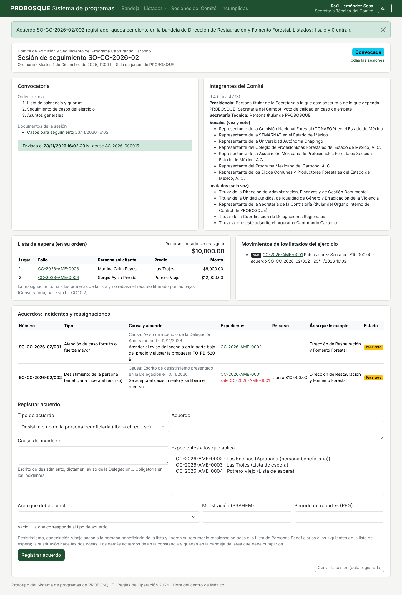

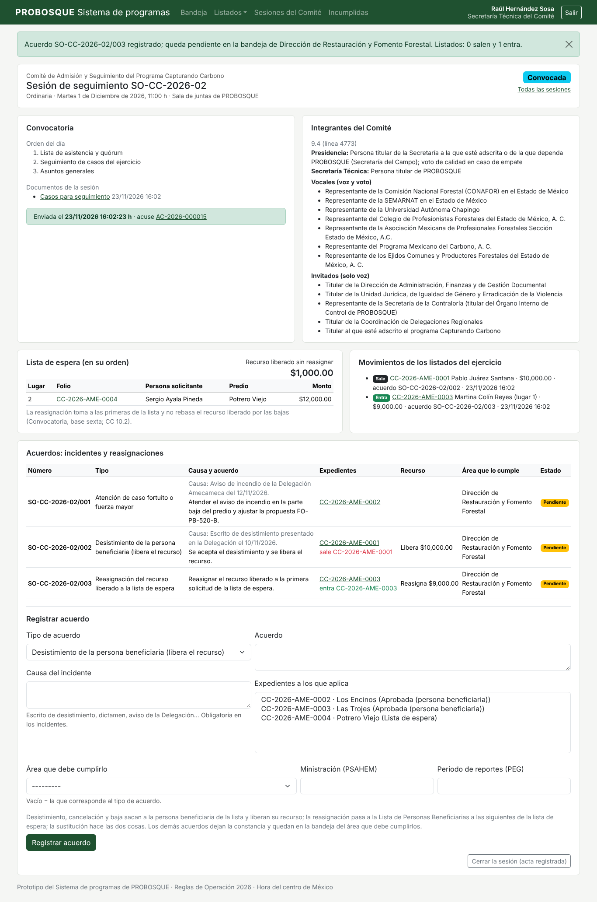

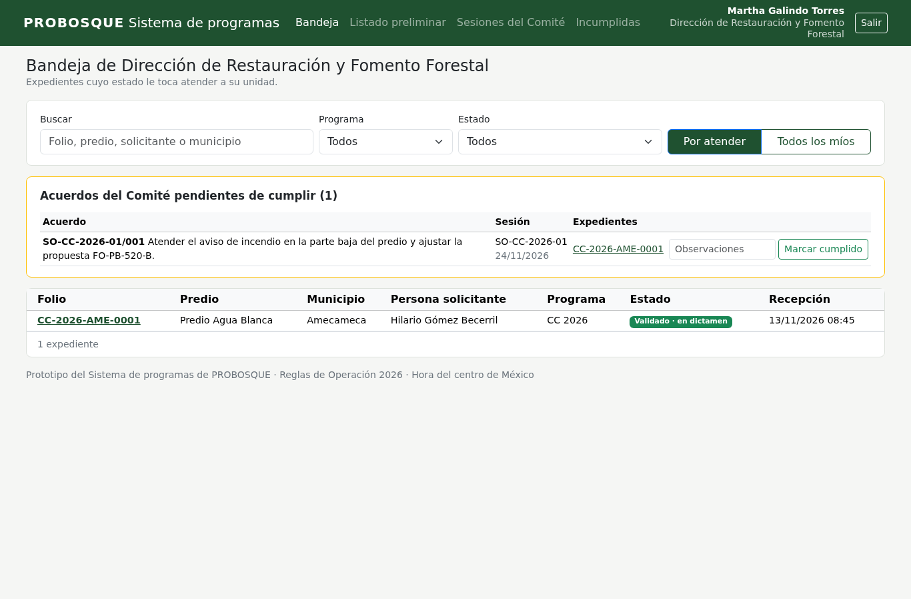

La **instrucción de pago** de PSAHEM es el soporte con el que la Dirección solicita cada ministración (sección 14.2): se
registra como acuerdo de la sesión de seguimiento, **por ministración**. La validación de reportes (Guardabosques) deja la
constancia, pero Guardabosques todavía no tiene reglas cargadas. Lo que pasa con la baja y la reasignación cuando ya hay
publicación, contrato o pagos está en la sección 15.

---

## 9. Documentos, acuses y bitácora

- La pestaña **Documentos y acuses** reúne los archivos subidos, los **documentos de los dictámenes** técnico y jurídico
  (resaltados) y cada acuse en PDF: recepción, envío a la Dirección, validación, aviso de faltantes, notificación,
  convocatoria y acta.
- Los archivos no tienen dirección pública: solo los descarga quien tiene permiso sobre el expediente.
- La pestaña **Bitácora** lista cada paso con su fecha y hora, quién lo hizo y qué hizo (con el motivo, cuando el
  paso lo pide).

- La pestaña **Trazabilidad** muestra lo que guarda la base de datos de cada registro del expediente (la solicitud, el
  predio, la persona, los requisitos, el polígono, las validaciones y sus observaciones, los dictámenes, la revisión de la
  propiedad, los listados y los acuerdos): **cada alta, cambio o baja**, con el usuario y su unidad, la fecha y la hora,
  el motivo y los campos que cambiaron (antes → después). Se puede filtrar por registro. Nada se borra: un registro
  dado de baja conserva su historial.

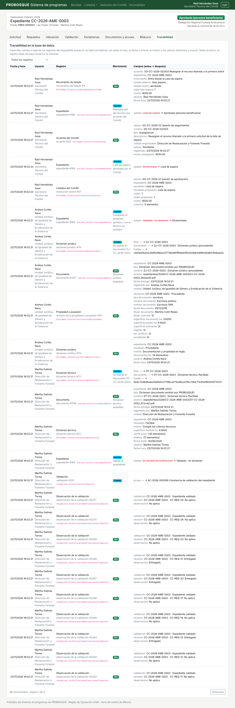

---

## 10. Dirección: publicar los resultados y avisar a cada persona (HU-3.1)

Usuario de ejemplo: `dir_drff`. Cuando el acta del Comité autoriza la publicación, el expediente de cada persona
beneficiaria sigue en «Aprobada» y pasa a la bandeja de la Dirección.

1. En la bandeja aparece el panel **Listados autorizados por publicar** (también, en el expediente, el botón
   **Publicar los resultados**, y en el menú **Publicación y contrato › Publicación**). Abre la sesión.
2. La pantalla **Publicación de resultados** muestra los tres listados del acta (**Personas beneficiarias**, **Lista de
   espera** y **No factibles**) con el lugar, el folio, el predio y el municipio. Solo el listado de personas
   beneficiarias lleva el nombre; nunca se publican CURP, RFC ni documentos. Una persona que salió por un acuerdo del
   Comité antes de publicar ya no aparece, y la que entró desde la lista de espera aparece como «Reasignación».
3. Arriba dice la **fecha de la convocatoria**: las Reglas de Operación de CC, PS, RHF y PSAHEM no fijan fecha ni días
   para publicar, por lo que la pantalla dice «Sin fecha en las reglas» y se registra la fecha y la hora reales.
4. En **Dónde se publica** escribe los lugares (si lo dejas vacío: la página de PROBOSQUE, Oficinas Centrales y las
   Delegaciones). Pulsa **Publicar los listados**.
5. Queda la publicación con **fecha y hora**, quién la hizo y su **acuse** (`AC-…`). Cada persona beneficiaria pasa a
   «Resultados publicados» y arranca el plazo de su firma. Abajo, **Avisos enviados a las Delegaciones**: un aviso por
   solicitud, con su acuse; en Plantaciones Sustentables, además, la **Cita a firma del contrato** (5 días hábiles de la
   Delegación desde la publicación).

La Secretaría Técnica y la Unidad Jurídica consultan la misma pantalla. La publicación se hace una sola vez por sesión; una
reasignación posterior se publica con el acta de la sesión de seguimiento (sección 15).

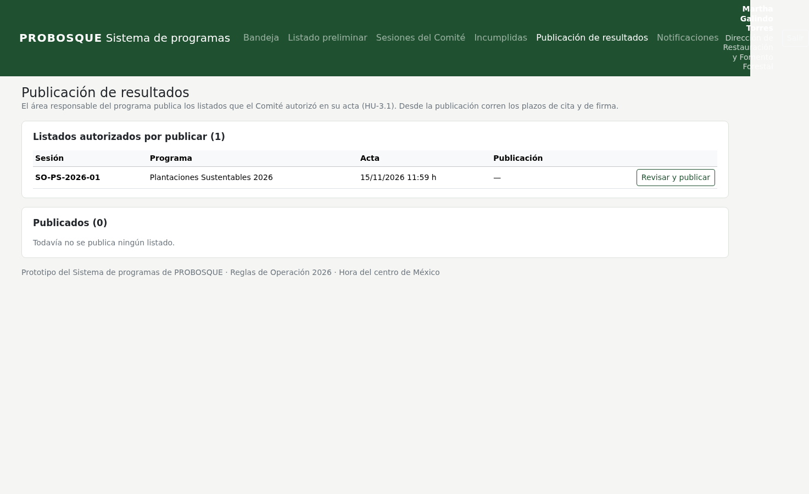

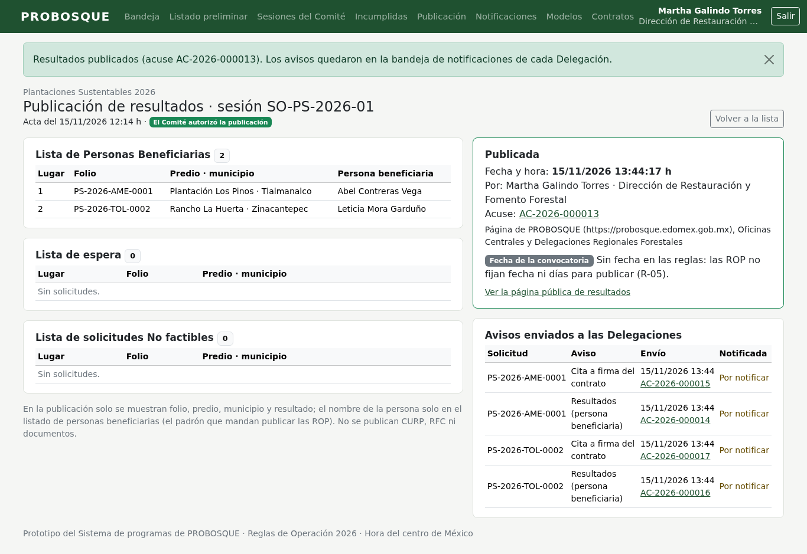

### Página pública de resultados

Cualquier persona, sin iniciar sesión, entra por el enlace **Consulte los resultados publicados** de la pantalla de
entrada (o a `/contrato/resultados/`). Elige el programa con **Ver listados**, consulta los tres listados y puede
buscar un folio con **Buscar**. Solo existen los programas ya publicados.

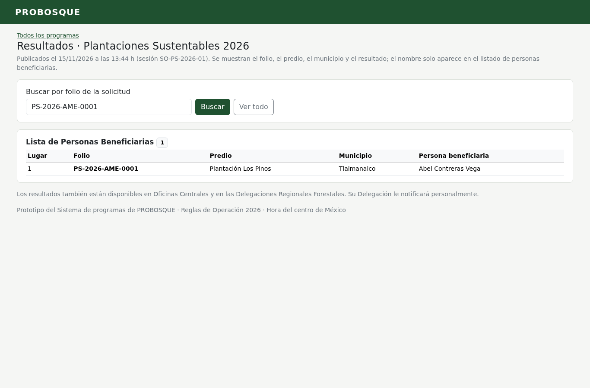

### Delegación: notificar a la persona

Usuario de ejemplo: `del_toluca` (o la Delegación que atiende el expediente). El expediente «Resultados publicados» está
en su bandeja, con el panel de notificaciones por entregar. Abre **Publicación y contrato › Notificaciones** (o el botón
**Notificar a la persona beneficiaria** del expediente). En cada aviso despliega el registro de la entrega, elige el
**Medio** (en persona, teléfono, correo…), la fecha y la hora (si no la pones, es ahora; no puede ser futura ni anterior al
envío) y observaciones, y pulsa **Registrar notificación**. Queda la fecha y la hora de la notificación con su acuse; al
notificar el resultado, el expediente pasa a «Persona beneficiaria notificada» y la Dirección puede elaborar el contrato. La
pestaña **Contrato** del expediente guarda todos los avisos, con su envío y su notificación.

---

## 11. Contrato: modelos y elaboración (HU-3.2)

### Modelos de contrato

Menú **Publicación y contrato › Modelos** (Dirección y Unidad Jurídica). Las Reglas de Operación no traen el texto del
Contrato de Adhesión ni del Convenio de Concertación (PSAHEM con fondos concurrentes), así que cada programa y ejercicio tiene
su modelo, que **la Dirección registra y la Unidad Jurídica valida**:

- **Plantilla base propia**: elige programa y ejercicio y pulsa **Crear plantilla base**. Es un texto de partida marcado
  «BORRADOR – modelo por validar»: hay que quitarle la marca (**Cambiar el texto › Guardar versión nueva**) y validarlo
  antes de usarlo. El texto lleva campos entre dobles llaves; la pantalla los lista y un campo desconocido se rechaza.
- **Cambiar el texto de un modelo** siempre crea una versión nueva **por validar**, aunque la anterior esté validada; la
  anterior se conserva y los contratos ya elaborados guardan la suya.
- **Unidad Jurídica** (`juridica`): el panel **Modelos por validar** de su bandeja abre el modelo; elige **Validada** o
  **Devuelta**, escribe observaciones y pulsa **Registrar la revisión**. Queda la fecha, la hora y quién la validó.

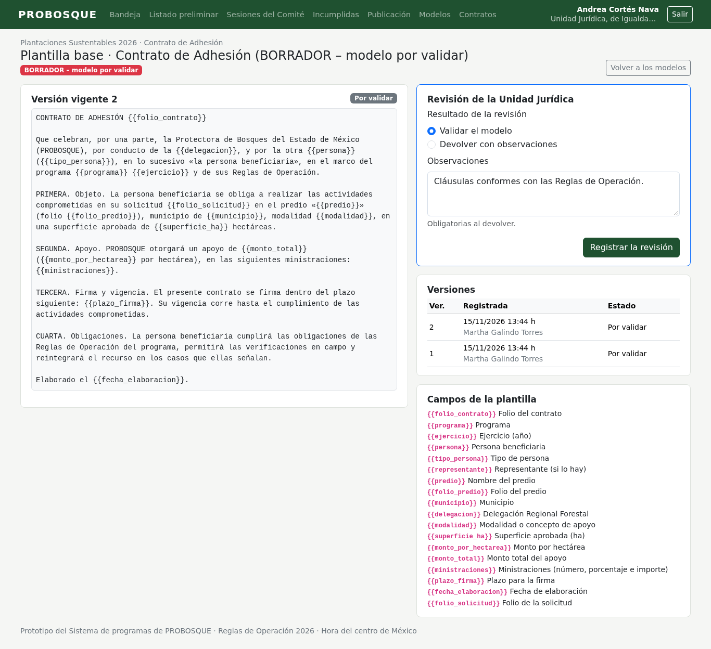

### Elaborar y enviar el contrato

1. Con el expediente en «Persona beneficiaria notificada», la Dirección abre **Elaborar el contrato** (botón del
   expediente, o **Publicación y contrato › Contratos**). La pantalla muestra los datos que llevará: persona, predio,
   modalidad, superficie aprobada, monto y ministraciones.
2. Si no hay un modelo validado del programa y ejercicio, lo dice y enlaza a **Modelos de contrato**: sin modelo validado
   no se elabora (el servicio también lo impide). Con modelo, elígelo y pulsa **Elaborar el contrato**.
3. Se genera el contrato en PDF, con folio `CTO-<programa>-<año>-NNNN` y huella SHA-256. Se puede **Rehacer el contrato**
   mientras no se envíe.
4. **Enviar a la Delegación** deja la **fecha y la hora del envío** y su acuse, y el expediente pasa a «Contrato en la
   Delegación». La Delegación ve el PDF solo desde el envío.

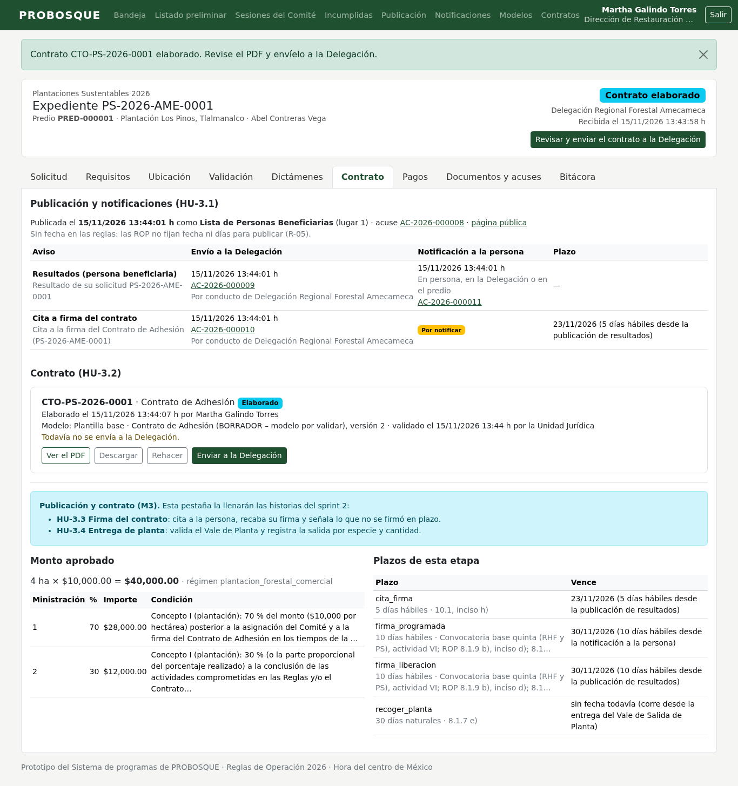

---

## 12. Delegación: firma del contrato (HU-3.3)

Usuario de ejemplo: `del_amecameca`. En la bandeja, el panel **Contratos por firmar** y, en el expediente, el botón
**Registrar la firma del contrato** (también **Publicación y contrato › Firmas**).

- La pantalla **Firma de contratos** muestra, de cada contrato, dos fechas: la **fecha programada de firma** y el
  **vencimiento para liberar el recurso** (10 días hábiles), con los días hábiles que faltan.
- En **Registrar la firma** indica quién firma (la persona o su representante), su nombre, la fecha y hora (por omisión,
  ahora; ni futura ni anterior al envío del contrato) y sube el **contrato firmado digitalizado**.
- **Verificación de firmas y sello**: una lista de puntos según el tipo de persona (persona física, jurídico colectiva o
  núcleo agrario con Presidencia, Secretaría, Tesorería y sello). **Todos deben marcarse**; si no, el contrato no se recibe.
- Al registrar queda la fecha y la hora de la firma, su acuse y el estado «Contrato firmado». Una firma posterior a la
  fecha programada pero dentro del vencimiento es válida y queda marcada «Fuera de la fecha programada».
- **Sin firma al vencer el plazo:** la revisión diaria de plazos lo **señala** («Sin firma en plazo · recurso por
  liberar») en la bandeja de la Dirección y en **Firmas**. Una firma que llegue después ya no se recibe. **Liberar el recurso
  no es automático:** la Dirección pulsa **Liberar el recurso** y escribe el motivo; el expediente queda en «Recurso liberado»,
  con acuse, y el monto queda como recurso liberado para que el Comité lo reasigne a la lista de espera (sección 15).

En MFS y Guardabosques la firma pide además su formalización propia (contrato de servicios técnicos con el RFN y carta
compromiso; credencial entregada), pero esos dos programas todavía no tienen reglas cargadas.

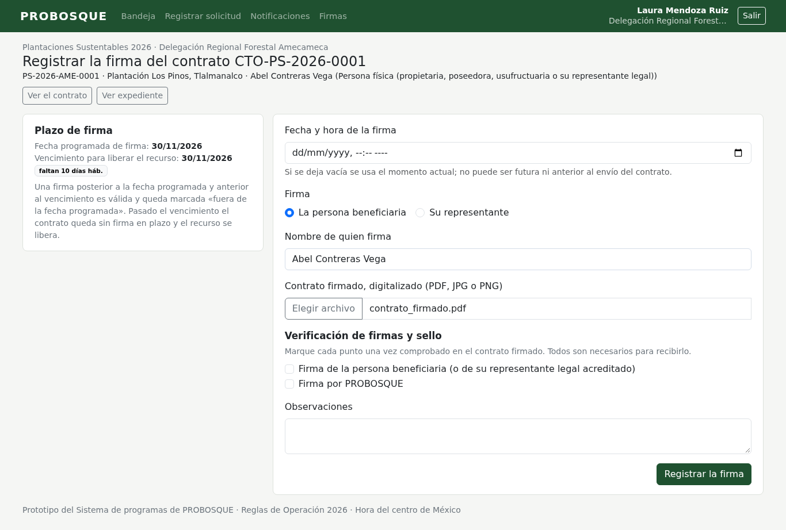

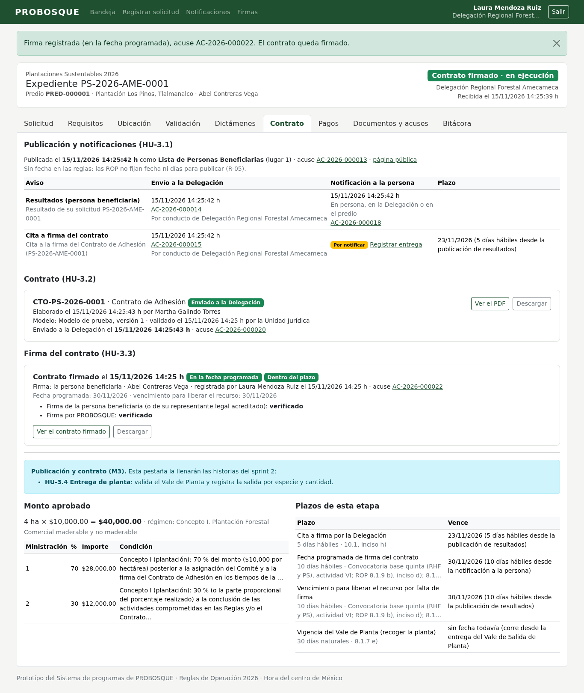

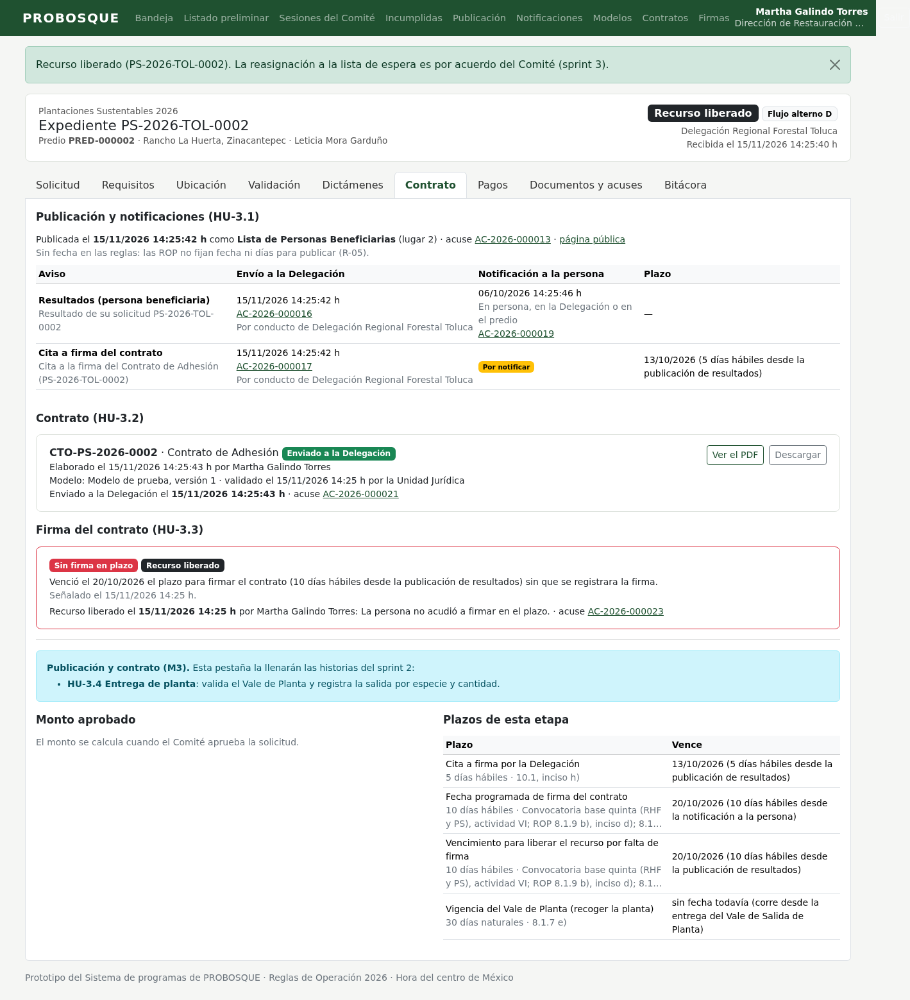

---

## 13. Vale de Planta y salida del vivero (HU-3.4)

Solo en **Plantaciones Sustentables** y **Restauración Hidrológico-Forestal** (RFI modalidad uno no recibe planta; CC y
PSAHEM no usan vale).

### Delegación: entregar el vale

En el panel **Contratos firmados por entregar su Vale de Planta** (o **Publicación y contrato › Vales**) abre el expediente
y **Entregar el vale**:

- La pantalla propone la **planta por hectárea** que fijan las reglas por la superficie aprobada. Captura la cantidad por
  **especie**, el **vivero que entrega la planta** y, si el total no es el propuesto, el **motivo del ajuste**.
- Dice la **vigencia**: en PS, 30 días naturales desde la entrega; en RHF, 15 días hábiles.
- Al **Entregar el vale** queda su folio (`VP-<programa>-<año>-NNNN`), la fecha y la hora y el acuse, y el expediente pasa a
  «Vale de Planta entregado».
- **Antes de firmar el contrato** el vale puede entregarse bajo responsabilidad de la persona, con su **carta compromiso**
  (archivo); al firmarse el contrato el expediente pasa a «Vale de Planta entregado».

### Vivero: validar el vale y registrar la salida

Usuario de ejemplo: `vivero`. En el menú **Planta** (o el panel **Vales de Planta vigentes por surtir**):

1. Escribe el folio del vale y pulsa **Validar el vale**: solo es válido un vale vigente. Uno vencido dice «Vale vencido,
   no válido» y no deja registrar salida.
2. Elige la **especie** y la **cantidad (piezas)** (y, si quieres, fecha y hora) y pulsa **Registrar la salida**. Hay salidas
   parciales; nunca se entrega más de lo autorizado por especie («no se entrega más de lo autorizado»). Cada salida deja su
   acuse. Al completarse todas, el expediente pasa a «Planta entregada».

### Vale vencido y reposición

Un vale **vencido no es válido**. En **RHF** la persona puede pedir otro: la Delegación pulsa **Reponer el vale**; el vale
nuevo solo cubre lo **no entregado** y pide confirmar que el vivero tiene planta disponible. En **PS** las Reglas no prevén
la reposición: la pantalla lo dice, con la regla que cita, y no deja reponer (queda como duda para el cliente).

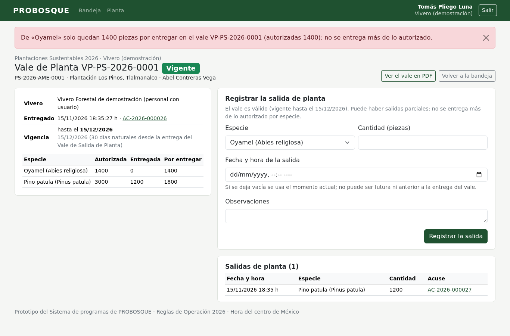

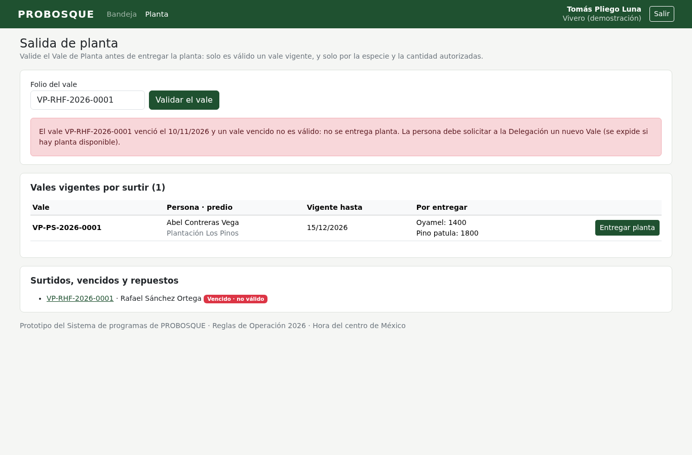

---

## 14. Pagos: solicitud, pago y cheques (HU-5.1, 5.2 y 5.3)

Cada solicitud tiene dos ministraciones (70 % y 30 %; en CC, un pago único de 100 % hasta 5 ha). Todo se ve en la pestaña
**Pagos** del expediente y en el menú **Pagos**. En esta versión solo se puede pedir la **primera** ministración: la
segunda pide la verificación en campo, que llega en el sprint 3.

### 14.1 Delegación: oficio de solicitud de pago y comprobante (HU-5.1)

Con el contrato firmado, el panel **Contratos firmados por emitir el oficio de solicitud de pago** (o el menú **Pagos**)
lleva a la pestaña **Pagos**:

- **Emitir el oficio** genera el oficio de la Delegación (`OFP-<programa>-<año>-NNNN`) con su acuse. El formato está marcado
  «borrador»: las Reglas de Operación no traen el formato.
- En CC, PS y RHF, sube el **comprobante de la cuenta bancaria** (PDF, JPG o PNG) y pulsa **Guardar**. PSAHEM paga con cheque
  y no lo pide. Un cambio de cuenta es un comprobante nuevo (el último es el vigente).

### 14.2 Dirección: solicitar la ministración (HU-5.1)

El panel **Ministraciones por solicitar** (o el botón **Solicitar la ministración 1**) abre la pestaña **Pagos**, con la lista de
**soportes** de la ministración: contrato firmado, oficio de la Delegación y comprobante de la cuenta; en PSAHEM, contrato o
convenio, oficio, dictámenes y la **instrucción de pago del Comité Técnico** (un acuerdo de la sesión de seguimiento,
sección 8). En PS y RHF con Vale de Planta, la solicitud se hace cuando el vivero ya surtió el vale («Planta entregada»). Cada
soporte dice «Completo» o «Falta», qué falta y quién lo resuelve.

Pulsa **Enviar la solicitud a Administración y Finanzas**. **Con un soporte faltante no se envía** y el sistema dice cuál. Al
enviar queda la **fecha y la hora del envío**, el acuse, la copia de los soportes y el estado «Ministración solicitada».

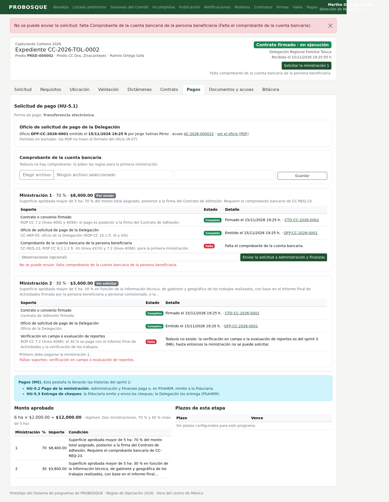

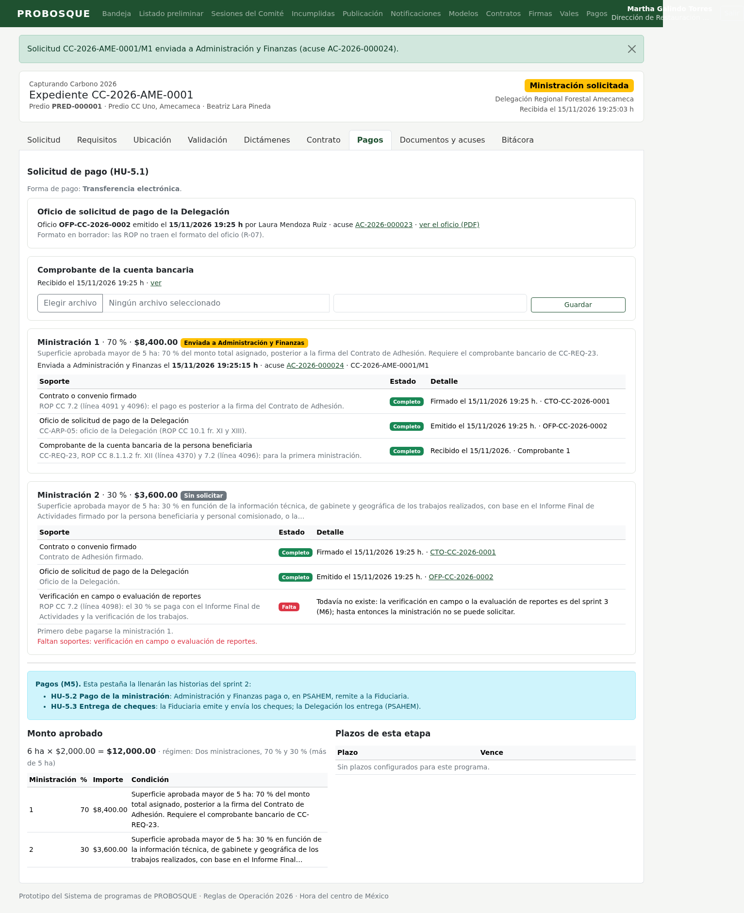

### 14.3 Administración y Finanzas: revisar y pagar (HU-5.2)

Usuario de ejemplo: `finanzas`. Menú **Pagos** (o los paneles **Solicitudes de pago por revisar** y **Solicitudes aceptadas
por pagar**):

1. **Aceptar la solicitud** (vuelve a comprobar los soportes y el importe) o **Devolver con observaciones** (obligatorias):
   la solicitud regresa al área responsable, que la corrige y la reenvía; cada revisión se conserva.
2. Solicitud aceptada (todos los programas menos PSAHEM): **Registrar el pago** con la **forma de pago** (transferencia), la
   **referencia**, la **fecha** y el **importe**, que debe ser **igual al solicitado**. El pago queda asociado a su solicitud,
   con su fecha y su acuse; el expediente pasa a «Ministración pagada» y a la bandeja de la Delegación llega el **aviso de
   pago**, que notifica a la persona en **Notificaciones**.

### 14.4 PSAHEM: solicitud de pago a la Fiduciaria (HU-5.2)

En PSAHEM, tras aceptar, la solicitud espera a la **Secretaría Técnica** (`comite`), que pide a la Fiduciaria el pago en un
máximo de **5 días hábiles** desde que el área envió la solicitud: menú **Pagos** (o el panel **Pagos por solicitar a la
Fiduciaria**), **Solicitar el pago a la Fiduciaria**, con el oficio o referencia. Queda la **fecha y la hora de la remisión** y
si fue «en plazo» o «fuera de plazo» (se acepta igual y queda señalada).

### 14.5 Fiduciaria y Delegación: el cheque (HU-5.3)

1. **Fiduciaria** (`fiduciaria`): menú **Cheques**. **Emitir el cheque**: número de cheque (único), importe igual al
   solicitado y fecha de emisión; queda a nombre de la persona y de su ministración. Luego **Enviar el cheque a la Delegación**
   (fecha, hora y acuse).
2. **Delegación**: el cheque está **por entregar**. **Registrar la entrega del cheque**: quién recibe y la fecha y hora (por
   omisión, ahora). Queda su acuse, el expediente pasa a «Cheque entregado» y la pantalla dice hasta cuándo debe cobrarlo (3
   meses desde la entrega).
3. En **Cheques**, la tabla **Entregados sin cobro** muestra cada vencimiento y su situación («en plazo», «por vencer» o
   «vencido»); la Fiduciaria o la Delegación pueden **Registrar que fue cobrado**. La baja por cheque vencido es del sprint 3.

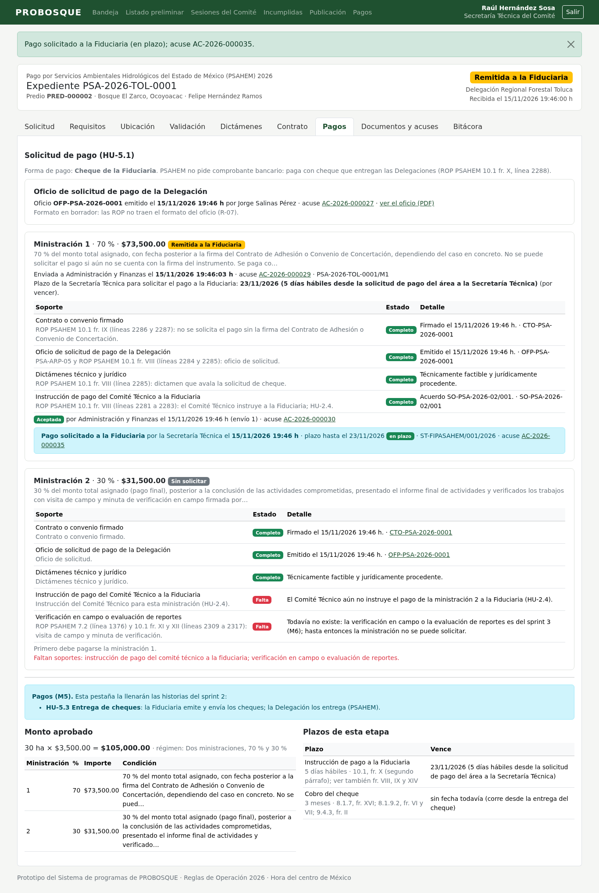

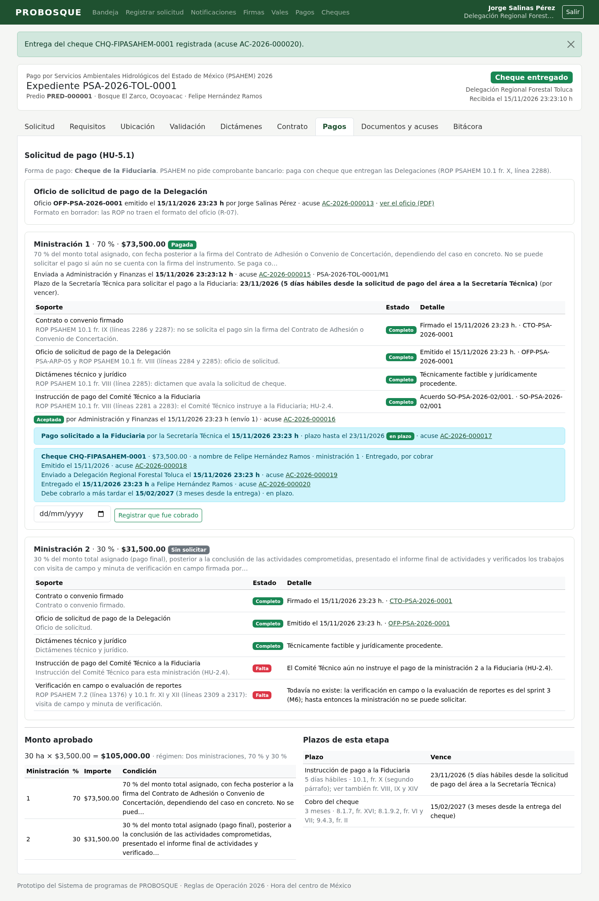

---

## 15. Bajas y reasignaciones con contrato o pagos (HU-2.4 en M3 y M5)

Las sesiones de seguimiento (sección 8) siguen funcionando después de publicar y mientras corre el contrato:

- **Baja** (desistimiento, cancelación, baja o sustitución): procede en cualquier etapa **anterior a la primera ministración
  solicitada** (aprobada, publicada, notificada, contrato elaborado o en la Delegación, sin firma en plazo, contratada, con vale o
  con planta entregada). La persona queda en «Baja · recurso liberado» y su monto, como recurso liberado. **Dada de baja ya no
  firma, no se le elabora contrato, no recibe ni se le surte vale, no se emite su oficio ni se solicita su ministración.**
- **Con una ministración ya solicitada o pagada no hay baja:** el sistema la rechaza y pide el acuerdo de **reintegro**.
- **Reasignación:** pasa a la siguiente de la lista de espera, en su orden y sin rebasar el recurso liberado. El recurso que la
  Dirección libera por no firmar en plazo (sección 12) entra igual como recurso liberado y el Comité lo reasigna.
- **Antes de publicar**, quien salió ya no aparece en la publicación y quien entró aparece como «Reasignación». **Después de
  publicar**, al cerrar la sesión de seguimiento con reasignaciones su acta queda autorizada y la Dirección la publica con el
  botón de la sección 10: la persona pasa a «Resultados publicados», recibe su aviso y corren sus plazos de firma.
- La vista **Listados › Beneficiarios** sigue a la persona en todo el trámite (situación actual, fecha de publicación) y muestra
  abajo las que salieron, con su causa.
- La pestaña **Trazabilidad** de cada expediente incluye ahora los registros de M3 y M5 (publicación, modelo de contrato,
  contrato, firma, vale, salida de planta, oficio, comprobante, solicitud, revisión, pago, remisión y cheque): cada alta o
  cambio, con quién, cuándo y qué valores.

---

## 16. Datos de demostración para practicar

Al levantar el sistema se cargan solicitudes de los cuatro programas con reglas, en distintos pasos. La demostración usa un
calendario simulado con fecha de corte el **19 de noviembre de 2026** (Guía de inicio, sección 1.4).

**Capturando Carbono (recepción, dictamen y Comité)**

| Para practicar | Entra como | Busca |
| --- | --- | --- |
| Revisar requisitos a medias | `del_amecameca` | Los Ocotes (`CC-2026-AME-0001`) |
| Enviar a la Dirección y ver un polígono dibujado | `del_amecameca` | Ejido San Rafael (`CC-2026-AME-0002`) |
| Validar o avisar faltantes | `dir_drff` | La Cañada (`CC-2026-AME-0003`) |
| Un aviso de faltantes ya notificado | la Delegación que lo atiende | Rancho El Capulín |
| Una solicitud desechada | la Delegación que la atiende | El Tecolote |
| Dictamen técnico con plazo vencido | `dir_drff` | El Ocotal (`CC-2026-TOL-0009`) |
| Dictamen jurídico pendiente, con traslape | `juridica` | Los Encinos del Monte |
| Expediente listo para el Comité | `comite` | Potrero Viejo |
| Una sesión de aprobación completa | `comite` | Sesión SO-CC-2026-01 |
| Incidentes y reasignación (La Joya Alta desiste y entra Las Trojes) | `comite`, `dir_drff`, `juridica` | Sesión SO-CC-2026-02 · Listados › Beneficiarios |
| Propiedad no acreditada (constancia de posesión vencida) | `juridica` | El Ocotal, pestaña Dictámenes |
| Documentos de los dictámenes y trazabilidad | cualquiera que vea el expediente | Las Trojes, pestañas Documentos y acuses y Trazabilidad |
| Una persona en el Listado de Incumplidas | `juridica` | Rogelio Bautista Núñez (Cerro de la Cruz, no factible) |

**Publicación, contrato y pagos (sprint 2)**

| Para practicar | Entra como | Busca |
| --- | --- | --- |
| Publicar los listados autorizados (la demostración trae el acta de PSAHEM sin publicar; CC, PS y RHF ya se publicaron) | `dir_drff` | Panel «Listados autorizados por publicar» |
| Notificar el resultado y la cita (PS) | `del_toluca` | Rancho La Huerta |
| Un contrato por firmar cuyo plazo ya venció (la revisión de plazos lo señala «Sin firma en plazo») | `del_amecameca`, `dir_drff` | Plantación Los Pinos (PS) |
| Contrato elaborado por enviar (su plazo de firma ya venció); otro por elaborar | `dir_drff` | Barranca Honda y Ojo de Agua (RHF) |
| Modelos de contrato por validar | `juridica` | Panel «Modelos por validar» (CC, PS y PSAHEM) |
| Contratos firmados y un contrato sin firma en plazo, por liberar | `del_amecameca`, `dir_drff` | Mirador de los Pinos y Ladera Verde (firmados), Cañada Seca (sin firma), todos de PS |
| Vale vigente con salidas parciales | `vivero` | Mirador de los Pinos (PS) y Arroyo Claro (RHF) |
| Vale vencido: sin reposición en PS; con reposición en RHF | `del_toluca`, `del_valle` | Ladera Verde (PS) y Cerro Gordo (RHF) |
| Contrato firmado sin oficio de pago | `del_toluca` | Predio El Paraíso (CC) |
| Solicitud por enviar con todos sus soportes; una devuelta con observaciones | `dir_drff` | Predio Santa Cruz y Predio El Fresno (CC) |
| Solicitudes enviadas por revisar, y otras ya pagadas | `finanzas` | Por revisar: Predio Las Palomas (CC), Plantación El Cedro (PS). Pagadas: Predio La Ciénega (CC), Plantación La Mesa (PS), Manantial Alto (RHF) |
| PSAHEM en cada punto del pago | `finanzas`, `comite`, `fiduciaria`, `del_toluca` | Solicitud por revisar: Rancho El Pedregal y Ejido La Joya. Remitida a la Fiduciaria: Bosque Los Cedros. Cheque emitido: Paraje Las Ánimas. Enviado a la Delegación: Monte Alto. Entregados: Cerro del Venado y Loma Verde (este, por vencer sin cobro) |

Los contratos que la demostración dejó por firmar el 19-nov (Plantación Los Pinos, Rancho La Huerta, Barranca Honda y, más adelante, Ojo de Agua) tienen plazo de 10 días hábiles: pasada la fecha, la revisión diaria de plazos los señala «Sin firma en plazo» y ya no se les puede registrar la firma. Para probar la firma con datos de hoy, `datos_prueba/sprint_2/preparar_casos_ps.py` agrega dos casos de PS (Guía de inicio y secuencia de prueba).

Para empezar de cero con los mismos datos: `docker compose -p probosque_s2 down -v` y `docker compose -p probosque_s2 up
--build` (Guía de inicio, sección 1.5). Los plazos que corren desde la fecha de corte se miden con el reloj real: según el
día en que pruebes, un vale o un cheque aparecerá vencido.

Para probar también la carga de archivos y capturar solicitudes nuevas con resultados conocidos, hay polígonos,
documentos PDF y fichas de solicitudes en `datos_prueba/sprint_1/`, y los documentos de contrato, firma y pagos en
`datos_prueba/sprint_2/`. La [secuencia de prueba del sprint 2](datos_prueba/sprint_2/SECUENCIA_DE_PRUEBA.md) dice paso a
paso qué hacer, por usuario, desde la solicitud autorizada hasta el cheque entregado, y la del
[sprint 1](datos_prueba/sprint_1/SECUENCIA_DE_PRUEBA.md) lleva una solicitud hasta su autorización.

---

## 17. Calculadora forestal

Ábrela como dice la Guía de inicio, sección 2. Muestra la **superficie con cobertura arbórea** (hectáreas de bosque)
dentro de la zona forestal del Estado de México, medida con imágenes Sentinel-2 de noviembre y diciembre de cada año.

- **Arriba** se elige el modo y los años:
  - **Comparar años**: elige **Desde** y **Hasta** (los años sin datos están marcados) y ve el bosque de cada uno, el cambio
    neto, la pérdida por incendio, las otras pérdidas y la ganancia.
  - **Un año**: el bosque de ese año, su cambio desde el año anterior y la tendencia.
- **Evolución del bosque**: la gráfica de 2023 a 2025 y su tabla; «ver» abre ese año en el mapa.
- **Detalle**: toca un municipio en el mapa o en la tabla, o búscalo por nombre, para ver su serie, su bosque por tipo
  (coníferas, encino, mesófilo, selva baja, zonas semiáridas) y a qué pasaron sus otras pérdidas.
- **Municipios**: la tabla ordenable de los 125 municipios (o solo los que tienen bosque).
- **Alcances**: qué mide y qué no, de dónde salen los datos y qué no se puede afirmar todavía.

### Balance entre dos años con su histograma (HU-7.2)

La sección **Balance del periodo** del par de años elegido trae, para el **Estado** y para **cada municipio** (elígelo en el
mapa o en la tabla), la **pérdida por incendio**, las **otras pérdidas**, la **ganancia** y el **cambio neto** en hectáreas:

- **Pérdidas y ganancia en hectáreas**: cuatro barras que parten del bosque inicial; la última es el cambio neto.
- **Municipios según su cambio neto**: el **histograma** del periodo, con el número de municipios por intervalo de cambio
  neto (% de su bosque inicial). Solo entran los municipios con 500 ha o más de bosque inicial; la nota dice cuántos pierden,
  cuántos ganan y cuántos quedan fuera.
- **Ver como tabla** muestra los mismos números de cada gráfica.

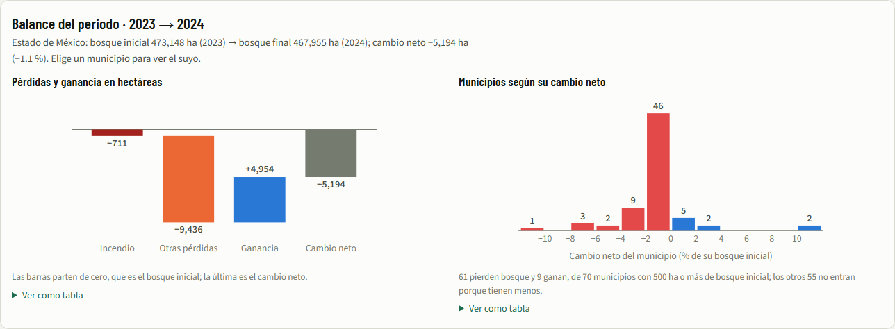

### Capa de incendios (HU-7.3)

- La vista **Incendios** del mapa dibuja un círculo por cada incendio del periodo (su centroide; el área es proporcional a las
  hectáreas quemadas dentro del bosque). Toca uno para ver su clave, fecha, municipio y hectáreas.
- La sección **Incendios del periodo** resume cuántos son, las hectáreas que reporta CONAFOR y las que tienen dNBR ≥ 0.27,
  dentro del bosque y sin copa al cierre. **Ver los incendios y su tabla** abre la **pérdida por incendio por año** (Estado y
  municipio) y la tabla ordenable de cada incendio (fecha, municipio, hectáreas reportadas, quemadas en bosque, sin copa y
  clave).
- **Un año que CONAFOR todavía no publica** (hoy, 2025) queda señalado en la página: «CONAFOR aún no publica los incendios de
  2025». La pérdida por incendio de ese periodo aparece con una marca de parcial (†) o «sin dato», nunca como cero, y lo
  quemado ese año queda dentro de «otras pérdidas».

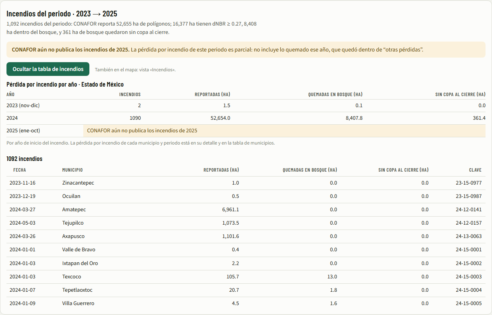

- **El mapa** tiene cuatro vistas: **Cambio de cobertura**, **Cambio neto por municipio**, **Incendios** y **Año de pérdida**.
  **Buscar** encuentra un municipio por nombre; se acerca y aleja con los botones + y −.

Ten en cuenta lo que la propia página advierte: el umbral de NDVI es provisional, las «otras pérdidas» no se han
verificado en campo, CONAFOR aún no publica los incendios de 2025 (ni los de 2026), y el uso al que pasó el terreno perdido
es una estimación con 55 % de exactitud.

---

## 18. Preguntas frecuentes

**No veo un botón que el manual menciona.** Los botones aparecen solo a la unidad a la que le toca el paso y cuando el
expediente está en el estado que corresponde. Revisa con qué usuario entraste y el estado del expediente.

**No me deja enviar el expediente a la Dirección.** La pantalla dice qué falta: requisitos sin revisar, alguno
faltante o un entregado sin archivo.

**¿Puedo deshacer un paso?** No directamente: cada paso queda en la bitácora y con su acuse. Lo que las reglas permiten
(reenviar con faltantes, cambiar el polígono con motivo, ajustar un listado con motivo, rehacer un contrato antes de
enviarlo, devolver una solicitud de pago) se hace con su propio botón.

**No me deja elaborar el contrato.** El expediente debe estar «Persona beneficiaria notificada» y debe haber un modelo de
contrato **validado** por la Unidad Jurídica para el programa y ejercicio (sección 11).

**No me deja enviar la solicitud de pago.** La pestaña **Pagos** dice qué soporte falta y quién lo resuelve; en PSAHEM
falta, por ejemplo, la instrucción de pago del Comité (sección 8).

**El vale aparece vencido o el contrato, sin firma en plazo.** Los plazos corren con el reloj real desde la fecha de corte de
la demostración (Guía de inicio, sección 1.4); una demostración vieja se ve vencida, como cualquier expediente real.

**¿Dónde están las fechas y plazos oficiales?** En las reglas de cada programa (`sistema/reglas/CC.json`, `PS.json`,
`RHF.json` y `PSA.json`), con el numeral y la línea de las Reglas de Operación. El calendario de días inhábiles 2026 es de
demostración.

**¿Qué falta en esta versión?** Guardabosques y Manejo Forestal Sustentable no tienen reglas cargadas; la segunda
ministración (verificación en campo), la ejecución, el seguimiento y el cierre llegan en el sprint 3. Los pendientes con el
cliente están en [`sistema/README.md`](sistema/README.md), sección «Pendientes con el cliente», y el resumen del sprint en
`entregas/sprint_2/Resumen_sprint_2.pdf`.
