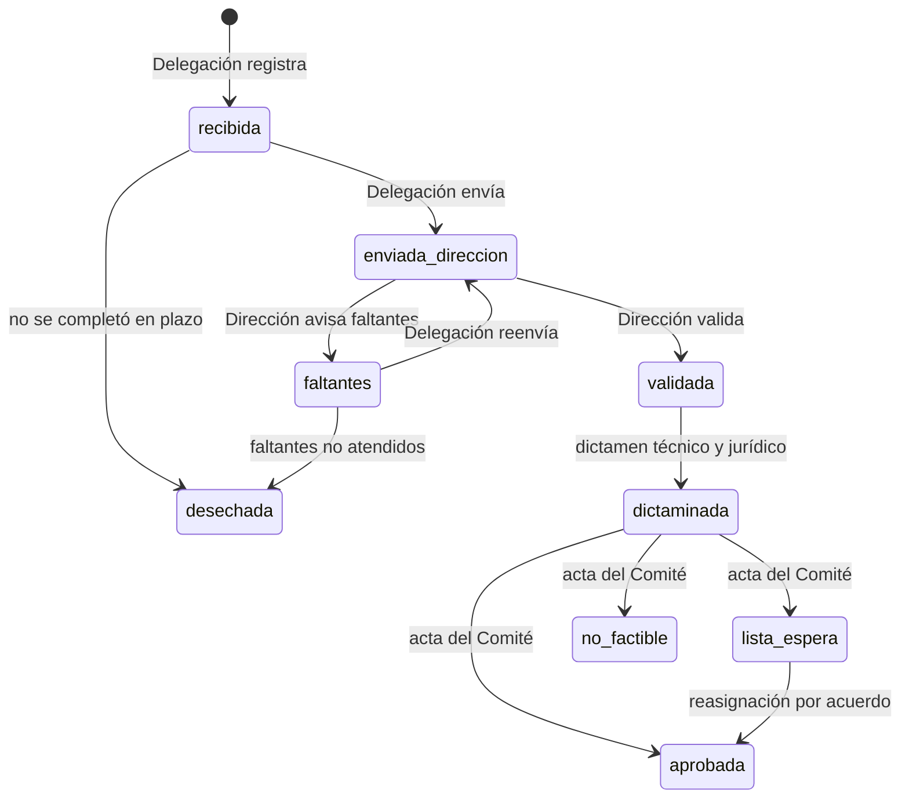
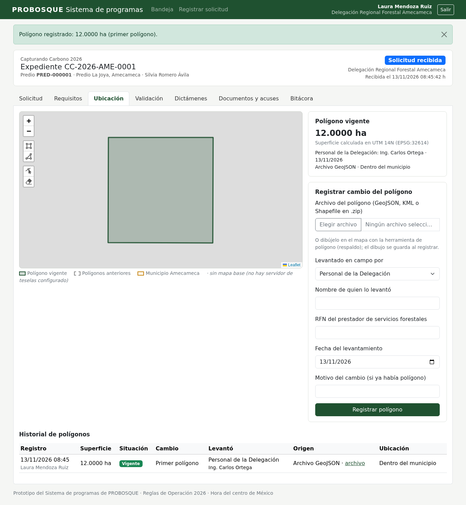
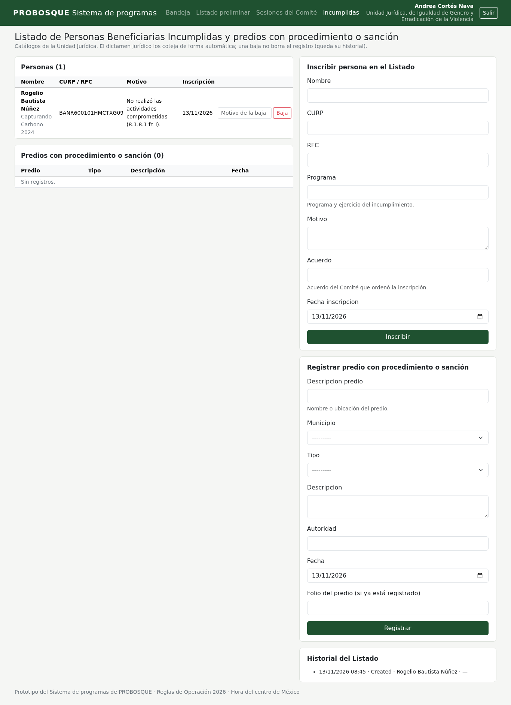
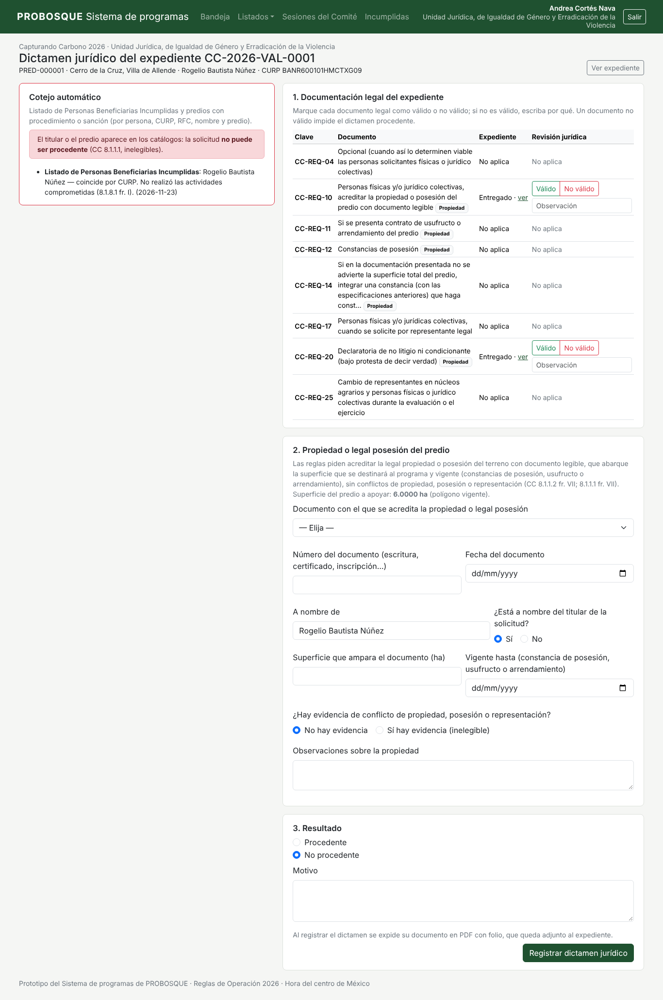
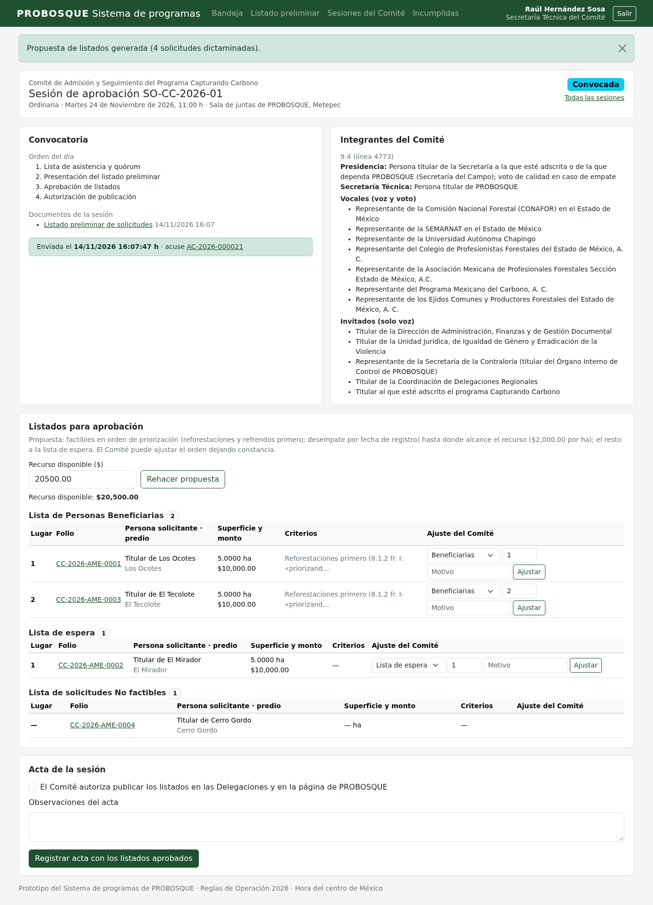
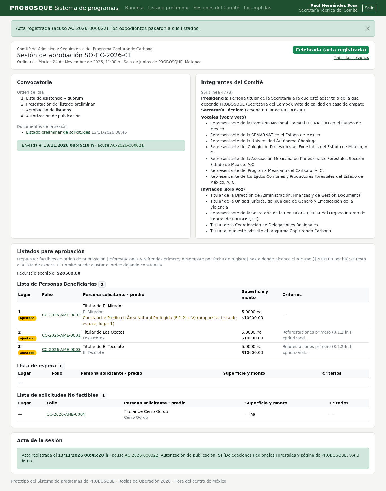
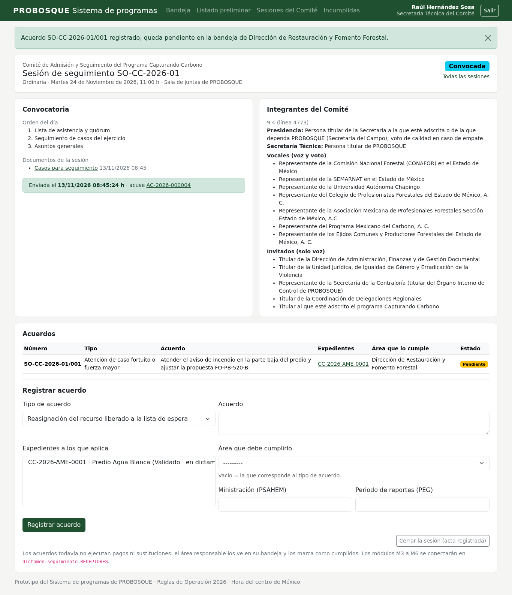
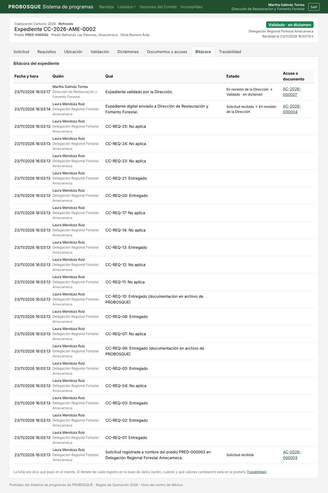
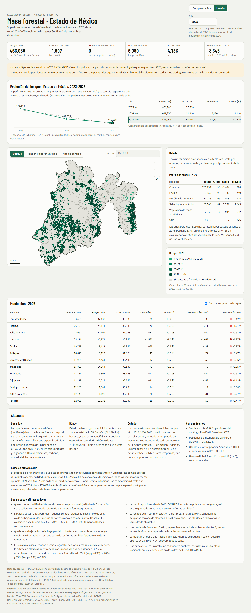

# Manual de usuario (versión del sprint 1)

Este manual explica cómo usar el prototipo tal como quedó al cerrar el **sprint 1** (14 de noviembre de 2026). Para
ponerlo a funcionar, sigue primero la [Guía de inicio](GUIA_DE_INICIO.md).

**Qué cubre esta versión**

- **Sistema de programas**, para el programa **Capturando Carbono 2026**, el único con reglas cargadas en este
  punto: desde que la persona solicitante entrega su solicitud en la Delegación hasta que el Comité aprueba los
  listados y da seguimiento a sus acuerdos.
  - Recepción (módulo M1): registro de la solicitud, revisión de requisitos, ubicación del predio y validación.
  - Dictamen y Comité (módulo M2): dictámenes técnico y jurídico, listado preliminar, sesión de aprobación y
    sesiones de seguimiento.
- **Calculadora forestal**: la masa forestal del Estado de México por año, de 2023 a 2025.

Lo que sigue después de la aprobación (publicación, contrato, pagos, ejecución, verificación y cierre) llegó en los
sprints 2 y 3 y está en la rama `main`.

Las imágenes de este manual son capturas del propio sistema, tomadas por las pruebas automáticas
(`entregas/sprint_1/capturas/`).

---

## 1. Ideas básicas

| Término | Qué es |
| --- | --- |
| **Expediente** | Todo lo de una solicitud a un programa: datos, requisitos, documentos, polígono, revisiones, dictámenes, acuses y bitácora. Su folio tiene la forma `CC-2026-AME-0001` (programa, ejercicio, Delegación y número). |
| **Folio del predio** | El predio tiene su propio folio (`PRED-000001`), que conserva si vuelve a solicitar en otro programa o ejercicio. |
| **Estado** | En qué paso va el expediente. Cada estado tiene una unidad que lo atiende; el sistema solo permite los pasos de las reglas y a la unidad que le toca. |
| **Bandeja** | La pantalla de inicio de cada usuario: los expedientes que le toca atender a su unidad. |
| **Acuse** | Comprobante en PDF con folio (`AC-2026-000001`), fecha y hora, que se genera en cada envío o entrega. Queda en el expediente. |
| **Bitácora** | Registro de todo lo que pasó en el expediente: quién, qué y cuándo. No se puede borrar. |
| **Días hábiles** | Los plazos de las Reglas de Operación se cuentan sin sábados, domingos ni días inhábiles del calendario 2026 de demostración. |

### Los estados de una solicitud

| Estado en pantalla | Quién lo atiende |
| --- | --- |
| Solicitud recibida · Aviso de faltantes | Delegación |
| En revisión de la Dirección | Dirección del programa |
| Validado · en dictamen | Dirección (dictamen técnico) y Unidad Jurídica (dictamen jurídico), al mismo tiempo |
| Dictaminada | Secretaría Técnica del Comité |
| Aprobada · Lista de espera · No factible | Siguen en el sprint 2 (publicación y contrato) |
| Solicitud desechada | Termina el trámite |

---

## 2. Entrar, la bandeja y el expediente

### Entrar y salir

Abre **http://localhost:8080/entrar/**, escribe tu usuario y contraseña y pulsa **Entrar**. Para cambiar de unidad
pulsa **Salir** (arriba a la derecha) y entra con otro usuario. Los usuarios de demostración están en la Guía de
inicio; la contraseña de todos es `Probosque2026`.

### La bandeja

- **Por atender**: lo que tu unidad debe hacer ahora. **Todos los míos**: también lo que ya pasó a otra unidad pero
  sigue siendo de tu Delegación o programa.
- **Buscar**, **Programa** y **Estado** filtran la lista. El folio abre el expediente.
- Una Delegación ve solo sus expedientes; una Dirección, los de los programas que tiene a su cargo.
- Arriba aparecen, si los hay, los **acuerdos del Comité** que le toca cumplir a tu unidad (sección 8).
- El menú superior cambia según la unidad: la Dirección ve **Listado preliminar**; la Unidad Jurídica,
  **Incumplidas**; la Secretaría Técnica, **Sesiones del Comité**.

La bandeja también funciona en un teléfono: la tabla se acomoda al ancho de la pantalla.

### El expediente

Arriba están el programa, el folio, el predio, la persona solicitante, el estado y la fecha y hora de recepción. Abajo,
las pestañas:

| Pestaña | Qué contiene |
| --- | --- |
| **Solicitud** | Los datos registrados en ventanilla y el acuse de recepción |
| **Requisitos** | Los requisitos del programa y su revisión (sección 3.2) |
| **Ubicación** | El mapa con el polígono del predio y su historial (sección 3.3) |
| **Validación** | Las revisiones de la Dirección, sus avisos de faltantes y fechas límite (sección 4) |
| **Dictámenes** | El dictamen técnico y el jurídico (secciones 5 y 6) |
| **Documentos y acuses** | Todos los archivos y acuses en PDF |
| **Bitácora** | El registro de todo lo ocurrido |

Los botones de cada pestaña aparecen solo cuando a tu unidad le toca ese paso.

---

## 3. Delegación: recibir la solicitud

Usuario de ejemplo: `del_amecameca`.

### 3.1 Registrar la solicitud

En la bandeja, pulsa **Registrar solicitud** y llena:

- **Programa y solicitud**: programa y ejercicio, tipo de persona, modalidad (tipo de superficie), si es refrendo, si
  se solicita por medio de representante legal y observaciones de la ventanilla.
- **Predio**: folio de predio ya registrado (si ya tuvo expediente en PROBOSQUE), municipio, nombre del predio,
  superficie solicitada en hectáreas y localidad o paraje.
- **Persona solicitante**: nombre o razón social, CURP, RFC, teléfono, correo y representante legal o comisariado.

Pulsa **Registrar y generar acuse**. El expediente queda en «Solicitud recibida» y se genera el **acuse de
recepción** en PDF, con el folio, la fecha, la hora y el plazo de 5 días hábiles para completar la documentación.

> Si el municipio del predio lo atiende otra Delegación, el formulario lo avisa al elegirlo y el sistema no deja
> registrar: dice qué Delegación corresponde.

### 3.2 Revisar los requisitos

En la pestaña **Requisitos** está la lista que piden las reglas para el tipo de persona y la modalidad de la
solicitud, cada uno con su numeral de las Reglas de Operación. Arriba, un resumen: entregados, faltantes, «no
aplican» y sin revisar.

En cada renglón pulsa **Revisar** y elige:

- **Entregado**, con su archivo digitalizado (**Elegir archivo**), o **Faltante**. En los requisitos opcionales o
  condicionales aparece también **No aplica**.
- En los requisitos que son condiciones y no documentos: **Cumple** o **No cumple**.

Pulsa **Guardar**. El renglón cambia sin recargar la página.

**Enviar a la Dirección.** El botón **Enviar expediente digital a la Dirección** se habilita cuando todos los
requisitos están revisados, ninguno está faltante y cada entregado tiene su archivo (en un refrendo, la documentación
vigente que ya obra en PROBOSQUE vale sin volver a subirla). Si falta algo, la pantalla dice qué. Al enviar se genera
un acuse y el expediente pasa a la bandeja de la Dirección.

Si la persona no completó su documentación en el plazo, la Delegación puede **Tener por desechada la solicitud**
(pide un motivo).

### 3.3 Ubicar el predio

En la pestaña **Ubicación** se registra el polígono del predio, levantado en campo. No es requisito para enviar el
expediente: las reglas lo levantan después de la entrega.

1. Sube el archivo del polígono (**GeoJSON, KML o Shapefile en .zip**) o dibújalo en el mapa con la herramienta de
   polígono.
2. Indica quién lo levantó (personal de la Delegación o prestador de servicios forestales, con su RFN), su nombre y
   la fecha del levantamiento.
3. Si ya había un polígono, escribe el motivo del cambio.
4. Pulsa **Registrar polígono**.

El sistema calcula la superficie en hectáreas y avisa si el polígono cae fuera del municipio. Rechaza una geometría
inválida. Cada cambio conserva el polígono anterior en el **Historial de polígonos**, marcado como «corrección» o
«cambio de lugar» según cuánto se traslapan.

---

## 4. Dirección: validar el expediente

Usuario de ejemplo: `dir_drff`.

1. En la bandeja aparecen los expedientes «En revisión de la Dirección». Abre uno, ve a la pestaña **Validación** y
   pulsa **Abrir pantalla de validación**.
2. La pantalla muestra cada requisito con la revisión de la Delegación y una **revisión automática con las reglas**.
   Marca como **Faltante** lo que no cumpla (ilegible, incompleto, no vigente) y escribe observaciones.
3. Sin faltantes, pulsa **Validar expediente**: queda «Validado · en dictamen», con su constancia en PDF.
4. Con faltantes, pulsa **Emitir aviso de faltantes**: se genera el aviso con su **fecha límite** (5 días hábiles
   desde el aviso) y el expediente regresa a la Delegación para que lo notifique.

**En un refrendo**, la documentación que ya obra en PROBOSQUE vale si no tiene más de 3 años desde la recepción; si
es más vieja, se marca como faltante.

### Del lado de la Delegación: atender el aviso de faltantes

El aviso va dirigido a la persona solicitante **por conducto de la Delegación**:

1. En la pestaña **Validación** del expediente aparece el aviso con la lista de faltantes y su fecha límite. Cuando
   entregues el aviso a la persona, pulsa **Registrar notificación a la persona solicitante**: queda la fecha y la
   hora con su acuse.
2. Cuando la persona entregue lo faltante, márcalo como entregado en **Requisitos** y pulsa **Reenviar a la
   Dirección con los faltantes**.

Si vence la fecha límite sin respuesta, la Dirección puede tener la solicitud por desechada.

---

## 5. Dirección: dictamen técnico y listado preliminar

Con el expediente validado, la Dirección y la Unidad Jurídica dictaminan al mismo tiempo. Cuando ya están los dos
dictámenes, el expediente pasa a «Dictaminada», en la bandeja de la Secretaría Técnica.

### Dictamen técnico

En la pestaña **Dictámenes**, pulsa **Elaborar dictamen técnico**. La pantalla tiene:

- **Análisis cartográfico**: el mapa con el polígono vigente, los de otros expedientes que se traslapan y el
  municipio; la superficie, si está dentro del rango del programa (1 a 200 ha en Capturando Carbono), si cae dentro
  del municipio y los traslapes con otras solicitudes del mismo ejercicio, en hectáreas.
- **Plazo de dictaminación**: en Capturando Carbono, la fecha límite de la Convocatoria (30 de junio de 2026). Dice si
  va en plazo, por vencer o vencido.
- **Lista de verificación** con los criterios del programa: en cada uno, **Cumple**, **No cumple** o **No aplica**,
  con una nota. Un criterio que no se cumple impide el dictamen factible.
- **Resultado**: **Factible** (con la superficie factible en hectáreas) o **No factible** (con su motivo).

Pulsa **Registrar dictamen técnico**. Queda con su acuse.

### Listado preliminar

En el menú, **Listado preliminar** reúne el resultado técnico y jurídico de cada solicitud validada. **Exportar CSV
(Excel)** lo descarga para abrirlo en Excel con acentos.

---

## 6. Unidad Jurídica: Listado de Incumplidas y dictamen jurídico

Usuario de ejemplo: `juridica`.

### Listado de Personas Beneficiarias Incumplidas

En el menú, **Incumplidas** muestra el Listado de Personas Beneficiarias Incumplidas y los predios con procedimiento
o sanción. Se agregan con **Inscribir** y se retiran con **Baja**, que desactiva el registro pero no lo borra: queda
su historial.

### Dictamen jurídico

En la pestaña **Dictámenes** de un expediente validado, pulsa **Elaborar dictamen jurídico**. El sistema **coteja
automáticamente** a la persona (CURP, RFC y nombre) y al predio contra el Listado de Incumplidas y muestra las
coincidencias. Si hay una coincidencia, no permite el dictamen procedente. Elige **Procedente** o **No procedente**,
escribe el motivo y pulsa **Registrar dictamen jurídico**. El cotejo queda también en el acuse.

---

## 7. Secretaría Técnica: sesión de aprobación del Comité

Usuario de ejemplo: `comite`. En el menú, **Sesiones del Comité**.

1. **Nueva sesión de aprobación**: programa y ejercicio, carácter (ordinaria o extraordinaria), fecha y hora, lugar o
   plataforma digital y orden del día (un punto por renglón). Pulsa **Crear sesión**.
2. **Agregar documento**: al menos uno (por ejemplo, el listado preliminar y los dictámenes).
3. **Enviar convocatoria a los integrantes**: el sistema exige la anticipación de las reglas (3 días hábiles antes de
   la sesión; 24 horas si es extraordinaria) y genera el acuse con la fecha, la hora, el orden del día y los
   integrantes del Comité según las reglas.
4. **Generar propuesta** de listados: ordena las solicitudes factibles por los criterios de priorización que se
   pueden leer del expediente (reforestaciones primero, luego refrendos, y por fecha y hora de registro) y asigna
   hasta donde alcance el **Recurso disponible** que escribas ($2,000 por hectárea factible); las demás van a la lista
   de espera con su lugar. Las no factibles van a su propia lista.
5. Si el Comité decide otra cosa, **Ajustar** mueve una solicitud de lista o de lugar, con un motivo obligatorio que
   queda en el acta. Una no factible no puede pasar a las listas de apoyo.
6. **Registrar acta con los listados aprobados**: genera el acta en PDF con la Lista de Personas Beneficiarias, la
   Lista de espera, la Lista de solicitudes No factibles y la autorización de publicación, y mueve cada expediente a
   «Aprobada», «Lista de espera» o «No factible». **Cerrar la sesión** deja la sesión como celebrada.

---

## 8. Sesiones de seguimiento y acuerdos

1. La Secretaría Técnica crea una **Nueva sesión de seguimiento** igual que la de aprobación.
2. En la sesión, **Registrar acuerdo**: tipo de acuerdo (reasignación, sustitución, caso fortuito, suspensión,
   cancelación, baja, reintegro, instrucción de pago a la Fiduciaria en PSAHEM, validación de reportes en
   Guardabosques u otro), el texto del acuerdo, los expedientes a los que aplica y el área que debe cumplirlo.
3. El área responsable ve el acuerdo en su bandeja, lo atiende y pulsa **Marcar cumplido**.

En esta versión los acuerdos se registran y se cumplen, pero todavía no ejecutan nada en otros módulos. Por ejemplo,
una instrucción de pago de PSAHEM llegaría a la bandeja de la Fiduciaria (`fiduciaria`), pero los pagos llegan en el
sprint 2. Además, PSAHEM todavía no tiene reglas cargadas: ese caso solo lo cubren las pruebas automáticas.

---

## 9. Documentos, acuses y bitácora

- La pestaña **Documentos y acuses** reúne los archivos subidos y cada acuse en PDF: recepción, envío a la
  Dirección, validación, aviso de faltantes, notificación, dictámenes, convocatoria y acta.
- Los archivos no tienen dirección pública: solo los descarga quien tiene permiso sobre el expediente.
- La pestaña **Bitácora** lista cada paso con su fecha y hora, quién lo hizo y qué hizo (con el motivo, cuando el
  paso lo pide).

---

## 10. Datos de demostración para practicar

Al levantar el sistema se cargan solicitudes de Capturando Carbono 2026 en distintos pasos:

| Para practicar | Entra como | Busca |
| --- | --- | --- |
| Revisar requisitos a medias | `del_amecameca` | Los Ocotes (`CC-2026-AME-0001`) |
| Enviar a la Dirección y ver un polígono dibujado | `del_amecameca` | Ejido San Rafael (`CC-2026-AME-0002`) |
| Validar o avisar faltantes | `dir_drff` | La Cañada (`CC-2026-AME-0003`) |
| Un aviso de faltantes ya notificado | la Delegación que lo atiende | Rancho El Capulín |
| Una solicitud desechada | la Delegación que la atiende | El Tecolote |
| Dictamen técnico con plazo vencido | `dir_drff` | El Ocotal (`CC-2026-TOL-0009`) |
| Dictamen jurídico pendiente, con traslape | `juridica` | Los Encinos del Monte |
| Expediente listo para el Comité | `comite` | Potrero Viejo |
| Una sesión de aprobación completa | `comite` | Sesión SO-CC-2026-01 |
| Acuerdos de seguimiento | `comite`, `dir_drff`, `juridica` | Sesión SO-CC-2026-02 |
| Una persona en el Listado de Incumplidas | `juridica` | Rogelio Bautista Núñez (Cerro de la Cruz, no factible) |

Para empezar de cero con los mismos datos: `docker compose down -v` y `docker compose up --build` (Guía de inicio,
sección 1.5).

Para probar también la carga de archivos y capturar solicitudes nuevas con resultados conocidos, hay polígonos,
documentos PDF y fichas de solicitudes en `datos_prueba/sprint_1/`. La
[secuencia de prueba](datos_prueba/sprint_1/SECUENCIA_DE_PRUEBA.md) dice paso a paso qué hacer con ellos y qué debe
pasar.

---

## 11. Calculadora forestal: masa forestal por año

Ábrela como dice la Guía de inicio, sección 2. Muestra la **superficie con cobertura arbórea** (hectáreas de bosque)
dentro de la zona forestal del Estado de México, medida con imágenes Sentinel-2 de noviembre y diciembre de cada año.

- **Arriba a la derecha** se elige el modo:
  - **Un año**: el bosque de ese año, su cambio desde el año anterior y la tendencia.
  - **Comparar años**: dos años lado a lado, con las pérdidas por incendio, otras pérdidas y la ganancia.
- **Las cifras de arriba**: bosque del año, cambio, pérdida por incendio, otras pérdidas, ganancia y tendencia.
- **Evolución del bosque**: la gráfica de 2023 a 2025 y su tabla; «ver» abre ese año en el mapa.
- **El mapa** tiene tres vistas: **Bosque**, **Tendencia por municipio** y **Año de pérdida**. **Buscar** encuentra un
  municipio por nombre; se acerca y aleja con los botones + y −.
- **Detalle**: toca un municipio en el mapa o en la tabla para ver su serie, su bosque por tipo (coníferas, encino,
  mesófilo, selva baja, zonas semiáridas) y a qué pasaron sus otras pérdidas.
- **Municipios**: la tabla ordenable de los 125 municipios, con su zona forestal, bosque, cambio y tendencia.
- **Alcances**: qué mide y qué no, de dónde salen los datos y qué no se puede afirmar todavía.

Ten en cuenta lo que la propia página advierte: el umbral de NDVI es provisional, las «otras pérdidas» no se han
verificado en campo, CONAFOR aún no publica los incendios de 2025, y el uso al que pasó el terreno perdido es una
estimación con 55 % de exactitud.

---

## 12. Preguntas frecuentes

**No veo un botón que el manual menciona.** Los botones aparecen solo a la unidad a la que le toca el paso y cuando el
expediente está en el estado que corresponde. Revisa con qué usuario entraste y el estado del expediente.

**No me deja enviar el expediente a la Dirección.** La pantalla dice qué falta: requisitos sin revisar, alguno
faltante o un entregado sin archivo.

**¿Puedo deshacer un paso?** No directamente: cada paso queda en la bitácora y con su acuse. Lo que las reglas permiten
(reenviar con faltantes, cambiar el polígono con motivo, ajustar un listado con motivo) se hace con su propio botón.

**¿Dónde están las fechas y plazos oficiales?** En las reglas del programa (`sistema/reglas/CC.json`), con el numeral
y la línea de las Reglas de Operación. El calendario de días inhábiles 2026 es de demostración.

**¿Qué falta en esta versión?** Los otros cinco programas no tienen reglas cargadas, y el trámite se detiene en la
aprobación del Comité. Los pendientes con el cliente están en [`sistema/README.md`](sistema/README.md), sección
«Pendientes con el cliente», y el resumen del sprint en `entregas/sprint_1/Resumen_sprint_1.pdf`.
