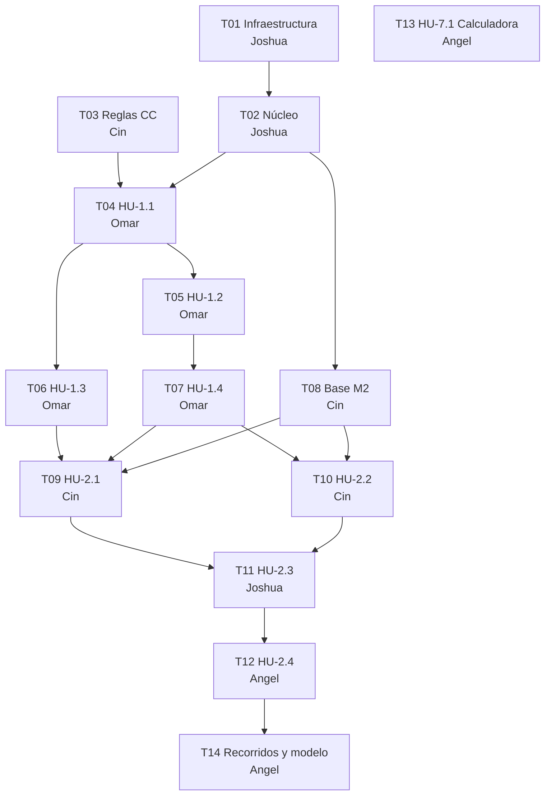

# Planeación del sprint 1

**Proyecto:** Sistema de programas de PROBOSQUE y Calculadora forestal · **Sprint 1:** Recepción, dictamen y Comité
(módulos M1 y M2) y masa forestal por año (M7.1) · **Equipo:** Joshua, Omar, Cin y Angel · **Rama:** `sprint-1`

Este documento reparte entre los cuatro integrantes del equipo el trabajo que compone el sprint 1, tal como quedó
construido en la rama `sprint-1`. Busca que cada quien tenga una carga proporcional y un bloque de trabajo con
sentido propio. El detalle de cada tarea, cómo se diseñó y cómo se ejecutó está en
[TAREAS_POR_PERSONA_SPRINT_1.md](TAREAS_POR_PERSONA_SPRINT_1.md).

[[SALTO]]

## 1. Objetivo del sprint

Que una solicitud de **Capturando Carbono 2026** recorra de forma digital y verificable el trámite desde la ventanilla
de la Delegación hasta el acta del Comité:

1. **Recepción:** registro, revisión de requisitos, polígono del predio y validación de la Dirección.
2. **Dictamen:** dictamen técnico y jurídico.
3. **Comité:** aprobación de listados y seguimiento de acuerdos.

Cada paso debe dejar acuse, fecha y hora, y bitácora. Además, la Calculadora forestal debe publicarse como sitio que
muestre la masa forestal de cada año por municipio y su evolución.

**Por qué este alcance.** Es la primera mitad del trámite y la base de todo lo demás:

- Sin expediente, estados, días hábiles, acuses y reglas como datos, los sprints 2 y 3 (contrato, pagos, ejecución y
  cierre) no tienen sobre qué construirse.
- Capturando Carbono era el programa con reglas más completas para extraer primero.

## 2. Alcance

| Historia | Título | Puntos | Criterios de aceptación |
| --- | --- | ---: | --- |
| HU-1.1 | Registro de la solicitud | 3 | Se genera un folio único para la solicitud; trazabilidad en la base de datos |
| HU-1.2 | Revisión del expediente | 3 | Cada requisito del programa, tipo de persona y modalidad revisado; expediente digital en la Dirección con fecha y hora del envío; trazabilidad |
| HU-1.3 | Ubicación del predio | 5 | Polígono asociado al expediente; si cambia de lugar, se conservan el anterior y el nuevo; trazabilidad |
| HU-1.4 | Validación del expediente | 3 | Expediente validado o con aviso de faltantes con fecha límite; cada faltante con la observación de la Dirección, incluida en el aviso; en refrendo vale la documentación legal de hasta 3 años; trazabilidad |
| HU-2.1 | Dictamen técnico | 5 | Dictamen factible o no factible con su motivo, expedido como documento PDF adjunto al expediente; listado preliminar técnico y jurídico; en PEG, dentro de 45 días hábiles; trazabilidad |
| HU-2.2 | Dictamen jurídico | 3 | Dictamen procedente o no procedente, expedido como documento PDF adjunto al expediente; sin propiedad o legal posesión acreditada no es procedente; con titular en el Listado de Incumplidas o predio con procedimiento o sanción no es procedente; trazabilidad |
| HU-2.3 | Sesión de aprobación | 3 | Convocatoria con orden del día, documentos, fecha y hora; acta con los listados aprobados y la autorización de publicación; candidatos y beneficiarios en dos vistas; trazabilidad |
| HU-2.4 | Reasignaciones e incidentes | 3 | Cada incidente con su acuerdo, causa, expedientes y área; en una reasignación o sustitución sale la persona beneficiaria y entra la siguiente de la lista de espera, en su orden, sin rebasar el recurso liberado; trazabilidad |
| HU-7.1 | Masa forestal por año | 8 | Superficie en hectáreas de cada año disponible, por municipio; evolución año con año |
| | **Total de historias** | **36** | 29 criterios (18 al inicio del sprint; ver la sección 11) |

**Historias de usuario** (formato «Como [rol], quiero [acción], para [beneficio]»):

| Historia | Redacción |
| --- | --- |
| HU-1.1 | Como personal de la Delegación, quiero registrar la solicitud con los datos generales de la persona solicitante, los datos del predio y los datos específicos del programa, para iniciar su trámite. |
| HU-1.2 | Como personal de la Delegación, quiero revisar los requisitos del expediente y enviarlo digitalizado a la Dirección, para que la solicitud no se detenga por falta de documentos. |
| HU-1.3 | Como personal de la Delegación, quiero registrar el polígono del predio levantado en campo por la Delegación o por el prestador de servicios forestales, para conocer su ubicación y su superficie real al dictaminar y verificar. |
| HU-1.4 | Como personal del área responsable del programa, quiero validar el expediente contra las reglas del programa y avisar cada faltante con su observación, para que la solicitud pase a dictamen o se corrija a tiempo. |
| HU-2.1 | Como personal del área responsable del programa, quiero elaborar el dictamen técnico de cada solicitud, expedido como documento, y el listado preliminar, para proponer al Comité qué solicitudes apoyar. |
| HU-2.2 | Como personal de la Unidad Jurídica, quiero dictaminar la documentación legal de cada solicitud, revisar que se acredite la propiedad o legal posesión del predio y cotejar a su titular con el Listado de Personas Beneficiarias Incumplidas y su predio con los predios con procedimiento o sanción, para que solo se aprueben solicitudes procedentes. |
| HU-2.3 | Como integrante del Comité, quiero aprobar en sesión los listados de la convocatoria, para que se puedan publicar. |
| HU-2.4 | Como integrante del Comité, quiero acordar en las sesiones de seguimiento la atención de cada incidente del ejercicio y la reasignación del recurso liberado a la lista de espera, para que el recurso llegue a otra solicitud factible y cada caso tenga un área que lo atienda. |
| HU-7.1 | Como integrante del equipo desarrollador, quiero calcular la superficie con masa forestal de cada año disponible, para que PROBOSQUE conozca la cifra del Estado y de cada municipio y cómo evoluciona. |

**Fuera del alcance:** publicación de resultados, contrato, pagos, ejecución y cierre (sprints 2 y 3), y las reglas
de los otros cinco programas.

### Diseño de la capa de persistencia

Desde este sprint se diseña y se programa la base de datos completa del sistema: las 78 tablas de los siete módulos, en ocho áreas, como modelos de Django con sus migraciones (paquete T02). Las apps de los módulos que llegan después traen por ahora solo sus tablas; sus pantallas y servicios se agregan en su sprint sin crear tablas. La tabla dice desde qué sprint usan cada tabla las historias: en el sprint 1, las 36 de la primera columna. El detalle (arquitectura, decisiones, diagrama entidad-relación de cada área, diccionario de datos de cada tabla e historial) está en `entregas/diseno/Diseno_capa_de_persistencia.pdf`.

| Área | Se usan desde el sprint 1 (36 tablas) | Desde el sprint 2 (23) | Desde el sprint 3 (19) |
| --- | --- | --- | --- |
| 1. Reglas por programa y catálogos (Núcleo: base de todas las historias) | Consecutivo, DiaInhabil, Ejercicio, Estado, Formato, Ministracion, Modalidad, MontoApoyo, Municipio, Plazo, Programa, Requisito, TipoPersona, Transicion, Unidad, Usuario | — | — |
| 2. Expediente y recepción (M1 · HU-1.1 a HU-1.4) | Acuse, Documento, Evento, Expediente, Persona, Predio, ObservacionValidacion, Poligono, RevisionRequisito, Validacion | Hito, Notificacion | — |
| 3. Dictamen y Comité (M2 · HU-2.1 a HU-2.4) | Acuerdo, DictamenJuridico, DictamenTecnico, DocumentoSesion, MovimientoListado, PersonaIncumplida, PredioSancionado, ResolucionSesion, RevisionPropiedad, SesionComite | — | — |
| 4. Publicación y contrato (M3 · HU-3.1 a HU-3.4) | — | Adendum, Contrato, ElementoFormalizacion, Especie, FirmaContrato, ModeloContrato, Publicacion, RenglonVale, ResultadoPublicado, SalidaPlanta, SinFirma, ValePlanta, VersionModelo, Vivero | — |
| 5. Pagos (M5 · HU-5.1 a HU-5.3) | — | Cheque, ComprobanteCuenta, OficioPago, Pago, RemisionFiduciaria, RevisionSolicitud, SolicitudPago | — |
| 6. Portal de personas beneficiarias (Apoyo a M4 y M6) | — | — | AccesoExpediente, CodigoConsulta, CuentaExterna |
| 7. Ejecución y verificación (M4 · HU-4.1 a HU-4.3) | — | — | Comprobacion, EnvioEvaluacion, EvaluacionPeriodo, Incidencia, RevisionReporte, Verificacion |
| 8. Seguimiento y cierre (M6 · HU-6.1 a HU-6.3) | — | — | AvisoOmision, CierreExpediente, CuentaReintegro, InformeAnual, PadronPublicacion, Propuesta, Prorroga, Requerimiento, Senalamiento, SolicitudPersona |

Decisiones de diseño (su porqué está en el documento):

- PostgreSQL 17 con PostGIS 3.5, a través del ORM de Django; una app por módulo y tablas `<app>_<modelo>`.
- Polígonos y municipios como geometrías en EPSG:4326; superficies calculadas en EPSG:32614 (UTM 14N).
- Reglas de operación como datos (programa, ejercicio, requisitos, plazos, montos, ministraciones), cargadas de
  `sistema/reglas/<CLAVE>.json`; el trámite como máquina de estados en tablas (`Estado`, `Transicion`).
- Trazabilidad con una tabla de historial por cada tabla del trámite (django-simple-history), además de la bitácora
  (`Evento`) y los acuses con folio y huella SHA-256; folios con tabla de consecutivos y bloqueo de fila.
- Archivos del expediente fuera de la base, en un volumen, entregados solo después de revisar el permiso.
- Nada se borra del trámite: llaves foráneas protegidas y registros anteriores marcados como «no vigentes».

## 3. Trabajo del sprint (paquetes)

Además de las nueve historias hay trabajo que no es de una sola historia: la base técnica, las reglas, las pruebas de
punta a punta y la documentación. Se estimó con la misma escala de la especificación (1, 2, 3, 5, 8 puntos).

| ID | Paquete de trabajo | Historia | Puntos | Responsable | Depende de |
| --- | --- | --- | ---: | --- | --- |
| T01 | Infraestructura: Docker Compose (PostGIS, Django con Gunicorn, Nginx, revisión de plazos, perfil de pruebas), arranque y variables | Base | 3 | Joshua | — |
| T02 | Núcleo común: base de datos completa (las 78 tablas de los siete módulos, con sus migraciones), unidades y usuarios, catálogos (125 municipios y Delegaciones), expediente y predio, estados y transiciones como datos, días hábiles, acuses PDF, bitácora, bandeja y permisos | Base | 5 | Joshua | T01 |
| T03 | Extracción de las reglas de Capturando Carbono de las Reglas de Operación a `reglas/CC.json` (requisitos, plazos, montos, criterios, Comité) con numeral y línea | Base | 3 | Cin | — |
| T04 | Registro de la solicitud y acuse | HU-1.1 | 3 | Omar | T02, T03 |
| T05 | Revisión de requisitos y envío a la Dirección | HU-1.2 | 3 | Omar | T04 |
| T06 | Ubicación del predio: carga GeoJSON, KML y Shapefile, dibujo en el mapa, historial | HU-1.3 | 5 | Omar | T04 |
| T07 | Validación de la Dirección y aviso de faltantes | HU-1.4 | 3 | Omar | T05 |
| T08 | Base del módulo de dictamen: app, ganchos con el núcleo (`extensiones.py`), estados del dictamen | Base M2 | 2 | Cin | T02 |
| T09 | Dictamen técnico con análisis cartográfico y listado preliminar | HU-2.1 | 5 | Cin | T06, T07, T08 |
| T10 | Dictamen jurídico y Listado de Personas Beneficiarias Incumplidas | HU-2.2 | 3 | Cin | T07, T08 |
| T11 | Sesión de aprobación: convocatoria, propuesta de listados, ajustes y acta | HU-2.3 | 3 | Joshua | T09, T10 |
| T12 | Sesiones de seguimiento y acuerdos por área (desde el 23-nov, «Reasignaciones e incidentes») | HU-2.4 | 3 | Angel | T11 |
| T13 | Masa forestal por año: la Calculadora como sitio estático con carga diferida | HU-7.1 | 8 | Angel | — |
| T14 | Recorrido completo por servicios y por la interfaz, modelo de datos (diagrama entidad-relación) y capturas | Integración | 3 | Angel | T04–T12 |
| T15 | Coordinación: plan, revisión e integración de cada entrega, tablero de avance, bitácora de decisiones, resumen del sprint | Gestión | 2 | Joshua | todas |
| | **Total** | | **54** | | |

## 4. Reparto por persona

| Persona | Rol en el sprint | Paquetes | Puntos | % |
| --- | --- | --- | ---: | ---: |
| **Joshua** | Coordinación y núcleo técnico | T01, T02, T11, T15 | 13 | 24 % |
| **Omar** | Recepción (M1) | T04, T05, T06, T07 | 14 | 26 % |
| **Cin** | Reglas y dictamen (M2) | T03, T08, T09, T10 | 13 | 24 % |
| **Angel** | Calculadora, seguimiento e integración | T12, T13, T14 | 14 | 26 % |
| | | | **54** | **100 %** |

**Criterio del reparto.**

- **Puntos parejos.** Cada persona tiene entre 13 y 14 puntos; la diferencia máxima es de un punto.
- **Un bloque coherente por persona,** para que cada quien sea dueño de un área y no se pisen los archivos:
  - Omar tiene toda la recepción.
  - Cin, todo lo que sale de las Reglas de Operación y los dictámenes.
  - Angel, la Calculadora, que es independiente, más el seguimiento y la prueba de todo junto.
  - Joshua, la base que usan todos y la sesión de aprobación, que integra el trabajo de Omar y de Cin.
- **El trabajo de integración va a quien no construyó la pieza:** Angel arma los recorridos completos sobre lo que
  hicieron los demás, lo que obliga a que cada historia funcione con las otras y no solo con sus propias pruebas.

## 5. Orden de trabajo y dependencias

**Ruta crítica:** T01 → T02 → T04 → T05 → T07 → T09 → T11 → T12 → T14. Las tareas que no están en ella se hacen en
paralelo:

- La Calculadora (T13) y las reglas (T03) no dependen de nadie y arrancan el primer día.
- La base de dictamen (T08) sale en cuanto existe el núcleo.
- El polígono (T06) corre junto a la revisión de requisitos (T05).

## 6. Calendario de referencia (5 días de trabajo)

| Día | Joshua | Omar | Cin | Angel |
| --- | --- | --- | --- | --- |
| 1 | T01 Infraestructura; T02 modelos y estados | Diseño de pantallas de recepción con las reglas de CC | T03 Reglas de CC | T13 Sitio de la Calculadora: datos por año |
| 2 | T02 días hábiles, acuses, bitácora, bandeja | T04 Registro y acuse | T03 cierre; T08 Base M2 | T13 Carga diferida, evolución y pruebas |
| 3 | T15 Revisión de T04–T06; demostración | T05 Requisitos; T06 Polígonos | T09 Dictamen técnico | T13 cierre; preparación de T14 |
| 4 | T11 Sesión de aprobación | T07 Validación y faltantes | T10 Dictamen jurídico | T12 Sesiones de seguimiento |
| 5 | T15 Integración, resumen y revisión con el cliente | Correcciones de la revisión | Correcciones de la revisión | T14 Recorridos completos, modelo de datos y capturas |

Cada día termina con las pruebas de lo construido en verde y su commit. La batería completa la corre la coordinación
al cerrar cada historia.

## 7. Forma de trabajo

- **Rama y commits:** todo en la rama `prototipos` (ahora `sprint-1` conserva este punto); un commit por historia
  verificada con su identificador (`HU-1.1: …`) y uno por cada base. Sin subir hasta la revisión.
- **Definición de terminado:** una historia está terminada cuando:
  - cada criterio de aceptación tiene al menos una prueba con el identificador en el nombre (`test_hu_1_1_…`);
  - tiene su recorrido de navegador con capturas;
  - las pruebas rápidas de todo el sistema siguen en verde;
  - el README documenta sus decisiones;
  - y la coordinación la revisó.
- **Reglas como datos:** ningún requisito, plazo ni monto se escribe en el código. Salen de `reglas/CC.json`, con
  numeral y línea de las Reglas de Operación.
- **Si las Reglas contradicen la especificación, mandan las Reglas:** la diferencia se anota en el README y en la
  bitácora.
- **Decisiones escritas:** toda propuesta, con su porqué y su estado, va a `entregas/BITACORA.md`; el avance por tarea,
  a `entregas/AVANCE.md`.

## 8. Riesgos y cómo se atienden

| Riesgo | Efecto | Cómo se atiende |
| --- | --- | --- |
| Las Reglas de Operación no traen un dato (plazo, puntaje, formato) | Una historia no se puede cerrar como pide la especificación | Se usa la mejor lectura del texto, marcada como decisión propia y anotada como duda para el cliente (sección 9) |
| Docker no corre en Windows directamente | El equipo no puede levantar el sistema | Docker Engine dentro de WSL, con la guía de inicio |
| Polígonos en formatos y proyecciones distintos | Superficies mal calculadas | Todo se lleva a UTM 14N (EPSG:32614) para medir y se aceptan GeoJSON, KML y Shapefile con o sin `.prj` |
| La Calculadora pesa 2.7 MB en un solo archivo | Carga lenta en teléfonos | Sitio por partes que solo pide lo que se consulta (~0.45 MB al abrir) |
| Varias personas tocando los mismos archivos | Conflictos al integrar | Un módulo de código por historia y ganchos en el núcleo (`extensiones.py`) en lugar de editar el núcleo |

## 9. Dudas abiertas con el cliente al cerrar el sprint

- Asignación de municipios a Delegaciones y calendario oficial de días inhábiles 2026.
- Desde cuándo corre el aviso de faltantes de la Dirección y si topa con la fecha límite de recepción.
- Lista de requisitos que no son documentos.
- Puntaje de priorización de Capturando Carbono (las Reglas no lo traen).
- Recurso disponible por sesión y monto cuando la superficie factible difiere de la solicitada.
- Reglas de los otros cinco programas (se cargaron en los sprints 2 y 3).

## 10. Resultado al cierre

- **Historias:** las 9 construidas, 36 puntos.
- **Pruebas del sistema:** 128 en verde al cierre (119 sin navegador y 9 recorridos con el navegador); 129 desde que la HU-1.1 tiene el criterio de folio único.
- **Pruebas de la Calculadora:** 15 en verde.
- **Capturas:** 60, en `entregas/sprint_1/capturas/`.
- **Resumen:** `entregas/sprint_1/Resumen_sprint_1.pdf`.
- **Revisión:** la de Joshua dio lugar a un commit de ajustes (`045feb7`) y al recorrido completo por la interfaz
  (`450a5ac`).

## 11. Ajustes por las observaciones del profesor (23-nov-2026)

En la revisión del 23-nov el profesor hizo seis observaciones al sprint 1. Se atendieron en la misma rama (`sprint-1`),
sin cambiar los puntos de las historias; el detalle, con las historias antes y ahora y las pantallas, está en
`Registro_de_cambios_observaciones_23_nov.pdf` (raíz del repositorio) y en el renglón D-29 de `entregas/BITACORA.md`.

| Observación | Historia | Qué se hizo |
| --- | --- | --- |
| Que cada observación de la validación se haga correctamente | HU-1.4 | Cada requisito faltante lleva la observación de la Dirección (obligatoria), guardada en su propio registro; el aviso de faltantes, la notificación y la pestaña Requisitos la muestran. |
| Falta el documento que expide el dictamen técnico y el jurídico, no en tarjetas | HU-2.1 y HU-2.2 | Al registrar cada dictamen se expide su documento en PDF (folio DT-… o DJ-…, con firmas y huella SHA-256) y queda adjunto al expediente. |
| El criterio de HU-2.4 está mal; título de reasignaciones o manejo de incidentes | HU-2.4 | Título «Reasignaciones e incidentes» y criterios nuevos: cada incidente con su acuerdo y causa; la reasignación sigue el orden de la lista de espera sin rebasar el recurso liberado. El sistema da de baja, libera el recurso y pasa a la siguiente a «aprobada». |
| Recordar la parte jurídica sobre la propiedad | HU-2.2 | El dictamen jurídico revisa la acreditación de la propiedad o legal posesión del predio (documento de las ROP, titular, superficie, vigencia, conflictos); si no se acredita, no puede ser procedente. |
| Lista de candidatos en una vista distinta de la de beneficiarios | HU-2.3 | Menú «Listados» con dos vistas: Candidatos y Beneficiarios, exportables a CSV. |
| Para la aceptación, los registros para la trazabilidad en la base de datos | Todas (M1 a M6) | Criterio de trazabilidad en las 21 historias del Sistema de programas; el historial registra siempre al usuario; pestaña «Trazabilidad» en el expediente. |

| ID | Paquete de ajuste | Historia | Responsable sugerido |
| --- | --- | --- | --- |
| T16 | Observación por requisito en la validación y en el aviso de faltantes | HU-1.4 | Omar |
| T17 | Documento PDF del dictamen técnico y jurídico, adjunto al expediente | HU-2.1, HU-2.2 | Cin |
| T18 | Revisión de la propiedad o legal posesión en el dictamen jurídico | HU-2.2 | Cin |
| T19 | Reasignaciones e incidentes: baja, reasignación en orden y sustitución | HU-2.4 | Angel |
| T20 | Vistas de Candidatos y Beneficiarios | HU-2.3 | Joshua |
| T21 | Trazabilidad: usuario en el historial y pestaña «Trazabilidad»; criterio en las historias | Todas | Joshua |

