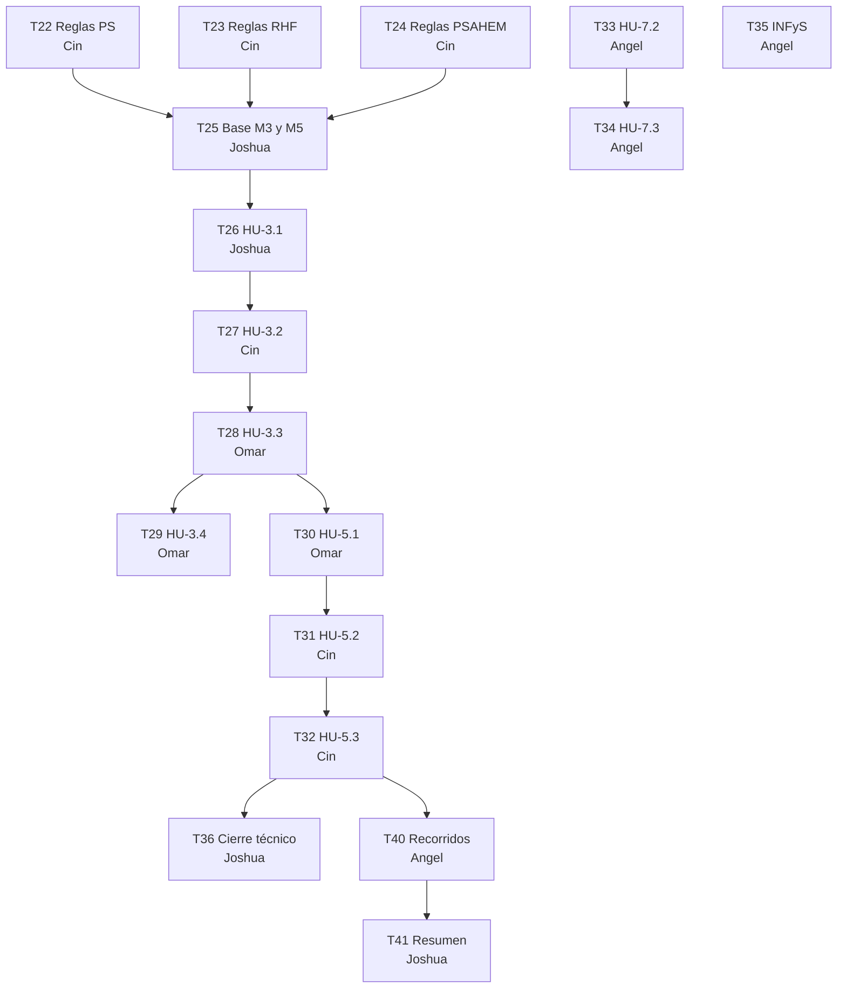

# Planeación del sprint 2

**Proyecto:** Sistema de programas de PROBOSQUE y Calculadora forestal · **Sprint 2:** Publicación y contrato (módulo M3),
pagos (módulo M5), balance entre dos años (M7.2) y pérdida por incendios (M7.3) · **Equipo:** Joshua, Omar, Cin y Angel ·
**Rama:** `sprint-2`

Este documento reparte entre los cuatro integrantes del equipo el trabajo que compone el sprint 2, tal como quedó
construido en la rama `sprint-2`. Busca que cada quien tenga una carga proporcional y un bloque de trabajo con sentido
propio, y que haya continuidad con el reparto del sprint 1 ([PLANEACION_SPRINT_1.md](../sprint_1/planeacion/PLANEACION_SPRINT_1.md)).
El detalle de cada tarea, cómo se diseñó y cómo se ejecutó está en
[TAREAS_POR_PERSONA_SPRINT_2.md](TAREAS_POR_PERSONA_SPRINT_2.md).

[[SALTO]]

## 1. Objetivo del sprint

Que una solicitud aprobada por el Comité recorra de forma digital y verificable el trámite desde la **publicación de
resultados** hasta el **pago de la primera ministración** (en PSAHEM, hasta el cheque entregado a la persona), en cuatro
programas (Capturando Carbono, Plantaciones Sustentables, Restauración Hidrológico-Forestal y PSAHEM):

1. **Publicación:** publicar los listados autorizados y avisar a cada persona su resultado por conducto de la Delegación.
2. **Contrato:** elaborarlo sobre un modelo validado por la Unidad Jurídica, enviarlo, recabar su firma y, en PS y RHF,
   entregar el Vale de Planta y registrar la salida del vivero.
3. **Pagos:** solicitar la ministración con todos sus soportes, revisarla y pagarla o, en PSAHEM, remitirla a la
   Fiduciaria, que emite el cheque y lo envía a la Delegación.

Cada paso debe dejar acuse, fecha y hora, y bitácora. Además, la Calculadora forestal debe dar el **balance entre dos
años** elegidos, con su histograma, y ubicar y cuantificar la **pérdida por incendios** que publica CONAFOR.

**Por qué este alcance.** Es la segunda parte del trámite y la que mueve el dinero:

- Sin los listados aprobados del sprint 1 no hay a quién publicar, firmar ni pagar; con ellos, el sprint 2 cierra el
  camino «solicitud → apoyo entregado».
- Las Reglas de PS, RHF y PSAHEM hacían falta para probar el sistema con más de un programa y comprobar que las reglas
  como datos de verdad cambian el trámite (vale de planta, pago por cheque, soportes de pago).
- La Calculadora sigue su propia ruta (M7), independiente del sistema, y aprovecha el sprint para completar los dos
  cálculos que faltaban antes de ejecución y cierre.

## 2. Alcance

| Historia | Título | Puntos | Criterios de aceptación (resumen) |
| --- | --- | ---: | --- |
| HU-3.1 | Publicación y notificaciones | 3 | Los listados autorizados están publicados; cada aviso tiene acuse, fecha y hora de envío y de notificación; trazabilidad |
| HU-3.2 | Elaboración del contrato | 3 | Un contrato por solicitud aprobada, sobre un modelo validado; fecha y hora del envío a la Delegación; trazabilidad |
| HU-3.3 | Firma del contrato | 5 | Contrato firmado con fecha y hora, dentro del plazo; formalización propia de MFS y PEG; el no firmado en plazo queda señalado; trazabilidad |
| HU-3.4 | Entrega de planta | 5 | Vale de Planta vigente por especie y cantidad; salida con especie, cantidad y fecha; un vale vencido no es válido y puede reponerse; trazabilidad |
| HU-5.1 | Solicitud de pago | 3 | La solicitud tiene todos sus soportes; fecha y hora del envío a Administración y Finanzas; trazabilidad |
| HU-5.2 | Pago de la ministración | 5 | Cada pago asociado a su solicitud con la fecha; en PSAHEM, fecha de remisión a la Fiduciaria; trazabilidad |
| HU-5.3 | Entrega de cheques | 3 | Cada cheque asociado a su persona y ministración con fecha y hora del envío; fecha de entrega; trazabilidad |
| HU-7.2 | Balance entre dos años | 5 | Pérdida, ganancia y cambio neto en hectáreas, para el Estado y cada municipio; histograma del periodo elegido |
| HU-7.3 | Pérdida por incendios | 5 | Cada incendio con su ubicación y fecha; pérdida por incendio por año y municipio; un año que CONAFOR no publicó queda señalado |
| | **Total de historias** | **37** | 28 criterios |

**Historias de usuario** (formato «Como [rol], quiero [acción], para [beneficio]»; redacción vigente de
`sistema/especificacion/modelo.json`):

| Historia | Redacción |
| --- | --- |
| HU-3.1 | Como personal del área responsable del programa, quiero publicar los listados aprobados y avisar a cada persona su resultado por conducto de la Delegación, para que los plazos corran desde una notificación comprobable. |
| HU-3.2 | Como personal del área responsable del programa, quiero elaborar el contrato de cada solicitud aprobada sobre el modelo validado y enviarlo a la Delegación, para que se firme. |
| HU-3.3 | Como personal de la Delegación, quiero recabar la firma del contrato dentro del plazo y verificar las firmas y el sello, para formalizar el apoyo. |
| HU-3.4 | Como personal del vivero, quiero validar el Vale de Planta y registrar la salida de planta por especie y cantidad, para entregar solo la planta autorizada. |
| HU-5.1 | Como personal del área responsable del programa, quiero solicitar el pago de cada ministración con todos sus soportes, para que se pague sin pedir nada más. |
| HU-5.2 | Como personal de Administración y Finanzas, quiero revisar la solicitud de pago y pagar la ministración o remitirla a la Fiduciaria, para que la persona beneficiaria reciba su apoyo. |
| HU-5.3 | Como personal de la Fiduciaria, quiero emitir los cheques de PSAHEM y enviarlos a las Delegaciones, para que se entreguen a cada persona beneficiaria. |
| HU-7.2 | Como integrante del equipo desarrollador, quiero calcular el balance de masa forestal entre el año inicial y el año final que se elijan, para presentar en un histograma cuánto se perdió y cuánto se ganó. |
| HU-7.3 | Como integrante del equipo desarrollador, quiero integrar los incendios que publica CONAFOR y la masa forestal que se perdió por ellos, para ubicar las zonas más dañadas. |

**Fuera del alcance:** ejecución, verificación en campo, seguimiento y cierre (sprint 3: la segunda ministración depende de
la verificación), Manejo Forestal Sustentable y Guardabosques (sin reglas cargadas; solo se prepararon sus datos de
formalización y de pago), el uso del suelo y las especies de la Calculadora (HU-7.4 y HU-7.5, sprint 3) y la ampliación de
plazo por causa externa en MFS.

### Diseño de la capa de persistencia

La base de datos completa (78 tablas en ocho áreas) está programada desde el sprint 1; en este sprint no se crean tablas. Las historias empiezan a usar las 23 de la columna «Desde el sprint 2» (publicación y contrato, pagos, notificaciones e hitos de plazo). El detalle (arquitectura, decisiones, diagrama entidad-relación de cada área, diccionario de datos de cada tabla e historial) está en `entregas/diseno/Diseno_capa_de_persistencia.pdf`.

| Área | Se usan desde el sprint 1 (36 tablas) | Desde el sprint 2 (23) | Desde el sprint 3 (19) |
| --- | --- | --- | --- |
| 1. Reglas por programa y catálogos (Núcleo: base de todas las historias) | Consecutivo, DiaInhabil, Ejercicio, Estado, Formato, Ministracion, Modalidad, MontoApoyo, Municipio, Plazo, Programa, Requisito, TipoPersona, Transicion, Unidad, Usuario | — | — |
| 2. Expediente y recepción (M1 · HU-1.1 a HU-1.4) | Acuse, Documento, Evento, Expediente, Persona, Predio, ObservacionValidacion, Poligono, RevisionRequisito, Validacion | Hito, Notificacion | — |
| 3. Dictamen y Comité (M2 · HU-2.1 a HU-2.4) | Acuerdo, DictamenJuridico, DictamenTecnico, DocumentoSesion, MovimientoListado, PersonaIncumplida, PredioSancionado, ResolucionSesion, RevisionPropiedad, SesionComite | — | — |
| 4. Publicación y contrato (M3 · HU-3.1 a HU-3.4) | — | Adendum, Contrato, ElementoFormalizacion, Especie, FirmaContrato, ModeloContrato, Publicacion, RenglonVale, ResultadoPublicado, SalidaPlanta, SinFirma, ValePlanta, VersionModelo, Vivero | — |
| 5. Pagos (M5 · HU-5.1 a HU-5.3) | — | Cheque, ComprobanteCuenta, OficioPago, Pago, RemisionFiduciaria, RevisionSolicitud, SolicitudPago | — |
| 6. Portal de personas beneficiarias (Apoyo a M4 y M6) | — | — | AccesoExpediente, CodigoConsulta, CuentaExterna |
| 7. Ejecución y verificación (M4 · HU-4.1 a HU-4.3) | — | — | Comprobacion, EnvioEvaluacion, EvaluacionPeriodo, Incidencia, RevisionReporte, Verificacion |
| 8. Seguimiento y cierre (M6 · HU-6.1 a HU-6.3) | — | — | AvisoOmision, CierreExpediente, CuentaReintegro, InformeAnual, PadronPublicacion, Propuesta, Prorroga, Requerimiento, Senalamiento, SolicitudPersona |

Decisiones de diseño (su porqué está en el documento):

- PostgreSQL 17 con PostGIS 3.5, a través del ORM de Django; una app por módulo y tablas `<app>_<modelo>`.
- Polígonos y municipios como geometrías en EPSG:4326; superficies calculadas en EPSG:32614 (UTM 14N).
- Reglas de operación como datos (programa, ejercicio, requisitos, plazos, montos, ministraciones), cargadas de
  `sistema/reglas/<CLAVE>.json`; el trámite como máquina de estados en tablas (`Estado`, `Transicion`).
- Trazabilidad con una tabla de historial por cada tabla del trámite (django-simple-history), además de la bitácora
  (`Evento`) y los acuses con folio y huella SHA-256; folios con tabla de consecutivos y bloqueo de fila.
- Archivos del expediente fuera de la base, en un volumen, entregados solo después de revisar el permiso.
- Nada se borra del trámite: llaves foráneas protegidas y registros anteriores marcados como «no vigentes».

## 3. Trabajo del sprint (paquetes)

Además de las nueve historias hay trabajo que no es de una sola historia: las reglas de los tres programas nuevos, la base
técnica de M3 y M5, las pruebas, los datos de demostración y la documentación. Se estimó con la misma escala de la
especificación (1, 2, 3, 5, 8 puntos). Los identificadores continúan los del sprint 1 (T01 a T21).

| ID | Paquete de trabajo | Historia | Puntos | Responsable | Depende de |
| --- | --- | --- | ---: | --- | --- |
| T22 | Reglas de Plantaciones Sustentables extraídas de las ROP (`reglas/PS.json`) | Base | 3 | Cin | — |
| T23 | Reglas de Restauración Hidrológico-Forestal (`reglas/RHF.json`) | Base | 3 | Cin | — |
| T24 | Reglas de PSAHEM (`reglas/PSA.json`) | Base | 3 | Cin | — |
| T25 | Base de M3 y M5: notificaciones en el núcleo, plazos con evento de arranque, estados y bandejas, monto aprobado, M1 y M2 con PS, RHF y PSAHEM, apps `contrato` y `pagos` y su demostración | Base | 8 | Joshua | T22–T24 |
| T26 | Publicación de resultados, avisos por conducto de la Delegación y página pública | HU-3.1 | 3 | Joshua | T25 |
| T27 | Modelos de contrato (validación de la Unidad Jurídica), elaboración y envío del contrato | HU-3.2 | 3 | Cin | T25, T26 |
| T28 | Firma del contrato, verificación de firmas y sello, y contratos sin firma en plazo | HU-3.3 | 5 | Omar | T27 |
| T29 | Vale de Planta, salida del vivero, vigencia y reposición | HU-3.4 | 5 | Omar | T28 |
| T30 | Oficio de la Delegación, comprobante de cuenta y solicitud de pago con sus soportes | HU-5.1 | 3 | Omar | T28 |
| T31 | Revisión de la solicitud, pago de la ministración y remisión a la Fiduciaria | HU-5.2 | 5 | Cin | T30 |
| T32 | Emisión, envío y entrega de cheques de PSAHEM | HU-5.3 | 3 | Cin | T31 |
| T33 | Balance entre dos años con su histograma | HU-7.2 | 5 | Angel | — |
| T34 | Ubicación y fecha de cada incendio y pérdida por incendio por año y municipio | HU-7.3 | 5 | Angel | T33 |
| T35 | Investigación de los datos de especie del INFyS (insumo de HU-7.5) | Investigación | 2 | Angel | — |
| T36 | Cierre técnico: batería de pruebas más corta (PDF ligero, P-22), menú agrupado por módulo, modelo de datos y README al día | Base | 3 | Joshua | T26–T32 |
| T37 | Datos de prueba: reloj simulado, demostración con el calendario de la convocatoria, pruebas en los bordes de cada plazo y generador con volumen | Datos | 3 | Omar | T32 |
| T38 | Pruebas en paralelo con pytest-xdist | Base | 2 | Omar | T36 |
| T39 | Tropiezos de interfaz del recorrido del sprint 2 (P-23 a P-31) | Integración | 2 | Omar | T40 |
| T40 | Recorrido completo por servicios y por la interfaz (cuatro programas) y capturas | Integración | 3 | Angel | T26–T32 |
| T41 | Resumen del sprint 2 en PDF, con diagramas y capturas | Gestión | 2 | Joshua | T40 |
| T42 | Coordinación: revisión de cada entrega, tablero de avance, bitácora y revisión con el cliente | Gestión | 2 | Joshua | todas |
| T43 | Integración de las observaciones del profesor a M3 y M5 (23-nov), en dos partes: **T43a** bajas y reasignaciones con publicación, contrato y pagos (HU-2.4) · **T43b** trazabilidad de M3 y M5 y documentación | Ajuste | 5 | Angel (3) y Joshua (2) | T26–T32 |
| | **Total** | | **78** | | |

Las 37 de las nueve historias salen de la sección 2; los otros 41 puntos son la base, las reglas, las pruebas, los datos,
la integración y la gestión.

## 4. Reparto por persona

| Persona | Rol en el sprint | Paquetes | Puntos | % |
| --- | --- | --- | ---: | ---: |
| **Joshua** | Coordinación, núcleo y publicación | T25, T26, T36, T41, T42, T43b | 20 | 26 % |
| **Omar** | Firma, planta y solicitud de pago; datos y pruebas | T28, T29, T30, T37, T38, T39 | 18 | 23 % |
| **Cin** | Reglas, contrato y pagos de Administración y Finanzas y Fiduciaria | T22, T23, T24, T27, T31, T32 | 20 | 26 % |
| **Angel** | Calculadora, integración y bajas | T33, T34, T35, T40, T43a | 20 | 26 % |
| | | | **78** | **100 %** |

**Criterio del reparto.**

- **Puntos parejos.** Cada persona tiene entre 18 y 20 puntos; la diferencia máxima es de dos puntos.
- **Continuidad con el sprint 1.** Cada quien sigue en el área donde ya era dueño de archivos, para que no se pisen:
  - Joshua conserva el núcleo (T25 es una extensión de T02) y las listas del Comité, de donde sale la publicación (T26).
  - Omar conserva la ventanilla de la Delegación: la firma, la entrega del vale y el oficio de pago son pasos que da la
    Delegación, igual que la recepción del sprint 1.
  - Cin conserva las Reglas de Operación y el trabajo con las unidades que dictaminan: extrae las reglas de los tres
    programas nuevos, elabora el contrato con la Unidad Jurídica y cierra con Administración y Finanzas y la Fiduciaria.
  - Angel conserva la Calculadora (HU-7.1 pasa a HU-7.2 y HU-7.3), los acuerdos del Comité (HU-2.4, ahora con contrato y
    pagos) y las pruebas de todo junto.
- **El trabajo de integración va a quien no construyó la pieza:** Angel arma los recorridos completos sobre lo que
  hicieron los demás y Omar corrige los tropiezos de interfaz que salieron de ellos.
- **Cada módulo tiene un par de manos conocido:** en M3, Joshua publica, Cin elabora y Omar formaliza; en M5, Omar solicita
  y Cin paga y emite los cheques.

## 5. Orden de trabajo y dependencias

**Ruta crítica:** T22 → T25 → T26 → T27 → T28 → T30 → T31 → T32 → T40 → T41. Las tareas que no están en ella se hacen en
paralelo:

- Las reglas de los tres programas (T22 a T24) no dependen de nadie y arrancan el primer día, cada una en su propia unidad
  de proceso.
- La Calculadora (T33 y T34) y la investigación del INFyS (T35) no dependen del sistema.
- La entrega de planta (T29) corre junto a la solicitud de pago (T30), porque las dos cuelgan de la firma.

## 6. Calendario de referencia (3 días de trabajo)

| Día | Joshua | Omar | Cin | Angel |
| --- | --- | --- | --- | --- |
| 1 (14-nov) | Plan del sprint y revisión de reglas | Diseño de pantallas de firma y vale con las reglas | T22, T23 y T24 Reglas de PS, RHF y PSAHEM | T33 Balance entre dos años con su histograma |
| 2 (15-nov) | T25 Base de M3 y M5; T26 HU-3.1 | T28 HU-3.3; T29 HU-3.4; T30 HU-5.1 | T27 HU-3.2; T31 HU-5.2; T32 HU-5.3 | T34 HU-7.3; T35 INFyS |
| 3 (16-nov) | T36 Cierre técnico; T41 Resumen; T42 Revisión | T37 Datos de prueba; T38 Pruebas en paralelo; T39 Tropiezos | Correcciones de la revisión | T40 Recorridos completos y capturas |

Cada día termina con las pruebas de lo construido en verde y su commit. La batería completa la corre la coordinación al
cerrar cada historia. Las observaciones del profesor (T43) se atendieron el 24 y 25 de noviembre, ya con el sprint
cerrado.

## 7. Forma de trabajo

- **Rama y commits:** un commit por historia verificada con su identificador (`HU-3.1: …`), uno por cada parte de la base
  (`Base de contrato y pagos (S2-02a)…`) y uno por cada ajuste. Sin subir hasta la revisión.
- **Definición de terminado:** una historia está terminada cuando:
  - cada criterio de aceptación tiene al menos una prueba con el identificador en el nombre (`test_hu_3_1_…`);
  - tiene su recorrido de navegador con capturas;
  - las pruebas rápidas de todo el sistema siguen en verde;
  - el README documenta sus decisiones;
  - y la coordinación la revisó.
- **Reglas como datos:** ningún requisito, plazo ni monto se escribe en el código. Salen de `reglas/<CLAVE>.json` y de
  `datos/contrato.json`, `datos/pagos.json` y `datos/sistema.json`, con numeral y línea de las Reglas de Operación.
- **Un módulo de código por historia:** `contrato/publicacion.py`, `contratos.py`, `firma.py` y `planta.py`;
  `pagos/solicitudes.py`, `pagos.py` y `cheques.py`, con sus vistas, formularios y plantillas por historia. Cada app se
  conecta al núcleo con `registro.py` y `nucleo/extensiones.py`, igual que `dictamen`.
- **Si las Reglas contradicen la especificación, mandan las Reglas:** la diferencia se anota en el README y en la
  bitácora.
- **Decisiones escritas:** toda propuesta, con su porqué y su estado, va a `entregas/BITACORA.md`; el avance por tarea, a
  `entregas/AVANCE.md`.

## 8. Riesgos y cómo se atienden

| Riesgo | Efecto | Cómo se atiende |
| --- | --- | --- |
| Las Reglas de Operación no traen el texto del contrato ni el formato del oficio de pago (R-07) | No hay modelo que validar ni formato que imprimir | Se escriben plantillas base propias marcadas «BORRADOR – modelo por validar»; el contrato solo se elabora sobre un modelo validado por la Unidad Jurídica |
| Las Reglas no dicen cuándo corre cada plazo (firma desde la publicación o desde la notificación) o no traen plazo (publicar, pagar, reintegrar) | Una historia no se puede cerrar como pide la especificación | Cada plazo es un dato con su evento de arranque; se registran las dos fechas (programada y de liberación) y la duda queda anotada para el cliente |
| PSAHEM paga por cheque de la Fiduciaria y las Reglas atribuyen la solicitud a dos áreas | El flujo de pago de PSAHEM sería ambiguo | Remite la Secretaría Técnica después de que Administración y Finanzas acepta (R-16), con el plazo de 5 días hábiles de la regla; queda como duda |
| Con cuatro programas, la barra del menú ya no cabe | La interfaz se vuelve inmanejable | Menú agrupado por módulo en listas desplegables (P-21) |
| La batería completa pasó de 6 a casi 14 minutos (366 pruebas) por los PDF | Se deja de correr completa | PDF ligero por omisión y real solo donde se comprueba (P-22) y pruebas en paralelo con pytest-xdist (W-17) |
| Varias personas tocando los mismos archivos | Conflictos al integrar | Un módulo por historia y registro en los puntos de extensión del núcleo |

## 9. Dudas abiertas con el cliente al cerrar el sprint

- Desde cuándo corren los 10 días hábiles de la firma del contrato: desde la publicación (Convocatoria, y PS) o desde la
  notificación (ROP 8.1.9 b, fr. IV, y CC).
- Los «15 días hábiles de verificación» de CC son para entregar el Informe Final, no para la visita en campo.
- No hay plazo en días para publicar, pagar ni reintegrar.
- Capturando Carbono no trae tabla de puntos de priorización.
- Faltan los formatos FO-PB-509-A y FO-PB-520-B, el texto del modelo de contrato (Contrato de Adhesión, Convenio de
  Concertación y Adendum) y el oficio de solicitud de pago.
- Si el Vale de Planta de PS se puede reponer: las Reglas fijan los 30 días de vigencia y no dicen más (R-13).
- Si en PSAHEM quien firma el oficio a la Fiduciaria es la Secretaría Técnica o Administración y Finanzas (R-16).

## 10. Resultado al cierre

- **Historias:** las 9 construidas, 37 puntos; con la base, las reglas y los demás paquetes, 78 puntos.
- **Pruebas del sistema:** 432 en verde al cierre del 16 de noviembre; **473** hoy, con las observaciones del profesor
  integradas (442 sin navegador y 31 recorridos con el navegador), todas con la batería completa.
- **Pruebas de la Calculadora:** 43 en verde (15 de HU-7.1, 13 de HU-7.2 y 15 de HU-7.3).
- **Capturas:** 120, en `entregas/sprint_2/capturas/`.
- **Datos de prueba:** `datos_prueba/sprint_2/`, con la secuencia de prueba paso a paso.
- **Resumen:** `entregas/sprint_2/Resumen_sprint_2.pdf`.
- **Revisión:** el recorrido completo por la interfaz sacó nueve tropiezos (P-23 a P-31), todos corregidos en `0871a66`.

## 11. Ajustes por las observaciones del profesor (23-nov-2026)

Las observaciones del 23 de noviembre al sprint 1 se atendieron en `sprint-1` (D-29) y se integraron aquí el 24 de
noviembre (merge `6c5815f`, D-30). Para M3 y M5 hubo que extenderlas, porque la baja, la trazabilidad y las listas ya no
terminan en el acta del Comité. El detalle está en `Registro_de_cambios_observaciones_23_nov.pdf` y en el renglón D-30 de
`entregas/BITACORA.md`.

| Observación | Qué se hizo en M3 y M5 | Paquete | Commit |
| --- | --- | --- | --- |
| Reasignaciones e incidentes (HU-2.4) | La baja procede en cualquier etapa anterior a la primera ministración solicitada; dada de baja la persona ya no firma, no recibe contrato ni vale, no cobra; el recurso liberado por no firmar en plazo se reasigna igual que el de una baja; la reasignación se publica con el acta de seguimiento | T43a · Angel | `53e78c0` |
| Trazabilidad en la base de datos (todas las historias) | Historial de cada modelo de `contrato` y `pagos`, con el usuario siempre registrado (`save()` en lugar de `update()`), y sus registros en la pestaña «Trazabilidad» del expediente; criterio en las siete historias de M3 y M5 | T43b · Joshua | `286cd22` |
| Candidatos y beneficiarios en vistas distintas | La vista de Beneficiarios sigue a la persona en la publicación, el contrato y el pago, y muestra las bajas | T43a · Angel | `53e78c0` |
| Documento de los dictámenes y propiedad del predio | Sin cambios en M3 y M5; el contrato se elabora de una solicitud ya dictaminada y aprobada | — | — |
| Documentación | README, modelo de datos y bitácora (D-30) | T43b · Joshua | `77b2180`, `d74da3c` |
