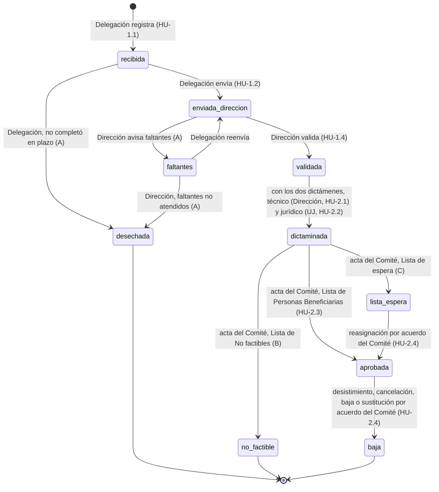

# Sistema de programas de PROBOSQUE

Prototipo completo (módulos M1, Recepción y expediente; M2, Dictamen y Comité; M3, Publicación y contrato; M4, Ejecución y verificación;
M5, Pagos, y M6, Seguimiento y cierre: las 26 historias) del sistema que lleva el trámite de los
seis programas de apoyo de PROBOSQUE: Capturando Carbono (CC), Manejo Forestal Sustentable (MFS),
Plantaciones Sustentables (PS), Restauración Hidrológico-Forestal (RHF), PSAHEM (PSA) y
Guardabosques (PEG). Los seis programas tienen reglas cargadas (`reglas/<CLAVE>.json`; MFS y PEG desde la base de
ejecución y seguimiento).

Historias implementadas: HU-1.1 Registro de la solicitud, HU-1.2 Revisión del expediente,
HU-1.3 Ubicación del predio, HU-1.4 Validación del expediente, HU-2.1 Dictamen técnico, HU-2.2 Dictamen
jurídico, HU-2.3 Sesión de aprobación, HU-2.4 Reasignaciones e incidentes (antes «Sesiones de seguimiento») y, del
sprint 2, HU-3.1 Publicación y notificaciones, HU-3.2 Elaboración del contrato, HU-3.3 Firma del contrato, HU-3.4 Entrega
de planta, HU-5.1 Solicitud de pago, HU-5.2 Pago de la ministración y HU-5.3 Entrega de cheques; del
módulo M4, HU-4.1 Envío de comprobaciones, HU-4.2 Verificación en campo y HU-4.3 Evaluación de reportes; del módulo M6, HU-6.1 Lista de
espera y sustituciones, HU-6.2 Incumplimientos y reintegros y HU-6.3 Cierre del ejercicio.
Además, el portal de personas beneficiarias (`/portal/`), la página pública de resultados (`/contrato/resultados/`) y el padrón
público (`/padron/`). Cómo recorrerlo de punta a punta: «Recorrer el sistema completo», abajo.

## Cómo levantar

Paso a paso, con la instalación de Docker en WSL, los usuarios y qué hacer si algo falla:
[`GUIA_DE_INICIO.md`](../GUIA_DE_INICIO.md). Aquí, lo esencial.

Requisitos: Docker con Compose 2.24 o posterior. En Windows, Docker vive en WSL:

```
wsl -e bash -lc "cd /mnt/c/Users/<usuario>/Documents/GitHub/FEPI/sistema && docker compose up --build"
```

En otro equipo basta con `docker compose up --build` dentro de `sistema/`.

- El sitio queda en **http://localhost:8080** (Nginx → Gunicorn).
- Al arrancar, el contenedor `web` aplica las migraciones, recolecta los estáticos y corre
  `cargar_catalogos`, `cargar_reglas` y `cargar_demo` (los tres son idempotentes).
- Variables: copiar `.env.ejemplo` a `.env` y cambiar los valores. Sin `.env` se usan los valores de
  desarrollo de `docker-compose.yml`. `.env` no se versiona.
- Para borrar todo (base y archivos): `docker compose down -v`.

Servicios de `docker-compose.yml`:

| Servicio | Qué hace |
| --- | --- |
| `bd` | PostgreSQL 17 + PostGIS 3.5 (volumen `bd_datos`). |
| `web` | Django 5.2 LTS con Gunicorn (imagen de producción, sin herramientas de prueba). |
| `nginx` | Sirve los estáticos y entrega los archivos del expediente solo después de que Django revisa el permiso (`X-Accel-Redirect`). Puerto 8080. |
| `plazos` | Corre `manage.py revisar_plazos` cada 24 h (bucle simple, sin cron ni Celery). |
| `pruebas` | Perfil aparte: pytest + Playwright con Chromium (etapa `pruebas` del Dockerfile). |

## Cómo probar

Desde `sistema/` (en este equipo, dentro de WSL: `wsl -e bash -lc "cd /mnt/c/.../FEPI/sistema && <comando>"`).
Docker Compose acepta argumentos para el servicio `pruebas`; al terminar, `docker compose down`.

**En paralelo (pytest-xdist 3.8.0).** La batería corre por omisión en paralelo: pytest-django crea una base por proceso
(`test_probosque_gw0`, `gw1`…) y cada proceso carga sus catálogos y su carpeta temporal de archivos, así que los folios
consecutivos, los acuses y los archivos no se mezclan entre procesos. El comando sin argumentos del servicio `pruebas`
ejecuta `docker/pruebas.sh`, en dos pasos: (1) las rápidas con `-n 4` y (2) los recorridos de navegador con `-n 3` (cada
proceso abre su Chromium; WSL dispone de unos 7 GB). Se separan porque las pruebas de navegador (`live_server`) vacían la base
al terminar cada una y, mezcladas con las rápidas en el mismo proceso, obligarían a recargar los catálogos en cada prueba. Para
cambiar los procesos: `-e PRUEBAS_N=2 -e PRUEBAS_N_NAVEGADOR=0` (0 = en serie). **Límite de tiempo por prueba:** `pytest-timeout` (`timeout = 300`, `timeout_method = thread` en `pytest.ini`): una prueba colgada falla con su traza en lugar de bloquear la corrida. **Un solo comando de Docker a la vez**: dos
invocaciones simultáneas chocarían en los nombres de las bases de prueba.

| Qué | Comando | Antes (serie) | Ahora |
|---|---|---|---|
| Rápidas (sin navegador) | `docker compose --profile pruebas run --rm pruebas pytest -m "not navegador" -n 4` (añadir `and not volumen` para excluir la prueba de volumen) | 365 pruebas, 4 min 24 s | 1 min 50 s (`-n 2`: 2 min 40 s; `-n auto` = 12: 2 min 14 s) |
| Recorridos de navegador | `... pruebas pytest -m navegador -n 3` | 31 pruebas, 4 min 14 s | 2 min 31 s (`-n 2`: 2 min 58 s) |
| Todo (rápidas, y luego navegador) | `docker compose --profile pruebas run --rm pruebas` | 396 pruebas, ~8 min 40 s | 4 min 46 s a 5 min 3 s (tres repeticiones, todas en verde) |
| **Antes de cada entrega**: todo con los PDF reales | `docker compose --profile pruebas run --rm -e PDF_REAL=1 pruebas` | ~14 min | 8 min 10 s (364 pasaron y 1 se omite por diseño) |
| Todo y regenerar capturas | `docker compose --profile pruebas run --rm -e CAPTURAS=1 -e CAPTURAS_DIR=/entregas/sprint_2/capturas pruebas` | igual que «todo» | igual que «todo» |
| Una historia o un archivo (en serie) | `docker compose --profile pruebas run --rm pruebas pytest pruebas/test_hu_2_3.py` | ~10–25 s | igual |
| **Depurar en serie** | `... pruebas pytest -n 0 ...` (o `-e PRUEBAS_N=0 -e PRUEBAS_N_NAVEGADOR=0` para todo) | | |

Sin intermitencias en tres repeticiones de la configuración elegida (`-n 4` y `-n 3`); los recorridos de navegador corren en paralelo sin fallas, así que no se dejaron en serie. Con argumentos, el servicio corre `pytest` tal cual (en serie salvo que se dé `-n`). Las capturas las escribe cada prueba con su
propio nombre, así que dos procesos no pisan el mismo archivo.

**PDF ligero (P-22).** Cada acuse, contrato, vale u oficio pasa por `nucleo.acuses._pdf`, y WeasyPrint tarda de 4 a 8 s por
documento; casi todas las pruebas arman expedientes completos y generaban decenas. Por omisión, la fixture automática
`pdf_ligero` (`pruebas/conftest.py`) sustituye `nucleo.acuses._render_pdf` por un PDF mínimo válido (empieza con `%PDF` y
lleva el texto visible del documento, así que cada uno tiene su propia huella SHA-256). Siguen con el render verdadero:
las pruebas marcadas con `@pytest.mark.pdf_real` (acuse de recepción, `test_hu_1_1`; acta, `test_hu_2_3`; contrato,
`test_hu_3_2`, en dos pruebas; contrato firmado, `test_hu_3_3`; vale, `test_hu_3_4`; oficio, `test_hu_5_1`; y `test_nucleo_pdf`),
**todas las de navegador** (descargan y abren documentos) y **toda la batería si se define `PDF_REAL=1`**. Para otra prueba que deba
comprobar el documento verdadero, basta `@pytest.mark.pdf_real`. Además, las pruebas cifran las contraseñas con MD5
(`hash_rapido`; PBKDF2 tarda ~0.5 s por inicio de sesión), y el servidor real sigue con PBKDF2.

Los recorridos de Playwright (todo lo que usa `page` o `live_server`, en `pruebas/e2e/`) llevan el marcador
`navegador` (registrado en `pytest.ini`) y corren al final. **Las capturas solo se guardan con `CAPTURAS=1`**; sin
esa variable la fixture `captura` no escribe nada y `git status` queda limpio. Van a `CAPTURAS_DIR`
(por omisión `/entregas/sprint_1/capturas`, la carpeta `entregas/` de la raíz del repositorio montada en el
contenedor); para otro sprint: `-e CAPTURAS_DIR=/entregas/sprint_2/capturas`. Para regenerar solo algunas:
`... run --rm -e CAPTURAS=1 pruebas pytest pruebas/e2e/test_recorrido_hu_2_3.py`.

Las pruebas unitarias y de criterios corren con pytest-django contra PostGIS. Las historias, sus criterios y las
necesidades se leen de
`especificacion/modelo.json` y `especificacion/necesidades_v12.json`; ahí está también el texto de las
Reglas de Operación 2026 al que remiten los numerales y las líneas de `reglas/*.json`.

Cada criterio de aceptación tiene al menos una prueba con el ID de su historia en el nombre
(`pruebas/test_hu_1_1.py` … `test_hu_5_3.py`); las del núcleo están en `pruebas/test_nucleo_*.py`.
Los recorridos de Playwright están en `pruebas/e2e/` (uno por historia; los de M2 en archivos
`test_recorrido_hu_2_*.py`) y corren con Chromium en español de México (`--lang=es-MX`, zona horaria de
la Ciudad de México). Guardabosques se prueba con sus reglas reales (`reglas/PEG.json`): la fixture `peg` solo devuelve
su ejercicio y `registrar_peg` (`pruebas/fixtures_m2.py`) registra como el núcleo agrario, en la modalidad única del programa,
sin superficie ni polígono, y valida con la Dirección de Protección Forestal (`PEG_SOLICITUD` en `fixtures_m3.py` para los
contratos).

## Usuarios de demostración

Contraseña de prueba para todos: **`Probosque2026`** (solo para demostración; nunca en un servidor real).

| Usuario | Unidad | Para qué |
| --- | --- | --- |
| `del_amecameca` | Delegación Regional Forestal Amecameca | Ventanilla: registra, revisa requisitos, levanta polígono, envía, notifica. |
| `del_toluca` | Delegación Regional Forestal Toluca | Igual, otra Delegación (solo ve lo suyo). |
| `del_valle` | Delegación Regional Forestal Valle de Bravo | Igual. |
| `dir_drff` | Dirección de Restauración y Fomento Forestal | Instancia Ejecutora de CC, MFS, PS, RHF y PSA: valida o avisa faltantes, dictamen técnico, listado preliminar, cumple acuerdos. |
| `dir_dpf` | Dirección de Protección Forestal | Instancia Ejecutora de PEG (dictamen técnico; validación de reportes). |
| `juridica` | Unidad Jurídica | Dictamen jurídico, Listado de Personas Beneficiarias Incumplidas y predios sancionados. |
| `comite` | Secretaría Técnica del Comité | Sesiones: convocatoria, documentos, listados, acta, acuerdos; en PSAHEM, solicita a la Fiduciaria el pago de las solicitudes aceptadas (HU-5.2). |
| `finanzas` | Dirección de Administración, Finanzas y de Gestión Documental | Revisa las solicitudes de pago (acepta o devuelve) y registra los pagos (HU-5.2). |
| `vivero` | Vivero (demostración) | Valida el Vale de Planta y registra las salidas de planta (HU-3.4). |
| `fiduciaria` | Fiduciaria | PSAHEM: ve lo remitido por la Secretaría Técnica, emite el cheque de cada ministración y lo envía a la Delegación (HU-5.3). |
| `admin` | — (superusuario) | Admin de Django para catálogos: `/admin/`. |

Solicitudes de demostración (CC 2026): Los Ocotes (recibida, revisión a medias), Ejido San Rafael
(recibida, completa, con polígono), La Cañada (en la Dirección), Rancho El Capulín (aviso de faltantes
notificado), El Tecolote (desechada) y, para M2: Los Encinos del Monte (con dictamen técnico, falta el
jurídico; traslapa con La Joya Alta), El Ocotal (en dictamen, plazo vencido), Potrero Viejo
(dictaminada, en la bandeja de la Secretaría Técnica) y la sesión de aprobación SO-CC-2026-01 con acta
(recurso de $26,000): Predio Agua Blanca (refrendo, con cambio de lugar del polígono) y La Joya Alta
aprobadas, Las Trojes en lista de espera y Cerro de la Cruz no factible (su titular, Rogelio Bautista
Núñez, está en el Listado de Incumplidas). El Ocotal tiene dictamen jurídico no procedente porque no se
acredita la legal posesión (constancia vencida que no ampara toda la superficie). La sesión de
seguimiento SO-CC-2026-02 tiene cuatro acuerdos: caso fortuito de Agua Blanca, desistimiento de La Joya
Alta (baja, libera $10,000; cumplido), reasignación a Las Trojes, primera de la lista de espera (pasa a
aprobada), y otro para la Unidad Jurídica. Cada dictamen tiene su documento en PDF adjunto.
Para las historias de M3 y M5 hay además dos solicitudes aprobadas de cada uno de PS (Plantación Los Pinos,
Rancho La Huerta), RHF (Barranca Honda, Ojo de Agua) y PSAHEM (Bosque El Zarco, Monte La Loma), cada programa
con su sesión de aprobación y su acta (`contrato/demo.py`). PS y RHF ya publicaron sus resultados (HU-3.1, a
distintas horas): en PS la Delegación notificó el resultado y la cita de Plantación Los Pinos (la otra queda
publicada, por notificar) y en RHF solo el resultado de Barranca Honda; PSAHEM y CC tienen el acta que autoriza
publicar, para mostrar la pantalla «Publicación de resultados». En HU-3.2, PS y RHF tienen un modelo de Contrato de
Adhesión validado por la Unidad Jurídica y CC, PS y PSAHEM la plantilla base por validar; el contrato de Plantación
Los Pinos (PS) está enviado a la Delegación, el de Barranca Honda (RHF) elaborado por enviar y Ojo de Agua (RHF)
notificada y por elaborar. En HU-3.3 cada uno de PS y RHF tiene un segundo lote de tres solicitudes con su propia
sesión y publicación: en PS, dos contratos firmados en plazo (Mirador de los Pinos, Ladera Verde) y uno sin firma al
vencer el plazo, señalado y por liberar (Cañada Seca); en RHF, tres firmados (Arroyo Claro, Cerro Gordo y Peña Blanca, esta
de RFI Modalidad uno, que no recibe planta). Cañada Seca venció su plazo de firma por el calendario (publicada el 24-sep). Plantación Los Pinos queda por firmar en
la Delegación, a un día hábil de vencer el día de la carga. **MFS y Guardabosques** (`ejecucion/demo.py`): en MFS, Bosque Los Volcanes (ETF de 7 a 95 ha, polígono del prestador)
y Aserradero La Cumbre (FSC de cadena de custodia) con la primera ministración pagada (70 % y 50 %), listos para entregar su Bitácora o
solicitud de auditoría (HU-4.1), Predio El Mirador contratado y Predio Agua Fría recién recibido; en PEG, Ejido San Juan y Ejido San
Bartolo con su Guardabosque, la evaluación de los reportes de junio validada por el CASPEG y el depósito del 25 %, Ejido Santa Ana
contratado (no entrega reportes) y Ejido San Lorenzo recién recibido. **Comprobaciones (HU-4.1):** Bosque Los Volcanes entregó su Bitácora en la Delegación
(2-oct, por verificar); Margarito Sánchez Ruiz envió por el portal sus reportes de junio a octubre (el de octubre, por revisar en la
Delegación de Amecameca) y Ejido San Bartolo entregó en ventanilla los de junio y julio (le falta agosto: «no entregó»); Predio La Ciénega (CC),
Plantación La Mesa (PS) y Manantial Alto (RHF, Modalidad uno: concluye en octubre) avisaron el término y La Ciénega entregó su
Informe Final. **Verificación (HU-4.2):** el área responsable revisó la Bitácora de Los Volcanes (6-oct) y su segunda ministración
($9,000) está pagada; Plantación La Mesa se verificó con 1.8 de 2 ha (90 %), una helada como caso fortuito y su segunda ministración
por solicitar en $2,000 (proporcional); Manantial Alto, completo y en plazo (concluye en octubre); Predio La Ciénega (pago único),
verificado y con sus actividades concluidas. **Evaluación de reportes (HU-4.3):** el CASPEG validó la evaluación de junio (7-jul) y las de
julio y agosto (15-sep); Margarito Sánchez Ruiz cobró su segunda ministración (22-sep); Ejido San Bartolo no entregó agosto y Ejido Santa
Ana ningún mes, así que quedan señalados y sin ministración; septiembre (con observaciones) queda por evaluar y el reporte de octubre por
revisar en la Delegación (cargada después de noviembre, San Juan entregó también cada mes terminado antes de la fecha de corte y el
último es el que queda por revisar). **Lista de espera y sustituciones** (`seguimiento/demo.py`): un lote de RHF (Bosques de Agua, 2 ha)
aprobado el 8-sep con recurso para dos: Loma del Aire avisa el fallecimiento de su titular (5-oct) y la segunda persona beneficiaria pide
continuar en plazo (9-oct); Arroyo Seco desiste por escrito (6-oct); el Comité acuerda las dos el 22-oct y el área las cumple el 23-oct
(Loma del Aire sigue con Rosa Robles Díaz; Arroyo Seco libera su recurso); la reasignación del 26-oct alcanza al lugar 1 de la lista de
espera, se acuerda el 10-nov, Paraje El Rocío queda aprobada el 11-nov y se le notifica el 13-nov (por firmar en plazo, a 7 días hábiles de vencer el día de la
carga); Cerro La Mina sigue en lista de espera.
En MFS, Aserradero La Cumbre tiene una prórroga por causa externa por resolver (16-nov). **Incumplimientos y reintegros:**
Administración y Finanzas registró las cuentas para reintegros de CC, PS, RHF y PSAHEM (12-nov); Loma del Aire recibió un aviso de
omisiones con fecha límite del 6-nov, el sistema lo señaló vencido, el área propuso la cancelación, el Comité la acordó y la Unidad
Jurídica la cumplió (Rosa Robles Díaz en el Listado de Incumplidas), emitió el requerimiento por la planta no establecida ($3,500) y
Administración y Finanzas comprobó el depósito (18-nov, reintegrada); los reportes no entregados de Ejido San Bartolo y Ejido Santa Ana
quedan señalados para que el área los confirme. Las fechas de octubre y noviembre de este párrafo son las del calendario de
referencia (corte el 19-nov): la carga las traslada a su fecha de corte (ver «Reloj simulado y calendario de la demostración»). El portal de personas beneficiarias (`/portal/`) tiene activa la cuenta de Margarito
Sánchez Ruiz (usuario `SARM800101HMCNZR09`, contraseña de demostración); los demás Guardabosques tienen su código de primer acceso en el
acuse «Acceso al portal» de su expediente. La página pública de resultados está en
`/contrato/resultados/` (sin iniciar sesión; enlace en la pantalla de entrada). `cargar_demo` carga antes las reglas de los cuatro
programas si faltan.

## Recorrer el sistema completo

Con `cargar_demo` hecho (lo corre el arranque), entrar en **http://localhost:8080/entrar/** con cada usuario de la tabla de arriba
(contraseña `Probosque2026`) y salir con «Salir» para cambiar de unidad. Un trámite completo de Capturando Carbono, en el orden en que
se relevan las unidades (es el guion de `pruebas/e2e/test_recorrido_sprint_3_completo.py`):

| Paso | Quién | Dónde |
| --- | --- | --- |
| 1. Registra la solicitud, revisa requisitos, levanta el polígono y la envía | `del_amecameca` | Bandeja → «Registrar solicitud»; pestañas Requisitos y Ubicación |
| 2. Valida (o avisa faltantes) y dictamen técnico | `dir_drff` | Bandeja → expediente → botón del siguiente paso |
| 3. Dictamen jurídico (cotejo con el Listado de Incumplidas) | `juridica` | Bandeja → expediente |
| 4. Sesión de aprobación: convocatoria, listados, acta | `comite` | Menú «Dictamen y Comité» → «Sesiones del Comité» |
| 5. Publica los listados; la persona los consulta sin sesión | `dir_drff`; cualquiera | Menú «Publicación y contrato» → «Publicación»; `/contrato/resultados/` |
| 6. Notifica el resultado | `del_amecameca` | Menú «Publicación y contrato» → «Notificaciones» |
| 7. Valida el modelo de contrato; elabora y envía el contrato | `juridica`; `dir_drff` | Menú «Publicación y contrato» → «Modelos»; pestaña Contrato |
| 8. Registra la firma (crea la cuenta del portal: códigos en el acuse «Acceso al portal»), oficio y comprobante | `del_amecameca` | Pestaña Contrato; panel «Contratos firmados por emitir el oficio de solicitud de pago» |
| 9. Solicita la ministración; la paga | `dir_drff`; `finanzas` | Panel «Ministraciones por solicitar»; pestaña Pagos |
| 10. Entra al portal (CURP y código del acuse), envía el aviso de término y el Informe Final | la persona | `/portal/` → «Primer acceso» |
| 11. Revisa lo recibido y registra la verificación en campo | `del_amecameca` | Panel «Comprobaciones recibidas por el portal, por revisar»; pestaña Ejecución |
| 12. Solicita y paga la segunda ministración | `dir_drff`; `finanzas` | Pestaña Pagos |
| 13. Cierra el expediente, publica el padrón y envía el informe anual | `dir_drff` | Pestaña Seguimiento; menú «Seguimiento y cierre» → Cierre del ejercicio |
| 14. Registra la recepción del informe en la sesión del Comité | `comite` | Panel «Informes anuales por recibir» |
| 15. Consulta el padrón; la persona consulta su expediente con folio y código | cualquiera | `/padron/`; `/portal/consulta/` |

Otros caminos: PSAHEM paga con cheque (`comite` remite a la Fiduciaria, `fiduciaria` emite y envía el cheque, la Delegación lo
entrega); PS y RHF entregan planta (`del_*` emite el Vale de Planta y `vivero` registra las salidas); Guardabosques (`dir_dpf`) reporta
cada mes (portal o ventanilla), la Delegación revisa, la Dirección de Protección Forestal evalúa en «Evaluación de reportes» y el CASPEG
valida con un acuerdo de su sesión de seguimiento; los incumplimientos (aviso de omisiones, señalamiento, cancelación, Listado de
Incumplidas, requerimiento y depósito) están en la pestaña Seguimiento y en «Incumplimientos y reintegros» (`juridica`, `finanzas`); la
lista de espera y las sustituciones, en «Seguimiento». El panel «Por vencer» de la bandeja avisa los plazos de ejecución y
seguimiento (5 días hábiles o menos). Rutas públicas sin sesión: `/contrato/resultados/`, `/padron/`, `/portal/entrar/` y
`/portal/consulta/`.

## Estructura

```
sistema/
├── docker-compose.yml, Dockerfile, .env.ejemplo, requirements*.txt, pytest.ini, manage.py
├── docker/            entrypoint.sh y nginx.conf
├── probosque/         proyecto Django (settings, urls, wsgi)
├── nucleo/            app común: modelos, días hábiles, acuses PDF, carga de catálogos y reglas,
│                      bandeja, permisos, comandos (cargar_catalogos, cargar_reglas, cargar_demo,
│                      revisar_plazos), datos de demostración y trazabilidad.py (historial)
├── recepcion/         app M1: revisión de requisitos, polígonos, validación; servicios.py (reglas),
│                      geometria.py (GeoJSON/KML/SHP), vistas y plantillas por pestaña
├── dictamen/          app M2, un módulo por historia: tecnico.py (HU-2.1), juridico.py (HU-2.2),
│                      aprobacion.py (HU-2.3), seguimiento.py (HU-2.4); documentos.py (PDF de los
│                      dictámenes), listados.py (candidatos y beneficiarios); sesiones.py y comun.py
│                      compartidos; vistas/, formularios/ y templates/dictamen/ con la misma división;
│                      registro.py conecta la app con las bandejas, el menú, la trazabilidad y los plazos del núcleo
├── ejecucion/, seguimiento/  apps M4 (HU-4.1 a 4.3, hechas) y M6 (HU-6.1 a 6.3, hechas): models/ (un módulo por historia,
│                      con los ganchos que cada una llena en el docstring), vistas/, urls.py, registro.py (pestañas
│                      «Ejecución» y «Seguimiento») y ejecucion/demo.py (MFS y Guardabosques)
├── portal/           portal de personas beneficiarias (cuentas externas, primer acceso, consulta con folio y código)
├── contrato/, pagos/  apps M3 (HU-3.1 a 3.4) y M5 (HU-5.1 a 5.3): models/ (paquete, un módulo por historia), vistas/,
│                      formularios/, templates/, urls.py, registro.py y demo.py (contrato: aprobadas de PS,
│                      RHF y PSAHEM)
├── plantillas/        base.html y 403.html (acceso no permitido)
├── estaticos/         css, js del mapa y vendor/ (Bootstrap 5.3.9, htmx 2.0.11, Leaflet 1.9.4,
│                      Leaflet-Geoman 2.20.6; sin CDN)
├── reglas/            CC.json, PS.json, RHF.json, PSA.json, catalogos.json, indice_rop.json (extraídos de las ROP;
│                      no se editan a mano)
├── datos/             municipios_edomex.geojson, flujo_tramite.json, sistema.json, dictamen.json, contrato.json, ejecucion.json,
│                      pagos.json, dias_inhabiles_2026.json
├── especificacion/    modelo.json, necesidades_v12.json y el texto de las ROP 2026
├── docs/              modelo_datos.md y .mmd (diagrama entidad-relación por áreas, ocho secciones)
├── herramientas/      preparar_municipios.py (convierte la capa de IDEFOR a GeoJSON) y diagrama_er.py
└── pruebas/           pytest (test_nucleo_*, test_hu_1_1 a test_hu_6_3, recorridos completos test_sprint_*_recorrido_*,
                       test_cierre_tecnico_interfaz.py, fixtures_m2 a m5) y e2e/ (Playwright)
```

## Estados del trámite (sprints 1 y 2)

Los estados y las transiciones son datos (`datos/flujo_tramite.json`, editables en el admin). El único
punto del código que cambia un estado es `Expediente.cambiar_estado(destino, usuario, motivo)`: valida
contra la tabla (origen, destino, tipo de unidad, programa opcional), revisa que el expediente sea de la
unidad del usuario, pide motivo cuando la transición lo exige y escribe la bitácora. Al cargar el
archivo, las transiciones que ya no aparecen en él dejan de estar permitidas.



Sprint 2 (tabla lista; las acciones las construyen las historias HU-3.x y HU-5.x). En M5 el expediente
recorre los estados de pago una vez por ministración.

```mermaid
stateDiagram-v2
    aprobada --> publicada: Dirección publica (HU-3.1)
    publicada --> notificada: Delegación notifica con acuse (HU-3.1)
    notificada --> contrato_elaborado: Dirección elabora (HU-3.2)
    contrato_elaborado --> contrato_en_delegacion: Dirección envía (HU-3.2)
    contrato_en_delegacion --> contratada: Delegación registra la firma (HU-3.3)
    publicada --> sin_firma_en_plazo: Dirección, plazo vencido (E)
    notificada --> sin_firma_en_plazo
    contrato_elaborado --> sin_firma_en_plazo
    contrato_en_delegacion --> sin_firma_en_plazo
    sin_firma_en_plazo --> recurso_liberado: Dirección confirma la liberación; el monto queda para reasignar (HU-3.3, E)
    contratada --> baja: acuerdo del Comité, sin ministración solicitada (HU-2.4)
    sin_firma_en_plazo --> baja: acuerdo del Comité (HU-2.4)
    contratada --> vale_entregado: Delegación, PS y RHF (HU-3.4)
    contratada --> planta_entregada: Delegación, si el vivero ya surtió el vale (HU-3.4)
    vale_entregado --> planta_entregada: vivero (HU-3.4)
    planta_entregada --> ministracion_solicitada: Dirección (HU-5.1)
    contratada --> ministracion_solicitada: Dirección (HU-5.1)
    ministracion_solicitada --> contratada: Administración y Finanzas devuelve (motivo)
    ministracion_solicitada --> pagada: Administración y Finanzas, salvo PSAHEM (HU-5.2)
    pagada --> ministracion_solicitada: siguiente ministración
    ministracion_solicitada --> remitida_fiduciaria: Secretaría Técnica del Comité, PSAHEM, con la solicitud aceptada (HU-5.2, R-16)
    remitida_fiduciaria --> cheque_emitido: Fiduciaria (HU-5.3)
    cheque_emitido --> cheque_enviado: Fiduciaria envía a la Delegación (HU-5.3)
    cheque_enviado --> cheque_entregado: Delegación entrega (HU-5.3)
    cheque_entregado --> ministracion_solicitada: siguiente ministración
    recurso_liberado --> [*]
    baja --> [*]
```

La baja por acuerdo del Comité (HU-2.4) sale de cualquier estado de la persona beneficiaria anterior a la primera
ministración solicitada: `aprobada`, `publicada`, `notificada`, `contrato_elaborado`, `contrato_en_delegacion`,
`sin_firma_en_plazo`, `contratada`, `vale_entregado` y `planta_entregada` (en el diagrama solo se dibujan dos). Con una
ministración en curso o pagada procede el reintegro, no la baja.

| Estado | Bandeja (quién lo atiende) | También lo consultan |
| --- | --- | --- |
| `recibida`, `faltantes` | Delegación | Dirección del programa |
| `enviada_direccion` | Dirección del programa | — |
| `validada` (en dictamen) | Dirección (si le falta el técnico) y Unidad Jurídica (si le falta el jurídico) | Secretaría Técnica |
| `dictaminada` | Secretaría Técnica del Comité | Unidad Jurídica |
| `aprobada` | Dirección (publica, M3) | Unidad Jurídica, Secretaría Técnica |
| `lista_espera`, `no_factible` | — | Unidad Jurídica, Secretaría Técnica |
| `publicada`, `contrato_en_delegacion` | Delegación (notifica y cita; recaba la firma) | Unidad Jurídica, Secretaría Técnica |
| `notificada`, `contrato_elaborado` | Dirección (elabora y envía el contrato) | Unidad Jurídica, Secretaría Técnica |
| `sin_firma_en_plazo` | Dirección y Secretaría Técnica (recurso por liberar) | Unidad Jurídica |
| `contratada`, `planta_entregada`, `pagada`, `cheque_entregado` | Dirección (solicita la ministración) | Administración y Finanzas, Jurídica, vivero, Fiduciaria según el estado; la Secretaría Técnica en `contratada` y `planta_entregada` (puede acordar la baja) |
| `vale_entregado` | Vivero (PS y RHF) | Secretaría Técnica |
| `ministracion_solicitada` | Administración y Finanzas (en PSAHEM, una solicitud ya aceptada espera a la Secretaría Técnica) | Unidad Jurídica, Secretaría Técnica (PSAHEM) |
| `remitida_fiduciaria`, `cheque_emitido` | Fiduciaria (PSAHEM) | Administración y Finanzas |
| `cheque_enviado` | Delegación (entrega el cheque) | Fiduciaria, Administración y Finanzas |
| `recurso_liberado` | — (final; contrato sin firma en plazo, su monto queda para reasignar, HU-3.3) | Unidad Jurídica, Secretaría Técnica |
| `baja` (recurso liberado) | — (final; salió de la lista por acuerdo del Comité, HU-2.4 y HU-6.1) | Dirección, Unidad Jurídica, Secretaría Técnica |

### Estados de M4 y M6 (base S3-02b; las acciones las construyen HU-4.x y HU-6.x)

Flujos alternos según la especificación: **D** caso fortuito, **E** incumplimiento y reintegro (también la baja por no firmar en
plazo, que en la base de M3 se había marcado D), **F** sustitución o desistimiento, **G** prórroga por causa externa (solo MFS).
Todos los estados nuevos van después de los de pago (`orden` mayor de 88), así que el monto aprobado sigue valiendo en ellos.

```mermaid
stateDiagram-v2
    pagada --> en_ejecucion: Dirección (HU-4.1)
    cheque_entregado --> en_ejecucion: Dirección, PSAHEM
    contratada --> en_ejecucion: Dirección, PEG (reporta desde la firma)
    en_ejecucion --> comprobacion_enviada: Delegación registra la entrega con acuse (HU-4.1)
    comprobacion_enviada --> en_ejecucion: Dirección devuelve (motivo)
    comprobacion_enviada --> verificada: Delegación o Dirección (HU-4.2; MFS revisa el entregable)
    verificada --> ministracion_solicitada: Dirección, siguiente ministración
    verificada --> concluida: Dirección
    pagada --> concluida: última ministración pagada
    en_ejecucion --> reporte_entregado: Delegación, PEG (HU-4.3)
    reporte_entregado --> reportes_evaluados: Dirección de Protección Forestal
    reportes_evaluados --> en_ejecucion: CASPEG valida el periodo
    en_ejecucion --> ministracion_solicitada: Dirección, PEG
    en_ejecucion --> caso_fortuito: Delegación, aviso con acuse (D; no MFS)
    caso_fortuito --> en_ejecucion: Comité, meta ajustada
    caso_fortuito --> suspendida: Comité
    en_ejecucion --> omisiones_por_subsanar: Dirección, con plazo (E, HU-6.2)
    omisiones_por_subsanar --> en_ejecucion: subsanadas
    omisiones_por_subsanar --> cancelada: Comité
    suspendida --> en_ejecucion: Comité levanta
    suspendida --> cancelada: Comité
    cancelada --> en_devolucion: Unidad Jurídica, requerimiento con monto y cuenta
    en_devolucion --> reintegrada: Administración y Finanzas registra el depósito
    en_ejecucion --> sustitucion: Delegación, solicitud con acuse (F, HU-6.1)
    sustitucion --> en_ejecucion: Comité aprueba la sustitución
    sustitucion --> baja: Comité da de baja y libera para la lista de espera (HU-6.1)
    en_ejecucion --> prorroga_solicitada: Delegación, MFS (G)
    prorroga_solicitada --> en_ejecucion: Dirección resuelve (adendum o negada)
    concluida --> ejercicio_cerrado: Dirección (HU-6.3)
    reintegrada --> ejercicio_cerrado
    cancelada --> ejercicio_cerrado: sin recurso por devolver
    ejercicio_cerrado --> [*]
```



El diagrama resume: el caso fortuito, las omisiones, la suspensión y la sustitución también salen de `contratada`, `pagada`,
`comprobacion_enviada`, `verificada` y (PS y RHF) `planta_entregada`, según la tabla. Restricciones por programa: reportes y su
evaluación solo PEG; comprobación con entrega solo los cinco con verificación o entregable (no PEG); verificación por la Delegación
en CC, PS, RHF y PSAHEM; prórroga solo MFS; caso fortuito en todos menos MFS (R-17).

| Estado | Bandeja (quién lo atiende) | También lo consultan |
| --- | --- | --- |
| `en_ejecucion` | Delegación (recibe la comprobación o el reporte) | Dirección, Jurídica |
| `comprobacion_enviada` | Delegación y Dirección (verifican; R-04: el plazo es de entrega) | Jurídica |
| `verificada`, `concluida`, `reintegrada` | Dirección (siguiente ministración, conclusión, cierre) | Jurídica, Administración y Finanzas |
| `reporte_entregado` (PEG) | Dirección de Protección Forestal (evaluación interna) | Delegación, Secretaría Técnica |
| `reportes_evaluados` (PEG) | Secretaría Técnica (validación del CASPEG) | Dirección |
| `caso_fortuito`, `prorroga_solicitada` | Dirección | Delegación, Secretaría Técnica, Jurídica |
| `suspendida` | Secretaría Técnica (levantar o cancelar) | Dirección, Jurídica, Administración y Finanzas |
| `omisiones_por_subsanar` | Delegación (notifica) y Dirección | Jurídica, Secretaría Técnica |
| `cancelada` | Unidad Jurídica (requerimiento de devolución) | Dirección, Secretaría Técnica, Administración y Finanzas |
| `en_devolucion` | Administración y Finanzas (registra el reintegro) | Jurídica, Dirección |
| `sustitucion` | Dirección y Secretaría Técnica | Delegación, Jurídica |
| `ejercicio_cerrado` | — (final) | Dirección, Jurídica, Secretaría Técnica, Administración y Finanzas |

Una Delegación solo ve sus expedientes; una Dirección, los de los programas de los que es Instancia
Ejecutora; las demás unidades, los estados que atienden o consultan. Además, cada unidad ve en su bandeja
los **acuerdos del Comité** que le toca cumplir (HU-2.4).

## Decisiones tomadas

- **Reglas como datos.** `cargar_reglas` lee `reglas/<CLAVE>.json` (hoy CC, PS, RHF y PSA): tipos de
  persona, modalidades, requisitos (con bandera de documento legal, `aplica_en_refrendo`, opcional y
  condición), plazos (cantidad + unidad; admite `cantidad: null` y unidades como `fecha_limite`),
  formatos, montos y ministraciones (estas dos quedan listas para el sprint 2). Las claves que el
  esquema no usa todavía se guardan en `Ejercicio.datos`. `datos/sistema.json` indica qué plazo usa el
  sistema para cada cosa y qué evento lo arranca (`usos_de_plazo`, ver «Base de M3 y M5») y para la vigencia
  en refrendo (`vigencia_documentacion_legal_refrendo`, 3 años).
- **Modalidades de CC.** El archivo de CC trae como «modalidades» los tres tipos de superficie, dos
  regímenes de pago y el refrendo. Al registrar solo se eligen los tipos de superficie
  (`ajustes_reglas` en `datos/sistema.json`); el refrendo es una casilla del expediente.
- **Expediente único por predio.** El predio tiene su folio (`PRED-000001`) que conserva entre
  programas (ROP CC 8.1.1.2 fr. XVII); cada solicitud a un programa-ejercicio es un `Expediente` con
  folio `CC-2026-AME-0001` y todo (requisitos, documentos, polígonos, validaciones, acuses, bitácora)
  cuelga de él. Los modelos del trámite llevan `django-simple-history`.
- **Municipios y Delegaciones.** Los 125 municipios vienen de la capa de IDEFOR, simplificada a ~40 m
  (`herramientas/preparar_municipios.py`). La capa no trae la clave INEGI: la clave es interna
  (`M001`…`M125`, orden alfabético). La asignación a Delegaciones es la de la Convocatoria 2026
  (`reglas/catalogos.json`); los nombres se empatan sin acentos y por prefijo («Acambay» → «Acambay de
  Ruíz Castañeda») y la carga falla con un mensaje que nombra al municipio si alguno no empata o queda
  sin Delegación. La interfaz la muestra como «según la Convocatoria 2026, por confirmar con el
  cliente»; se edita en el admin (Municipios).
- **HU-1.1.** Solo la Delegación registra. Si el municipio del predio lo atiende otra Delegación, se
  rechaza y el mensaje dice cuál (ROP CC 8.1.3); en el formulario se avisa por HTMX al elegir el
  municipio. El acuse de recepción (PDF con folio, fecha y hora) indica el plazo de 5 días hábiles para
  completar la documentación.
- **HU-1.2, regla de envío.** Se puede enviar a la Dirección cuando (1) todos los requisitos aplicables
  están revisados, (2) ninguno está faltante, porque las ROP piden la documentación completa para atender
  la solicitud (CC 8.1.1.2 fr. XIV), y (3) cada entregado tiene su archivo digitalizado o, en refrendo,
  es documentación vigente que obra en PROBOSQUE. «No aplica» solo se permite en requisitos opcionales o
  con condición. El polígono no es condición de envío: las ROP lo levantan después (CC 10.1 fr. III).
- **HU-1.3.** Se acepta GeoJSON, KML y Shapefile en .zip (con o sin .prj; sin .prj y con coordenadas
  grandes se asume UTM 14N), o el dibujo en el mapa con Leaflet-Geoman. La superficie se calcula en
  EPSG:32614. Una geometría inválida se rechaza; si cae fuera (o parcialmente fuera, >0.5 %) del
  municipio se guarda con aviso. Cada cambio conserva el polígono anterior; si el traslape
  (intersección/unión) es menor de 50 % se marca «cambio de lugar», si no «corrección». Se registra quién
  lo levantó (Delegación o prestador con RFN). Si el programa no usa polígono (PEG), la pestaña no
  aparece y el servicio lo rechaza.
- **HU-1.4.** La Dirección ve cada requisito con una revisión automática contra las reglas y marca los
  faltantes; **cada faltante lleva su observación** (obligatoria si lo marca la Dirección; si lo marca la
  revisión con las reglas y no se escribe nada, su motivo). Cada requisito queda con su resultado y su
  observación en `ObservacionValidacion`; el aviso, la notificación y la pestaña Requisitos la muestran. Sin faltantes, el expediente queda validado (constancia en PDF). Con faltantes, se emite el
  aviso con fecha límite = fecha del aviso + 5 días hábiles (plazo de las reglas, calendario de días
  inhábiles), dirigido a la persona solicitante por conducto de la Delegación; el expediente pasa a la
  bandeja de la Delegación, que registra la notificación (acuse) y reenvía cuando recibe lo faltante.
  En refrendo, la documentación que obra en PROBOSQUE vale si su fecha no es anterior a la recepción
  menos la vigencia de las reglas (3 años); si es más vieja, la Delegación no la acepta y la Dirección
  la marca como faltante.
- **Días hábiles.** Sábados, domingos y el catálogo `DiaInhabil`. Un plazo en días hábiles empieza a
  contar el día hábil siguiente al evento; en días naturales, meses o años, si el último día es
  inhábil vence el siguiente hábil. Las ROP no traen calendario: se cargó uno de demostración 2026
  (`datos/dias_inhabiles_2026.json`), editable en el admin.
- **Acuses.** Cada envío o entrega (recepción, envío a la Dirección, validación, aviso de faltantes,
  notificación) genera un `Acuse` con folio `AC-AAAA-NNNNNN`, fecha y hora, PDF (WeasyPrint) y su huella
  SHA-256, y un evento en la bitácora.
- **Trazabilidad.** Los modelos del trámite (también los de `contrato` y `pagos` desde la integración D-32, migraciones
  `contrato 0005_historial_m3` y `pagos 0004_historial_m5`) llevan `django-simple-history`: cada alta, cambio o baja deja
  un renglón con los valores, el usuario, la fecha y la hora y el motivo. `nucleo/trazabilidad.py`
  (`registra_usuario`, `con_usuario`) registra al usuario de cada servicio aunque no haya petición web
  (pruebas, demostración, comandos), y los cambios en lote se hacen con `save()` para que queden en el
  historial. Desde D-35 también los de `ejecucion` y `seguimiento` (migraciones `ejecucion 0004_historial_m4` y `seguimiento 0005_historial_m6`). La pestaña «Trazabilidad» junta el historial de todos los registros del expediente, campo por
  campo; cada app agrega los suyos en `extensiones.TRAZABILIDAD`. Es el último criterio de aceptación de
  todas las historias del sistema.
- **Archivos.** `FileSystemStorage` en el volumen `archivos`; no hay URL pública de los archivos: se
  descargan por vistas que revisan la unidad del usuario.
- **Revisión de plazos.** En este sprint `revisar_plazos` solo señala en la bitácora (una vez) los
  avisos de faltantes vencidos y las solicitudes con faltantes cuyo plazo desde la recepción venció;
  no cambia estados.
- **Mapa base.** OpenStreetMap si hay conexión (`MAPA_TESELAS_URL`); vacío = sin teselas (las pruebas
  corren así).
- **Requisitos que no son documentos (ajuste a M1).** `datos/sistema.json`
  (`ajustes_reglas.CC.requisitos_sin_documento`) marca CC-REQ-01 y CC-REQ-03 como condiciones: se
  revisan como «cumple» o «no cumple» sin archivo (campo `Requisito.requiere_documento`). La pestaña
  Requisitos muestra solo el estado de cada fila y un botón «Revisar» que despliega su formulario. Los
  campos de archivo usan un botón «Elegir archivo» propio (`estaticos/js/archivos.js`), porque el texto
  del control nativo depende del idioma del navegador.

### Módulo M2 (Dictamen y Comité)

- **Organización.** Un módulo de servicios por historia (`dictamen/tecnico.py`, `juridico.py`,
  `aprobacion.py`, `seguimiento.py`), con sus vistas (`dictamen/vistas/`), formularios
  (`dictamen/formularios/`), plantillas (`templates/dictamen/<historia>/`) y pruebas por separado. Lo
  común: `models.py`, migraciones, `urls.py`, `admin.py`, `comun.py`, `sesiones.py` (convocatoria) y
  `registro.py`. El núcleo no depende de `dictamen`: la app se registra en `nucleo/extensiones.py`
  (filtros y paneles de bandeja, pestaña del expediente, menú, revisión de plazos y datos de
  demostración), que es donde se conectarán los módulos M3 a M6.
- **Estados.** Los dictámenes técnico y jurídico corren en paralelo sobre el expediente validado; el que
  completa el par pasa el expediente a `dictaminada` (bandeja de la Secretaría Técnica). Se quitó la
  transición `validada → no_factible` del sprint anterior: según las ROP de CC (10.1 fr. VI y VII; 9.4.3
  fr. I y III) los dictámenes producen el listado preliminar y es el Comité quien aprueba la Lista de
  Personas Beneficiarias, la Lista de espera y la Lista de No factibles. Por eso las tres salidas de
  `dictaminada` las registra la Secretaría Técnica con el acta. `Estado.tipo_unidad_bandeja` admite
  varios tipos de unidad (separados por coma) y `Estado.visible_para`, las unidades que solo consultan.
- **HU-2.1.** La lista de verificación se arma con `superficie`, `criterios_elegibilidad_tecnica`,
  `inelegibles` y `criterios_seleccion` del archivo de reglas; un criterio «no cumple» impide el dictamen
  factible. El análisis cartográfico usa PostGIS: polígono vigente, superficie en EPSG:32614, rango del
  programa, ubicación en el municipio y traslapes (`geom__intersects`) con polígonos vigentes de otros
  expedientes del mismo ejercicio, con su superficie en hectáreas; se guarda una copia en el dictamen.
  El plazo de dictaminación sale de las reglas (`datos/dictamen.json` nombra las claves): en PEG,
  45 días hábiles desde la recepción (Convocatoria PEG, base quinta, fr. II, línea 9516); en CC, la fecha
  límite de la Convocatoria (30-jun-2026). El dictamen queda «en plazo» o «fuera de plazo»; sin
  dictamen, «en plazo», «por vencer» (5 días hábiles o menos) o «vencido», y `revisar_plazos` lo señala
  una vez en la bitácora. El listado preliminar reúne el resultado técnico y jurídico de cada solicitud
  validada y se exporta a CSV en UTF-8 con BOM (Excel lo abre con acentos). Al registrarlo se expide el
  **documento «Dictamen técnico»** (`dictamen/documentos.py`, plantilla `dictamen/pdf/dictamen_tecnico.html`):
  folio `DT-<programa>-<año>-<consecutivo>`, datos de la solicitud, análisis con el croquis del polígono,
  verificación, plazo, resultado y firmas; se guarda como `Documento` de tipo «dictamen» del expediente,
  con su huella SHA-256 en el dictamen.
- **HU-2.2.** El Listado de Personas Beneficiarias Incumplidas y los predios con procedimiento o
  sanción son catálogos con historial (`django-simple-history`); una baja desactiva, no borra. El cotejo
  es automático (persona, CURP, RFC, nombre sin acentos y predio) y se muestra en la pantalla y en el
  acuse. Con coincidencias, el **servicio** rechaza el dictamen procedente. Un predio sancionado con el
  reintegro hecho deja de impedir el apoyo (CC 8.1.1.1, inelegibles fr. III). En refrendo se pide el
  dictamen igual (CC 10.1 fr. IV). Cada documento legal se marca válido o no válido (con su observación).
  La **propiedad o legal posesión** del predio (`RevisionPropiedad`) se acredita con un documento de los
  que admiten las ROP (`datos/dictamen.json` → `propiedad.tipos_documento`, CC 8.1.1.2 fr. VII), a nombre
  del titular, que ampare la superficie del polígono vigente (o la solicitada), vigente si es constancia de
  posesión o contrato (usufructo o arrendamiento, máximo 5 años) y sin evidencia de conflicto (8.1.1.1
  fr. VII). Si falta algo, el servicio rechaza el dictamen procedente. Se expide el **documento «Dictamen
  jurídico»** (folio `DJ-…`) con la revisión de la documentación, la propiedad, el cotejo y el resultado.
- **HU-2.3.** La convocatoria exige orden del día y al menos un documento y se rechaza si no se envía con
  la anticipación de las reglas (`convocatoria_sesion_comite`: 3 días hábiles; 24 horas si es
  extraordinaria); su acuse lleva la fecha y la hora del envío, el orden del día y los integrantes del
  Comité tomados de `CC.json` (`instancias.comite`) o de `catalogos.json`. La propuesta de listados
  ordena las factibles por los criterios de priorización que se pueden leer del expediente
  (`datos/dictamen.json`: reforestaciones primero, 8.1.2 fr. I; refrendos, fr. II) y desempata por fecha y
  hora de registro (8.1.2, último párrafo); asigna hasta donde alcance el recurso disponible
  ($2,000 por ha de superficie factible, numeral 7.2) y el resto va a la lista de espera con su lugar.
  El Comité puede mover una solicitud de listado o de lugar con un motivo obligatorio, que queda en el
  acta, en el historial y en la bitácora; una no factible no puede pasar a los listados de apoyo. El acta
  (PDF) trae los tres listados y la autorización de publicación, y mueve cada expediente a `aprobada`,
  `lista_espera` o `no_factible`.
- **Candidatos y beneficiarios** (HU-2.3). `dictamen/listados.py` arma dos vistas separadas (menú
  «Listados»): candidatos (validadas en dictamen, dictaminadas por aprobar y lista de espera en su orden) y
  beneficiarios (vigentes en cualquier etapa, de `aprobada` al pago, con su monto, cómo entraron —acta o
  reasignación—, su situación en el trámite y la fecha en que se publicó su resultado, HU-3.1; aparte, las que
  salieron por acuerdo del Comité o porque la Dirección liberó su recurso al no firmarse el contrato), con
  exportación a CSV. Usan `expedientes_visibles`: la Delegación ve solo las suyas.
- **HU-2.4 · Reasignaciones e incidentes.** Los tipos de acuerdo, el área que los atiende por omisión y su
  efecto están en `datos/dictamen.json` (desistimiento, cancelación y baja → `baja`; reasignación →
  `reasignacion`; sustitución → `sustitucion`; caso fortuito, suspensión, reintegro, instrucción de pago
  a la Fiduciaria solo en PSAHEM y por ministración, validación de reportes solo en PEG y por periodo, y
  otro → `registro`). Los incidentes piden su causa. La baja pasa a la persona beneficiaria a `baja` y su
  monto (el del acta) queda como recurso liberado; la reasignación pasa a `aprobada` a las primeras de la
  lista de espera, en su orden (lugar del acta), y no rebasa el recurso liberado sin reasignar; la
  sustitución hace las dos cosas. Cada salida y entrada queda en `MovimientoListado`. Cada acuerdo lleva
  sus expedientes y su unidad responsable, que lo ve en su bandeja y lo marca como cumplido. `ministraciones_sin_instruccion` y `periodos_sin_validacion` dicen qué falta.
  `dictamen.seguimiento.RECEPTORES` es el punto de conexión (tipo de acuerdo → funciones) para que otros módulos
  ejecuten un acuerdo al cumplirse.
- **HU-2.4 junto con M3 y M5 (D-32).** La baja aplica a la persona beneficiaria en cualquier etapa anterior a la primera
  ministración solicitada (`seguimiento.ESTADOS_CON_BAJA`); con una ministración en curso o pagada el sistema la rechaza y
  pide el acuerdo de reintegro. Dada de baja ya no firma, no se le elabora contrato, no recibe ni surte Vale de Planta, no
  se emite su oficio de pago ni se solicita su ministración (`seguimiento.exigir_vigente` en `contrato` y `pagos`). El
  recurso que la Dirección libera por un contrato sin firma en plazo (HU-3.3) entra como recurso liberado con un
  `MovimientoListado` sin acuerdo (gancho `AL_LIBERAR_RECURSO` → `dictamen.seguimiento.al_liberar_recurso`, el único) y el Comité lo
  reasigna igual que el de una baja. Si el Comité da de baja a una persona `sin_firma_en_plazo`, el señalamiento deja de
  estar «por liberar». La transición `sin_firma_en_plazo → recurso_liberado` de la Secretaría Técnica se quitó: el
  Comité ahora da de baja por acuerdo y la Dirección confirma la liberación. La Secretaría Técnica consulta los
  expedientes de M3 previos al pago (para poder acordar la baja).

- **HU-2.4 junto con HU-6.1 y HU-6.2 (integración en `prototipos`, D-34).** `MovimientoListado` es el **registro único** de lo que
  sale (`sale`: la persona deja la Lista de Personas Beneficiarias con lo no ministrado), entra (`entra`: reasignación desde la lista de
  espera) o se libera sin salir (`libera`: ajuste de superficie de la verificación y reintegro depositado), con `origen`
  (`datos/dictamen.json` → `movimientos.origenes`) y `referencia`; `seguimiento.RecursoLiberado` ya no existe (migraciones
  `dictamen 0004`, `seguimiento 0004`). Hay dos caminos y un solo efecto: el acuerdo que el Comité toma directamente (aquí) y la
  propuesta del área responsable (M6), cuyo acuerdo se registra con `registrar_acuerdo(..., aplicar_efecto=False)` y se ejecuta al
  cumplirse. Los dos usan `registrar_salida`, `registrar_entrada` y `registrar_liberacion`, y leen el mismo recurso por reasignar
  (`recurso_liberado`, `recursos_por_reasignar`, de lo más antiguo a lo más nuevo); lo que reasigna una propuesta en trámite queda
  comprometido (`COMPROMETIDO`, que llena M6) y un acuerdo directo no lo puede volver a reasignar. La salida sin ministración deja
  `baja` por los dos caminos; con ministración, la propuesta deja `cancelada` y el requerimiento (HU-6.2). La sustitución de la persona
  titular por la segunda persona beneficiaria (HU-6.1) es el tipo de acuerdo `sustitucion_titular` (constancia); `sustitucion` es la de
  HU-2.4 (sale y entra la siguiente de la lista de espera).

### Base de M3 (Publicación y contrato) y M5 (Pagos)

- **Notificaciones en el núcleo.** `nucleo.Notificacion` y `nucleo/notificaciones.py` son la única forma de
  notificar a la persona por conducto de la Delegación (faltantes, resultados, cita a firma, omisiones,
  devoluciones; `TipoNotificacion`). Dos momentos, cada uno con fecha, hora, acuse y renglón de bitácora:
  `emitir_notificacion(expediente, tipo, asunto, usuario, acuse_envio=None, …)` (la unidad que decide la
  manda a la Delegación; si no trae acuse propio se emite uno) y `registrar_notificacion(usuario_delegacion,
  notificacion, medio, fecha_hora=None)` (solo la Delegación de la notificación; fecha no futura ni anterior
  al envío). `pendientes_de_notificar(delegacion)` y `ultima_notificada(expediente, tipo)` sirven a bandejas
  y plazos; `extensiones.AL_NOTIFICAR` avisa a los módulos. Cada módulo guarda una referencia a la suya: M1
  lo hace en `Validacion.notificacion` (la migración `recepcion/0002` pasó los avisos existentes al núcleo;
  `Validacion.notificado_en`, `notificado_por` y `acuse_notificacion` quedan como propiedades).
- **Plazos con evento de arranque (R-03, R-12).** `nucleo.plazos.vencimiento(expediente, uso)` es el único
  cálculo de vencimientos por evento. `datos/sistema.json` → `usos_de_plazo` resuelve cada uso **por programa**
  (`por_omision` + lo propio del programa; `false` = no lo tiene) a una clave de plazo de las reglas, un evento
  de arranque y, si aplica, un tope. Devuelve un `Vencimiento` (`vencimiento`, `fecha_evento`, `tope`,
  `topado`, `texto`, `estado()`): si el evento no ha ocurrido, «sin fecha todavía». Los eventos que producen
  otros módulos se registran con `plazos.registrar_hito(expediente, clave, usuario, fecha_hora)` (modelo
  `Hito`) o con una función en `extensiones.EVENTOS_PLAZO`; el servicio no cambia.

  | Uso | Plazo de las reglas | Evento | Tope / nota |
  | --- | --- | --- | --- |
  | `faltantes_ventanilla` | `complemento_documentacion_faltante` (5 d. háb.) | `recepcion_solicitud` | fecha límite de recepción (`recepcion_solicitudes`, 27-mar-2026), ROP 8.1.1.2 |
  | `faltantes_direccion` | el mismo | `aviso_direccion` | decisión propia (las ROP no dan días, 10.1) |
  | `firma_programada` | `firma_contrato` (10 d. háb.) | CC y PSA: `publicacion_resultados`; PS y RHF: `notificacion_persona` | reasignadas: desde su notificación, hasta `fecha_limite_reasignados` |
  | `firma_liberacion` | `firma_contrato` | CC y RHF: `notificacion_persona`; PS y PSA: `publicacion_resultados` | vencido = «sin firma en plazo», recurso por liberar |
  | `cita_firma` (PS) | `cita_firma_contrato` (5 d. háb.) | `publicacion_resultados` | la Delegación notifica y cita |
  | `recoger_planta` (PS, RHF) | `recoger_planta_vivero` / `recoger_planta_vale` | `entrega_vale` | PS: «30 días» como naturales (R-13) |
  | `ptrfi_actualizado` (RHF) | `entrega_ptrfi_actualizado` | `notificacion_persona` | |
  | `instruccion_pago_fiduciaria`, `cobro_cheque` (PSA) | los de las reglas | `solicitud_pago_fiduciaria`, `entrega_cheque` | cheque: desde la entrega (R-14) |
  | `firma_programada` (MFS) | `firma_contrato` (10 d. háb.) | `notificacion_persona` | sin pasar del 15-jul-2026 (`fecha_limite_firma`, Convocatoria líneas 877 a 880); la baja (`firma_liberacion`) sin tope, 8.1.9.2 e (línea 7884) |
  | `firma_programada`, `firma_liberacion` (PEG) | `firma_contrato` (10 d. háb.) | `aprobacion_comite` (hito del acta del CASPEG) | Convocatoria base quinta, actividad V (línea 9525), R-18 |
  | `faltantes_ventanilla`, `faltantes_direccion` (PEG) | `complemento_documentacion_faltante` (sin cantidad) | — | «sin plazo en las reglas»: el aviso de faltantes sale sin fecha límite y lo dice |
  | `notificacion_faltantes` (PEG) | `aviso_faltantes_en_evaluacion` (10 d. nat.) | `recepcion_solicitud` | las reglas no dicen desde cuándo (8.1.1.2 b, fr. XII, línea 8563): decisión propia |

  `Vencimiento.sin_plazo_en_reglas` y `plazos.SIN_PLAZO` («sin plazo en las reglas») distinguen un plazo que las reglas no
  traen de uno cuyo evento aún no ocurre («sin fecha todavía»). El acta de la sesión de aprobación registra el hito
  `aprobacion_comite` de cada persona beneficiaria (todos los programas).

  Si el evento ocurrió después del tope (por ejemplo, una solicitud de demostración recibida después del
  27-mar-2026), no se topa: se marca `evento_despues_del_tope` y el acuse lo avisa. M1 ya usa el servicio
  (acuse de recepción, aviso de faltantes, revisión de plazos).
- **Monto aprobado.** `nucleo.montos.monto_aprobado(expediente, superficie=None, condiciones=())` devuelve
  `MontoAprobado` (`superficie_ha`, `monto_ha` —el monto unitario—, `total`, `tipo_monto`, `cantidad`, `regimen`,
  `ministraciones` con número, porcentaje, importe, condición y `supuesto`; `texto_base` y `texto_calculo` para pantallas).
  **Tipo de monto** (S3-02, `datos/sistema.json` → `tipos_de_monto`, por la unidad del monto en las reglas): por hectárea
  (CC, PS, RHF, PSAHEM), **por apoyo** (MFS: monto fijo por concepto, $25,000 a $175,000; en la certificación FSC grupal se
  suman sus tres componentes, lectura por confirmar, R-17) y **por persona** (PEG: $25,550 por Guardabosque al año, una
  persona por núcleo agrario, 8.1.2 k). Régimen de MFS por el mapa de sus reglas (`regimen_pago_por_modalidad`: `etf` 70/30,
  `fsc` 50/50); PEG fijo, hasta cuatro ministraciones de 25 % marcadas `supuesto` en sus reglas (`Ministracion.supuesto`):
  la nota del monto lo dice. Superficie: la que se pase o la factible del dictamen técnico
  (`extensiones.SUPERFICIE_APROBADA`, la registra M2) o la solicitada. Monto por hectárea: el de la modalidad
  del expediente o, si no tiene propio, el general del ejercicio; un concepto sin dinero da 0 sin
  ministraciones (PS, navideñas). `MontoApoyo.modalidad` se llena al cargar las reglas: con la clave del
  archivo o, en PS, por el inicio del concepto (`ajustes_reglas.PS.modalidad_de_montos`). Los montos con
  `requiere` (FSC en PSAHEM) cuentan solo con esa condición. El régimen de pago sale de
  `ajustes_reglas.<CLAVE>.regimen_pago`: CC por superficie (100 % hasta 5 ha; 70 y 30 arriba), PS y RHF por
  modalidad, PSAHEM fijo (70 y 30). La última ministración absorbe el redondeo. La propuesta de listados
  del Comité (HU-2.3) ya usa este servicio.
- **M1 y M2 con PS, RHF y PSAHEM.** El recorrido completo corre en los cuatro programas con reglas. Lo que
  se corrigió por estar pensado para CC: el rango de superficie se lee por modalidad (`nucleo/reglas.py`,
  `rango_superficie`: por concepto en PS, por cuenca en PSAHEM con máximo mayor si hay FSC, sin máximo en RHF),
  en la lista de verificación y en el análisis cartográfico del dictamen técnico; el Comité de PSAHEM se lee
  de `instancias.comite_tecnico` (Comité Técnico del FIPASAHEM); el registro rechaza en el servicio, no solo
  en el formulario, las modalidades no seleccionables. Lo que ya funcionaba sin cambios: los requisitos que
  no son documentos (PS, RHF y PSAHEM los marcan en sus reglas con `requiere_documento: false`), los plazos de
  faltantes y de dictaminación (cada programa tiene el suyo) y las modalidades no seleccionables de PSAHEM
  (fondos concurrentes y refrendo, marcadas en sus reglas). PSAHEM no trae `convocatoria_sesion_comite`: la
  convocatoria de su Comité Técnico no valida anticipación mientras no se tenga su Reglamento Interno (R-14).
  La priorización del Comité (`datos/dictamen.json`) solo tiene criterios de CC; en los demás programas se
  ordena por fecha y hora de registro.
- **Tropiezos de interfaz del sprint 1 (P-13 a P-18).** El encabezado del expediente muestra el botón del
  **siguiente paso** de la unidad que lo mira (`nucleo/pasos.py`; cada módulo registra el suyo en
  `extensiones.SIGUIENTES_PASOS`: M1 en `recepcion/pasos.py`, M2 en `dictamen/registro.py`). El panel de envío
  avisa cuando el polígono aún no se levanta (sin impedir el envío, R-09). Cada requisito del aviso de faltantes
  enlaza a su fila (`#req-<id>`, resaltada). La bandeja de la Secretaría Técnica trae el panel «Solicitudes
  dictaminadas por llevar a sesión de aprobación», que abre la sesión de aprobación abierta del ejercicio o el
  alta de una nueva con el ejercicio elegido. «Por atender» y «Todos los míos» quedan arriba, con conteo, y la
  bandeja vacía invita a ver «Todos los míos». Acuses y documentos se ven o se descargan (`?descargar=1`,
  `Content-Disposition: attachment`); la descarga se prueba con Playwright
  (`pruebas/e2e/test_recorrido_tropiezos_s2.py`, capturas `s2_02_*` en `entregas/sprint_2/capturas/`).

### M3 · HU-3.1 Publicación y notificaciones

- **Organización.** `contrato/models/publicacion.py` (migración `0001_hu_3_1_publicacion`), servicio
  `contrato/publicacion.py`, vistas `vistas/publicacion.py`, formularios y `templates/contrato/publicacion/`. Los
  avisos no tienen modelo propio: son `nucleo.Notificacion` (`nucleo.notificaciones`).
- **Publicar.** `publicacion.publicar(usuario, sesion)`: solo la Dirección Instancia Ejecutora del programa, solo
  una sesión de aprobación **con acta que autorizó la publicación** (no antes del acta, una sola vez por sesión).
  Deja `Publicacion` (fecha y hora, quién, dónde, acuse en PDF), un renglón publicado por solicitud
  (`ResultadoPublicado`, copia de lo que ve el público), el hito `publicacion_resultados` de cada expediente (arranca
  los plazos de firma y de cita, R-03), el cambio `aprobada → publicada` de las personas beneficiarias (lista de
  espera y no factibles no cambian de estado) y, por cada solicitud, el aviso del resultado a la Delegación.
- **Fecha de la convocatoria (R-05).** Las ROP no fijan fecha ni días para publicar (plazo `publicacion_resultados`
  sin número en CC, PS, RHF y PSAHEM): la publicación dice «Sin fecha en las reglas». Si un programa la trae (cantidad
  en días o fecha límite), se compara y se guarda `dentro_de_fecha`; se prueba cambiando el plazo.
- **Avisos y entrega.** Cada aviso tiene dos momentos con fecha, hora y acuse: envío a la Delegación (la publicación)
  y notificación a la persona (la Delegación registra la entrega con el medio; `publicacion.registrar_entrega`).
  Al notificar el resultado de una persona beneficiaria el expediente pasa a `notificada`
  (`extensiones.AL_NOTIFICAR`). En **PS** se envía además la **cita a firma**, con el plazo de 5 días hábiles de la
  Delegación desde la publicación (10.1 inciso h, `cita_firma_contrato`). `publicacion.enviar_aviso` deja listos
  los tipos «omisión» y «devolución» (y cualquier otro) para el sprint 3.
- **Página pública** `/contrato/resultados/` y `/contrato/resultados/<programa>/<año>/`, sin iniciar sesión: listados
  publicados con búsqueda por folio. Muestra folio, predio, municipio y resultado; el nombre **solo** en el listado de
  personas beneficiarias (el padrón que mandan publicar las ROP, CC 9.4.3 fr. III); nunca CURP, RFC ni documentos.
  Solo existe para lo ya publicado (si no, 404).
- **Pantallas.** «Publicación de resultados» (Dirección; Secretaría Técnica y Jurídica consultan), «Notificaciones»
  (Delegación entrega; Dirección ve el estado), paneles en las bandejas, siguiente paso en el expediente y la
  pestaña «Contrato».
- **Bajas y reasignaciones (HU-2.4, D-32).** `publicacion.filas_por_publicar(sesion)` arma lo que se publica: quien
  salió por un acuerdo de seguimiento antes de publicar ya no aparece y quien entró desde la lista de espera se publica
  como persona beneficiaria («Reasignación» en la pantalla). Si la reasignación llega después de publicar el acta de
  aprobación, al cerrar la sesión de seguimiento con reasignaciones su acta queda autorizada para publicar
  (`seguimiento.cerrar_sesion`) y la Dirección la publica en la misma pantalla: la persona pasa a `publicada`, recibe su
  hito y su aviso, y corren sus plazos de firma. La página pública muestra de cada solicitud su publicación más reciente.
- **Pendientes.** La publicación en la Gaceta (PSAHEM) no se modela: el lugar de publicación es un texto.

### M3 · HU-3.2 Elaboración del contrato

- **Organización.** `contrato/models/contratos.py` (migración `0002_hu_3_2_contratos`), servicio `contrato/contratos.py`,
  vistas `vistas/contratos.py`, formularios y `templates/contrato/contratos/`.
- **Modelos de contrato (S2-04, R-07).** Las ROP no traen el texto del Contrato de Adhesión, del Convenio de
  Concertación ni del Adendum (faltan los formatos y el modelo, R-07). `ModeloContrato` (por programa-ejercicio y tipo)
  tiene `VersionModelo`: el área responsable registra el texto (plantilla con campos `{{campo}}`, que se validan contra
  `contratos.CAMPOS`; un campo desconocido se rechaza) y la Unidad Jurídica lo **valida** (fecha y hora, quién,
  observaciones) o lo **devuelve** con observaciones. Cambiar el texto crea una versión nueva **por validar**; la
  versión anterior se conserva y los contratos ya elaborados guardan la suya. Incluye una **plantilla base propia** por
  tipo, marcada «BORRADOR – modelo por validar» en el nombre, en el texto y en las pantallas: hay que quitarle la marca
  (versión nueva) y validarla antes de usarla. Un texto con la marca no se valida, y al validarlo la marca sale del nombre y
  de las pantallas (`ModeloContrato.por_validar_base`, D-38).
- **Elaborar.** `contratos.elaborar_contrato(usuario, expediente, modelo)`: solo la Dirección Instancia Ejecutora, solo
  de una solicitud **aprobada, publicada y notificada** (estado `notificada`; antes dice qué falta), solo sobre la
  versión vigente **validada** de un modelo del mismo programa-ejercicio y del tipo que toca (Convenio de Concertación
  en PSAHEM con fondos concurrentes; Contrato de Adhesión en los demás casos): el servicio lo impide, no solo la
  pantalla. El PDF (WeasyPrint) lleva persona, tipo de persona, predio, municipio, Delegación, modalidad, superficie
  aprobada, monto y ministraciones (`nucleo.montos.monto_aprobado`) y el plazo de firma (`plazos.vencimiento`), con su
  huella SHA-256 y la leyenda del modelo y su validación. Uno por solicitud (folio `CTO-<programa>-<año>-NNNN`); se
  **rehace** (mismo folio, se cuenta en `rehechos`) mientras no se envíe. Estado `notificada → contrato_elaborado`.
- **Enviar a la Delegación.** `contratos.enviar_a_delegacion`: fecha y hora, acuse en PDF (con la huella), estado
  `contrato_en_delegacion` y bandeja de la Delegación, que ve el PDF solo desde el envío. La firma es HU-3.3.
- **Pendiente.** La ampliación de plazo por causa externa en MFS: MFS aún no tiene reglas (sprint 3), por eso solo
  quedó el modelo de datos `Adendum` (ligado al contrato, con motivo, plazo original y nuevo y su modelo), sin servicio
  ni pantalla. El texto jurídico real de los modelos lo aporta el cliente (R-07).
- **Barra de navegación (P-21).** Con todos los módulos la barra ya no cabía a 1366 px. Ahora el menú va agrupado por módulo en
  listas desplegables (Recepción · Dictamen y Comité · Publicación y contrato · Pagos): cada enlace se registra con su `grupo`
  en `extensiones.MENU` (`dictamen/registro.py`, `contrato/registro.py`, `pagos/registro.py`; el orden de los grupos es
  `extensiones.GRUPOS_MENU`) y `nucleo/contexto.py` arma el menú de cada persona con solo lo que su unidad tiene; un grupo con un
  solo enlace se muestra como enlace simple. El nombre, la unidad y «Salir» siempre se ven; en pantallas angostas el menú queda
  colapsado. Las pruebas de navegador entran a un enlace con `ir_a(page, "Pagos")` (`pruebas/e2e/conftest.py`).

### M3 · HU-3.3 Firma del contrato

- **Organización.** `contrato/models/firma.py` (migración `0003_hu_3_3_firma`: `FirmaContrato`, `ElementoFormalizacion`,
  `SinFirma`), servicio `contrato/firma.py`, vistas `vistas/firma.py`, formularios `formularios/firma.py` y
  `templates/contrato/firma/`. Los datos por programa y por tipo de persona están en `datos/contrato.json`.
- **Registrar la firma.** `firma.registrar_firma`: solo la Delegación del expediente, con el contrato ya enviado
  (`contrato_en_delegacion`). Pide la fecha y hora de la firma (por omisión, ahora; ni futura ni anterior al envío del
  contrato), quién firma (la persona o su representante), el contrato firmado digitalizado (PDF, JPG o PNG, obligatorio) y la
  **verificación de firmas y sello**: una lista por tipo de persona (`datos/contrato.json` → `verificacion_firmas`: persona
  física, jurídico colectiva, núcleo agrario con Presidencia, Secretaría, Tesorería y sello; tipos sin lista propia usan la de
  su equivalente). Todos los puntos deben marcarse; si no, no se recibe. Deja el acuse de la firma, el hito `firma_contrato`
  con la fecha y hora de la firma y el estado `contratada`.
- **Dos fechas (R-03).** Se muestran siempre la **fecha programada de firma** (`firma_programada`) y el **vencimiento para
  liberar el recurso** (`firma_liberacion`), con los días hábiles que faltan. Una firma posterior a la programada y anterior
  a la de liberación es válida y queda «fuera de la fecha programada»; una posterior a la de liberación no se recibe. En PS la
  programada corre desde la notificación y la de liberación desde la publicación (R-13): la de liberación puede caer antes;
  la programada la lleva como tope (`"tope": {"uso": "firma_liberacion"}` en `datos/sistema.json`, D-38), así que nunca se
  muestra después del vencimiento. Los casos «fuera de la fecha programada» solo se dan en CC (programada desde
  la publicación, liberación desde la notificación) y se cubren en las pruebas; en la demostración no hay uno porque la
  publicación de CC queda pendiente a propósito.
- **Formalización propia (criterio 2).** Las reglas de MFS y PEG nombran estos elementos solo en el texto: están en
  `datos/contrato.json` → `formalizacion_propia`. MFS: contrato de servicios técnicos con el prestador (con su RFN) y carta
  compromiso (ROP MFS, línea 8091 y derechos, líneas 7775 a 7778); PEG: credencial del Guardabosque entregada, con su folio
  (derechos, línea 8770). Sin ellos la firma no se da por completa. Se prueban con las reglas reales (fixtures `mfs`, `peg`).
  En PEG la verificación de firmas tiene su propia lista (`verificacion_firmas.por_programa`): firma del Guardabosque, del
  Comisariado, sello del núcleo agrario y PROBOSQUE (10.1 fr. XII, líneas 9021 a 9023).
- **Sin firma al vencer (criterio 3, P-08).** `manage.py revisar_plazos` (`firma.revisar_firmas`) señala los contratos de
  solicitudes publicadas, notificadas, con contrato elaborado o en la Delegación cuyo vencimiento para liberar el recurso ya
  pasó: estado `sin_firma_en_plazo`, renglón en la bitácora sin persona (el sistema), registro `SinFirma` y aviso en la
  bandeja de la Dirección (panel «Sin firma en plazo»). Para esto `Expediente.cambiar_estado` acepta `por_sistema=True` sin
  usuario (solo si la transición existe). **Liberar el recurso no es automático:** una persona de la Dirección del programa
  lo confirma con un motivo (`firma.liberar_recurso`; estado `recurso_liberado` y acuse). Una firma que llegue cuando ya está
  señalado se rechaza con un mensaje claro. Al liberar, el monto queda como recurso liberado para que el Comité lo reasigne
  a la lista de espera (HU-2.4; gancho `extensiones.AL_LIBERAR_RECURSO`, D-32). Se agregó la transición `sin_firma_en_plazo → recurso_liberado` para la Dirección (el
  flujo la traía solo para la Secretaría Técnica) y `extensiones.AL_FIRMAR` para que HU-3.4 reaccione a la firma.
- **Pantallas.** «Firmas» (menú de la Delegación y de la Dirección): por firmar con las dos fechas y los días, firmados y
  sin firma con la acción de liberar; «Registrar la firma» (formulario con la verificación y los elementos del programa);
  pestaña «Contrato» con la firma, sus puntos, los archivos y el señalamiento; paneles en las bandejas de la Delegación y de
  la Dirección y siguiente paso en el expediente.

### M3 · HU-3.4 Entrega de planta

- **Organización.** `contrato/models/planta.py` (migración `0004_hu_3_4_planta`: `Especie`, `Vivero`, `ValePlanta`, `RenglonVale`,
  `SalidaPlanta`), servicio `contrato/planta.py`, vistas `vistas/planta.py`, formularios y `templates/contrato/planta/`. Las reglas
  por programa (reposición, carta compromiso, planta por hectárea, modalidades sin planta) están en `datos/contrato.json` →
  `vale_de_planta`; los catálogos de demostración, en `catalogos_planta` (se mantienen en el admin).
- **Vale de Planta (solo PS y RHF).** `planta.emitir_vale`: la Delegación del expediente lo entrega con especie(s) y cantidad
  (se propone la planta por hectárea de las reglas por la superficie aprobada, `planta.propuesta`; un ajuste exige motivo), el
  vivero que entrega, fecha y hora de entrega, acuse, PDF con su vigencia y el hito `entrega_vale`, que arranca el plazo
  `recoger_planta`. Con el contrato firmado el estado pasa de `contratada` a `vale_entregado`. **Antes de la firma** se exige la
  carta compromiso (archivo; PS 8.1.6 inciso f, línea 5908; RHF 8.1.6 inciso g, línea 3248) y el estado no cambia; al firmar,
  `planta.al_firmar` (enganchado a `extensiones.AL_FIRMAR`) deja el expediente en `vale_entregado` o, si el vivero ya lo surtió,
  en `planta_entregada` (transición nueva `contratada → planta_entregada` para la Delegación). RHF modalidad uno no recibe
  planta (8.1.7 inciso d; 7.1) y CC, MFS, PEG y PSA no usan Vale.
- **Vigencia desde las reglas.** `plazos.vencimiento(exp, "recoger_planta", fecha_evento=entrega)`: PS, 30 días naturales desde la
  entrega del vale (8.1.7 inciso e, línea 5931; el texto no dice hábiles o naturales, R-13); RHF, 15 días hábiles (8.1.7 inciso e,
  líneas 3278 y 3279). Situación del vale: vigente, surtido, vencido o repuesto. **Un vale vencido no es válido**: el vivero no
  registra salida con él.
- **Reposición (dato por programa).** RHF sí: «vencido el vale… deberá solicitar a la brevedad un nuevo Vale… el Organismo lo
  expedirá siempre y cuando tenga disponibilidad de planta» (8.1.7 inciso e, líneas 3280 a 3283): el vale nuevo referencia al
  anterior, solo cubre lo no entregado por especie y pide confirmar la disponibilidad. PS no la prevé: el texto de 8.1.7 inciso e
  (líneas 5931 y 5932) solo fija los 30 días; la pantalla lo dice citando la regla y queda como duda para el cliente (R-13).
- **Salida de planta del vivero.** `planta.validar_vale` y `planta.registrar_salida`: solo el personal del vivero del vale
  (unidad ligada al `Vivero`), con especie, cantidad, fecha y hora y acuse; hay salidas parciales y nunca más de lo autorizado
  por especie; no antes de la entrega del vale ni en el futuro. Al completarse, `vale_entregado → planta_entregada`.
- **Pantallas.** «Vales» (Delegación y Dirección): contratos firmados por entregar vale, vencidos y emitidos; emisión y
  reposición; detalle del vale con sus salidas y el PDF; «Planta» (vivero): validar un vale por su folio, vales vigentes por
  surtir y registro de salidas; sección en la pestaña «Contrato» y paneles en las bandejas de la Delegación y del vivero. Con
  esta historia la pestaña ya no dice qué historia la llenará.
- **Demostración.** Sobre el segundo lote de HU-3.3: Mirador de los Pinos (PS) con vale vigente y dos salidas parciales; Ladera
  Verde (PS) con vale vencido sin reposición; Arroyo Claro (RHF) con vale vigente y salida parcial; Cerro Gordo (RHF) con vale
  vencido (salida parcial) y su vale de reposición por lo no entregado. El vencimiento se simula corriendo hacia atrás las
  fechas del vale.

### M5 · HU-5.1 Solicitud de pago

- **Organización.** `pagos/models/solicitudes.py` (migración `0001_hu_5_1_solicitudes`: `OficioPago`, `ComprobanteCuenta`,
  `SolicitudPago`), servicio `pagos/solicitudes.py`, vistas `vistas/solicitudes.py`, formularios `formularios/solicitudes.py`,
  plantillas `templates/pagos/solicitudes/` y los datos por programa en `datos/pagos.json`.
- **Oficio de la Delegación.** `solicitudes.emitir_oficio`: solo la Delegación del expediente y solo con el contrato firmado
  (HU-3.3); uno por solicitud (folio `OFP-<programa>-<año>-NNNN`), PDF con plantilla propia marcada «BORRADOR» (las ROP no traen el
  formato, R-07), acuse y renglón de bitácora. No cambia el estado del expediente.
- **Soportes por programa y por número de ministración (datos).** `datos/pagos.json` dice, para la primera ministración y para
  «siguientes», qué soportes pide cada programa, con su fundamento (numeral y línea de las ROP): CC, PS y RHF, contrato firmado,
  oficio de la Delegación y comprobante de la cuenta bancaria (CC-REQ-23, PS-REQ-20, RHF-REQ-29: son condiciones «al firmar el
  contrato», por eso el comprobante se sube en M5 y no se revisa en M1); PSAHEM, contrato o convenio firmado, oficio, dictámenes y la
  **instrucción de pago del Comité Técnico** de esa ministración (acuerdo de HU-2.4 tipo `instruccion_pago`; no pide comprobante: paga
  con cheque, 10.1 fr. X, línea 2288). Las ministraciones siguientes agregan la «verificación en campo o evaluación de reportes».
  Cada soporte se comprueba con una función de `solicitudes.FUENTES` (el soporte nombra su fuente en `soportes.<clave>.fuente`). Ganchos de
  M4: `verificacion_campo` (HU-4.2), `entregable` (HU-4.1: Bitácora o autorización en MFS-ETF, solicitud o Plan de auditoría en MFS-FSC) y
  `evaluacion_reportes` (HU-4.3: la evaluación de cada periodo que cubre la ministración, validada por el CASPEG). Mientras no se
  reemplacen, dicen por qué la ministración no se puede solicitar (hay una prueba que demuestra el reemplazo).
- **Comprobante de la cuenta.** `solicitudes.adjuntar_comprobante` (Delegación, que lo recibe al firmar, o el área responsable): PDF, JPG
  o PNG; el más reciente es el vigente (un cambio de cuenta es un comprobante nuevo). Se rechaza en los programas que no lo piden.
- **Solicitud de la ministración.** `preparar_solicitud` (la deja «por enviar», con su lista de soportes) y `enviar_solicitud`: solo el
  área responsable (Dirección Instancia Ejecutora del programa). **El servicio impide el envío si falta un soporte y dice cuál**
  (la solicitud queda por enviar). Importe y porcentaje son los de `nucleo.montos.monto_aprobado` (CC: pago único de 100 % hasta 5 ha,
  70 y 30 arriba; PS, RHF y PSAHEM, 70 y 30). Una por expediente y número de ministración; la segunda solo cuando la anterior está pagada.
  El envío deja fecha, hora, copia de los soportes, acuse en PDF y el estado `ministracion_solicitada`; solo se solicita desde
  `contratada`, `planta_entregada` (PS y RHF con Vale), `pagada` o `cheque_entregado`. Una solicitud devuelta (HU-5.2) se corrige y se reenvía.
- **PSAHEM.** El envío registra el hito `solicitud_pago_fiduciaria` (la solicitud del área llega a Administración y Finanzas y a la Secretaría
  Técnica) con el que corren los 5 días hábiles de la Secretaría Técnica (`solicitudes.plazo_remision`, ROP 10.1 fr. X, líneas 2290 a 2292),
  que la pestaña ya muestra.
- **Pantallas.** Pestaña «Pagos» del expediente (oficio, comprobante y cada ministración con su lista de soportes, con enlace al
  documento de cada uno), «Pagos» en el menú (solicitudes por emitir oficio, por solicitar, por enviar, en trámite y pagadas), paneles en
  las bandejas de la Delegación y del área responsable y siguiente paso en el expediente.
- **MFS y PEG (S3-02).** MFS pide contrato, oficio y comprobante (MFS-REQ-10) para la primera y, para las siguientes, el entregable de su
  régimen (`siguientes_por_regimen`: `etf` la Bitácora, `fsc` la solicitud o el Plan de auditoría; ROP MFS 7.2, líneas 6871 y 6885). PEG paga
  por depósito y pide contrato, comprobante (PEG-REQ-09) y la evaluación de reportes validada por el CASPEG; no pide oficio de la Delegación
  (la solicitud la genera la Instancia Ejecutora, 10.1 fr. XIII, línea 9024).

### M5 · HU-5.2 Pago de la ministración

- **Organización.** `pagos/models/pagos.py` (migración `0002_hu_5_2_pagos`: `RevisionSolicitud`, `Pago`, `RemisionFiduciaria`; y
  `nucleo/0007_tipo_notificacion_pago`, el tipo de notificación «Aviso de pago»), servicio `pagos/pagos.py`, vistas
  `vistas/pagos.py`, formularios y `templates/pagos/pagos/`. Las acciones se hacen en la pestaña «Pagos» del expediente y en la pantalla
  «Pagos» del menú de Administración y Finanzas y de la Secretaría Técnica.
- **Revisión.** `pagos.revisar_solicitud`: solo Administración y Finanzas, solo una solicitud enviada. **Acepta** (vuelve a comprobar los
  soportes y el importe: se paga solo lo comprobado) o **devuelve** con observaciones obligatorias (acuse; el expediente vuelve a
  `contratada`, queda en la bandeja del área, que la corrige y la reenvía; se conserva cada revisión).
- **Pago.** `pagos.registrar_pago`: referencia, fecha y un importe **igual al solicitado**; transferencia (CC, MFS, PS, RHF), depósito
  (Guardabosques: el tipo de pago es un dato de `datos/pagos.json`; se prueba con un programa mínimo en fixtures, sin pantalla propia) o
  cheque solo como caso excepcional con su motivo. El pago cuelga de la solicitud **aceptada** (`Pago.solicitud` es uno a uno: no se paga
  dos veces la misma ministración); no puede ser futuro ni anterior al envío de la solicitud. Deja acuse, el hito `pago_ministracion`, el
  estado `pagada` y el **aviso de pago** a la persona por conducto de la Delegación (`nucleo.notificaciones`, tipo `pago`), que lo entrega
  desde «Notificaciones».
- **PSAHEM y R-16: quién remite a la Fiduciaria.** El registro R-14 dice que el pago se solicita a la Fiduciaria a través de la Secretaría
  Técnica del Comité Técnico en 5 días hábiles desde que recibe la solicitud del área; la historia lo pone en Administración y
  Finanzas. Las ROP de PSAHEM dicen las dos cosas en lugares distintos: 10.1 fr. X (líneas 2288 a 2292) manda que los pagos del 70 % y
  del 30 % «se solicitarán a la Fiduciaria a través de la Secretaría Técnica del Comité Técnico del FIPASAHEM, en un plazo máximo de
  5 días hábiles, a partir de la recepción de la solicitud presentada por el área operativa del Programa», y 10.1 fr. XIV (líneas
  2321 a 2323) hace a Administración y Finanzas «responsable de la administración de los recursos económicos, así como de solicitar
  ante la Fiduciaria la emisión de los pagos, una vez solicitados» por la Dirección. Se resolvió así: **remite la Secretaría Técnica**
  (la fr. X es la regla operativa y la única con plazo y con canal) **después de que Administración y Finanzas acepta la solicitud**
  (fr. XIV: comprueba lo solicitado y administra el recurso). Se cambió en `datos/flujo_tramite.json` la unidad de la transición
  `ministracion_solicitada → remitida_fiduciaria` (de `admin_finanzas` a `secretaria_comite`) y `ministracion_solicitada` es visible para
  la Secretaría Técnica; en la bandeja de Administración y Finanzas una solicitud de PSAHEM ya aceptada deja de estar «por atender».
  Queda como duda para el cliente si la fr. XIV quiere decir que Administración y Finanzas firma el oficio a la Fiduciaria.
- **Fecha de remisión y plazo.** `pagos.remitir_a_fiduciaria` (solo PSAHEM, solo una solicitud aceptada, una vez): fecha y hora de la
  remisión, oficio opcional, acuse, el hito `remision_fiduciaria` y el estado `remitida_fiduciaria`. El hito `solicitud_pago_fiduciaria`
  (HU-5.1) es el que arranca el plazo: `plazo_remision` da el vencimiento de los 5 días hábiles (`instruccion_pago_fiduciaria`,
  visible en la pestaña y en la bandeja) y la remisión guarda si fue «en plazo» o «fuera de plazo» (se acepta igual, queda señalada).
  `revisar_plazos` anota una vez en la bitácora las solicitudes cuyo plazo venció sin remisión.
- **Pantallas.** «Pagos» (Administración y Finanzas y Secretaría Técnica): por revisar, aceptadas por pagar o por solicitar a la
  Fiduciaria, devueltas, pagos registrados y remisiones; paneles en las bandejas; siguiente paso en el expediente (revisar, registrar el
  pago, solicitar a la Fiduciaria, notificar el pago).

### M5 · HU-5.3 Entrega de cheques (PSAHEM)

- **Organización.** `pagos/models/cheques.py` (migración `0003_hu_5_3_cheques`: `Cheque`), servicio `pagos/cheques.py`, vistas
  `vistas/cheques.py`, formularios y `templates/pagos/cheques/`. Acciones en la pestaña «Pagos» del expediente y en «Cheques» del menú
  (Fiduciaria, Delegación y Administración y Finanzas).
- **Emisión.** `cheques.emitir_cheque`: solo la Fiduciaria y solo de una solicitud ya remitida (antes ni la ve): número de cheque
  (único), importe igual al solicitado y fecha de emisión; el cheque queda ligado a la persona beneficiaria, a la solicitud y a la
  ministración (70 % o 30 %) y es **uno por persona y ministración**. Estado `cheque_emitido`.
- **Envío.** `enviar_a_delegacion`: fecha y hora, acuse y estado `cheque_enviado` (bandeja de la Delegación del expediente). Genera el
  aviso de que el pago está listo, que la Delegación notifica a la persona (teléfono, medios electrónicos o visita; ROP 10.1 fr. X).
- **Entrega.** `registrar_entrega`: solo la Delegación del cheque; fecha y hora (no futura ni antes del envío), quién recibe y acuse; hito
  `entrega_cheque`; la ministración queda pagada (`cheque_entregado`) y el área puede solicitar la siguiente.
- **Cobro en 3 meses.** El plazo `cobro_cheque` de las reglas (3 meses, ROP 8.1.7 fr. XVI, líneas 2069 y 2070) corre desde la entrega
  (decisión de R-14); el vencimiento se muestra en la pestaña y en «Cheques». `registrar_cobro` (Fiduciaria o la Delegación del
  cheque) lo marca cobrado; uno vencido ya no se cobra. `revisar_plazos` (`cheques.revisar_cobros`) deja un aviso en la bitácora, una
  vez por situación, de los entregados sin cobro **por vencer** (5 días hábiles o menos) o **vencidos**, y hay un panel en las bandejas.
  Solo es aviso: la baja por cheque vencido (8.1.9, fr. VII) es del sprint 3.
- **Demostración.** En PSAHEM, cheque emitido (Paraje Las Ánimas), enviado (Monte Alto), entregado (Cerro del Venado) y entregado hace
  casi tres meses, por vencer sin cobro en la fecha de corte (Loma Verde: vence a dos días hábiles de ella;
  `demo_calendario.entrega_cheque_por_vencer`); Bosque Los Cedros espera su cheque.

### Tropiezos de interfaz del sprint 2 (P-23 a P-31)

Salieron del recorrido completo por la interfaz (`pruebas/e2e/test_recorrido_sprint_2_completo.py`, que ya no lleva rodeos) y
se prueban en `pruebas/test_nucleo_tropiezos_interfaz_s2.py`:
- **P-23** La bitácora del expediente va en orden cronológico (lo más antiguo arriba); los renglones del mismo segundo van en el
  orden en que se registraron.
- **P-24** Toda página pública (entrada excluida) trae el botón «Iniciar sesión» en la barra.
- **P-25** El folio del panel «Notificaciones por entregar» abre la bandeja de notificaciones con ese aviso resaltado y su
  formulario de entrega desplegado (`?aviso=<id>`).
- **P-26** «Por atender» puede crecer por módulo: `extensiones.EXTRAS_BANDEJA` (funciones `usuario → Q`). M5 lo usa para que
  la Secretaría Técnica de PSAHEM vea ahí la solicitud aceptada que debe remitir.
- **P-27** Remitida la solicitud, el plazo de la Secretaría Técnica dice «cumplido en plazo» o «cumplido fuera de plazo» con su fecha.
- **P-28** El documento se llama «Vale de Salida de Planta» (nombre de las ROP; encabezados, PDF y acuse) y «Vale de Planta» como
  forma corta en botones, estados y mensajes. Al surtirse el vale, el mensaje del vivero dice que la solicitud pasó a «Planta entregada».
- **P-29** La página pública muestra la fecha de la publicación y de la sesión del Comité, no su clave interna.
- **P-30** Un soporte faltante se dice una vez (al intentar enviar) y con la unidad que lo resuelve
  (`pagos.solicitudes.RESPONSABLE`); la tabla de soportes lo repite solo como detalle de su renglón.
- **P-31** El cobro del cheque lleva rótulo «Cobro del cheque», ayuda y fecha rotulada, y solo se ve a la Fiduciaria y a la
  Delegación del cheque.

### Reloj simulado y calendario de la demostración (G-03, P-03, D-37)

`nucleo/reloj.py`: `with reloj.en("2026-03-02 10:30") as r: ...` hace que **todo** el sistema vea ese momento como «ahora»
(`timezone.now`, `localdate`, `auto_now`, los `default=timezone.now` de los modelos, folios, acuses, bitácora y plazos) y al salir
restaura el reloj real; `r.avanzar(days=1)`, `r.ir_a(...)` y `tic=` (segundos por lectura) lo mueven, y se puede anidar. No agrega
dependencias (sustituye `django.utils.timezone.now` y los valores por omisión de los campos) y no es seguro entre hilos: lo usan
la demostración, el generador y las pruebas; la interfaz y los servicios no cambian. El sistema no usa `datetime.now()` ni
`date.today()` (se revisó con grep).

La carga de demostración (`nucleo/demo.py`, `dictamen/demo.py`, `contrato/demo.py`, `pagos/demo.py`, `ejecucion/demo.py`,
`seguimiento/demo.py`) pone cada paso en su fecha del
calendario de la Convocatoria 2026 (`nucleo/demo_calendario.py`): solicitudes entre el 3-feb y el 24-mar (recepción del 28-ene al
27-mar), dictámenes de abril a junio (límite 30-jun en CC y PSAHEM; 30-abr en PS y RHF), sesión de aprobación de CC el 14-jul y de
PSAHEM el 15-jul (aprobación del 1 al 31-jul), y, donde las reglas no dan fecha límite de aprobación (PS y RHF), sesiones en agosto,
septiembre y pocos días antes de la fecha de corte para que los plazos de firma estén vigentes o vencidos según el caso. Casos fuera de plazo a propósito:
Los Ocotes (revisión sin terminar, plazo de la ventanilla vencido), El Tecolote (desechada), El Ocotal (dictamen vencido), Potrero
Viejo (dictaminado el 15-jul, fuera de plazo), Cañada Seca (sin firma en plazo), Ladera Verde y Cerro Gordo (vales vencidos) y
Loma Verde (cheque por vencer). **Fecha de corte:** el «hoy» de la demostración es **el día en que se corre la carga**,
sin bajar del 19-nov-2026 ni pasar del 31-dic-2026 (en 2027 la demostración queda como al cierre del ejercicio 2026);
`DEMO_FECHA_CORTE=AAAA-MM-DD` fija otra dentro de ese rango (`docker-compose.yml` la pasa al contenedor; las pruebas la fijan en el
19-nov en `pruebas/conftest.py`). Se calcula una vez al empezar (`demo_calendario.carga()`; cada `cargar_demo` lleva `@con_corte`).
Lo que sirve por estar cerca de «hoy» (primer lote de PS y RHF con sesión, publicación, notificaciones y contratos; vales y sus
salidas; solicitudes de pago, revisiones, remisiones y cheques de octubre y noviembre; sesiones de seguimiento de CC y PSAHEM; en M6,
la cadena de Loma del Aire, Arroyo Seco y Paraje El Rocío desde el aviso del fallecimiento, con sus sesiones de seguimiento, la
omisión, la cancelación, el requerimiento y el depósito, más las cuentas para reintegros y la prórroga de MFS) está escrito en el
calendario de referencia (corte el 19-nov) y `demo_calendario.reciente` lo traslada a la fecha de corte conservando los días hábiles
que lo separan de ella (una fecha inhábil de la referencia conserva los días naturales desde su hábil anterior); si la fecha de corte
es inhábil, se cuenta desde el siguiente día hábil (`ancla`) y nada queda después de hoy. El cheque de Loma Verde se arma desde su
entrega, que `entrega_cheque_por_vencer` elige para que su plazo de 3 meses venza a dos días hábiles. Los reportes mensuales del PEG
van por mes (`meses_terminados`): Ejido San Juan entregó cada mes terminado antes de la fecha de corte y el último queda por revisar.
La verificación de M4 (avisos de término, Informe Final, visitas y conclusión) sigue fija porque depende de las fechas límite de
conclusión de las reglas; el cierre de Loma del Aire, los padrones y el informe anual ocurren en la fecha de corte. Con el corte de
referencia la carga es idéntica a la anterior; con otro, cada caso queda en el mismo punto
(`test_demo_fecha_de_corte_es_hoy_y_los_casos_quedan_en_su_punto`, con un martes de diciembre, un sábado y 2027). El resto
(recepción, dictamen, sesiones de julio, segundo lote de septiembre) no depende del día de la carga, que es idempotente. Una vez
cargada, el sistema usa el reloj real, así que una demostración cargada hace días muestra sus plazos vencidos, como cualquier
expediente real.

**Bordes de los plazos (G-03).** `pruebas/test_nucleo_plazos_bordes.py` fija, con el reloj simulado, el último momento válido y el
primero inválido de cada plazo que calcula el sistema: faltantes en ventanilla (5 días hábiles, topados al 27-mar y el caso de una
recepción posterior), faltantes avisados por la Dirección, firma del contrato (las dos fechas, en CC y en PS, donde van al revés; el
servicio recibe la firma el último día y la rechaza al siguiente), cita a firma de PS, vale de PS (30 días naturales) y de RHF (15
días hábiles), remisión a la Fiduciaria (5 días hábiles), cobro del cheque (3 meses; entregado el 30-nov vence el 1-mar-2027),
convocatoria del Comité (3 días hábiles de anticipación) y dictaminación (30-jun en CC); con fines de semana y días inhábiles
(2-mar, 16-mar, Jueves y Viernes Santo, 1-may, 16-sep, 2 y 16-nov) en medio. No encontraron ningún cálculo incorrecto.

### Generador de datos y prueba de volumen (G-02)

`manage.py generar_datos --programa CC --n 200 --semilla 7` (o `--programa todos`; `--pdf-real` usa WeasyPrint) crea solicitudes con
los servicios del sistema (`nucleo/generador.py`), repartidas entre las Delegaciones con usuario (Amecameca, Toluca y Valle de
Bravo) y sus municipios, los tipos de persona y las modalidades del programa, y con el reloj simulado en el calendario de la
Convocatoria (registro del 29-ene al 25-mar, dictámenes en abril y mayo, sesión del Comité en julio o agosto). Distribución fija:
12 % recibidas con la revisión a medias, 10 % recibidas completas con polígono, 12 % enviadas a la Dirección, 10 % con aviso de
faltantes, 14 % validadas, 12 % dictaminadas por llevar a sesión y 30 % aprobadas por una sesión con acta y publicadas (con sus
avisos por notificar). **La misma semilla da los mismos datos** (se prueba); repetir la corrida no duplica. Por omisión usa el PDF
ligero de las pruebas: **200 solicitudes de CC tardan 37 s (0.19 s cada una)**; 50 de cada programa, 8 s por programa. No corre en
`docker compose up`; en Docker: `docker compose --profile pruebas run --rm pruebas sh -c "python manage.py migrate && python
manage.py generar_datos --programa todos --n 200 --semilla 7"` (con la base del servicio `bd`).

`pruebas/test_nucleo_volumen.py` (marca `volumen`; ~1 min; se excluye con `-m "not volumen"`) genera ~270 solicitudes y compara el
número de consultas de 26 pantallas (bandejas, «Todos los míos», listado preliminar, sesiones, publicación, notificaciones, firmas,
vales, pagos, cheques y la página pública) con 36 y con 276 solicitudes: no puede crecer más de 3 consultas ni pasar de 45. Se encontró y
corrigió una consulta por renglón en **Notificaciones** (9 consultas con 6 renglones, 27 con 41; ahora 9 y 9: plazos del ejercicio
con `prefetch_related`, hitos de publicación en una consulta y `dias_habiles.inhabiles_en_memoria()` para los vencimientos de la
lista). Se limitaron las tablas que crecían sin tope: el listado preliminar muestra 300 renglones (el CSV trae todos) y la página
pública, 250 por listado (con aviso y búsqueda por folio); la bandeja ya tenía su tope de 300. Las pantallas de contratos, firmas,
vales y pagos quedan sin renglones en esa prueba (el generador llega hasta la publicación).

### Base de ejecución y seguimiento (S3-02): MFS y Guardabosques de punta a punta

- **Quién solicita y quién recibe.** `Expediente.persona_beneficiaria` (nucleo `0009`) y la propiedad `Expediente.beneficiaria` (la
  propia o quien solicita). En PEG (`ajustes_reglas.PEG.persona_beneficiaria`) solicita el núcleo agrario y la persona beneficiaria es el
  Guardabosque: el registro la pide (nombre, CURP y teléfono; sin ella no se recibe), el Guardabosque no es tipo de persona que registre
  (`tipos_persona_no_seleccionables`) y los requisitos de los dos tipos se revisan en el mismo expediente (`recepcion.servicios.requisitos_aplicables`).
  El contrato de PEG es de la persona Guardabosque y menciona al núcleo agrario.
- **Superficie.** PEG no la usa (la lista de verificación no trae el renglón ni el contrato la frase); MFS tiene rango solo en los Programas de
  Manejo maderable (`ajustes_reglas.MFS.rango_superficie`: lista `rangos_etf`, desde exclusivo y hasta inclusivo).
- **Comité.** Integrantes del CASPEG (invitados permanentes en lista y especiales en texto); convocatoria de 5 días hábiles o de 1 día si es
  extraordinaria (`cantidad_extraordinaria_dias`). La unidad sugerida de un acuerdo que toca a «la Dirección» es la Instancia Ejecutora del programa
  (Protección Forestal en PEG).
- **Aviso de faltantes sin plazo.** Si las reglas no dan plazo (PEG), el aviso de la Dirección sale sin fecha límite y lo dice («sin plazo en las reglas»).
- **Textos.** Las pantallas ya no dicen «sprint»: nombran la historia que llenará cada cosa.

### Plazos y avisos de M4 y M6 (S3-02d)

- **Usos de plazo nuevos** (`datos/sistema.json` → `usos_de_plazo`, por programa; mismo servicio `nucleo.plazos.vencimiento`):

  | Uso | Plazo de las reglas | Evento | Programas |
  | --- | --- | --- | --- |
  | `aviso_caso_fortuito` | `aviso_caso_fortuito_conflicto` (15 d. háb.) | hito `siniestro` (lo registra HU-6.2; las ROP no dicen desde cuándo) | CC, PS, RHF, PSAHEM (no MFS ni PEG) |
  | `entrega_comprobacion` | CC 15 d. háb., PS 30, RHF 10 (`verificacion_en_campo_*`) | `plazo:fecha_limite_conclusion…` (la fecha límite de conclusión de las reglas) | **R-04: plazo de ENTREGA del informe o documento de verificación, no de visita**; PSAHEM y MFS «sin plazo en las reglas»; PEG no |
  | `fecha_limite_conclusion` | `fecha_limite_conclusion_actividades` (CC 13-nov, PS 30-sep, RHF 30-sep/30-oct) | `firma_contrato` | CC, PS, RHF |
  | `interes_segunda_beneficiaria` | `segunda_persona_beneficiaria_interes` (30 d. háb.) | hito `fallecimiento_titular` (HU-6.1) | todos menos PEG |
  | `subsanar_omisiones` | ninguno (las ROP no fijan días) | hito `aviso_omision` con `datos.vence`: el plazo que fija el área (HU-6.2) | todos |
  | `reporte_mensual` | `entrega_reporte_mensual` (mensual, sin día) | `firma_contrato`; vence al fin del mes en curso (`periodos_reportes`, decisión propia) | PEG |

  Opciones nuevas del servicio: `evento: "plazo:<clave>"`, `vence_en_hito` y `periodos` (ver `nucleo/plazos.py`).
- **Avisos** (`nucleo/avisos.py`, configurados en `avisos_de_plazo`: uso, estados del expediente y unidades a las que se avisa).
  `manage.py revisar_plazos` (`avisos.revisar`, registrado por el núcleo en `REVISIONES_PLAZO`) deja en la bitácora, sin persona y
  una sola vez por uso, situación y fecha, los plazos **por vencer** (5 días hábiles o menos) y los **vencidos**. La bandeja de
  cada unidad muestra el panel **«Por vencer»** (`avisos.panel_por_vencer`) con los expedientes que esa unidad ve. **Solo avisa**:
  no cambia estados ni ejecuta nada (P-08). Pruebas: `pruebas/test_nucleo_avisos_plazo.py`.

### Portal de personas beneficiarias (S3-02c; decisión S2-05)

- **App `portal`** (`portal/models.py`, migración `0001_cuentas_portal`: `CuentaExterna`, `AccesoExpediente`, `CodigoConsulta`;
  servicio `portal/cuentas.py`; vistas, plantillas propias y `portal/middleware.py`). Rutas en `/portal/`.
- **Alta al firmar.** `cuentas.al_firmar` (enganchado a `extensiones.AL_FIRMAR`): cuando la Delegación registra la firma del contrato
  (HU-3.3) da de alta a la persona beneficiaria (en PEG, el Guardabosque) como **usuario externo sin unidad interna**: usuario = su CURP,
  sin contraseña utilizable y con un **código de primer acceso de un solo uso**. También crea el **código de consulta** del expediente
  (respaldo sin cuenta: folio + código). Los dos códigos se imprimen en el acuse «Acceso al portal de personas beneficiarias»
  (tipo `alta_portal`, se entrega en persona: no hay correo ni SMS) y en la base quedan cifrados. Sin CURP válida (persona jurídico
  colectiva, núcleo agrario) no hay cuenta, solo el respaldo. Si la persona ya tiene cuenta, se le suma el expediente.
  `cuentas.dar_acceso(delegacion, expediente, persona, rol="prestador")` sirve también para el prestador de servicios forestales con RFN
  (MFS); todavía sin pantalla.
- **Entrada separada.** `/portal/entrar/` (CURP y contraseña), `/portal/primer-acceso/` (CURP, código y contraseña nueva: el código deja
  de servir) y `/portal/consulta/` (folio y código, solo ese expediente en esa sesión). La entrada del personal (`/entrar/`) rechaza las
  cuentas del portal y la del portal rechaza al personal; cada una enlaza a la otra.
- **Qué ve un externo.** Solo SUS expedientes (`AccesoExpediente`): situación, apoyo y ministraciones, plazos con fecha, notificaciones
  recibidas y sus acuses (descarga revisada contra el expediente). `SoloPortalMiddleware` regresa a «Mis expedientes» cualquier otra
  pantalla (403 si no es GET); la página pública de resultados sigue abierta. Lo ajeno da 404. Las comprobaciones, reportes y avisos que
  la persona podrá enviar desde el portal son de HU-4.1 a 4.3 y HU-6.1 y 6.2 (`AccesoExpediente.rol` distingue a la persona del prestador).
- **Pruebas.** `pruebas/test_portal.py`.

### Apps `ejecucion` (M4) y `seguimiento` (M6) (S3-02e)

- **Vacías pero listas**, como se dejaron `contrato` y `pagos`: `models/__init__.py` (sin modelos; el docstring dice qué archivo y qué
  migración crea cada historia y qué ganchos ya existen), `vistas/`, `urls.py` (`/ejecucion/` y `/seguimiento/`, sin rutas todavía),
  `registro.py` y las pestañas **«Ejecución»** y **«Seguimiento»** del expediente, que dicen qué historia las llenará y muestran el monto
  aprobado y los plazos de la etapa (`entrega_comprobacion`, `fecha_limite_conclusion`, `reporte_mensual`; `aviso_caso_fortuito`,
  `interes_segunda_beneficiaria`, `subsanar_omisiones`).
- **Lo que las historias deben respetar** (está también en cada `models/__init__.py`): estados solo con `Expediente.cambiar_estado` y
  los de `flujo_tramite.json` (S3-02b); soportes de pago por `pagos.solicitudes.FUENTES` (`entregable` HU-4.1, `verificacion_campo`
  HU-4.2, `evaluacion_reportes` HU-4.3); eventos de plazo como hitos (`siniestro`, `fallecimiento_titular`, `aviso_omision` con
  `datos.vence`); acuerdos del Comité por `dictamen.seguimiento.RECEPTORES` y `extensiones.AL_LIBERAR_RECURSO`; lo que llegue por el
  portal, con el mismo servicio que en la Delegación (`portal.models.AccesoExpediente`).
- **Demostración** (`ejecucion/demo.py`, registrada en `extensiones.DEMOS`; idempotente, con el reloj y el calendario de la
  Convocatoria): ver «Usuarios de demostración». `herramientas/regenerar_modelo_datos.py` vuelve a dibujar `docs/modelo_datos.md` y `.mmd`.

### M4 · HU-4.1 Envío de comprobaciones

- **Organización.** `ejecucion/models/comprobaciones.py` (migración `0001_hu_4_1_comprobaciones`: `Comprobacion`), servicio
  `ejecucion/comprobaciones.py`, vistas `vistas/comprobaciones.py` (personal) y `vistas/portal.py` (portal, rutas en `/portal/envios/`,
  `ejecucion/urls_portal.py`), formulario `formularios/comprobaciones.py`, plantillas `templates/ejecucion/comprobaciones/` y los tipos de
  envío por programa en **`datos/ejecucion.json`** (con su fundamento: numeral y línea de las ROP).
- **Qué se envía (datos por programa).** CC: aviso de término (8.1.1.1 fr. VII, líneas 4178 a 4180), Informe Final FO-PB-509-A (7.2,
  líneas 4098 a 4100) y caso fortuito (8.1.7 fr. VI, línea 4642). PS: aviso de término (7.2 criterio 5, línea 5440), cambio del lugar del
  polígono antes de plantar (8.1.7 j, línea 5951), justificación del ajuste (criterio 10, líneas 5455 y 5456) y caso fortuito (8.1.7 k,
  línea 5954). RHF: aviso de término (10.1 t, líneas 3588 a 3591) y caso fortuito (8.1.7 i, línea 3294). PSAHEM: Informe Final con la
  comprobación de gastos (8.1.7 fr. XVII, línea 2072) y caso fortuito (8.1.7 fr. VII, línea 2034). MFS, según su régimen: la Bitácora
  (estudio técnico, 7.2 línea 6871 y 8.1.7 m) o la solicitud o el Plan de auditoría (FSC, línea 6885 y 8.1.7 n y o). PEG: reporte mensual
  con su periodo (8.1.7 l, línea 8814; uno por periodo, no se reporta un mes que no empieza), acuse de recibo del depósito (10.1 fr. XV,
  línea 9028) y evidencia del informe al núcleo agrario (8.1.7 k, línea 8812).
- **Un solo servicio para los dos medios** (`registrar_envio`). Desde el portal, la persona con cuenta (solo a sus expedientes,
  `AccesoExpediente`); en ventanilla, la Delegación del expediente, que anota quién lo entrega y queda como quien lo recibió. Ninguna
  otra unidad registra. Cada envío deja: fecha y hora, el documento con su huella SHA-256 (obligatorio salvo en el aviso de término, que
  las reglas admiten «por cualquier medio»), el **acuse** (tipo `comprobacion`, con los mismos renglones en los dos medios más
  «Entrega» y «Recibe» en ventanilla), el renglón de la bitácora, el **hito** (`conclusion_actividades` y `siniestro` con la fecha que da
  la persona, `informe_final`, `entrega_entregable`, `reporte_mensual` con su periodo, `acuse_deposito`, `aviso_cambio_poligono`) y la
  calificación del plazo con `nucleo.plazos`: aviso de término contra la fecha límite de conclusión, Informe Final, Bitácora y solicitud
  de auditoría contra `entrega_comprobacion` (MFS y PSAHEM: «sin plazo en las reglas»), caso fortuito contra los 15 días hábiles desde el
  siniestro. **Fuera de plazo se registra igual** y queda señalado (acuse, pestaña y portal). Los reportes de PEG se registran sin
  calificar el plazo: las reglas no dan el día de entrega (R-18).
- **Estados.** El aviso de término, el Informe Final, la Bitácora y la solicitud de auditoría pasan el expediente a
  `comprobacion_enviada` (el segundo envío ya no lo cambia); el caso fortuito, a `caso_fortuito` (flujo alterno D; lo resuelve el
  Comité, HU-6.2). Si la primera comprobación llega con el expediente en `pagada`, `cheque_entregado` o `planta_entregada`, **el
  sistema** registra antes el inicio de la ejecución (`en_ejecucion`, sin persona en la bitácora: la transición de la tabla es de la
  Dirección y nadie tiene que hacer clic). Lo que llega por el portal cambia el estado como lo haría el sistema (`por_sistema`; la cuenta
  externa no tiene unidad) y la bitácora dice quién lo envió. Los reportes y acuses de depósito de PEG no cambian el estado: su
  evaluación es de HU-4.3. No se agregaron transiciones.
- **Portal (P-35).** Primera pantalla real del portal: la sección «Mis envíos a la Delegación» del expediente
  (`extensiones.SECCIONES_PORTAL`, nuevo punto de extensión que también usarán HU-4.3 y HU-6.x) con la lista de envíos, sus acuses y
  documentos, y el formulario. La consulta sin cuenta (folio + código) ve los envíos y sus acuses pero **no envía**: el acuse lleva el
  nombre y el usuario de quien envía, y quien no tiene cuenta (persona jurídico colectiva, núcleo agrario) entrega en la Delegación con
  el mismo registro (S2-05). Un externo no ve, no envía ni descarga lo ajeno (404) y las pantallas del personal lo regresan al portal.
- **Delegación.** Pestaña «Ejecución» (comprobaciones con medio, fecha y hora, plazo, acuse y documento; formulario de la entrega en
  ventanilla con el fundamento de cada tipo), menú «Ejecución» (`/ejecucion/comprobaciones/`), panel de bandeja «Comprobaciones
  recibidas por el portal, por revisar» y siguiente paso «Revisar lo recibido por el portal» (`marcar_revisada` deja quién y cuándo).
- **Segunda ministración de MFS.** `ejecucion/registro.py` reemplaza la fuente `entregable` de `pagos.solicitudes.FUENTES`
  (`comprobaciones.fuente_entregable`): la Bitácora (estudio técnico) o la solicitud o el Plan de auditoría (FSC) entregados son el
  soporte, con el folio de su acuse y el enlace al documento.
- **RHF en octubre (R-19).** `nucleo.plazos` admite `por_modalidad` en `usos_de_plazo`: en RHF la Restauración Forestal Integral
  Modalidad uno toma la fecha límite de conclusión de octubre (30-oct-2026) y la entrega de la verificación corre desde ahí (17-nov-2026);
  los demás conceptos siguen en septiembre (10.1 t, líneas 3588 a 3592).
- **Pruebas.** `pruebas/test_hu_4_1.py` (criterios, tipos por programa, plazos, caso fortuito, MFS, PEG, permisos, bandeja, portal y
  consulta sin cuenta) y el recorrido `pruebas/e2e/test_recorrido_hu_4_1.py` (capturas `hu_4_1_*` en `entregas/sprint_3/capturas/`);
  fixtures `pruebas/fixtures_m4.py` (`pagada`, `cuenta_portal`).

### M4 · HU-4.2 Verificación en campo

- **Organización.** `ejecucion/models/verificacion.py` (migración `0002_hu_4_2_verificacion`: `Verificacion`, `Incidencia`), servicio
  `ejecucion/verificacion.py`, vistas `vistas/verificacion.py`, formularios `formularios/verificacion.py`, plantillas
  `templates/ejecucion/verificacion/` y los datos por programa en `datos/ejecucion.json` → `verificacion` (con su fundamento).
- **Quién y con qué documento.** CC: la Delegación, con el Informe Final FO-PB-509-A firmado o la minuta (8.1.1.1 fr. VII, línea 4180);
  PS y RHF: la Delegación, con el formato de verificación (PS 7.2 criterios 6 y 7, líneas 5443 a 5449; RHF 10.1 n y t, líneas 3566 y
  3592); PSAHEM: la Delegación, con la minuta de verificación (7.2, líneas 1376 a 1380); MFS: el área responsable revisa el
  entregable (10.1.1 m, línea 8093; no hay visita de conclusión, R-17). El área responsable también puede registrarla en los demás.
  PEG no tiene verificación en campo (su pago depende de la evaluación de reportes, HU-4.3). Solo se registra con la comprobación
  entregada (estado `comprobacion_enviada`).
- **Criterio 1: resultado, superficie y ajuste, dentro del plazo.** Se registran el documento (obligatorio, con huella), la fecha de la
  visita, la superficie verificada (no mayor que la aprobada) y su **ajuste** (verificada entre aprobada), y la sobrevivencia en PS y
  RHF (en el mantenimiento de PS es obligatoria y la mínima es 50 %, 7.2, línea 5377). El momento del registro es la **entrega del
  documento de verificación** al área responsable: con él se califica el plazo de `entrega_comprobacion` (R-04: CC 15, PS 30 y RHF 10
  días hábiles desde la fecha límite de conclusión; en RHF Modalidad uno, desde octubre; PSAHEM y MFS «sin plazo en las reglas»).
  **Fuera de plazo se registra igual** y queda señalado. Resultado: «incumplimiento» si el ajuste queda debajo del 70 % (CC línea 4742,
  PS línea 5456, RHF línea 3598, PSAHEM línea 2157), si la sobrevivencia no alcanza la mínima o si hay una incidencia de incumplimiento;
  «cumple con ajuste» si se verificó menos de lo aprobado; si no, «cumple». Deja acuse (tipo `verificacion_campo`, con las incidencias en
  su detalle), bitácora, el hito `verificacion_campo` y el estado `verificada`.
- **Criterio 2: incidencias.** Cada una con su tipo (caso fortuito, incumplimiento; en MFS, incumplimiento y causa externa), su
  descripción y el documento que la avala (sin documento no se registra). `extensiones.AL_INCIDENCIA` (nuevo) corre por cada incidencia:
  es el gancho de HU-6.2 (omisiones, suspensión, cancelación y reintegro no se construyen aquí).
- **Segunda ministración (regla del pago proporcional).** `ejecucion/registro.py` reemplaza la fuente `verificacion_campo` de
  `pagos.solicitudes.FUENTES` (`verificacion.fuente_verificacion`): sin verificación, o con incumplimiento, la ministración no se solicita
  y dice por qué. Donde las ROP dicen «o en su caso la parte proporcional del porcentaje realizado» —**CC 7.2, líneas 4098 a 4100; PS 7.2,
  líneas 5371, 5372 y 5379; RHF 7.2.1.1 a) línea 2745, 7.2.1.2 a) línea 2756, 7.2.2 a) línea 2769 y Convocatoria base quinta VII,
  líneas 843 y 844**— la ministración que depende de la verificación paga la superficie verificada por el monto por hectárea **menos
  lo ya ministrado**, sin bajar de cero (RHF 8.1.9 b fr. 15, línea 3382: la superficie no trabajada se cancela sin poder ser menor al pago
  de la primera ministración). Ejemplo: CC de 6 ha verificada en 5.4 ha → $10,800 − $8,400 = $2,400 en lugar de $3,600. Lo ministrado
  de más (ajuste menor al 70 %) queda anotado en `Verificacion.excedente_ministrado` para el reintegro de HU-6.2. **PSAHEM no trae esa
  frase** (7.2, líneas 1374 a 1380): paga el 30 % completo y la nota del monto lo dice (duda para el cliente). MFS y PEG no pagan por
  superficie. El ajuste entra por `extensiones.AJUSTES_MONTO` (nuevo): `nucleo.montos.monto_aprobado(expediente)` sin superficie ni
  condiciones explícitas ya da la ministración ajustada (pestañas, solicitud y pago); con superficie explícita da lo aprobado. No se usó
  `SUPERFICIE_APROBADA`: recalcularía la primera ministración ya pagada y, en CC, el régimen (pago único hasta 5 ha). Una consulta solo
  en los estados donde puede existir verificación (la prueba de volumen no crece).
- **Estados.** `pagos.solicitudes` admite solicitar desde `verificada`. El área responsable puede **devolver la comprobación** con motivo
  (`comprobacion_enviada → en_ejecucion`; la Delegación notifica las observaciones) y **dar por concluidas las actividades**
  (`verificada → concluida`) cuando no quedan ministraciones por pagar (pago único de CC). No se agregaron transiciones. El aviso «Por
  vencer» de `entrega_comprobacion` cubre también `comprobacion_enviada` (falta el documento de verificación).
- **Pantallas.** Pestaña «Ejecución» (resultado con su acuse, documento, ajuste, sobrevivencia, importe ajustado e incidencias; formulario
  con hasta dos incidencias; devolver y concluir), siguiente paso de la Delegación (o del área en MFS) y la página
  «Comprobaciones y verificaciones» con lo que está por verificar y las verificaciones registradas.
- **Pruebas.** `pruebas/test_hu_4_2.py`, el recorrido `pruebas/e2e/test_recorrido_hu_4_2.py` (capturas `hu_4_2_*`) y
  `pruebas/test_sprint_3_recorrido_ejecucion.py`: CC (comprobación por el portal), PS, RHF, PSAHEM (cheque del 30 %) y MFS (con la
  Bitácora) recorren de la primera ministración pagada a la segunda pagada, con estado, bandeja, acuse y bitácora en cada relevo.

### M4 · HU-4.3 Evaluación de reportes (Guardabosques)

- **Organización.** `ejecucion/models/reportes.py` (migración `0003_hu_4_3_reportes`: `RevisionReporte`, `EvaluacionPeriodo`,
  `EnvioEvaluacion`), servicio `ejecucion/reportes.py`, vistas `vistas/reportes.py`, formularios `formularios/reportes.py`, plantillas
  `templates/ejecucion/reportes/` y lo del programa en `datos/ejecucion.json` → `reportes` (con su fundamento). Solo aplica a
  **Guardabosques (PEG)**: en los demás programas `reportes.config` es None.
- **Quién hace qué (ROP PEG).** La **Delegación** revisa cada reporte mensual y cada acuse de depósito que recibe de los Guardabosques de su
  zona (8.1.7 l, líneas 8814 y 8815; Convocatoria base quinta VII, líneas 9534 a 9538; 10.1 fr. XV, línea 9028): «revisado», «revisado con
  observaciones» o «devuelto para corregir» (se notifica a la persona; el Guardabosque lo vuelve a enviar y el envío más reciente es el que
  cuenta). La **Dirección de Protección Forestal** evalúa **por Guardabosque y por periodo** (glosario «Evaluación interna», líneas 8433 y
  8434; 10.1 fr. XIII, líneas 9024 y 9025): «cumple» o «no cumple» con su motivo, a partir de lo que revisó la Delegación. Un periodo ya
  terminado sin reporte (o con el reporte devuelto sin corregir) queda **«no entregó» en automático**, visible en la tabla por periodo
  (criterio 2). La Dirección **envía la evaluación del periodo al CASPEG** con fecha, hora y acuse (no antes de que termine el periodo ni
  mientras haya reportes por revisar o evaluar). El **CASPEG la valida** (Convocatoria base cuarta, líneas 9505 y 9506) con un acuerdo de su
  sesión de seguimiento: el tipo `validacion_reportes` de HU-2.4, con el periodo y los expedientes; cuenta si es posterior al envío.
- **Pago.** `ejecucion/registro.py` reemplaza la fuente `evaluacion_reportes` de `pagos.solicitudes.FUENTES` (`reportes.fuente_evaluacion`):
  la ministración N pide que **cada periodo que cubre** esté evaluado «cumple», enviado al CASPEG y validado por él. Quien **no cumplió o no
  entregó** queda señalado y su ministración no se solicita: lo atiende el seguimiento de incumplimientos (suspensión por ministración,
  8.1.8 a y 8.1.9.1 a, líneas 8827 y 8852; baja por tres reportes no presentados, 8.1.8 i y 8.1.9.2 f, líneas 8838 y 8864).
- **Supuestos (se dicen en pantalla).** Los 12 periodos son los meses del ejercicio, derivados, y las 4 ministraciones del 25 % son un supuesto
  del archivo de reglas (R-18). Qué periodo cubre cada ministración **no lo dicen las ROP**: `datos/ejecucion.json` → `reportes` → `programas`
  → `PEG` → `meses_por_ministracion` (1, 2, 2 y el resto) toma «cada ministración cubre los meses que van desde la previa», contados desde
  el mes de la firma (se reporta desde ese mes, Convocatoria base quinta VII, línea 9534): con firma en junio, la 1 cubre junio, la 2 julio y
  agosto, la 3 septiembre y octubre y la 4 noviembre y diciembre. Duda para el cliente.
- **Estados.** No cambia el estado del expediente y **no se agregaron transiciones**: el flujo trae `reporte_entregado` y `reportes_evaluados`
  (desde `en_ejecucion`), pero la evaluación es por Guardabosque y por periodo, y un Guardabosque tiene periodos en distintas etapas mientras
  sigue en el ciclo «pagada» ↔ «ministración solicitada» (no existe `pagada` → `reporte_entregado`); un estado por expediente la contradiría.
  Las bandejas se arman con consultas: paneles «Reportes de Guardabosques por revisar» (Delegación), «Evaluación de reportes por periodo»
  (Dirección) y «Evaluaciones de reportes por validar» (Secretaría Técnica, que no ve los expedientes de PEG en `pagada`: su pantalla lee
  los envíos, `EnvioEvaluacion`).
- **Pantallas.** Menú «Evaluación de reportes» (`/ejecucion/reportes/`): la Delegación revisa; la Dirección ve la tabla por periodo
  (Guardabosques × estado), evalúa y envía; el CASPEG ve lo enviado y lo que falta validar; hay también una matriz de todos los periodos. La
  pestaña «Ejecución» del expediente trae el historial por periodo (reporte, revisión, evaluación, validación y ministración que lo cubre) y
  el portal muestra la revisión de la Delegación junto a cada envío. Los reportes y acuses de PEG ya no se «marcan como revisados» (HU-4.1):
  se revisan con su resultado.
- **Ganchos para HU-6.2.** `extensiones.AL_REPORTE_INCUMPLIDO` (nuevo) corre por cada evaluación distinta de «cumple» al enviarse el
  periodo; `reportes.periodos_senalados(expediente)` lista los periodos señalados.
- **Pruebas.** `pruebas/test_hu_4_3.py`, el recorrido `pruebas/e2e/test_recorrido_hu_4_3.py` (capturas `hu_4_3_*`) y
  `pruebas/test_sprint_3_recorrido_ejecucion.py` (PEG hasta la segunda ministración: uno cumple, otro no entrega agosto). La fixture
  `validar_reportes` arma toda la cadena para los periodos de una ministración, con el reloj simulado el día siguiente al fin del último
  periodo; `Rastro` cuenta los renglones nuevos de la bitácora por orden de alta, no por fecha.

### M6 · HU-6.1 Lista de espera y sustituciones

- **Organización.** `seguimiento/models/reasignacion.py` (migración `0001_hu_6_1_reasignacion`: `Propuesta`, `SolicitudPersona`,
  `Prorroga`; el recurso liberado se lleva en `dictamen.MovimientoListado` desde D-34), servicio `seguimiento/reasignacion.py`, vistas `vistas/reasignacion.py` y `vistas/portal.py` (rutas del
  portal en `/portal/seguimiento/`), formularios `formularios/reasignacion.py`, plantillas `templates/seguimiento/reasignacion/` y los datos
  por programa en **`datos/seguimiento.json`** (con numeral y línea de las ROP). `Propuesta` es común a M6: HU-6.2 suma sus tipos.
- **Recurso liberado** (en `dictamen.MovimientoListado`, el registro único de HU-2.4; D-34). Se registra solo: al confirmar la liberación de un contrato sin firma (`extensiones.AL_LIBERAR_RECURSO`, HU-3.3), al
  cumplirse la baja por desistimiento, por fallecimiento sin sustitución o por caso fortuito (lo no ministrado) y por el ajuste de superficie
  de la verificación (HU-4.2: lo aprobado que ya no se pagará, total menos el mayor entre lo que no depende de la verificación y lo
  verificado). Cada uno dice de qué expediente sale, por qué, cuánto y su acuse o acuerdo.
- **Criterio 1: la propuesta indica el recurso liberado y sigue el orden de la lista de espera.** La página «Seguimiento» (menú del área
  responsable, la Secretaría Técnica y la Unidad Jurídica) muestra por ejercicio el recurso liberado y la lista de espera en el orden del
  acta (lugar de `ResolucionSesion`), con «alcanza» o «no alcanza». `proponer_reasignacion` recorre la lista en orden y **se detiene en la
  primera a la que ya no le alcanza** (decisión propia, `reasignacion.saltar_si_no_alcanza` en `datos/seguimiento.json`; las reglas solo
  dicen «con base en la Lista de espera», Convocatoria base sexta, línea 909; CC 8.1.9 c, línea 4744; 10.2, línea 4908). La propuesta guarda
  el recurso (lo que reasigna queda comprometido mientras esté en trámite), los renglones de la lista con su lugar, monto y saldo, y su acuse para la Secretaría
  Técnica. Guardabosques sí tiene lista de espera (R-18; base sexta PEG, líneas 9544 a 9546).
- **Comité.** La Secretaría Técnica lleva cada propuesta (panel de su bandeja y página «Seguimiento») a una sesión de seguimiento convocada,
  como acuerdo del tipo de HU-2.4 (aprueba o no aprueba); el acuerdo queda en la bandeja del área responsable del programa y **al
  cumplirlo se ejecuta** (`dictamen.seguimiento.RECEPTORES` → `reasignacion.ejecutar_acuerdo`). Un acuerdo registrado sin propuesta sigue
  dejando solo constancia (el de la demostración de HU-2.4). Reasignación: las solicitudes que alcanzan pasan de `lista_espera` a
  `aprobada`, con el hito `aprobacion_comite` (en PEG la firma corre desde ahí) y el aviso del resultado a la Delegación; al notificarlo
  pasan a `notificada` (`extensiones.AL_NOTIFICAR`) y su firma corre desde esa notificación, con el tope de las reasignadas
  (`evento_reasignada` y `fecha_limite_reasignados`, que ya existían en `nucleo.plazos`); cada una entra con su `MovimientoListado`
  (`entra`). El saldo sigue por reasignar.
- **Criterio 2: cada solicitud de sustitución o de desistimiento tiene su acuse con la fecha y la hora.** `registrar_solicitud`, un solo
  servicio para la Delegación (ventanilla) y el portal (la persona con cuenta): aviso del fallecimiento de la persona titular (fecha del
  fallecimiento, hito `fallecimiento_titular`), solicitud de sustitución por la segunda persona beneficiaria (por fallecimiento, calificada
  contra los 30 días hábiles de `interes_segunda_beneficiaria`; fuera de plazo se registra igual y queda señalada, causa de baja CC 8.1.9 b
  fr. VIII, línea 4717; o por imposibilidad con causa justificada, glosario, línea 1294) y desistimiento por escrito con sus motivos y la
  **verificación de firmas por tipo de persona** (en núcleos agrarios, Presidencia, Secretaría, Tesorería y sello; CC 8.1.9 b fr. VII,
  líneas 4714 a 4716). El expediente pasa a `sustitucion`; lo que llega por el portal cambia el estado como el sistema (sin persona en la
  bitácora, que dice quién lo envió). PEG no tiene segunda persona beneficiaria: la defunción es baja (8.1.9.2 g, línea 8865) y el lugar se
  sustituye desde la lista de espera (10.2, líneas 9057 a 9059).
- **Propuestas por expediente** (el área responsable, pestaña «Seguimiento»; una a la vez): sustitución (la persona sustituta queda como
  persona beneficiaria del expediente, con su historial, y el trámite vuelve al estado del que salió), baja por desistimiento o por
  fallecimiento sin sustitución (sin nada ministrado → `baja`; con algo ministrado → `cancelada`, el reintegro es de HU-6.2; desde D-34),
  **caso fortuito** (continuar con la meta ajustada, vuelve al estado previo, o terminar sin sanción y liberar lo no ministrado; CC 8.1.7 fr.
  VI, líneas 4642 a 4651) y **sobrevivencia menor por causas no imputables** (PS y RHF 9.4.3 c, líneas 6127 y 3489: con el acuerdo, la
  verificación con ese incumplimiento vuelve a ser soporte de la siguiente ministración). Cada propuesta dice el recurso que libera.
- **Prórroga por causa externa (MFS, flujo G).** La Delegación registra la solicitud con su acuse (`prorroga_solicitada`) y el área
  responsable la resuelve: autorizada con el **adendum** al contrato (`contrato.Adendum`, plazo nuevo y archivo) o negada; la Delegación
  notifica la resolución. **Supuesto (R-17):** las reglas no dicen quién la pide ni quién la autoriza (10.1.1 n, línea 8100): está en
  `datos/seguimiento.json` → `prorroga` (`solicita`, `autoriza`) y la pantalla lo dice.
- **Transiciones agregadas** (`datos/flujo_tramite.json`, 30): `lista_espera → aprobada` (área responsable) y `aprobada → notificada`
  (Delegación) para la reasignación; `→ sustitucion` también desde `publicada`, `notificada`, `contrato_elaborado`,
  `contrato_en_delegacion`, `cheque_entregado`, `comprobacion_enviada` y `verificada` (desistimiento antes de firmar o en cualquier punto
  de la ejecución); `sustitucion → <estado previo>`, `→ baja` y `→ cancelada`, y `caso_fortuito → <estado previo>` y
  `→ baja` para el área responsable (hasta D-34 eran `→ recurso_liberado`), que cumple los acuerdos. Las de la Secretaría Técnica siguen en la tabla. Tipos de acuerdo
  nuevos en `datos/dictamen.json`: `liberacion_recurso`, `caso_especial` y (D-34) `sustitucion_titular`.
- **Corrección.** `contrato.models.ruta_contrato` fallaba con el adendum (no tiene `expediente`): ahora lo toma de su contrato.
- **Pruebas.** `pruebas/test_hu_6_1.py` (21: criterios, los seis programas en el desistimiento, portal, sustitución con historial, caso
  fortuito, sobrevivencia menor, prórroga, acuerdo sin propuesta, pantallas) y el recorrido `pruebas/e2e/test_recorrido_hu_6_1.py`
  (capturas `hu_6_1_*`).

### M6 · HU-6.2 Incumplimientos y reintegros

- **Organización.** `seguimiento/models/incumplimientos.py` (migración `0002_hu_6_2_incumplimientos`: `AvisoOmision`, `Senalamiento`,
  `CuentaReintegro`, `Requerimiento`), servicio `seguimiento/incumplimientos.py`, vistas `vistas/incumplimientos.py`, formularios
  `formularios/incumplimientos.py`, plantillas `templates/seguimiento/incumplimientos/` y los datos en `datos/seguimiento.json` →
  `incumplimientos` y `propuestas` (tipos `cancelacion`, `suspension`, `levantar_suspension`, `baja_cheque`, `baja_reportes`). Las
  propuestas usan el mismo `Propuesta` y el mismo camino de HU-6.1: la Secretaría Técnica registra el acuerdo y, al cumplirlo la unidad
  responsable del tipo de acuerdo (`datos/dictamen.json`: la cancelación y la baja, la Unidad Jurídica; la suspensión, el área
  responsable), se ejecuta.
- **Criterio 1: cada omisión tiene su plazo para corregirse.** `avisar_omision` (área responsable, pestaña «Seguimiento»): omisiones,
  causa de las reglas (lista `causas_incumplimiento` del programa) y **fecha límite obligatoria** que fija el área, porque las reglas no
  dan días («durante el periodo que determine el Comité», CC 8.1.9 a, línea 4699; el aviso y la pantalla lo dicen; el formulario sugiere 10
  días hábiles, decisión propia). Deja el hito `aviso_omision` con `datos.vence` (uso `subsanar_omisiones` y aviso «Por vencer»), el acuse,
  la notificación de tipo `omision` por conducto de la Delegación y el estado `omisiones_por_subsanar`. `dar_por_subsanadas` regresa al
  estado previo.
- **Lo que prepara el sistema y confirma una persona (P-08).** `Senalamiento`, una vez por situación, con su renglón en la bitácora sin
  persona: omisión vencida sin subsanar (`manage.py revisar_plazos`, `incumplimientos.revisar`) → propuesta de cancelación; **cheque
  vencido sin cobrar** (PSAHEM 8.1.9.2 fr. VII, línea 2126) → propuesta de baja; reporte de Guardabosque no entregado o que no cumple
  (`extensiones.AL_REPORTE_INCUMPLIDO`, HU-4.3) → propuesta de suspensión (8.1.9.1 a, línea 8852) y, con tres no presentados, de baja
  (8.1.9.2 f, línea 8864), que libera su lugar para la lista de espera; **faltantes de la recepción vencidos** → desecho de la solicitud
  (la Delegación o el área, según quién avisó; CC 8.1.1.2 fr. XIV), y la incidencia de incumplimiento de la verificación
  (`extensiones.AL_INCIDENCIA`, HU-4.2) → aviso de omisión (marca `Incidencia.atendida_en`). Nada cambia de estado hasta el clic
  (`confirmar`); el panel «Incumplimientos por atender» está en la bandeja del área responsable y de la Delegación.
- **Cancelación** (acuerdo `cancelacion` o `baja` que cumple la Unidad Jurídica): estado `cancelada`; **criterio 3**: la persona
  beneficiaria se inscribe en el **Listado de Personas Beneficiarias Incumplidas** con el acuerdo como fundamento
  (`dictamen.juridico.registrar_incumplida`; el cotejo de HU-2.2 ya la encuentra); lo no ministrado queda como recurso liberado
  (HU-6.1); se prepara el requerimiento; la Delegación notifica la cancelación. La baja por desistimiento con ministraciones (HU-6.1)
  también prepara el requerimiento, sin inscripción (en PS, quien desiste y no reintegra en 10 días hábiles se considera incumplida:
  queda dicho en el plazo del requerimiento).
- **Criterio 2: requerimiento con el monto y la cuenta.** El monto es lo ministrado (sin los cheques vencidos sin cobrar) o, si la
  propuesta lo dice, lo **ministrado de más según la verificación** (`Verificacion.excedente_ministrado`, HU-4.2), **más el valor de la
  planta no establecida** donde las reglas lo piden (PS 8.1.9 c d, línea 6042; RHF 8.1.9 c fr. 5, línea 3412; se lee de las reglas
  cargadas, `valor_planta_no_establecida`): plantas por el precio oficial, que las reglas no traen, así que la Unidad Jurídica lo captura
  con su fuente. La **cuenta para reintegros** la registra Administración y Finanzas por programa (página «Incumplimientos y
  reintegros»; la anterior deja de estar vigente). **PSAHEM:** el titular es configurable (`incumplimientos.cuentas.PSA`, hoy la
  Fiduciaria) y la pantalla y el acuse dicen la duda abierta (R-14: las reglas la nombran de PROBOSQUE y del Fideicomiso). Sin cuenta no
  se emite. Al emitir: acuse con el desglose, la cuenta y el plazo de las reglas («inmediato», sin días), notificación de tipo
  `devolucion` por la Delegación y estado `en_devolucion`.
- **Reintegro.** Administración y Finanzas registra el depósito (fecha, importe igual al requerido, referencia y comprobante con su
  huella): acuse, estado `reintegrada` y el importe vuelve como recurso liberado para la lista de espera.
- **Transiciones agregadas** (34): a `cancelada` desde los estados de ejecución para la Unidad Jurídica; a `suspendida` y de regreso
  (levantar) para el área responsable; `omisiones_por_subsanar → <estado previo>` para el área. **Visibilidad:** la Unidad Jurídica consulta
  ahora `cheque_entregado`, `planta_entregada` y `vale_entregado` (debe poder cancelar desde ahí).
- **Pantallas.** Página «Incumplimientos y reintegros» (`/seguimiento/incumplimientos/`; menú de la Unidad Jurídica y de Administración y
  Finanzas, enlace desde «Seguimiento» para el área): señalamientos por confirmar, requerimientos, avisos y cuentas. Pestaña
  «Seguimiento»: señalamientos con su botón, avisos con su plazo y situación, inscripción en el Listado, requerimiento con monto y cuenta,
  formularios de emisión (Jurídica) y de depósito (Finanzas). Paneles «Requerimientos de devolución por emitir» (Jurídica) y «Reintegros
  por comprobar» (Finanzas) y siguiente paso de cada unidad.
- **Pruebas.** `pruebas/test_hu_6_2.py` (13: criterios, señalamiento sin ejecución automática, cancelación completa hasta el reintegro,
  planta no establecida, excedente de la verificación con la incidencia, cuenta de PSAHEM, cheque vencido, Guardabosque, suspensión y su
  levantamiento, desecho por faltantes, desistimiento con ministraciones, pantallas) y el recorrido
  `pruebas/e2e/test_recorrido_hu_6_2.py` (capturas `hu_6_2_*`).
### M6 · HU-6.3 Cierre del ejercicio

- **Resultados finales** (`seguimiento/cierre.py`, pantalla «Cierre del ejercicio» en el grupo «Seguimiento y cierre» del menú para el
  área responsable, la Secretaría Técnica, la Unidad Jurídica y Administración y Finanzas): por programa y ejercicio, una fila por
  persona beneficiaria (expediente con contrato firmado) con lo **aprobado** (`reasignacion.total_aprobado` y el ajustado a lo
  verificado de `nucleo.montos`), lo **verificado** (HU-4.2 o la evaluación de reportes en PEG), lo **pagado** (ministraciones pagadas), lo
  **reintegrado** (requerimientos depositados) y lo **liberado** y **reasignado** (`MovimientoListado`). Exporta a CSV.
- **Comprobación** (`comprobar_expediente`): señala pagado mayor que lo aprobado, verificado sin pago, pagado sin la verificación que la
  regla exige (soportes `verificacion_campo` o `evaluacion_reportes` de `datos/pagos.json`), cancelado sin requerimiento resuelto,
  reintegrado mayor que lo ministrado (más el valor de la planta no establecida) y pago distinto de su solicitud. Las diferencias, su
  texto y su gravedad son datos: `datos/seguimiento.json`, sección `cierre.diferencias`. Una diferencia de gravedad «error» impide el cierre.
- **Cierre del expediente** (`cerrar_expediente`; solo la Dirección del programa): desde `concluida` (pasa antes por ella desde
  `verificada`, `pagada`, `cheque_entregado` o PEG `en_ejecucion` si ya no queda ministración por pagar), `reintegrada` o `cancelada` con
  el requerimiento «sin recurso por devolver»; queda `ejercicio_cerrado` con su acuse y la copia de los resultados (`CierreExpediente`).
  **No se agregó ninguna transición**: las siete que usa ya estaban en `datos/flujo_tramite.json` (marcadas HU-6.3). «Cerrar los que ya
  cuadran» lo hace por ejercicio.
- **Padrón público** (`/padron/`, sin cuenta; `seguimiento/vistas/padron.py`, `PadronPublicacion`): el área responsable lo publica con su
  acuse y después **se calcula en cada consulta**, así que refleja solo las bajas, cancelaciones, desistimientos, suspensiones y
  sustituciones de HU-6.1 y 6.2. Columnas por programa en `cierre.padron.programas` (CC, PS, RHF, PSAHEM, MFS: folio, persona, municipio, predio,
  modalidad, monto del apoyo, situación y alta; 8.1.5 de cada programa, líneas 4600, 5892, 3231, 1989 y 7760). **Nunca** se publican CURP, RFC,
  domicilio, teléfono, correo, cuenta ni representante. **PEG** (8.1.5, línea 8750; 14, línea 9091): muestra el núcleo agrario y **no el nombre
  del Guardabosque** (información clasificada para quien sea vulnerable; decisión propia por confirmar) y agrega la tabla de **altas, bajas y
  sustituciones** (9.4.3 a, b y d; 10.2). Exporta a CSV. El enlace está en la pantalla de entrada.
- **Informe anual al Comité** (`enviar_informe`, `InformeAnual`): PDF con el resumen de resultados finales y las diferencias, con el acuse del
  envío (**fecha y hora**, `nucleo.acuses`); la Secretaría Técnica **registra su recepción** (acuse con fecha y hora) y la sesión del Comité
  en que se presenta, y el informe queda entre los documentos de la sesión. Panel «Informes anuales por recibir» en su bandeja. Fundamento:
  informe anual a la Instancia Normativa (PSAHEM 16.1, línea 2367; RHF 15, línea 3659; CC 15, línea 4948; PS 15, línea 6258; MFS 15, línea 8160;
  PEG 15, línea 9096, en la primera sesión ordinaria del ejercicio siguiente, y 10.1 fr. XVI, línea 9031) y listados de resultados finales (PSAHEM 10.1
  fr. XIII, línea 2318; RHF 10.1 p, línea 3574; CC 10.1 fr. XIV, línea 4902; PS 10.1 o, línea 6220).
- **Cierre del ejercicio**: la pantalla lista lo que falta (expedientes cerrados, padrón, informe enviado y recibido).
- **Demostración** (`seguimiento/demo.py`, `_cierre`, fecha de corte): el área de RHF cierra Loma del Aire (reintegro depositado), publica el
  padrón de RHF (con la baja de Arroyo Seco y la cancelación de Loma del Aire) y envía el informe al Comité (sin recepción); la Dirección de
  Protección Forestal publica el padrón del PEG.
- **Pruebas.** `pruebas/test_hu_6_3.py` (13) y el recorrido `pruebas/e2e/test_recorrido_hu_6_3.py` (capturas `hu_6_3_*`). El menú de la
  Dirección, la Secretaría Técnica, Jurídica y Finanzas ahora muestra el grupo «Seguimiento y cierre» (dos enlaces o más).
- **Duda para el cliente (no traen plazo en días ni lista de columnas).** Ninguna ROP da un plazo para publicar el padrón, cerrar el ejercicio
  ni enviar el informe; tampoco enumeran las columnas del padrón (remiten al artículo 92 fr. XIV p) de la Ley de Transparencia y a los
  Lineamientos de 28-nov-2025, que no están en el texto): las columnas son decisión propia. MFS no trae la fracción de «listados de
  resultados finales»: se aplica el mismo cierre.

### Cierre técnico: recorrido completo y pendientes de interfaz (P-33 a P-38)

- **Recorrido completo por servicios** (`pruebas/test_sprint_3_recorrido_completo.py`): una solicitud por programa (CC, PS, RHF,
  PSAHEM y MFS) de la solicitud al padrón: registro, validación, dictámenes, Comité, publicación, contrato y firma (con la cuenta del
  portal), Vale de Planta en PS y RHF, primera ministración (cheque en PSAHEM), comprobación (por el portal en CC), verificación,
  segunda ministración, cierre del expediente, padrón consultado sin cuenta e informe anual enviado y recibido; en cada relevo, el
  estado, la bandeja, el acuse y la bitácora. PEG con sus siete periodos de reportes (junio a diciembre, por el portal y en ventanilla),
  evaluación, validación del CASPEG y las cuatro ministraciones hasta el cierre (enero de 2027). Y dos caminos alternos: incumplimiento
  (omisión vencida, cancelación, Listado de Incumplidas, requerimiento, depósito y cierre) y reasignación a la lista de espera hasta la
  firma de la reasignada y su alta en el padrón.
- **Recorrido completo por la interfaz** (`pruebas/e2e/test_recorrido_sprint_3_completo.py`, capturas `s3_11_*` en
  `entregas/sprint_3/capturas/`): Capturando Carbono de la firma al padrón público con un cambio de usuario en cada relevo (incluida la
  persona en el portal: primer acceso, envíos y consulta con folio y código) y el ciclo de reportes de Guardabosques (aviso «Por
  vencer», reporte por el portal, revisión, evaluación, validación del CASPEG y pago). Cada paso ocurre en su fecha con el reloj
  simulado.
- **P-33.** Ningún texto visible dice «sprint» ni nombra historias: se quitaron los «(HU-x.y)» de los títulos de las pestañas, de los
  mensajes de los servicios, de los fundamentos de los soportes (`datos/pagos.json`), de las acciones de las transiciones y de las
  descripciones de los estados (`datos/flujo_tramite.json`, que también ve la persona en el portal); el historial de cambios del
  registro ya no dice «Changed» ni «django-simple-history»; se quitó el aviso «Esta pestaña la llenarán estas historias» (ya no queda
  ninguna) y se actualizaron las notas que hablaban de funciones futuras (la baja por cheque vencido, la evaluación de reportes). Lo
  comprueba `pruebas/test_cierre_tecnico_interfaz.py` recorriendo, con cada usuario, la bandeja, el menú y todas las pestañas de
  cuatro expedientes, el portal y las páginas públicas.
- **P-36.** Las pestañas del expediente (11) caben en una fila a 1366 px (`.pestanas-exp` en `estaticos/css/probosque.css`: menos
  relleno y letra un poco menor); si la ventana es más angosta pasan a una segunda fila y en el teléfono se desplazan a lo ancho. El
  recorrido de interfaz mide que ninguna quede cortada.
- **P-37.** «Plazos de esta etapa» muestra para «Subsanar las omisiones» la fecha que fijó el área en el aviso vigente, con el texto
  «fijada por el área responsable»; sin aviso, «la fija el área responsable en el aviso de la omisión» (antes: «sin plazo en las
  reglas» o la fecha guardada en el hito).
- **P-38.** El padrón público ya no mezcla el reloj del servidor con las fechas registradas: dice cuándo se publicó y a qué fecha está
  actualizado (el último movimiento), las dos del mismo reloj. El botón del cierre concuerda en número («Cerrar el expediente que ya
  cuadra» / «Cerrar los N expedientes que ya cuadran»).
- **P-35.** El prestador de servicios forestales (RFN) ya tiene pantalla: la Delegación del expediente le da acceso al portal desde la
  pestaña «Ejecución» (nombre, CURP y RFN; `portal.cuentas.dar_acceso_prestador`, papel «prestador»), con su acuse y código de primer
  acceso; el prestador ve el expediente en el portal y envía lo que le toca (por ejemplo, la Bitácora de MFS).

### Cómo se engancha una historia nueva a `contrato` o `pagos`

1. **Modelos:** un archivo por historia en `contrato/models/` o `pagos/models/` (por ejemplo,
   `contrato/models/firma.py` para HU-3.3), importado en `models/__init__.py`, y su migración propia:
   `python manage.py makemigrations contrato -n hu_3_3_firma`.
2. **Servicios, vistas, formularios y plantillas** por historia, como en `dictamen` (`contrato/firma.py`,
   `contrato/vistas/firma.py`, `contrato/formularios/firma.py`, `templates/contrato/firma/`), con sus rutas en
   `urls.py` (prefijos `/contrato/` y `/pagos/`).
3. **Enganche al núcleo** en `registro.py`: la pestaña «Contrato» o «Pagos» ya existe y hoy dice qué historia
   la llenará, con el monto aprobado y los plazos de la etapa; cada historia agrega su contexto en
   `vistas/comun.py` y lo que necesite en `nucleo/extensiones.py` (`FILTROS_BANDEJA`, `PANELES_BANDEJA`, `MENU`,
   `REVISIONES_PLAZO`, `SIGUIENTES_PASOS`, `AL_NOTIFICAR`, `EVENTOS_PLAZO`, `DEMOS`).
4. **Lo que ya da el núcleo y no se duplica:** estados con `Expediente.cambiar_estado` (la tabla ya tiene los
   de M3 y M5), notificaciones con `nucleo.notificaciones`, vencimientos con `nucleo.plazos.vencimiento` y los
   eventos con `plazos.registrar_hito` (`publicacion_resultados`, `firma_contrato`, `entrega_vale`,
   `solicitud_pago_fiduciaria`, `entrega_cheque`), monto y ministraciones con `nucleo.montos.monto_aprobado`,
   acuses con `nucleo.acuses.emitir_acuse`.
5. **Pruebas** `pruebas/test_hu_3_x.py` / `test_hu_5_x.py` y su recorrido en `pruebas/e2e/`; capturas del
   sprint 2 con `-e CAPTURAS_DIR=/entregas/sprint_2/capturas`.

## Diferencias con la especificación (mandan las ROP)

- La especificación pide asignar municipios a Delegaciones de forma provisional; las ROP y la
  Convocatoria sí traen la tabla completa (125 municipios), así que se usa esa tabla, marcada por
  confirmar.
- El polígono se levanta después de entregar el expediente (CC 10.1 fr. III), por eso no es requisito
  para enviarlo a la Dirección.
- La no factibilidad no la decide la Dirección ni la Unidad Jurídica por sí solas: el dictamen produce
  el listado preliminar y el Comité aprueba la Lista de solicitudes No factibles (CC 10.1 fr. VI y VII;
  9.4.3 fr. I y III). Se quitó la transición directa `validada → no_factible`.
- En CC el plazo de dictaminación no es un número de días sino la fecha límite de la Convocatoria
  (30-jun-2026); el de 45 días hábiles es solo de PEG.

## Pendientes con el cliente

- Confirmar la asignación de municipios a Delegaciones y el calendario oficial de días inhábiles 2026.
- Plazo del aviso de faltantes de la Dirección: las ROP dicen «dentro del plazo de evaluación»
  (10.1 fr. V) sin cantidad; se usó el de complemento (5 días hábiles, 8.1.1.2 fr. XIV) contado desde el
  aviso. Falta decidir si corre desde el aviso o desde la notificación de la Delegación, y si debe
  topar con la fecha límite de recepción de la Convocatoria (27-mar-2026).
- Requisitos que no son documentos: se marcaron CC-REQ-01 y CC-REQ-03 (`datos/sistema.json`); confirmar
  la lista.
- Priorización en CC: las ROP no traen puntaje; se propone el orden reforestaciones → refrendos → fecha
  de registro. Confirmar con el Comité los demás criterios (8.1.2 fr. III a X necesitan datos que hoy no
  se capturan: índice de presión, ANP, grupos prioritarios…).
- Recurso disponible por sesión y monto por hectárea cuando la superficie factible difiere de la
  solicitada.
- Plazo de convocatoria del Comité Técnico de PSAHEM (su Reglamento Interno no está en el texto). El CASPEG ya valida
  5 días hábiles (1 si es extraordinaria, 9.4.2, línea 8938).
- Si el acta debe esperar a la fecha de la sesión: hoy se puede registrar en cuanto se envía la
  convocatoria.
- Clave INEGI de los municipios (la capa de IDEFOR no la trae).
- Nombre de la fiduciaria del FIPASAHEM y departamento responsable de cada programa.
- MFS (R-17): superficie de los conceptos ETF 5 y 6 (7 contra 10 ha), columnas del cuadro de montos FSC (hoy se suman los
  componentes de la certificación grupal) y quién pide y quién autoriza la prórroga (hoy la Delegación y el área responsable, supuesto).
- Incumplimientos (HU-6.2): titular de la cuenta de reintegros de PSAHEM (R-14); cuántos días se dan para subsanar una omisión
  (hoy los fija el área en cada aviso); precio oficial por planta para el valor de la planta no establecida; si una baja por cheque
  vencido debe inscribir en el Listado de Incumplidas.
- Lista de espera (HU-6.1): si la reasignación se detiene en la primera solicitud a la que no le alcanza o pasa a la siguiente que sí
  alcance; si las reasignadas deben aparecer en la página pública de resultados. PEG (R-18): reparto de las 4 ministraciones (25 % es
  supuesto), calendario de reportes (se usan los 12 meses), desde cuándo corren los 10 días naturales para notificar faltantes.

## Modelo de datos y recorrido completo

- [`docs/modelo_datos.md`](docs/modelo_datos.md): diagrama entidad-relación por áreas (núcleo, recepción,
  dictamen, contrato, pagos, portal, ejecución y seguimiento: 76 tablas, ocho áreas; en las dos últimas, solo las tablas
  principales), generado desde los modelos con `herramientas/diagrama_er.py`
  (`herramientas/regenerar_modelo_datos.py` rehace todos los diagramas); el completo, con todos los
  campos, está en `docs/modelo_datos.mmd`.
- `pruebas/test_sprint_1_recorrido_completo.py` y `test_sprint_2_recorrido_completo.py` (parametrizadas con los seis programas: CC,
  PS, RHF, PSAHEM, MFS y PEG; lo propio de MFS y PEG se prueba además en `test_nucleo_mfs_peg.py`): una sola solicitud recorre el registro, los requisitos, el
  polígono, el envío, el aviso de faltantes y su reenvío, la validación, los dos dictámenes, la sesión de
  aprobación y un acuerdo de seguimiento. En cada relevo comprueba el estado, en la bandeja de qué unidad
  queda, el acuse y el renglón de la bitácora; al final, los dos documentos de los dictámenes y que el
  historial de la base de datos tenga a cada unidad que intervino.
