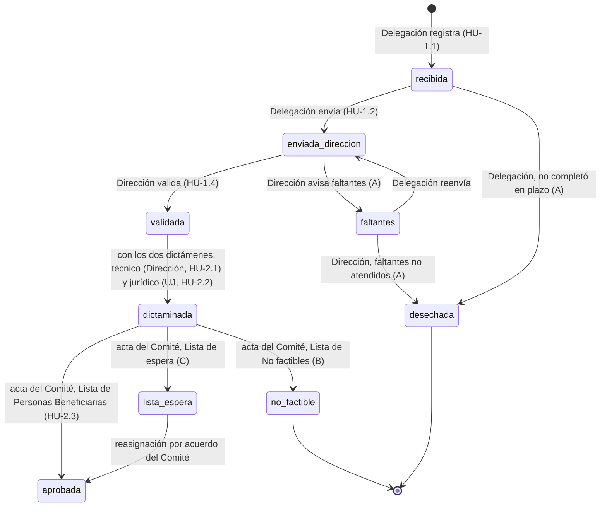
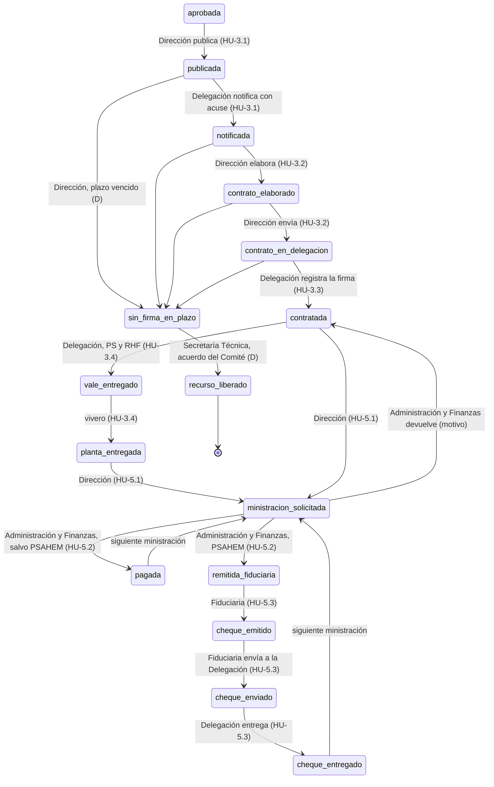

# Sistema de programas de PROBOSQUE

Prototipo del sprint 1 (módulos M1, Recepción y expediente, y M2, Dictamen y Comité) del sistema que lleva el trámite de los
seis programas de apoyo de PROBOSQUE: Capturando Carbono (CC), Manejo Forestal Sustentable (MFS),
Plantaciones Sustentables (PS), Restauración Hidrológico-Forestal (RHF), PSAHEM (PSA) y
Guardabosques (PEG). Tienen reglas cargadas CC, PS, RHF y PSAHEM; MFS y PEG existen en el catálogo sin archivo de reglas.

Historias implementadas: HU-1.1 Registro de la solicitud, HU-1.2 Revisión del expediente,
HU-1.3 Ubicación del predio, HU-1.4 Validación del expediente, HU-2.1 Dictamen técnico, HU-2.2 Dictamen
jurídico, HU-2.3 Sesión de aprobación, HU-2.4 Sesiones de seguimiento y, del sprint 2, HU-3.1 Publicación y
notificaciones, HU-3.2 Elaboración del contrato y HU-3.3 Firma del contrato.

## Cómo levantar

Requisitos: Docker con Compose 2.24 o posterior. En Windows, Docker vive en WSL:

```
wsl -e bash -lc "cd /mnt/c/Users/<usuario>/Documents/GitHub/FEPI/sistema && docker compose up --build"
```

En otro equipo basta con `docker compose up --build` dentro de `sistema/`.

- El sitio queda en **http://localhost:8080** (Nginx → Gunicorn).
- Al arrancar, el contenedor `web` aplica las migraciones, recolecta los estáticos y corre
  `cargar_catalogos`, `cargar_reglas` y `cargar_demo` (los tres son idempotentes).
- Variables: copiar `.env.ejemplo` a `.env` y cambiar los valores. Sin `.env` se usan los valores de
  desarrollo de `docker-compose.yml`. `.env` no se versiona.
- Para borrar todo (base y archivos): `docker compose down -v`.

Servicios de `docker-compose.yml`:

| Servicio | Qué hace |
| --- | --- |
| `bd` | PostgreSQL 17 + PostGIS 3.5 (volumen `bd_datos`). |
| `web` | Django 5.2 LTS con Gunicorn (imagen de producción, sin herramientas de prueba). |
| `nginx` | Sirve los estáticos y entrega los archivos del expediente solo después de que Django revisa el permiso (`X-Accel-Redirect`). Puerto 8080. |
| `plazos` | Corre `manage.py revisar_plazos` cada 24 h (bucle simple, sin cron ni Celery). |
| `pruebas` | Perfil aparte: pytest + Playwright con Chromium (etapa `pruebas` del Dockerfile). |

## Cómo probar

Desde `sistema/` (en este equipo, dentro de WSL: `wsl -e bash -lc "cd /mnt/c/.../FEPI/sistema && <comando>"`).
Docker Compose acepta argumentos para el servicio `pruebas`; al terminar, `docker compose down`.

| Qué | Comando | Tiempo medido |
|---|---|---|
| Rápidas (sin navegador) | `docker compose --profile pruebas run --rm pruebas pytest -m "not navegador"` | 119 pruebas, ~62 s (71 s con arranque) |
| Una historia | `docker compose --profile pruebas run --rm pruebas pytest pruebas/test_hu_2_3.py` | ~15–25 s |
| Todo (rápidas + recorridos de Playwright) | `docker compose --profile pruebas run --rm pruebas` | 127 pruebas, ~114 s (120 s con arranque) |
| Todo y regenerar capturas | `docker compose --profile pruebas run --rm -e CAPTURAS=1 pruebas` | igual que «todo» |

Los recorridos de Playwright (todo lo que usa `page` o `live_server`, en `pruebas/e2e/`) llevan el marcador
`navegador` (registrado en `pytest.ini`) y corren al final. **Las capturas solo se guardan con `CAPTURAS=1`**; sin
esa variable la fixture `captura` no escribe nada y `git status` queda limpio. Van a `CAPTURAS_DIR`
(por omisión `/entregas/sprint_1/capturas`, la carpeta `entregas/` de la raíz del repositorio montada en el
contenedor); para otro sprint: `-e CAPTURAS_DIR=/entregas/sprint_2/capturas`. Para regenerar solo algunas:
`... run --rm -e CAPTURAS=1 pruebas pytest pruebas/e2e/test_recorrido_hu_2_3.py`.

Las pruebas unitarias y de criterios corren con pytest-django contra PostGIS. Las historias, sus criterios y las
necesidades se leen de
`especificacion/modelo.json` y `especificacion/necesidades_v12.json`; ahí está también el texto de las
Reglas de Operación 2026 al que remiten los numerales y las líneas de `reglas/*.json`.

Cada criterio de aceptación tiene al menos una prueba con el ID de su historia en el nombre
(`pruebas/test_hu_1_1.py` … `test_hu_2_4.py`); las del núcleo están en `pruebas/test_nucleo_*.py`.
Los recorridos de Playwright están en `pruebas/e2e/` (uno por historia; los de M2 en archivos
`test_recorrido_hu_2_*.py`) y corren con Chromium en español de México (`--lang=es-MX`, zona horaria de
la Ciudad de México). PEG, que no tiene archivo de reglas, se prueba con fixtures
(`pruebas/fixtures_m2.py`) que crean su programa-ejercicio, su plazo y sus ministraciones.

## Usuarios de demostración

Contraseña de prueba para todos: **`Probosque2026`** (solo para demostración; nunca en un servidor real).

| Usuario | Unidad | Para qué |
| --- | --- | --- |
| `del_amecameca` | Delegación Regional Forestal Amecameca | Ventanilla: registra, revisa requisitos, levanta polígono, envía, notifica. |
| `del_toluca` | Delegación Regional Forestal Toluca | Igual, otra Delegación (solo ve lo suyo). |
| `del_valle` | Delegación Regional Forestal Valle de Bravo | Igual. |
| `dir_drff` | Dirección de Restauración y Fomento Forestal | Instancia Ejecutora de CC, MFS, PS, RHF y PSA: valida o avisa faltantes, dictamen técnico, listado preliminar, cumple acuerdos. |
| `dir_dpf` | Dirección de Protección Forestal | Instancia Ejecutora de PEG (dictamen técnico; validación de reportes). |
| `juridica` | Unidad Jurídica | Dictamen jurídico, Listado de Personas Beneficiarias Incumplidas y predios sancionados. |
| `comite` | Secretaría Técnica del Comité | Sesiones: convocatoria, documentos, listados, acta, acuerdos. |
| `finanzas` | Dirección de Administración, Finanzas y de Gestión Documental | (Sprint 2.) |
| `vivero` | Vivero (demostración) | (Sprint 2.) |
| `fiduciaria` | Fiduciaria | Ve en su bandeja las instrucciones de pago del Comité (PSAHEM). |
| `admin` | — (superusuario) | Admin de Django para catálogos: `/admin/`. |

Solicitudes de demostración (CC 2026): Los Ocotes (recibida, revisión a medias), Ejido San Rafael
(recibida, completa, con polígono), La Cañada (en la Dirección), Rancho El Capulín (aviso de faltantes
notificado), El Tecolote (desechada) y, para M2: Los Encinos del Monte (con dictamen técnico, falta el
jurídico; traslapa con La Joya Alta), El Ocotal (en dictamen, plazo vencido), Potrero Viejo
(dictaminada, en la bandeja de la Secretaría Técnica) y la sesión de aprobación SO-CC-2026-01 con acta:
Predio Agua Blanca (refrendo, con cambio de lugar del polígono) y La Joya Alta aprobadas, Las Trojes en
lista de espera y Cerro de la Cruz no factible (su titular, Rogelio Bautista Núñez, está en el Listado
de Incumplidas). La sesión de seguimiento SO-CC-2026-02 tiene tres acuerdos (uno cumplido; dos
pendientes en las bandejas de la Dirección y de la Unidad Jurídica).
Para las historias de M3 y M5 hay además dos solicitudes aprobadas de cada uno de PS (Plantación Los Pinos,
Rancho La Huerta), RHF (Barranca Honda, Ojo de Agua) y PSAHEM (Bosque El Zarco, Monte La Loma), cada programa
con su sesión de aprobación y su acta (`contrato/demo.py`). PS y RHF ya publicaron sus resultados (HU-3.1, a
distintas horas): en PS la Delegación notificó el resultado y la cita de Plantación Los Pinos (la otra queda
publicada, por notificar) y en RHF solo el resultado de Barranca Honda; PSAHEM y CC tienen el acta que autoriza
publicar, para mostrar la pantalla «Publicación de resultados». En HU-3.2, PS y RHF tienen un modelo de Contrato de
Adhesión validado por la Unidad Jurídica y CC, PS y PSAHEM la plantilla base por validar; el contrato de Plantación
Los Pinos (PS) está enviado a la Delegación, el de Barranca Honda (RHF) elaborado por enviar y Ojo de Agua (RHF)
notificada y por elaborar. En HU-3.3 cada uno de PS y RHF tiene un segundo lote de tres solicitudes con su propia
sesión y publicación: en PS, dos contratos firmados en plazo (Mirador de los Pinos, Ladera Verde) y uno sin firma al
vencer el plazo, señalado y por liberar (Cañada Seca); en RHF, tres firmados (Arroyo Claro, Cerro Gordo y Peña Blanca, esta
de RFI Modalidad uno, que no recibe planta). Para vencer el plazo sin esperar días, la demostración corre hacia atrás las
fechas de la publicación y la notificación de Cañada Seca (calendario simulado). Plantación Los Pinos queda por firmar en
la Delegación. La página pública de resultados está en
`/contrato/resultados/` (sin iniciar sesión; enlace en la pantalla de entrada). `cargar_demo` carga antes las reglas de los cuatro
programas si faltan.

## Estructura

```
sistema/
├── docker-compose.yml, Dockerfile, .env.ejemplo, requirements*.txt, pytest.ini, manage.py
├── docker/            entrypoint.sh y nginx.conf
├── probosque/         proyecto Django (settings, urls, wsgi)
├── nucleo/            app común: modelos, días hábiles, acuses PDF, carga de catálogos y reglas,
│                      bandeja, permisos, comandos (cargar_catalogos, cargar_reglas, cargar_demo,
│                      revisar_plazos) y datos de demostración
├── recepcion/         app M1: revisión de requisitos, polígonos, validación; servicios.py (reglas),
│                      geometria.py (GeoJSON/KML/SHP), vistas y plantillas por pestaña
├── dictamen/          app M2, un módulo por historia: tecnico.py (HU-2.1), juridico.py (HU-2.2),
│                      aprobacion.py (HU-2.3), seguimiento.py (HU-2.4); sesiones.py y comun.py
│                      compartidos; vistas/, formularios/ y templates/dictamen/ con la misma división;
│                      registro.py conecta la app con las bandejas, el menú y los plazos del núcleo
├── contrato/, pagos/  apps M3 (HU-3.1 y HU-3.2 hechas) y M5 (vacía): models/ (paquete, un módulo por historia), vistas/,
│                      formularios/, templates/, urls.py, registro.py y demo.py (contrato: aprobadas de PS,
│                      RHF y PSAHEM)
├── plantillas/        base.html
├── estaticos/         css, js del mapa y vendor/ (Bootstrap 5.3.9, htmx 2.0.11, Leaflet 1.9.4,
│                      Leaflet-Geoman 2.20.6; sin CDN)
├── reglas/            CC.json, catalogos.json, indice_rop.json (extraídos de las ROP; no se editan a mano)
├── datos/             municipios_edomex.geojson, flujo_tramite.json, sistema.json, dictamen.json,
│                      dias_inhabiles_2026.json
├── especificacion/    modelo.json, necesidades_v12.json y el texto de las ROP 2026
├── herramientas/      preparar_municipios.py (convierte la capa de IDEFOR a GeoJSON)
└── pruebas/           pytest (test_nucleo_*, test_hu_1_*, test_hu_2_*, fixtures_m2.py) y e2e/ (Playwright)
```

## Estados del trámite (sprints 1 y 2)

Los estados y las transiciones son datos (`datos/flujo_tramite.json`, editables en el admin). El único
punto del código que cambia un estado es `Expediente.cambiar_estado(destino, usuario, motivo)`: valida
contra la tabla (origen, destino, tipo de unidad, programa opcional), revisa que el expediente sea de la
unidad del usuario, pide motivo cuando la transición lo exige y escribe la bitácora. Al cargar el
archivo, las transiciones que ya no aparecen en él dejan de estar permitidas.



Sprint 2 (tabla lista; las acciones las construyen las historias HU-3.x y HU-5.x). En M5 el expediente
recorre los estados de pago una vez por ministración.



| Estado | Bandeja (quién lo atiende) | También lo consultan |
| --- | --- | --- |
| `recibida`, `faltantes` | Delegación | Dirección del programa |
| `enviada_direccion` | Dirección del programa | — |
| `validada` (en dictamen) | Dirección (si le falta el técnico) y Unidad Jurídica (si le falta el jurídico) | Secretaría Técnica |
| `dictaminada` | Secretaría Técnica del Comité | Unidad Jurídica |
| `aprobada` | Dirección (publica, M3) | Unidad Jurídica, Secretaría Técnica |
| `lista_espera`, `no_factible` | — | Unidad Jurídica, Secretaría Técnica |
| `publicada`, `contrato_en_delegacion` | Delegación (notifica y cita; recaba la firma) | Unidad Jurídica |
| `notificada`, `contrato_elaborado` | Dirección (elabora y envía el contrato) | Unidad Jurídica |
| `sin_firma_en_plazo` | Dirección y Secretaría Técnica (recurso por liberar) | Unidad Jurídica |
| `contratada`, `planta_entregada`, `pagada`, `cheque_entregado` | Dirección (solicita la ministración) | Administración y Finanzas, Jurídica, vivero, Fiduciaria según el estado |
| `vale_entregado` | Vivero (PS y RHF) | — |
| `ministracion_solicitada` | Administración y Finanzas | Unidad Jurídica |
| `remitida_fiduciaria`, `cheque_emitido` | Fiduciaria (PSAHEM) | Administración y Finanzas |
| `cheque_enviado` | Delegación (entrega el cheque) | Fiduciaria, Administración y Finanzas |
| `recurso_liberado` | — (final) | Unidad Jurídica, Secretaría Técnica |

Una Delegación solo ve sus expedientes; una Dirección, los de los programas de los que es Instancia
Ejecutora; las demás unidades, los estados que atienden o consultan. Además, cada unidad ve en su bandeja
los **acuerdos del Comité** que le toca cumplir (HU-2.4).

## Decisiones tomadas

- **Reglas como datos.** `cargar_reglas` lee `reglas/<CLAVE>.json` (hoy solo `CC.json`): tipos de
  persona, modalidades, requisitos (con bandera de documento legal, `aplica_en_refrendo`, opcional y
  condición), plazos (cantidad + unidad; admite `cantidad: null` y unidades como `fecha_limite`),
  formatos, montos y ministraciones (estas dos quedan listas para el sprint 2). Las claves que el
  esquema no usa todavía se guardan en `Ejercicio.datos`. `datos/sistema.json` indica qué plazo usa el
  sistema para cada cosa y qué evento lo arranca (`usos_de_plazo`, ver «Base de M3 y M5») y para la vigencia
  en refrendo (`vigencia_documentacion_legal_refrendo`, 3 años).
- **Modalidades de CC.** El archivo de CC trae como «modalidades» los tres tipos de superficie, dos
  regímenes de pago y el refrendo. Al registrar solo se eligen los tipos de superficie
  (`ajustes_reglas` en `datos/sistema.json`); el refrendo es una casilla del expediente.
- **Expediente único por predio.** El predio tiene su folio (`PRED-000001`) que conserva entre
  programas (ROP CC 8.1.1.2 fr. XVII); cada solicitud a un programa-ejercicio es un `Expediente` con
  folio `CC-2026-AME-0001` y todo (requisitos, documentos, polígonos, validaciones, acuses, bitácora)
  cuelga de él. Los modelos del trámite llevan `django-simple-history`.
- **Municipios y Delegaciones.** Los 125 municipios vienen de la capa de IDEFOR, simplificada a ~40 m
  (`herramientas/preparar_municipios.py`). La capa no trae la clave INEGI: la clave es interna
  (`M001`…`M125`, orden alfabético). La asignación a Delegaciones es la de la Convocatoria 2026
  (`reglas/catalogos.json`); los nombres se empatan sin acentos y por prefijo («Acambay» → «Acambay de
  Ruíz Castañeda») y la carga falla con un mensaje que nombra al municipio si alguno no empata o queda
  sin Delegación. La interfaz la muestra como «según la Convocatoria 2026, por confirmar con el
  cliente»; se edita en el admin (Municipios).
- **HU-1.1.** Solo la Delegación registra. Si el municipio del predio lo atiende otra Delegación, se
  rechaza y el mensaje dice cuál (ROP CC 8.1.3); en el formulario se avisa por HTMX al elegir el
  municipio. El acuse de recepción (PDF con folio, fecha y hora) indica el plazo de 5 días hábiles para
  completar la documentación.
- **HU-1.2, regla de envío.** Se puede enviar a la Dirección cuando (1) todos los requisitos aplicables
  están revisados, (2) ninguno está faltante, porque las ROP piden la documentación completa para atender
  la solicitud (CC 8.1.1.2 fr. XIV), y (3) cada entregado tiene su archivo digitalizado o, en refrendo,
  es documentación vigente que obra en PROBOSQUE. «No aplica» solo se permite en requisitos opcionales o
  con condición. El polígono no es condición de envío: las ROP lo levantan después (CC 10.1 fr. III).
- **HU-1.3.** Se acepta GeoJSON, KML y Shapefile en .zip (con o sin .prj; sin .prj y con coordenadas
  grandes se asume UTM 14N), o el dibujo en el mapa con Leaflet-Geoman. La superficie se calcula en
  EPSG:32614. Una geometría inválida se rechaza; si cae fuera (o parcialmente fuera, >0.5 %) del
  municipio se guarda con aviso. Cada cambio conserva el polígono anterior; si el traslape
  (intersección/unión) es menor de 50 % se marca «cambio de lugar», si no «corrección». Se registra quién
  lo levantó (Delegación o prestador con RFN). Si el programa no usa polígono (PEG), la pestaña no
  aparece y el servicio lo rechaza.
- **HU-1.4.** La Dirección ve cada requisito con una revisión automática contra las reglas y marca los
  faltantes. Sin faltantes, el expediente queda validado (constancia en PDF). Con faltantes, se emite el
  aviso con fecha límite = fecha del aviso + 5 días hábiles (plazo de las reglas, calendario de días
  inhábiles), dirigido a la persona solicitante por conducto de la Delegación; el expediente pasa a la
  bandeja de la Delegación, que registra la notificación (acuse) y reenvía cuando recibe lo faltante.
  En refrendo, la documentación que obra en PROBOSQUE vale si su fecha no es anterior a la recepción
  menos la vigencia de las reglas (3 años); si es más vieja, la Delegación no la acepta y la Dirección
  la marca como faltante.
- **Días hábiles.** Sábados, domingos y el catálogo `DiaInhabil`. Un plazo en días hábiles empieza a
  contar el día hábil siguiente al evento; en días naturales, meses o años, si el último día es
  inhábil vence el siguiente hábil. Las ROP no traen calendario: se cargó uno de demostración 2026
  (`datos/dias_inhabiles_2026.json`), editable en el admin.
- **Acuses.** Cada envío o entrega (recepción, envío a la Dirección, validación, aviso de faltantes,
  notificación) genera un `Acuse` con folio `AC-AAAA-NNNNNN`, fecha y hora, PDF (WeasyPrint) y su huella
  SHA-256, y un evento en la bitácora.
- **Archivos.** `FileSystemStorage` en el volumen `archivos`; no hay URL pública de los archivos: se
  descargan por vistas que revisan la unidad del usuario.
- **Revisión de plazos.** En este sprint `revisar_plazos` solo señala en la bitácora (una vez) los
  avisos de faltantes vencidos y las solicitudes con faltantes cuyo plazo desde la recepción venció;
  no cambia estados.
- **Mapa base.** OpenStreetMap si hay conexión (`MAPA_TESELAS_URL`); vacío = sin teselas (las pruebas
  corren así).
- **Requisitos que no son documentos (ajuste a M1).** `datos/sistema.json`
  (`ajustes_reglas.CC.requisitos_sin_documento`) marca CC-REQ-01 y CC-REQ-03 como condiciones: se
  revisan como «cumple» o «no cumple» sin archivo (campo `Requisito.requiere_documento`). La pestaña
  Requisitos muestra solo el estado de cada fila y un botón «Revisar» que despliega su formulario. Los
  campos de archivo usan un botón «Elegir archivo» propio (`estaticos/js/archivos.js`), porque el texto
  del control nativo depende del idioma del navegador.

### Módulo M2 (Dictamen y Comité)

- **Organización.** Un módulo de servicios por historia (`dictamen/tecnico.py`, `juridico.py`,
  `aprobacion.py`, `seguimiento.py`), con sus vistas (`dictamen/vistas/`), formularios
  (`dictamen/formularios/`), plantillas (`templates/dictamen/<historia>/`) y pruebas por separado. Lo
  común: `models.py`, migraciones, `urls.py`, `admin.py`, `comun.py`, `sesiones.py` (convocatoria) y
  `registro.py`. El núcleo no depende de `dictamen`: la app se registra en `nucleo/extensiones.py`
  (filtros y paneles de bandeja, pestaña del expediente, menú, revisión de plazos y datos de
  demostración), que es donde se conectarán los módulos M3 a M6.
- **Estados.** Los dictámenes técnico y jurídico corren en paralelo sobre el expediente validado; el que
  completa el par pasa el expediente a `dictaminada` (bandeja de la Secretaría Técnica). Se quitó la
  transición `validada → no_factible` del sprint anterior: según las ROP de CC (10.1 fr. VI y VII; 9.4.3
  fr. I y III) los dictámenes producen el listado preliminar y es el Comité quien aprueba la Lista de
  Personas Beneficiarias, la Lista de espera y la Lista de No factibles. Por eso las tres salidas de
  `dictaminada` las registra la Secretaría Técnica con el acta. `Estado.tipo_unidad_bandeja` admite
  varios tipos de unidad (separados por coma) y `Estado.visible_para`, las unidades que solo consultan.
- **HU-2.1.** La lista de verificación se arma con `superficie`, `criterios_elegibilidad_tecnica`,
  `inelegibles` y `criterios_seleccion` del archivo de reglas; un criterio «no cumple» impide el dictamen
  factible. El análisis cartográfico usa PostGIS: polígono vigente, superficie en EPSG:32614, rango del
  programa, ubicación en el municipio y traslapes (`geom__intersects`) con polígonos vigentes de otros
  expedientes del mismo ejercicio, con su superficie en hectáreas; se guarda una copia en el dictamen.
  El plazo de dictaminación sale de las reglas (`datos/dictamen.json` nombra las claves): en PEG,
  45 días hábiles desde la recepción (Convocatoria PEG, base quinta, fr. II, línea 9516); en CC, la fecha
  límite de la Convocatoria (30-jun-2026). El dictamen queda «en plazo» o «fuera de plazo»; sin
  dictamen, «en plazo», «por vencer» (5 días hábiles o menos) o «vencido», y `revisar_plazos` lo señala
  una vez en la bitácora. El listado preliminar reúne el resultado técnico y jurídico de cada solicitud
  validada y se exporta a CSV en UTF-8 con BOM (Excel lo abre con acentos).
- **HU-2.2.** El Listado de Personas Beneficiarias Incumplidas y los predios con procedimiento o
  sanción son catálogos con historial (`django-simple-history`); una baja desactiva, no borra. El cotejo
  es automático (persona, CURP, RFC, nombre sin acentos y predio) y se muestra en la pantalla y en el
  acuse. Con coincidencias, el **servicio** rechaza el dictamen procedente. Un predio sancionado con el
  reintegro hecho deja de impedir el apoyo (CC 8.1.1.1, inelegibles fr. III). En refrendo se pide el
  dictamen igual (CC 10.1 fr. IV).
- **HU-2.3.** La convocatoria exige orden del día y al menos un documento y se rechaza si no se envía con
  la anticipación de las reglas (`convocatoria_sesion_comite`: 3 días hábiles; 24 horas si es
  extraordinaria); su acuse lleva la fecha y la hora del envío, el orden del día y los integrantes del
  Comité tomados de `CC.json` (`instancias.comite`) o de `catalogos.json`. La propuesta de listados
  ordena las factibles por los criterios de priorización que se pueden leer del expediente
  (`datos/dictamen.json`: reforestaciones primero, 8.1.2 fr. I; refrendos, fr. II) y desempata por fecha y
  hora de registro (8.1.2, último párrafo); asigna hasta donde alcance el recurso disponible
  ($2,000 por ha de superficie factible, numeral 7.2) y el resto va a la lista de espera con su lugar.
  El Comité puede mover una solicitud de listado o de lugar con un motivo obligatorio, que queda en el
  acta, en el historial y en la bitácora; una no factible no puede pasar a los listados de apoyo. El acta
  (PDF) trae los tres listados y la autorización de publicación, y mueve cada expediente a `aprobada`,
  `lista_espera` o `no_factible`.
- **HU-2.4.** Los tipos de acuerdo y el área que los cumple por omisión están en `datos/dictamen.json`
  (reasignación, sustitución, caso fortuito, suspensión, cancelación, baja, reintegro, instrucción de
  pago a la Fiduciaria solo en PSAHEM y por ministración, validación de reportes solo en PEG y por
  periodo, y otro). Cada acuerdo lleva sus expedientes y su unidad responsable, que lo ve en su bandeja y
  lo marca como cumplido. `ministraciones_sin_instruccion` y `periodos_sin_validacion` dicen qué falta.
  Los acuerdos todavía no ejecutan nada en otros módulos: `dictamen.seguimiento.RECEPTORES` es el punto
  de conexión (tipo de acuerdo → funciones) para pagos (M5) y seguimiento (M6).

### Base de M3 (Publicación y contrato) y M5 (Pagos)

- **Notificaciones en el núcleo.** `nucleo.Notificacion` y `nucleo/notificaciones.py` son la única forma de
  notificar a la persona por conducto de la Delegación (faltantes, resultados, cita a firma, omisiones,
  devoluciones; `TipoNotificacion`). Dos momentos, cada uno con fecha, hora, acuse y renglón de bitácora:
  `emitir_notificacion(expediente, tipo, asunto, usuario, acuse_envio=None, …)` (la unidad que decide la
  manda a la Delegación; si no trae acuse propio se emite uno) y `registrar_notificacion(usuario_delegacion,
  notificacion, medio, fecha_hora=None)` (solo la Delegación de la notificación; fecha no futura ni anterior
  al envío). `pendientes_de_notificar(delegacion)` y `ultima_notificada(expediente, tipo)` sirven a bandejas
  y plazos; `extensiones.AL_NOTIFICAR` avisa a los módulos. Cada módulo guarda una referencia a la suya: M1
  lo hace en `Validacion.notificacion` (la migración `recepcion/0002` pasó los avisos existentes al núcleo;
  `Validacion.notificado_en`, `notificado_por` y `acuse_notificacion` quedan como propiedades).
- **Plazos con evento de arranque (R-03, R-12).** `nucleo.plazos.vencimiento(expediente, uso)` es el único
  cálculo de vencimientos por evento. `datos/sistema.json` → `usos_de_plazo` resuelve cada uso **por programa**
  (`por_omision` + lo propio del programa; `false` = no lo tiene) a una clave de plazo de las reglas, un evento
  de arranque y, si aplica, un tope. Devuelve un `Vencimiento` (`vencimiento`, `fecha_evento`, `tope`,
  `topado`, `texto`, `estado()`): si el evento no ha ocurrido, «sin fecha todavía». Los eventos que producen
  otros módulos se registran con `plazos.registrar_hito(expediente, clave, usuario, fecha_hora)` (modelo
  `Hito`) o con una función en `extensiones.EVENTOS_PLAZO`; el servicio no cambia.

  | Uso | Plazo de las reglas | Evento | Tope / nota |
  | --- | --- | --- | --- |
  | `faltantes_ventanilla` | `complemento_documentacion_faltante` (5 d. háb.) | `recepcion_solicitud` | fecha límite de recepción (`recepcion_solicitudes`, 27-mar-2026), ROP 8.1.1.2 |
  | `faltantes_direccion` | el mismo | `aviso_direccion` | decisión propia (las ROP no dan días, 10.1) |
  | `firma_programada` | `firma_contrato` (10 d. háb.) | CC y PSA: `publicacion_resultados`; PS y RHF: `notificacion_persona` | reasignadas: desde su notificación, hasta `fecha_limite_reasignados` |
  | `firma_liberacion` | `firma_contrato` | CC y RHF: `notificacion_persona`; PS y PSA: `publicacion_resultados` | vencido = «sin firma en plazo», recurso por liberar |
  | `cita_firma` (PS) | `cita_firma_contrato` (5 d. háb.) | `publicacion_resultados` | la Delegación notifica y cita |
  | `recoger_planta` (PS, RHF) | `recoger_planta_vivero` / `recoger_planta_vale` | `entrega_vale` | PS: «30 días» como naturales (R-13) |
  | `ptrfi_actualizado` (RHF) | `entrega_ptrfi_actualizado` | `notificacion_persona` | |
  | `instruccion_pago_fiduciaria`, `cobro_cheque` (PSA) | los de las reglas | `solicitud_pago_fiduciaria`, `entrega_cheque` | cheque: desde la entrega (R-14) |

  Si el evento ocurrió después del tope (por ejemplo, una solicitud de demostración recibida después del
  27-mar-2026), no se topa: se marca `evento_despues_del_tope` y el acuse lo avisa. M1 ya usa el servicio
  (acuse de recepción, aviso de faltantes, revisión de plazos).
- **Monto aprobado.** `nucleo.montos.monto_aprobado(expediente, superficie=None, condiciones=())` devuelve
  `MontoAprobado` (`superficie_ha`, `monto_ha`, `total`, `regimen`, `ministraciones` con número, porcentaje,
  importe y condición). Superficie: la que se pase o la factible del dictamen técnico
  (`extensiones.SUPERFICIE_APROBADA`, la registra M2) o la solicitada. Monto por hectárea: el de la modalidad
  del expediente o, si no tiene propio, el general del ejercicio; un concepto sin dinero da 0 sin
  ministraciones (PS, navideñas). `MontoApoyo.modalidad` se llena al cargar las reglas: con la clave del
  archivo o, en PS, por el inicio del concepto (`ajustes_reglas.PS.modalidad_de_montos`). Los montos con
  `requiere` (FSC en PSAHEM) cuentan solo con esa condición. El régimen de pago sale de
  `ajustes_reglas.<CLAVE>.regimen_pago`: CC por superficie (100 % hasta 5 ha; 70 y 30 arriba), PS y RHF por
  modalidad, PSAHEM fijo (70 y 30). La última ministración absorbe el redondeo. La propuesta de listados
  del Comité (HU-2.3) ya usa este servicio.
- **M1 y M2 con PS, RHF y PSAHEM.** El recorrido completo corre en los cuatro programas con reglas. Lo que
  se corrigió por estar pensado para CC: el rango de superficie se lee por modalidad (`nucleo/reglas.py`,
  `rango_superficie`: por concepto en PS, por cuenca en PSAHEM con máximo mayor si hay FSC, sin máximo en RHF),
  en la lista de verificación y en el análisis cartográfico del dictamen técnico; el Comité de PSAHEM se lee
  de `instancias.comite_tecnico` (Comité Técnico del FIPASAHEM); el registro rechaza en el servicio, no solo
  en el formulario, las modalidades no seleccionables. Lo que ya funcionaba sin cambios: los requisitos que
  no son documentos (PS, RHF y PSAHEM los marcan en sus reglas con `requiere_documento: false`), los plazos de
  faltantes y de dictaminación (cada programa tiene el suyo) y las modalidades no seleccionables de PSAHEM
  (fondos concurrentes y refrendo, marcadas en sus reglas). PSAHEM no trae `convocatoria_sesion_comite`: la
  convocatoria de su Comité Técnico no valida anticipación mientras no se tenga su Reglamento Interno (R-14).
  La priorización del Comité (`datos/dictamen.json`) solo tiene criterios de CC; en los demás programas se
  ordena por fecha y hora de registro.
- **Tropiezos de interfaz del sprint 1 (P-13 a P-18).** El encabezado del expediente muestra el botón del
  **siguiente paso** de la unidad que lo mira (`nucleo/pasos.py`; cada módulo registra el suyo en
  `extensiones.SIGUIENTES_PASOS`: M1 en `recepcion/pasos.py`, M2 en `dictamen/registro.py`). El panel de envío
  avisa cuando el polígono aún no se levanta (sin impedir el envío, R-09). Cada requisito del aviso de faltantes
  enlaza a su fila (`#req-<id>`, resaltada). La bandeja de la Secretaría Técnica trae el panel «Solicitudes
  dictaminadas por llevar a sesión de aprobación», que abre la sesión de aprobación abierta del ejercicio o el
  alta de una nueva con el ejercicio elegido. «Por atender» y «Todos los míos» quedan arriba, con conteo, y la
  bandeja vacía invita a ver «Todos los míos». Acuses y documentos se ven o se descargan (`?descargar=1`,
  `Content-Disposition: attachment`); la descarga se prueba con Playwright
  (`pruebas/e2e/test_recorrido_tropiezos_s2.py`, capturas `s2_02_*` en `entregas/sprint_2/capturas/`).

### M3 · HU-3.1 Publicación y notificaciones

- **Organización.** `contrato/models/publicacion.py` (migración `0001_hu_3_1_publicacion`), servicio
  `contrato/publicacion.py`, vistas `vistas/publicacion.py`, formularios y `templates/contrato/publicacion/`. Los
  avisos no tienen modelo propio: son `nucleo.Notificacion` (`nucleo.notificaciones`).
- **Publicar.** `publicacion.publicar(usuario, sesion)`: solo la Dirección Instancia Ejecutora del programa, solo
  una sesión de aprobación **con acta que autorizó la publicación** (no antes del acta, una sola vez por sesión).
  Deja `Publicacion` (fecha y hora, quién, dónde, acuse en PDF), un renglón publicado por solicitud
  (`ResultadoPublicado`, copia de lo que ve el público), el hito `publicacion_resultados` de cada expediente (arranca
  los plazos de firma y de cita, R-03), el cambio `aprobada → publicada` de las personas beneficiarias (lista de
  espera y no factibles no cambian de estado) y, por cada solicitud, el aviso del resultado a la Delegación.
- **Fecha de la convocatoria (R-05).** Las ROP no fijan fecha ni días para publicar (plazo `publicacion_resultados`
  sin número en CC, PS, RHF y PSAHEM): la publicación dice «Sin fecha en las reglas». Si un programa la trae (cantidad
  en días o fecha límite), se compara y se guarda `dentro_de_fecha`; se prueba cambiando el plazo.
- **Avisos y entrega.** Cada aviso tiene dos momentos con fecha, hora y acuse: envío a la Delegación (la publicación)
  y notificación a la persona (la Delegación registra la entrega con el medio; `publicacion.registrar_entrega`).
  Al notificar el resultado de una persona beneficiaria el expediente pasa a `notificada`
  (`extensiones.AL_NOTIFICAR`). En **PS** se envía además la **cita a firma**, con el plazo de 5 días hábiles de la
  Delegación desde la publicación (10.1 inciso h, `cita_firma_contrato`). `publicacion.enviar_aviso` deja listos
  los tipos «omisión» y «devolución» (y cualquier otro) para el sprint 3.
- **Página pública** `/contrato/resultados/` y `/contrato/resultados/<programa>/<año>/`, sin iniciar sesión: listados
  publicados con búsqueda por folio. Muestra folio, predio, municipio y resultado; el nombre **solo** en el listado de
  personas beneficiarias (el padrón que mandan publicar las ROP, CC 9.4.3 fr. III); nunca CURP, RFC ni documentos.
  Solo existe para lo ya publicado (si no, 404).
- **Pantallas.** «Publicación de resultados» (Dirección; Secretaría Técnica y Jurídica consultan), «Notificaciones»
  (Delegación entrega; Dirección ve el estado), paneles en las bandejas, siguiente paso en el expediente y la
  pestaña «Contrato».
- **Pendientes.** Los resultados de quienes pasan de la lista de espera a beneficiarias por acuerdo del Comité
  (reasignación) se publicarán con HU-3.3 (flujo alterno D); la publicación en la Gaceta (PSAHEM) no se modela: el
  lugar de publicación es un texto.

### M3 · HU-3.2 Elaboración del contrato

- **Organización.** `contrato/models/contratos.py` (migración `0002_hu_3_2_contratos`), servicio `contrato/contratos.py`,
  vistas `vistas/contratos.py`, formularios y `templates/contrato/contratos/`.
- **Modelos de contrato (S2-04, R-07).** Las ROP no traen el texto del Contrato de Adhesión, del Convenio de
  Concertación ni del Adendum (faltan los formatos y el modelo, R-07). `ModeloContrato` (por programa-ejercicio y tipo)
  tiene `VersionModelo`: el área responsable registra el texto (plantilla con campos `{{campo}}`, que se validan contra
  `contratos.CAMPOS`; un campo desconocido se rechaza) y la Unidad Jurídica lo **valida** (fecha y hora, quién,
  observaciones) o lo **devuelve** con observaciones. Cambiar el texto crea una versión nueva **por validar**; la
  versión anterior se conserva y los contratos ya elaborados guardan la suya. Incluye una **plantilla base propia** por
  tipo, marcada «BORRADOR – modelo por validar» en el nombre, en el texto y en las pantallas: hay que quitarle la marca
  (versión nueva) y validarla antes de usarla.
- **Elaborar.** `contratos.elaborar_contrato(usuario, expediente, modelo)`: solo la Dirección Instancia Ejecutora, solo
  de una solicitud **aprobada, publicada y notificada** (estado `notificada`; antes dice qué falta), solo sobre la
  versión vigente **validada** de un modelo del mismo programa-ejercicio y del tipo que toca (Convenio de Concertación
  en PSAHEM con fondos concurrentes; Contrato de Adhesión en los demás casos): el servicio lo impide, no solo la
  pantalla. El PDF (WeasyPrint) lleva persona, tipo de persona, predio, municipio, Delegación, modalidad, superficie
  aprobada, monto y ministraciones (`nucleo.montos.monto_aprobado`) y el plazo de firma (`plazos.vencimiento`), con su
  huella SHA-256 y la leyenda del modelo y su validación. Uno por solicitud (folio `CTO-<programa>-<año>-NNNN`); se
  **rehace** (mismo folio, se cuenta en `rehechos`) mientras no se envíe. Estado `notificada → contrato_elaborado`.
- **Enviar a la Delegación.** `contratos.enviar_a_delegacion`: fecha y hora, acuse en PDF (con la huella), estado
  `contrato_en_delegacion` y bandeja de la Delegación, que ve el PDF solo desde el envío. La firma es HU-3.3.
- **Pendiente.** La ampliación de plazo por causa externa en MFS: MFS aún no tiene reglas (sprint 3), por eso solo
  quedó el modelo de datos `Adendum` (ligado al contrato, con motivo, plazo original y nuevo y su modelo), sin servicio
  ni pantalla. El texto jurídico real de los modelos lo aporta el cliente (R-07).
- **Barra de navegación.** Con las pantallas de M3 la barra de la Dirección y de la Unidad Jurídica ya no cabía:
  nombres más cortos («Publicación», «Modelos»), subtítulo de la marca solo en pantallas anchas, colapso desde 1200 px y
  nombre de la unidad truncado (con su `title`).

### M3 · HU-3.3 Firma del contrato

- **Organización.** `contrato/models/firma.py` (migración `0003_hu_3_3_firma`: `FirmaContrato`, `ElementoFormalizacion`,
  `SinFirma`), servicio `contrato/firma.py`, vistas `vistas/firma.py`, formularios `formularios/firma.py` y
  `templates/contrato/firma/`. Los datos por programa y por tipo de persona están en `datos/contrato.json`.
- **Registrar la firma.** `firma.registrar_firma`: solo la Delegación del expediente, con el contrato ya enviado
  (`contrato_en_delegacion`). Pide la fecha y hora de la firma (por omisión, ahora; ni futura ni anterior al envío del
  contrato), quién firma (la persona o su representante), el contrato firmado digitalizado (PDF, JPG o PNG, obligatorio) y la
  **verificación de firmas y sello**: una lista por tipo de persona (`datos/contrato.json` → `verificacion_firmas`: persona
  física, jurídico colectiva, núcleo agrario con Presidencia, Secretaría, Tesorería y sello; tipos sin lista propia usan la de
  su equivalente). Todos los puntos deben marcarse; si no, no se recibe. Deja el acuse de la firma, el hito `firma_contrato`
  con la fecha y hora de la firma y el estado `contratada`.
- **Dos fechas (R-03).** Se muestran siempre la **fecha programada de firma** (`firma_programada`) y el **vencimiento para
  liberar el recurso** (`firma_liberacion`), con los días hábiles que faltan. Una firma posterior a la programada y anterior
  a la de liberación es válida y queda «fuera de la fecha programada»; una posterior a la de liberación no se recibe. En PS la
  programada corre desde la notificación y la de liberación desde la publicación (R-13): la de liberación puede caer antes;
  el servicio aplica la de liberación como tope. Los casos «fuera de la fecha programada» solo se dan en CC (programada desde
  la publicación, liberación desde la notificación) y se cubren en las pruebas; en la demostración no hay uno porque la
  publicación de CC queda pendiente a propósito.
- **Formalización propia (criterio 2).** MFS y PEG no tienen archivo de reglas: sus elementos están en
  `datos/contrato.json` → `formalizacion_propia`. MFS: contrato de servicios técnicos con el prestador (con su RFN) y carta
  compromiso (ROP MFS, línea 8091 y derechos, líneas 7775 a 7778); PEG: credencial del Guardabosque entregada, con su folio
  (derechos, línea 8770). Sin ellos la firma no se da por completa. Se prueban con programas de fixtures (`mfs`, `peg`).
- **Sin firma al vencer (criterio 3, P-08).** `manage.py revisar_plazos` (`firma.revisar_firmas`) señala los contratos de
  solicitudes publicadas, notificadas, con contrato elaborado o en la Delegación cuyo vencimiento para liberar el recurso ya
  pasó: estado `sin_firma_en_plazo`, renglón en la bitácora sin persona (el sistema), registro `SinFirma` y aviso en la
  bandeja de la Dirección (panel «Sin firma en plazo»). Para esto `Expediente.cambiar_estado` acepta `por_sistema=True` sin
  usuario (solo si la transición existe). **Liberar el recurso no es automático:** una persona de la Dirección del programa
  lo confirma con un motivo (`firma.liberar_recurso`; estado `recurso_liberado` y acuse). Una firma que llegue cuando ya está
  señalado se rechaza con un mensaje claro. La reasignación a la lista de espera es del sprint 3: queda el gancho
  `extensiones.AL_LIBERAR_RECURSO`. Se agregó la transición `sin_firma_en_plazo → recurso_liberado` para la Dirección (el
  flujo la traía solo para la Secretaría Técnica) y `extensiones.AL_FIRMAR` para que HU-3.4 reaccione a la firma.
- **Pantallas.** «Firmas» (menú de la Delegación y de la Dirección): por firmar con las dos fechas y los días, firmados y
  sin firma con la acción de liberar; «Registrar la firma» (formulario con la verificación y los elementos del programa);
  pestaña «Contrato» con la firma, sus puntos, los archivos y el señalamiento; paneles en las bandejas de la Delegación y de
  la Dirección y siguiente paso en el expediente.

### Cómo se engancha una historia nueva a `contrato` o `pagos`

1. **Modelos:** un archivo por historia en `contrato/models/` o `pagos/models/` (por ejemplo,
   `contrato/models/firma.py` para HU-3.3), importado en `models/__init__.py`, y su migración propia:
   `python manage.py makemigrations contrato -n hu_3_3_firma`.
2. **Servicios, vistas, formularios y plantillas** por historia, como en `dictamen` (`contrato/firma.py`,
   `contrato/vistas/firma.py`, `contrato/formularios/firma.py`, `templates/contrato/firma/`), con sus rutas en
   `urls.py` (prefijos `/contrato/` y `/pagos/`).
3. **Enganche al núcleo** en `registro.py`: la pestaña «Contrato» o «Pagos» ya existe y hoy dice qué historia
   la llenará, con el monto aprobado y los plazos de la etapa; cada historia agrega su contexto en
   `vistas/comun.py` y lo que necesite en `nucleo/extensiones.py` (`FILTROS_BANDEJA`, `PANELES_BANDEJA`, `MENU`,
   `REVISIONES_PLAZO`, `SIGUIENTES_PASOS`, `AL_NOTIFICAR`, `EVENTOS_PLAZO`, `DEMOS`).
4. **Lo que ya da el núcleo y no se duplica:** estados con `Expediente.cambiar_estado` (la tabla ya tiene los
   de M3 y M5), notificaciones con `nucleo.notificaciones`, vencimientos con `nucleo.plazos.vencimiento` y los
   eventos con `plazos.registrar_hito` (`publicacion_resultados`, `firma_contrato`, `entrega_vale`,
   `solicitud_pago_fiduciaria`, `entrega_cheque`), monto y ministraciones con `nucleo.montos.monto_aprobado`,
   acuses con `nucleo.acuses.emitir_acuse`.
5. **Pruebas** `pruebas/test_hu_3_x.py` / `test_hu_5_x.py` y su recorrido en `pruebas/e2e/`; capturas del
   sprint 2 con `-e CAPTURAS_DIR=/entregas/sprint_2/capturas`.

## Diferencias con la especificación (mandan las ROP)

- La especificación pide asignar municipios a Delegaciones de forma provisional; las ROP y la
  Convocatoria sí traen la tabla completa (125 municipios), así que se usa esa tabla, marcada por
  confirmar.
- El polígono se levanta después de entregar el expediente (CC 10.1 fr. III), por eso no es requisito
  para enviarlo a la Dirección.
- La no factibilidad no la decide la Dirección ni la Unidad Jurídica por sí solas: el dictamen produce
  el listado preliminar y el Comité aprueba la Lista de solicitudes No factibles (CC 10.1 fr. VI y VII;
  9.4.3 fr. I y III). Se quitó la transición directa `validada → no_factible`.
- En CC el plazo de dictaminación no es un número de días sino la fecha límite de la Convocatoria
  (30-jun-2026); el de 45 días hábiles es solo de PEG.

## Pendientes con el cliente

- Confirmar la asignación de municipios a Delegaciones y el calendario oficial de días inhábiles 2026.
- Plazo del aviso de faltantes de la Dirección: las ROP dicen «dentro del plazo de evaluación»
  (10.1 fr. V) sin cantidad; se usó el de complemento (5 días hábiles, 8.1.1.2 fr. XIV) contado desde el
  aviso. Falta decidir si corre desde el aviso o desde la notificación de la Delegación, y si debe
  topar con la fecha límite de recepción de la Convocatoria (27-mar-2026).
- Requisitos que no son documentos: se marcaron CC-REQ-01 y CC-REQ-03 (`datos/sistema.json`); confirmar
  la lista.
- Priorización en CC: las ROP no traen puntaje; se propone el orden reforestaciones → refrendos → fecha
  de registro. Confirmar con el Comité los demás criterios (8.1.2 fr. III a X necesitan datos que hoy no
  se capturan: índice de presión, ANP, grupos prioritarios…).
- Recurso disponible por sesión y monto por hectárea cuando la superficie factible difiere de la
  solicitada.
- Plazo de convocatoria de los Comités de PSAHEM y PEG (5 días hábiles en el CASPEG, línea 8939) y
  sus integrantes: cuando existan sus archivos de reglas.
- Si el acta debe esperar a la fecha de la sesión: hoy se puede registrar en cuanto se envía la
  convocatoria.
- Clave INEGI de los municipios (la capa de IDEFOR no la trae).
- Nombre de la fiduciaria del FIPASAHEM y departamento responsable de cada programa.
- Reglas de MFS y PEG (archivos `reglas/<CLAVE>.json`).

## Modelo de datos y recorrido completo

- [`docs/modelo_datos.md`](docs/modelo_datos.md): diagrama entidad-relación por áreas (núcleo, recepción,
  dictamen; contrato y pagos aún sin tablas), generado desde los modelos con `herramientas/diagrama_er.py`; el completo, con todos los
  campos, está en `docs/modelo_datos.mmd`.
- `pruebas/test_sprint_1_recorrido_completo.py` (parametrizada por programa: CC, PS, RHF y PSAHEM): una sola solicitud recorre el registro, los requisitos, el
  polígono, el envío, el aviso de faltantes y su reenvío, la validación, los dos dictámenes, la sesión de
  aprobación y un acuerdo de seguimiento. En cada relevo comprueba el estado, en la bandeja de qué unidad
  queda, el acuse y el renglón de la bitácora.
