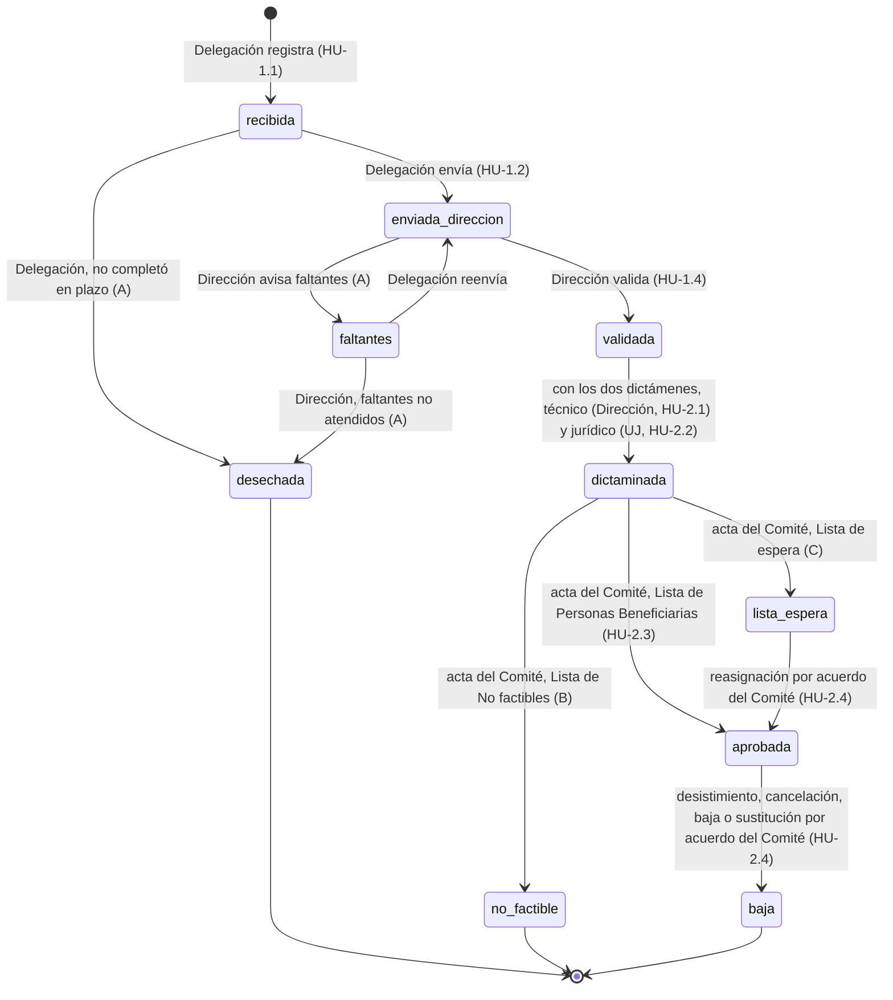

# Sistema de programas de PROBOSQUE

Prototipo del sprint 1 (módulos M1, Recepción y expediente, y M2, Dictamen y Comité) del sistema que lleva el trámite de los
seis programas de apoyo de PROBOSQUE: Capturando Carbono (CC), Manejo Forestal Sustentable (MFS),
Plantaciones Sustentables (PS), Restauración Hidrológico-Forestal (RHF), PSAHEM (PSA) y
Guardabosques (PEG). En este sprint solo CC tiene reglas cargadas; los demás existen en el catálogo.

Historias implementadas: HU-1.1 Registro de la solicitud, HU-1.2 Revisión del expediente,
HU-1.3 Ubicación del predio, HU-1.4 Validación del expediente, HU-2.1 Dictamen técnico, HU-2.2 Dictamen
jurídico, HU-2.3 Sesión de aprobación y HU-2.4 Reasignaciones e incidentes (antes «Sesiones de seguimiento»).

## Cómo levantar

Requisitos: Docker con Compose 2.24 o posterior. En Windows, Docker vive en WSL:

```
wsl -e bash -lc "cd /mnt/c/Users/<usuario>/Documents/GitHub/FEPI/sistema && docker compose up --build"
```

En otro equipo basta con `docker compose up --build` dentro de `sistema/`.

- El sitio queda en **http://localhost:8080** (Nginx → Gunicorn).
- Al arrancar, el contenedor `web` aplica las migraciones, recolecta los estáticos y corre
  `cargar_catalogos`, `cargar_reglas` y `cargar_demo` (los tres son idempotentes).
- Variables: copiar `.env.ejemplo` a `.env` y cambiar los valores. Sin `.env` se usan los valores de
  desarrollo de `docker-compose.yml`. `.env` no se versiona.
- Para borrar todo (base y archivos): `docker compose down -v`.

Servicios de `docker-compose.yml`:

| Servicio | Qué hace |
| --- | --- |
| `bd` | PostgreSQL 17 + PostGIS 3.5 (volumen `bd_datos`). |
| `web` | Django 5.2 LTS con Gunicorn (imagen de producción, sin herramientas de prueba). |
| `nginx` | Sirve los estáticos y entrega los archivos del expediente solo después de que Django revisa el permiso (`X-Accel-Redirect`). Puerto 8080. |
| `plazos` | Corre `manage.py revisar_plazos` cada 24 h (bucle simple, sin cron ni Celery). |
| `pruebas` | Perfil aparte: pytest + Playwright con Chromium (etapa `pruebas` del Dockerfile). |

## Cómo probar

Desde `sistema/` (en este equipo, dentro de WSL: `wsl -e bash -lc "cd /mnt/c/.../FEPI/sistema && <comando>"`).
Docker Compose acepta argumentos para el servicio `pruebas`; al terminar, `docker compose down`.

| Qué | Comando | Tiempo medido |
|---|---|---|
| Rápidas (sin navegador) | `docker compose --profile pruebas run --rm pruebas pytest -m "not navegador"` | 119 pruebas, ~62 s (71 s con arranque) |
| Una historia | `docker compose --profile pruebas run --rm pruebas pytest pruebas/test_hu_2_3.py` | ~15–25 s |
| Todo (rápidas + recorridos de Playwright) | `docker compose --profile pruebas run --rm pruebas` | 127 pruebas, ~114 s (120 s con arranque) |
| Todo y regenerar capturas | `docker compose --profile pruebas run --rm -e CAPTURAS=1 pruebas` | igual que «todo» |

Los recorridos de Playwright (todo lo que usa `page` o `live_server`, en `pruebas/e2e/`) llevan el marcador
`navegador` (registrado en `pytest.ini`) y corren al final. **Las capturas solo se guardan con `CAPTURAS=1`**; sin
esa variable la fixture `captura` no escribe nada y `git status` queda limpio. Van a `CAPTURAS_DIR`
(por omisión `/entregas/sprint_1/capturas`, la carpeta `entregas/` de la raíz del repositorio montada en el
contenedor); para otro sprint: `-e CAPTURAS_DIR=/entregas/sprint_2/capturas`. Para regenerar solo algunas:
`... run --rm -e CAPTURAS=1 pruebas pytest pruebas/e2e/test_recorrido_hu_2_3.py`.

Las pruebas unitarias y de criterios corren con pytest-django contra PostGIS. Las historias, sus criterios y las
necesidades se leen de
`especificacion/modelo.json` y `especificacion/necesidades_v12.json`; ahí está también el texto de las
Reglas de Operación 2026 al que remiten los numerales y las líneas de `reglas/*.json`.

Cada criterio de aceptación tiene al menos una prueba con el ID de su historia en el nombre
(`pruebas/test_hu_1_1.py` … `test_hu_2_4.py`); las del núcleo están en `pruebas/test_nucleo_*.py`.
Los recorridos de Playwright están en `pruebas/e2e/` (uno por historia; los de M2 en archivos
`test_recorrido_hu_2_*.py`) y corren con Chromium en español de México (`--lang=es-MX`, zona horaria de
la Ciudad de México). Los programas sin archivo de reglas (PEG y PSAHEM) se prueban con fixtures
(`pruebas/fixtures_m2.py`) que crean su programa-ejercicio, su plazo y sus ministraciones.

## Usuarios de demostración

Contraseña de prueba para todos: **`Probosque2026`** (solo para demostración; nunca en un servidor real).

| Usuario | Unidad | Para qué |
| --- | --- | --- |
| `del_amecameca` | Delegación Regional Forestal Amecameca | Ventanilla: registra, revisa requisitos, levanta polígono, envía, notifica. |
| `del_toluca` | Delegación Regional Forestal Toluca | Igual, otra Delegación (solo ve lo suyo). |
| `del_valle` | Delegación Regional Forestal Valle de Bravo | Igual. |
| `dir_drff` | Dirección de Restauración y Fomento Forestal | Instancia Ejecutora de CC, MFS, PS, RHF y PSA: valida o avisa faltantes, dictamen técnico, listado preliminar, cumple acuerdos. |
| `dir_dpf` | Dirección de Protección Forestal | Instancia Ejecutora de PEG (dictamen técnico; validación de reportes). |
| `juridica` | Unidad Jurídica | Dictamen jurídico, Listado de Personas Beneficiarias Incumplidas y predios sancionados. |
| `comite` | Secretaría Técnica del Comité | Sesiones: convocatoria, documentos, listados, acta, acuerdos. |
| `finanzas` | Dirección de Administración, Finanzas y de Gestión Documental | (Sprint 2.) |
| `vivero` | Vivero (demostración) | (Sprint 2.) |
| `fiduciaria` | Fiduciaria | Ve en su bandeja las instrucciones de pago del Comité (PSAHEM). |
| `admin` | — (superusuario) | Admin de Django para catálogos: `/admin/`. |

Solicitudes de demostración (CC 2026): Los Ocotes (recibida, revisión a medias), Ejido San Rafael
(recibida, completa, con polígono), La Cañada (en la Dirección), Rancho El Capulín (aviso de faltantes
notificado), El Tecolote (desechada) y, para M2: Los Encinos del Monte (con dictamen técnico, falta el
jurídico; traslapa con La Joya Alta), El Ocotal (en dictamen, plazo vencido), Potrero Viejo
(dictaminada, en la bandeja de la Secretaría Técnica) y la sesión de aprobación SO-CC-2026-01 con acta
(recurso de $26,000): Predio Agua Blanca (refrendo, con cambio de lugar del polígono) y La Joya Alta
aprobadas, Las Trojes en lista de espera y Cerro de la Cruz no factible (su titular, Rogelio Bautista
Núñez, está en el Listado de Incumplidas). El Ocotal tiene dictamen jurídico no procedente porque no se
acredita la legal posesión (constancia vencida que no ampara toda la superficie). La sesión de
seguimiento SO-CC-2026-02 tiene cuatro acuerdos: caso fortuito de Agua Blanca, desistimiento de La Joya
Alta (baja, libera $10,000; cumplido), reasignación a Las Trojes, primera de la lista de espera (pasa a
aprobada), y otro para la Unidad Jurídica. Cada dictamen tiene su documento en PDF adjunto.

## Estructura

```
sistema/
├── docker-compose.yml, Dockerfile, .env.ejemplo, requirements*.txt, pytest.ini, manage.py
├── docker/            entrypoint.sh y nginx.conf
├── probosque/         proyecto Django (settings, urls, wsgi)
├── nucleo/            app común: modelos, días hábiles, acuses PDF, carga de catálogos y reglas,
│                      bandeja, permisos, comandos (cargar_catalogos, cargar_reglas, cargar_demo,
│                      revisar_plazos), datos de demostración y trazabilidad.py (historial)
├── recepcion/         app M1: revisión de requisitos, polígonos, validación; servicios.py (reglas),
│                      geometria.py (GeoJSON/KML/SHP), vistas y plantillas por pestaña
├── dictamen/          app M2, un módulo por historia: tecnico.py (HU-2.1), juridico.py (HU-2.2),
│                      aprobacion.py (HU-2.3), seguimiento.py (HU-2.4); documentos.py (PDF de los
│                      dictámenes), listados.py (candidatos y beneficiarios); sesiones.py y comun.py
│                      compartidos; vistas/, formularios/ y templates/dictamen/ con la misma división;
│                      registro.py conecta la app con las bandejas, el menú, la trazabilidad y los plazos
├── plantillas/        base.html y 403.html (acceso no permitido)
├── estaticos/         css, js del mapa y vendor/ (Bootstrap 5.3.9, htmx 2.0.11, Leaflet 1.9.4,
│                      Leaflet-Geoman 2.20.6; sin CDN)
├── reglas/            CC.json, catalogos.json, indice_rop.json (extraídos de las ROP; no se editan a mano)
├── datos/             municipios_edomex.geojson, flujo_tramite.json, sistema.json, dictamen.json,
│                      dias_inhabiles_2026.json
├── especificacion/    modelo.json, necesidades_v12.json y el texto de las ROP 2026
├── herramientas/      preparar_municipios.py (convierte la capa de IDEFOR a GeoJSON)
└── pruebas/           pytest (test_nucleo_*, test_hu_1_*, test_hu_2_*, fixtures_m2.py) y e2e/ (Playwright)
```

## Estados del trámite (sprint 1)

Los estados y las transiciones son datos (`datos/flujo_tramite.json`, editables en el admin). El único
punto del código que cambia un estado es `Expediente.cambiar_estado(destino, usuario, motivo)`: valida
contra la tabla (origen, destino, tipo de unidad, programa opcional), revisa que el expediente sea de la
unidad del usuario, pide motivo cuando la transición lo exige y escribe la bitácora. Al cargar el
archivo, las transiciones que ya no aparecen en él dejan de estar permitidas.



| Estado | Bandeja (quién lo atiende) | También lo consultan |
| --- | --- | --- |
| `recibida`, `faltantes` | Delegación | Dirección del programa |
| `enviada_direccion` | Dirección del programa | — |
| `validada` (en dictamen) | Dirección (si le falta el técnico) y Unidad Jurídica (si le falta el jurídico) | Secretaría Técnica |
| `dictaminada` | Secretaría Técnica del Comité | Unidad Jurídica |
| `aprobada`, `lista_espera`, `no_factible` | — (M3 en el sprint 2) | Unidad Jurídica, Secretaría Técnica |
| `baja` (recurso liberado) | — (final) | Dirección, Unidad Jurídica, Secretaría Técnica |

Una Delegación solo ve sus expedientes; una Dirección, los de los programas de los que es Instancia
Ejecutora; las demás unidades, los estados que atienden o consultan. Además, cada unidad ve en su bandeja
los **acuerdos del Comité** que le toca cumplir (HU-2.4).

## Decisiones tomadas

- **Reglas como datos.** `cargar_reglas` lee `reglas/<CLAVE>.json` (hoy solo `CC.json`): tipos de
  persona, modalidades, requisitos (con bandera de documento legal, `aplica_en_refrendo`, opcional y
  condición), plazos (cantidad + unidad; admite `cantidad: null` y unidades como `fecha_limite`),
  formatos, montos y ministraciones (estas dos quedan listas para el sprint 2). Las claves que el
  esquema no usa todavía se guardan en `Ejercicio.datos`. `datos/sistema.json` indica qué plazo usa el
  sistema para los faltantes (`complemento_documentacion_faltante`, 5 días hábiles) y para la vigencia
  en refrendo (`vigencia_documentacion_legal_refrendo`, 3 años).
- **Modalidades de CC.** El archivo de CC trae como «modalidades» los tres tipos de superficie, dos
  regímenes de pago y el refrendo. Al registrar solo se eligen los tipos de superficie
  (`ajustes_reglas` en `datos/sistema.json`); el refrendo es una casilla del expediente.
- **Expediente único por predio.** El predio tiene su folio (`PRED-000001`) que conserva entre
  programas (ROP CC 8.1.1.2 fr. XVII); cada solicitud a un programa-ejercicio es un `Expediente` con
  folio `CC-2026-AME-0001` y todo (requisitos, documentos, polígonos, validaciones, acuses, bitácora)
  cuelga de él. Los modelos del trámite llevan `django-simple-history`.
- **Municipios y Delegaciones.** Los 125 municipios vienen de la capa de IDEFOR, simplificada a ~40 m
  (`herramientas/preparar_municipios.py`). La capa no trae la clave INEGI: la clave es interna
  (`M001`…`M125`, orden alfabético). La asignación a Delegaciones es la de la Convocatoria 2026
  (`reglas/catalogos.json`); los nombres se empatan sin acentos y por prefijo («Acambay» → «Acambay de
  Ruíz Castañeda») y la carga falla con un mensaje que nombra al municipio si alguno no empata o queda
  sin Delegación. La interfaz la muestra como «según la Convocatoria 2026, por confirmar con el
  cliente»; se edita en el admin (Municipios).
- **HU-1.1.** Solo la Delegación registra. Si el municipio del predio lo atiende otra Delegación, se
  rechaza y el mensaje dice cuál (ROP CC 8.1.3); en el formulario se avisa por HTMX al elegir el
  municipio. El acuse de recepción (PDF con folio, fecha y hora) indica el plazo de 5 días hábiles para
  completar la documentación.
- **HU-1.2, regla de envío.** Se puede enviar a la Dirección cuando (1) todos los requisitos aplicables
  están revisados, (2) ninguno está faltante, porque las ROP piden la documentación completa para atender
  la solicitud (CC 8.1.1.2 fr. XIV), y (3) cada entregado tiene su archivo digitalizado o, en refrendo,
  es documentación vigente que obra en PROBOSQUE. «No aplica» solo se permite en requisitos opcionales o
  con condición. El polígono no es condición de envío: las ROP lo levantan después (CC 10.1 fr. III).
- **HU-1.3.** Se acepta GeoJSON, KML y Shapefile en .zip (con o sin .prj; sin .prj y con coordenadas
  grandes se asume UTM 14N), o el dibujo en el mapa con Leaflet-Geoman. La superficie se calcula en
  EPSG:32614. Una geometría inválida se rechaza; si cae fuera (o parcialmente fuera, >0.5 %) del
  municipio se guarda con aviso. Cada cambio conserva el polígono anterior; si el traslape
  (intersección/unión) es menor de 50 % se marca «cambio de lugar», si no «corrección». Se registra quién
  lo levantó (Delegación o prestador con RFN). Si el programa no usa polígono (PEG), la pestaña no
  aparece y el servicio lo rechaza.
- **HU-1.4.** La Dirección ve cada requisito con una revisión automática contra las reglas y marca los
  faltantes; **cada faltante lleva su observación** (obligatoria si lo marca la Dirección; si lo marca la
  revisión con las reglas y no se escribe nada, su motivo). Cada requisito queda con su resultado y su
  observación en `ObservacionValidacion`; el aviso, la notificación y la pestaña Requisitos la muestran. Sin faltantes, el expediente queda validado (constancia en PDF). Con faltantes, se emite el
  aviso con fecha límite = fecha del aviso + 5 días hábiles (plazo de las reglas, calendario de días
  inhábiles), dirigido a la persona solicitante por conducto de la Delegación; el expediente pasa a la
  bandeja de la Delegación, que registra la notificación (acuse) y reenvía cuando recibe lo faltante.
  En refrendo, la documentación que obra en PROBOSQUE vale si su fecha no es anterior a la recepción
  menos la vigencia de las reglas (3 años); si es más vieja, la Delegación no la acepta y la Dirección
  la marca como faltante.
- **Días hábiles.** Sábados, domingos y el catálogo `DiaInhabil`. Un plazo en días hábiles empieza a
  contar el día hábil siguiente al evento; en días naturales, meses o años, si el último día es
  inhábil vence el siguiente hábil. Las ROP no traen calendario: se cargó uno de demostración 2026
  (`datos/dias_inhabiles_2026.json`), editable en el admin.
- **Acuses.** Cada envío o entrega (recepción, envío a la Dirección, validación, aviso de faltantes,
  notificación) genera un `Acuse` con folio `AC-AAAA-NNNNNN`, fecha y hora, PDF (WeasyPrint) y su huella
  SHA-256, y un evento en la bitácora.
- **Trazabilidad.** Los modelos del trámite llevan `django-simple-history`: cada alta, cambio o baja deja
  un renglón con los valores, el usuario, la fecha y la hora y el motivo. `nucleo/trazabilidad.py`
  (`registra_usuario`, `con_usuario`) registra al usuario de cada servicio aunque no haya petición web
  (pruebas, demostración, comandos), y los cambios en lote se hacen con `save()` para que queden en el
  historial. La pestaña «Trazabilidad» junta el historial de todos los registros del expediente, campo por
  campo; cada app agrega los suyos en `extensiones.TRAZABILIDAD`. Es el último criterio de aceptación de
  todas las historias del sistema.
- **Archivos.** `FileSystemStorage` en el volumen `archivos`; no hay URL pública de los archivos: se
  descargan por vistas que revisan la unidad del usuario.
- **Revisión de plazos.** En este sprint `revisar_plazos` solo señala en la bitácora (una vez) los
  avisos de faltantes vencidos y las solicitudes con faltantes cuyo plazo desde la recepción venció;
  no cambia estados.
- **Mapa base.** OpenStreetMap si hay conexión (`MAPA_TESELAS_URL`); vacío = sin teselas (las pruebas
  corren así).
- **Requisitos que no son documentos (ajuste a M1).** `datos/sistema.json`
  (`ajustes_reglas.CC.requisitos_sin_documento`) marca CC-REQ-01 y CC-REQ-03 como condiciones: se
  revisan como «cumple» o «no cumple» sin archivo (campo `Requisito.requiere_documento`). La pestaña
  Requisitos muestra solo el estado de cada fila y un botón «Revisar» que despliega su formulario. Los
  campos de archivo usan un botón «Elegir archivo» propio (`estaticos/js/archivos.js`), porque el texto
  del control nativo depende del idioma del navegador.

### Módulo M2 (Dictamen y Comité)

- **Organización.** Un módulo de servicios por historia (`dictamen/tecnico.py`, `juridico.py`,
  `aprobacion.py`, `seguimiento.py`), con sus vistas (`dictamen/vistas/`), formularios
  (`dictamen/formularios/`), plantillas (`templates/dictamen/<historia>/`) y pruebas por separado. Lo
  común: `models.py`, migraciones, `urls.py`, `admin.py`, `comun.py`, `sesiones.py` (convocatoria) y
  `registro.py`. El núcleo no depende de `dictamen`: la app se registra en `nucleo/extensiones.py`
  (filtros y paneles de bandeja, pestaña del expediente, menú, revisión de plazos y datos de
  demostración), que es donde se conectarán los módulos M3 a M6.
- **Estados.** Los dictámenes técnico y jurídico corren en paralelo sobre el expediente validado; el que
  completa el par pasa el expediente a `dictaminada` (bandeja de la Secretaría Técnica). Se quitó la
  transición `validada → no_factible` del sprint anterior: según las ROP de CC (10.1 fr. VI y VII; 9.4.3
  fr. I y III) los dictámenes producen el listado preliminar y es el Comité quien aprueba la Lista de
  Personas Beneficiarias, la Lista de espera y la Lista de No factibles. Por eso las tres salidas de
  `dictaminada` las registra la Secretaría Técnica con el acta. `Estado.tipo_unidad_bandeja` admite
  varios tipos de unidad (separados por coma) y `Estado.visible_para`, las unidades que solo consultan.
- **HU-2.1.** La lista de verificación se arma con `superficie`, `criterios_elegibilidad_tecnica`,
  `inelegibles` y `criterios_seleccion` del archivo de reglas; un criterio «no cumple» impide el dictamen
  factible. El análisis cartográfico usa PostGIS: polígono vigente, superficie en EPSG:32614, rango del
  programa, ubicación en el municipio y traslapes (`geom__intersects`) con polígonos vigentes de otros
  expedientes del mismo ejercicio, con su superficie en hectáreas; se guarda una copia en el dictamen.
  El plazo de dictaminación sale de las reglas (`datos/dictamen.json` nombra las claves): en PEG,
  45 días hábiles desde la recepción (Convocatoria PEG, base quinta, fr. II, línea 9516); en CC, la fecha
  límite de la Convocatoria (30-jun-2026). El dictamen queda «en plazo» o «fuera de plazo»; sin
  dictamen, «en plazo», «por vencer» (5 días hábiles o menos) o «vencido», y `revisar_plazos` lo señala
  una vez en la bitácora. El listado preliminar reúne el resultado técnico y jurídico de cada solicitud
  validada y se exporta a CSV en UTF-8 con BOM (Excel lo abre con acentos). Al registrarlo se expide el
  **documento «Dictamen técnico»** (`dictamen/documentos.py`, plantilla `dictamen/pdf/dictamen_tecnico.html`):
  folio `DT-<programa>-<año>-<consecutivo>`, datos de la solicitud, análisis con el croquis del polígono,
  verificación, plazo, resultado y firmas; se guarda como `Documento` de tipo «dictamen» del expediente,
  con su huella SHA-256 en el dictamen.
- **HU-2.2.** El Listado de Personas Beneficiarias Incumplidas y los predios con procedimiento o
  sanción son catálogos con historial (`django-simple-history`); una baja desactiva, no borra. El cotejo
  es automático (persona, CURP, RFC, nombre sin acentos y predio) y se muestra en la pantalla y en el
  acuse. Con coincidencias, el **servicio** rechaza el dictamen procedente. Un predio sancionado con el
  reintegro hecho deja de impedir el apoyo (CC 8.1.1.1, inelegibles fr. III). En refrendo se pide el
  dictamen igual (CC 10.1 fr. IV). Cada documento legal se marca válido o no válido (con su observación).
  La **propiedad o legal posesión** del predio (`RevisionPropiedad`) se acredita con un documento de los
  que admiten las ROP (`datos/dictamen.json` → `propiedad.tipos_documento`, CC 8.1.1.2 fr. VII), a nombre
  del titular, que ampare la superficie del polígono vigente (o la solicitada), vigente si es constancia de
  posesión o contrato (usufructo o arrendamiento, máximo 5 años) y sin evidencia de conflicto (8.1.1.1
  fr. VII). Si falta algo, el servicio rechaza el dictamen procedente. Se expide el **documento «Dictamen
  jurídico»** (folio `DJ-…`) con la revisión de la documentación, la propiedad, el cotejo y el resultado.
- **HU-2.3.** La convocatoria exige orden del día y al menos un documento y se rechaza si no se envía con
  la anticipación de las reglas (`convocatoria_sesion_comite`: 3 días hábiles; 24 horas si es
  extraordinaria); su acuse lleva la fecha y la hora del envío, el orden del día y los integrantes del
  Comité tomados de `CC.json` (`instancias.comite`) o de `catalogos.json`. La propuesta de listados
  ordena las factibles por los criterios de priorización que se pueden leer del expediente
  (`datos/dictamen.json`: reforestaciones primero, 8.1.2 fr. I; refrendos, fr. II) y desempata por fecha y
  hora de registro (8.1.2, último párrafo); asigna hasta donde alcance el recurso disponible
  ($2,000 por ha de superficie factible, numeral 7.2) y el resto va a la lista de espera con su lugar.
  El Comité puede mover una solicitud de listado o de lugar con un motivo obligatorio, que queda en el
  acta, en el historial y en la bitácora; una no factible no puede pasar a los listados de apoyo. El acta
  (PDF) trae los tres listados y la autorización de publicación, y mueve cada expediente a `aprobada`,
  `lista_espera` o `no_factible`.
- **Candidatos y beneficiarios** (HU-2.3). `dictamen/listados.py` arma dos vistas separadas (menú
  «Listados»): candidatos (validadas en dictamen, dictaminadas por aprobar y lista de espera en su orden) y
  beneficiarios (aprobadas con su monto y cómo entraron: acta o reasignación; aparte, las que salieron),
  con exportación a CSV. Usan `expedientes_visibles`: la Delegación ve solo las suyas.
- **HU-2.4 · Reasignaciones e incidentes.** Los tipos de acuerdo, el área que los atiende por omisión y su
  efecto están en `datos/dictamen.json` (desistimiento, cancelación y baja → `baja`; reasignación →
  `reasignacion`; sustitución → `sustitucion`; caso fortuito, suspensión, reintegro, instrucción de pago
  a la Fiduciaria solo en PSAHEM y por ministración, validación de reportes solo en PEG y por periodo, y
  otro → `registro`). Los incidentes piden su causa. La baja pasa a la persona beneficiaria a `baja` y su
  monto (el del acta) queda como recurso liberado; la reasignación pasa a `aprobada` a las primeras de la
  lista de espera, en su orden (lugar del acta), y no rebasa el recurso liberado sin reasignar; la
  sustitución hace las dos cosas. Cada salida y entrada queda en `MovimientoListado`. Cada acuerdo lleva
  sus expedientes y su unidad responsable, que lo ve en su bandeja y lo marca como cumplido. `ministraciones_sin_instruccion` y `periodos_sin_validacion` dicen qué falta.
  Los acuerdos todavía no ejecutan nada en otros módulos: `dictamen.seguimiento.RECEPTORES` es el punto
  de conexión (tipo de acuerdo → funciones) para pagos (M5) y seguimiento (M6).

## Diferencias con la especificación (mandan las ROP)

- La especificación pide asignar municipios a Delegaciones de forma provisional; las ROP y la
  Convocatoria sí traen la tabla completa (125 municipios), así que se usa esa tabla, marcada por
  confirmar.
- El polígono se levanta después de entregar el expediente (CC 10.1 fr. III), por eso no es requisito
  para enviarlo a la Dirección.
- La no factibilidad no la decide la Dirección ni la Unidad Jurídica por sí solas: el dictamen produce
  el listado preliminar y el Comité aprueba la Lista de solicitudes No factibles (CC 10.1 fr. VI y VII;
  9.4.3 fr. I y III). Se quitó la transición directa `validada → no_factible`.
- En CC el plazo de dictaminación no es un número de días sino la fecha límite de la Convocatoria
  (30-jun-2026); el de 45 días hábiles es solo de PEG.

## Pendientes con el cliente

- Confirmar la asignación de municipios a Delegaciones y el calendario oficial de días inhábiles 2026.
- Plazo del aviso de faltantes de la Dirección: las ROP dicen «dentro del plazo de evaluación»
  (10.1 fr. V) sin cantidad; se usó el de complemento (5 días hábiles, 8.1.1.2 fr. XIV) contado desde el
  aviso. Falta decidir si corre desde el aviso o desde la notificación de la Delegación, y si debe
  topar con la fecha límite de recepción de la Convocatoria (27-mar-2026).
- Requisitos que no son documentos: se marcaron CC-REQ-01 y CC-REQ-03 (`datos/sistema.json`); confirmar
  la lista.
- Priorización en CC: las ROP no traen puntaje; se propone el orden reforestaciones → refrendos → fecha
  de registro. Confirmar con el Comité los demás criterios (8.1.2 fr. III a X necesitan datos que hoy no
  se capturan: índice de presión, ANP, grupos prioritarios…).
- Recurso disponible por sesión y monto por hectárea cuando la superficie factible difiere de la
  solicitada.
- Plazo de convocatoria de los Comités de PSAHEM y PEG (5 días hábiles en el CASPEG, línea 8939) y
  sus integrantes: cuando existan sus archivos de reglas.
- Si el acta debe esperar a la fecha de la sesión: hoy se puede registrar en cuanto se envía la
  convocatoria.
- Clave INEGI de los municipios (la capa de IDEFOR no la trae).
- Nombre de la fiduciaria del FIPASAHEM y departamento responsable de cada programa.
- Reglas de MFS, PS, RHF, PSA y PEG (archivos `reglas/<CLAVE>.json`).

## Modelo de datos y recorrido completo

- [`docs/modelo_datos.md`](docs/modelo_datos.md): diagrama entidad-relación por áreas (núcleo, recepción,
  dictamen), generado desde los modelos con `herramientas/diagrama_er.py`; el completo, con todos los
  campos, está en `docs/modelo_datos.mmd`.
- `pruebas/test_sprint_1_recorrido_completo.py`: una sola solicitud recorre el registro, los requisitos, el
  polígono, el envío, el aviso de faltantes y su reenvío, la validación, los dos dictámenes, la sesión de
  aprobación y un acuerdo de seguimiento. En cada relevo comprueba el estado, en la bandeja de qué unidad
  queda, el acuse y el renglón de la bitácora; al final, los dos documentos de los dictámenes y que el
  historial de la base de datos tenga a cada unidad que intervino.
