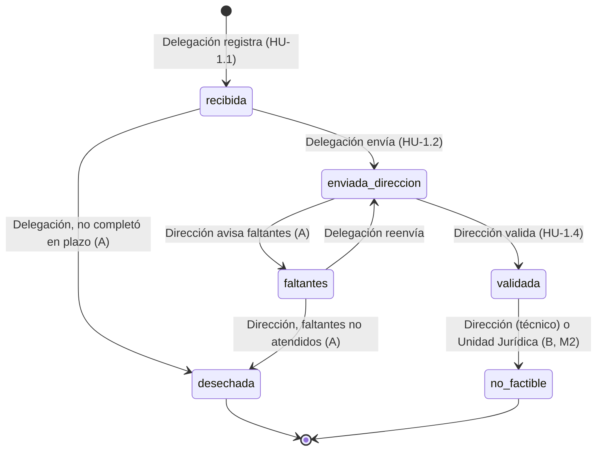

# Sistema de programas de PROBOSQUE

Prototipo del sprint 1 (módulo M1, Recepción y expediente) del sistema que lleva el trámite de los
seis programas de apoyo de PROBOSQUE: Capturando Carbono (CC), Manejo Forestal Sustentable (MFS),
Plantaciones Sustentables (PS), Restauración Hidrológico-Forestal (RHF), PSAHEM (PSA) y
Guardabosques (PEG). En este sprint solo CC tiene reglas cargadas; los demás existen en el catálogo.

Historias implementadas: HU-1.1 Registro de la solicitud, HU-1.2 Revisión del expediente,
HU-1.3 Ubicación del predio y HU-1.4 Validación del expediente.

## Cómo levantar

Requisitos: Docker con Compose 2.24 o posterior. En Windows, Docker vive en WSL:

```
wsl -e bash -lc "cd /mnt/c/Users/<usuario>/Documents/GitHub/FEPI/sistema && docker compose up --build"
```

En otro equipo basta con `docker compose up --build` dentro de `sistema/`.

- El sitio queda en **http://localhost:8080** (Nginx → Gunicorn).
- Al arrancar, el contenedor `web` aplica las migraciones, recolecta los estáticos y corre
  `cargar_catalogos`, `cargar_reglas` y `cargar_demo` (los tres son idempotentes).
- Variables: copiar `.env.ejemplo` a `.env` y cambiar los valores. Sin `.env` se usan los valores de
  desarrollo de `docker-compose.yml`. `.env` no se versiona.
- Para borrar todo (base y archivos): `docker compose down -v`.

Servicios de `docker-compose.yml`:

| Servicio | Qué hace |
| --- | --- |
| `bd` | PostgreSQL 17 + PostGIS 3.5 (volumen `bd_datos`). |
| `web` | Django 5.2 LTS con Gunicorn (imagen de producción, sin herramientas de prueba). |
| `nginx` | Sirve los estáticos y entrega los archivos del expediente solo después de que Django revisa el permiso (`X-Accel-Redirect`). Puerto 8080. |
| `plazos` | Corre `manage.py revisar_plazos` cada 24 h (bucle simple, sin cron ni Celery). |
| `pruebas` | Perfil aparte: pytest + Playwright con Chromium (etapa `pruebas` del Dockerfile). |

## Cómo probar

Un solo comando (desde `sistema/`):

```
docker compose --profile pruebas run --rm pruebas
```

Corre las pruebas unitarias y de criterios (pytest-django contra PostGIS) y, al final, los recorridos
de Playwright, que dejan las capturas en `entregas/sprint_1/capturas/hu_1_*.png` (carpeta de la raíz
del repositorio montada en el contenedor). Las historias, sus criterios y las necesidades se leen de
`especificacion/modelo.json` y `especificacion/necesidades_v12.json`; ahí está también el texto de las
Reglas de Operación 2026 al que remiten los numerales y las líneas de `reglas/*.json`.

Cada criterio de aceptación tiene al menos una prueba con el ID de su historia en el nombre
(`pruebas/test_hu_1_1.py` … `test_hu_1_4.py`); las del núcleo están en `pruebas/test_nucleo_*.py`.

## Usuarios de demostración

Contraseña de prueba para todos: **`Probosque2026`** (solo para demostración; nunca en un servidor real).

| Usuario | Unidad | Para qué |
| --- | --- | --- |
| `del_amecameca` | Delegación Regional Forestal Amecameca | Ventanilla: registra, revisa requisitos, levanta polígono, envía, notifica. |
| `del_toluca` | Delegación Regional Forestal Toluca | Igual, otra Delegación (solo ve lo suyo). |
| `del_valle` | Delegación Regional Forestal Valle de Bravo | Igual. |
| `dir_drff` | Dirección de Restauración y Fomento Forestal | Instancia Ejecutora de CC, MFS, PS, RHF y PSA: valida o avisa faltantes. |
| `dir_dpf` | Dirección de Protección Forestal | Instancia Ejecutora de PEG. |
| `juridica` | Unidad Jurídica | (Sprint siguiente: dictamen jurídico.) |
| `comite` | Secretaría Técnica del Comité | (Sprint siguiente.) |
| `finanzas` | Dirección de Administración, Finanzas y de Gestión Documental | (Sprint 2.) |
| `vivero` | Vivero (demostración) | (Sprint 2.) |
| `fiduciaria` | Fiduciaria | (Sprint 2.) |
| `admin` | — (superusuario) | Admin de Django para catálogos: `/admin/`. |

Solicitudes de demostración (CC 2026): Los Ocotes (recibida, revisión a medias), Ejido San Rafael
(recibida, completa, con polígono), La Cañada (en la Dirección), Rancho El Capulín (aviso de faltantes
notificado), Predio Agua Blanca (refrendo validado, con cambio de lugar del polígono) y El Tecolote
(desechada).

## Estructura

```
sistema/
├── docker-compose.yml, Dockerfile, .env.ejemplo, requirements*.txt, pytest.ini, manage.py
├── docker/            entrypoint.sh y nginx.conf
├── probosque/         proyecto Django (settings, urls, wsgi)
├── nucleo/            app común: modelos, días hábiles, acuses PDF, carga de catálogos y reglas,
│                      bandeja, permisos, comandos (cargar_catalogos, cargar_reglas, cargar_demo,
│                      revisar_plazos) y datos de demostración
├── recepcion/         app M1: revisión de requisitos, polígonos, validación; servicios.py (reglas),
│                      geometria.py (GeoJSON/KML/SHP), vistas y plantillas por pestaña
├── plantillas/        base.html
├── estaticos/         css, js del mapa y vendor/ (Bootstrap 5.3.9, htmx 2.0.11, Leaflet 1.9.4,
│                      Leaflet-Geoman 2.20.6; sin CDN)
├── reglas/            CC.json, catalogos.json, indice_rop.json (extraídos de las ROP; no se editan a mano)
├── datos/             municipios_edomex.geojson, flujo_tramite.json, sistema.json, dias_inhabiles_2026.json
├── herramientas/      preparar_municipios.py (convierte la capa de IDEFOR a GeoJSON)
└── pruebas/           pytest (test_nucleo_*, test_hu_1_*) y e2e/ (Playwright)
```

## Estados del trámite (sprint 1)

Los estados y las transiciones son datos (`datos/flujo_tramite.json`, editables en el admin). El único
punto del código que cambia un estado es `Expediente.cambiar_estado(destino, usuario, motivo)`: valida
contra la tabla (origen, destino, tipo de unidad, programa opcional), revisa que el expediente sea de la
unidad del usuario, pide motivo cuando la transición lo exige y escribe la bitácora.



Bandejas: `recibida` y `faltantes` las atiende la Delegación; `enviada_direccion` y `validada` (para el
dictamen del sprint siguiente), la Dirección. Una Delegación solo ve sus expedientes; una Dirección, los
de los programas de los que es Instancia Ejecutora.

## Decisiones tomadas

- **Reglas como datos.** `cargar_reglas` lee `reglas/<CLAVE>.json` (hoy solo `CC.json`): tipos de
  persona, modalidades, requisitos (con bandera de documento legal, `aplica_en_refrendo`, opcional y
  condición), plazos (cantidad + unidad; admite `cantidad: null` y unidades como `fecha_limite`),
  formatos, montos y ministraciones (estas dos quedan listas para el sprint 2). Las claves que el
  esquema no usa todavía se guardan en `Ejercicio.datos`. `datos/sistema.json` indica qué plazo usa el
  sistema para los faltantes (`complemento_documentacion_faltante`, 5 días hábiles) y para la vigencia
  en refrendo (`vigencia_documentacion_legal_refrendo`, 3 años).
- **Modalidades de CC.** El archivo de CC trae como «modalidades» los tres tipos de superficie, dos
  regímenes de pago y el refrendo. Al registrar solo se eligen los tipos de superficie
  (`ajustes_reglas` en `datos/sistema.json`); el refrendo es una casilla del expediente.
- **Expediente único por predio.** El predio tiene su folio (`PRED-000001`) que conserva entre
  programas (ROP CC 8.1.1.2 fr. XVII); cada solicitud a un programa-ejercicio es un `Expediente` con
  folio `CC-2026-AME-0001` y todo (requisitos, documentos, polígonos, validaciones, acuses, bitácora)
  cuelga de él. Los modelos del trámite llevan `django-simple-history`.
- **Municipios y Delegaciones.** Los 125 municipios vienen de la capa de IDEFOR, simplificada a ~40 m
  (`herramientas/preparar_municipios.py`). La capa no trae la clave INEGI: la clave es interna
  (`M001`…`M125`, orden alfabético). La asignación a Delegaciones es la de la Convocatoria 2026
  (`reglas/catalogos.json`); los nombres se empatan sin acentos y por prefijo («Acambay» → «Acambay de
  Ruíz Castañeda») y la carga falla con un mensaje que nombra al municipio si alguno no empata o queda
  sin Delegación. La interfaz la muestra como «según la Convocatoria 2026, por confirmar con el
  cliente»; se edita en el admin (Municipios).
- **HU-1.1.** Solo la Delegación registra. Si el municipio del predio lo atiende otra Delegación, se
  rechaza y el mensaje dice cuál (ROP CC 8.1.3); en el formulario se avisa por HTMX al elegir el
  municipio. El acuse de recepción (PDF con folio, fecha y hora) indica el plazo de 5 días hábiles para
  completar la documentación.
- **HU-1.2, regla de envío.** Se puede enviar a la Dirección cuando (1) todos los requisitos aplicables
  están revisados, (2) ninguno está faltante, porque las ROP piden la documentación completa para atender
  la solicitud (CC 8.1.1.2 fr. XIV), y (3) cada entregado tiene su archivo digitalizado o, en refrendo,
  es documentación vigente que obra en PROBOSQUE. «No aplica» solo se permite en requisitos opcionales o
  con condición. El polígono no es condición de envío: las ROP lo levantan después (CC 10.1 fr. III).
- **HU-1.3.** Se acepta GeoJSON, KML y Shapefile en .zip (con o sin .prj; sin .prj y con coordenadas
  grandes se asume UTM 14N), o el dibujo en el mapa con Leaflet-Geoman. La superficie se calcula en
  EPSG:32614. Una geometría inválida se rechaza; si cae fuera (o parcialmente fuera, >0.5 %) del
  municipio se guarda con aviso. Cada cambio conserva el polígono anterior; si el traslape
  (intersección/unión) es menor de 50 % se marca «cambio de lugar», si no «corrección». Se registra quién
  lo levantó (Delegación o prestador con RFN). Si el programa no usa polígono (PEG), la pestaña no
  aparece y el servicio lo rechaza.
- **HU-1.4.** La Dirección ve cada requisito con una revisión automática contra las reglas y marca los
  faltantes. Sin faltantes, el expediente queda validado (constancia en PDF). Con faltantes, se emite el
  aviso con fecha límite = fecha del aviso + 5 días hábiles (plazo de las reglas, calendario de días
  inhábiles), dirigido a la persona solicitante por conducto de la Delegación; el expediente pasa a la
  bandeja de la Delegación, que registra la notificación (acuse) y reenvía cuando recibe lo faltante.
  En refrendo, la documentación que obra en PROBOSQUE vale si su fecha no es anterior a la recepción
  menos la vigencia de las reglas (3 años); si es más vieja, la Delegación no la acepta y la Dirección
  la marca como faltante.
- **Días hábiles.** Sábados, domingos y el catálogo `DiaInhabil`. Un plazo en días hábiles empieza a
  contar el día hábil siguiente al evento; en días naturales, meses o años, si el último día es
  inhábil vence el siguiente hábil. Las ROP no traen calendario: se cargó uno de demostración 2026
  (`datos/dias_inhabiles_2026.json`), editable en el admin.
- **Acuses.** Cada envío o entrega (recepción, envío a la Dirección, validación, aviso de faltantes,
  notificación) genera un `Acuse` con folio `AC-AAAA-NNNNNN`, fecha y hora, PDF (WeasyPrint) y su huella
  SHA-256, y un evento en la bitácora.
- **Archivos.** `FileSystemStorage` en el volumen `archivos`; no hay URL pública de los archivos: se
  descargan por vistas que revisan la unidad del usuario.
- **Revisión de plazos.** En este sprint `revisar_plazos` solo señala en la bitácora (una vez) los
  avisos de faltantes vencidos y las solicitudes con faltantes cuyo plazo desde la recepción venció;
  no cambia estados.
- **Mapa base.** OpenStreetMap si hay conexión (`MAPA_TESELAS_URL`); vacío = sin teselas (las pruebas
  corren así).

## Diferencias con la especificación (mandan las ROP)

- La especificación pide asignar municipios a Delegaciones de forma provisional; las ROP y la
  Convocatoria sí traen la tabla completa (125 municipios), así que se usa esa tabla, marcada por
  confirmar.
- El polígono se levanta después de entregar el expediente (CC 10.1 fr. III), por eso no es requisito
  para enviarlo a la Dirección.

## Pendientes con el cliente

- Confirmar la asignación de municipios a Delegaciones y el calendario oficial de días inhábiles 2026.
- Plazo del aviso de faltantes de la Dirección: las ROP dicen «dentro del plazo de evaluación»
  (10.1 fr. V) sin cantidad; se usó el de complemento (5 días hábiles, 8.1.1.2 fr. XIV) contado desde el
  aviso. Falta decidir si corre desde el aviso o desde la notificación de la Delegación, y si debe
  topar con la fecha límite de recepción de la Convocatoria (27-mar-2026).
- Varios requisitos de CC no son documentos (por ejemplo CC-REQ-01, «ser persona física o jurídico
  colectiva…»); hoy se marcan entregados con un archivo. Convendría una bandera en las reglas.
- Clave INEGI de los municipios (la capa de IDEFOR no la trae).
- Nombre de la fiduciaria del FIPASAHEM y departamento responsable de cada programa.
- Reglas de MFS, PS, RHF, PSA y PEG (archivos `reglas/<CLAVE>.json`).
