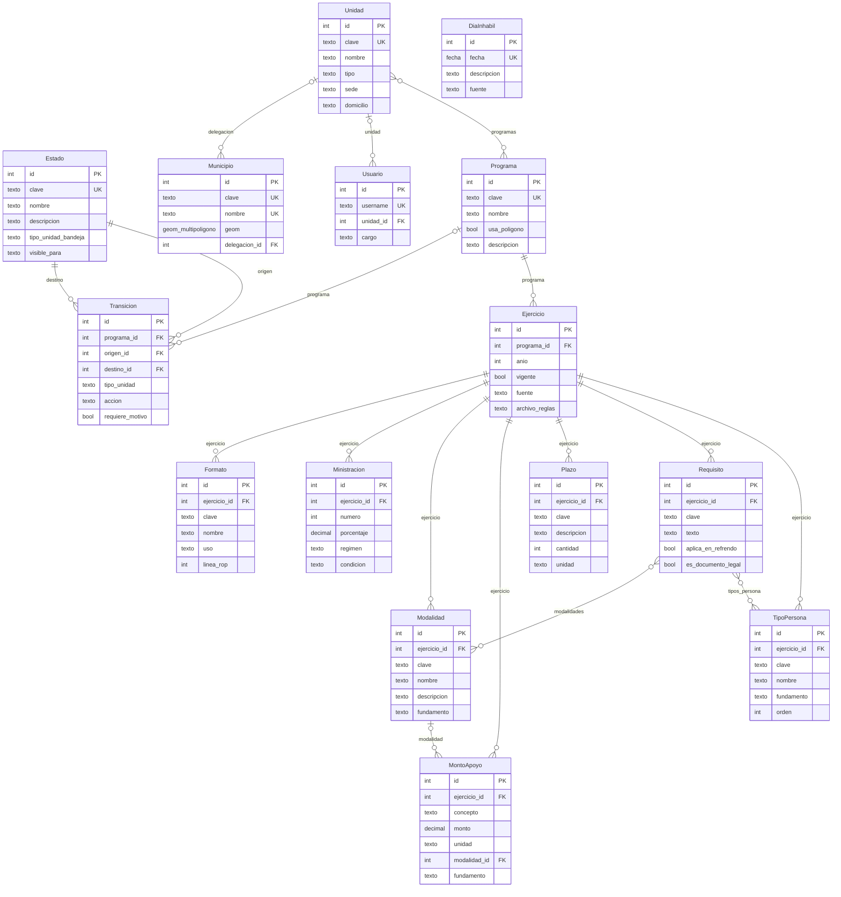
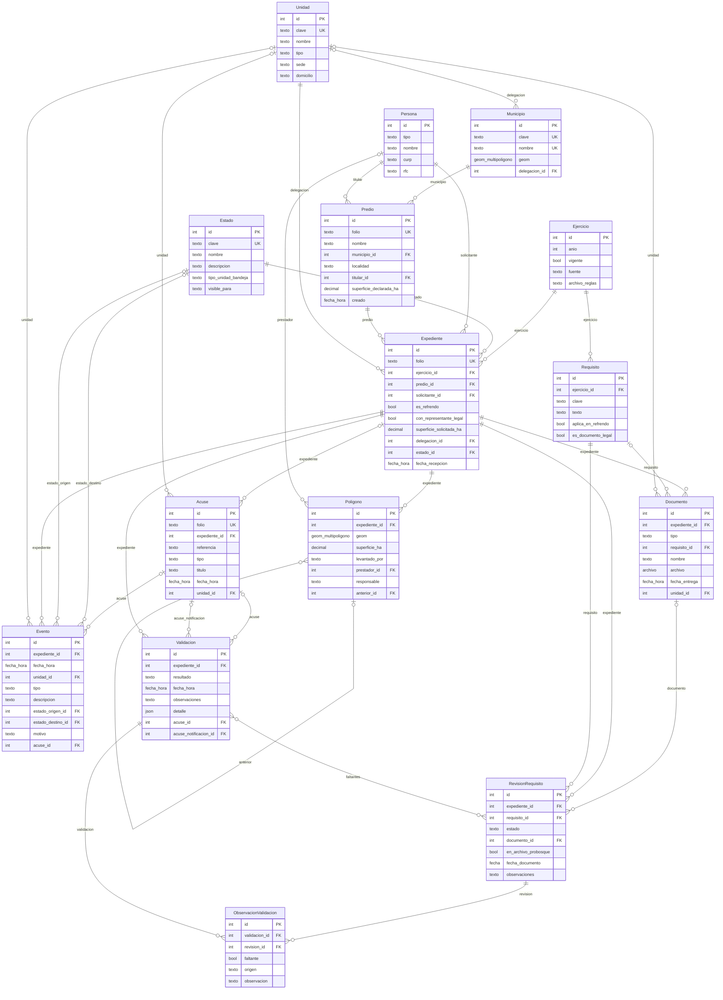
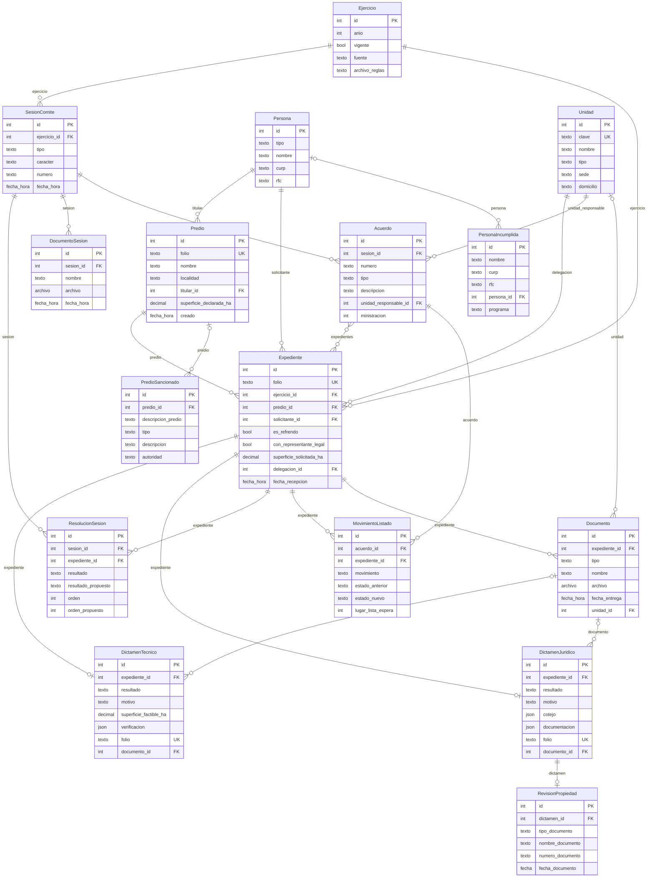

# Modelo de datos

Diagrama entidad-relación del Sistema de programas, generado a partir de los modelos de Django con
`herramientas/diagrama_er.py` (no se dibuja a mano: si cambia un modelo, se vuelve a generar). Son
36 tablas propias en tres apps (`nucleo`, `recepcion`, `dictamen`) sobre PostgreSQL + PostGIS. El diagrama
completo, con todos los campos, está en [`modelo_datos.mmd`](modelo_datos.mmd).

Para leerlo: `||--o{` es «uno a muchos» obligatorio, `|o--o{` «uno a muchos» opcional, `||--o|` «uno a uno»
y `}o--o{` «muchos a muchos». Aquí cada tabla muestra su llave, sus llaves foráneas y sus campos
principales. No se dibujan las relaciones hacia `Usuario` (casi todas las tablas guardan quién registró)
ni las tablas de historial que crea django-simple-history (una `Historical…` por tabla del trámite).

```bash
docker compose --profile pruebas run --rm --no-deps --entrypoint python pruebas     herramientas/diagrama_er.py > docs/modelo_datos.mmd
```

## 1. Reglas por programa y catálogos (núcleo)

Lo que cambia de un programa a otro vive aquí como datos: requisitos por tipo de persona y modalidad,
plazos, formatos, montos y ministraciones de cada ejercicio; los estados del trámite y sus transiciones
permitidas; las unidades con sus usuarios y los municipios que atiende cada Delegación.



## 2. Expediente y recepción (M1)

El expediente único por predio: la solicitud, la revisión de cada requisito con su documento, los
polígonos (el vigente y los anteriores), la validación con su aviso de faltantes y la observación de la Dirección
sobre cada requisito (`ObservacionValidacion`), los acuses y la bitácora. Las tablas de historial
(`Historical…`) guardan cada alta, cambio o baja con el usuario, la fecha y la hora: es la trazabilidad que muestra
la pestaña «Trazabilidad» del expediente.



## 3. Dictamen y Comité (M2)

Un dictamen técnico y uno jurídico por expediente, cada uno con su documento en PDF (`Documento` de tipo
«dictamen»); la revisión de la propiedad o legal posesión del predio (`RevisionPropiedad`, una por dictamen
jurídico); el Listado de Personas Beneficiarias Incumplidas y los predios sancionados; las sesiones del Comité
con sus documentos; la resolución de cada expediente en la sesión de aprobación; los acuerdos de seguimiento
(incidentes y reasignaciones, con su causa, su área responsable y el recurso que liberan o reasignan) y los
movimientos de listado que producen (`MovimientoListado`: quién sale de la Lista de Personas Beneficiarias y
quién entra desde la lista de espera).


