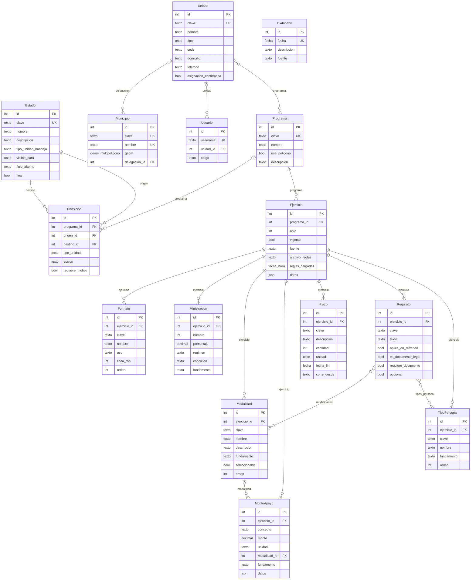
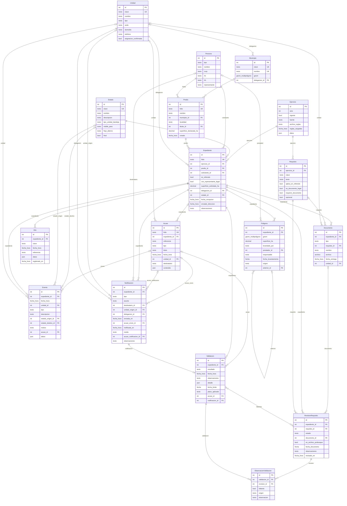
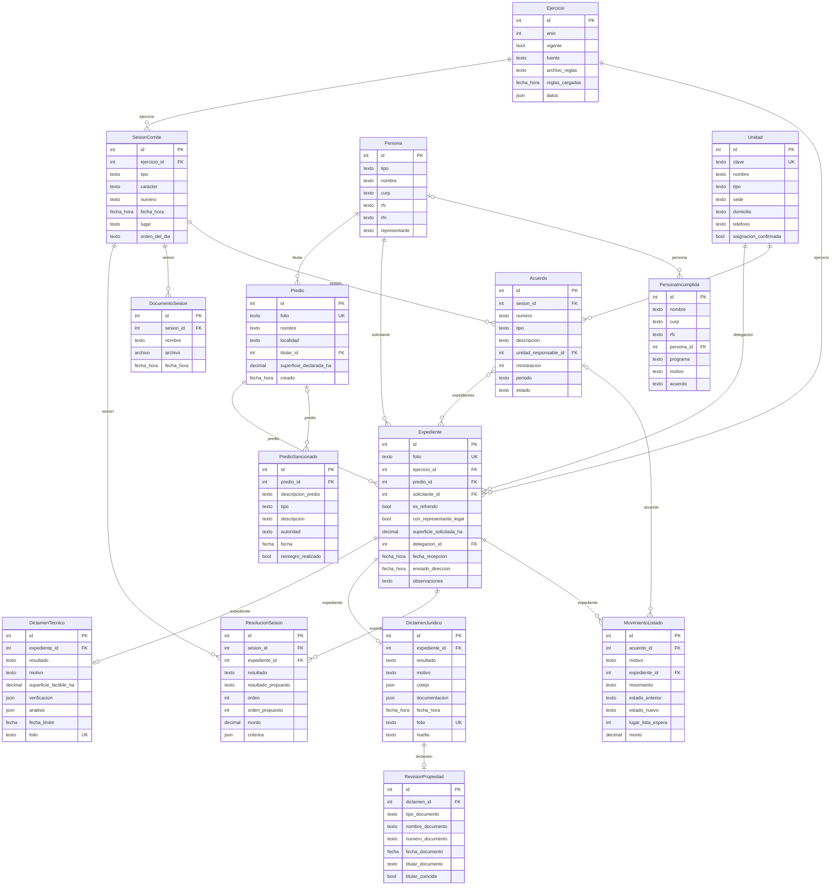
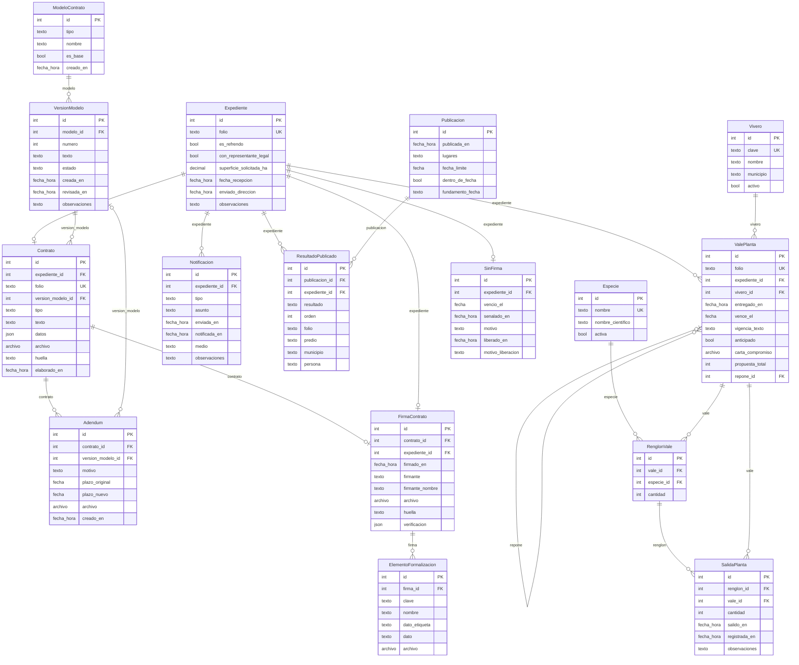
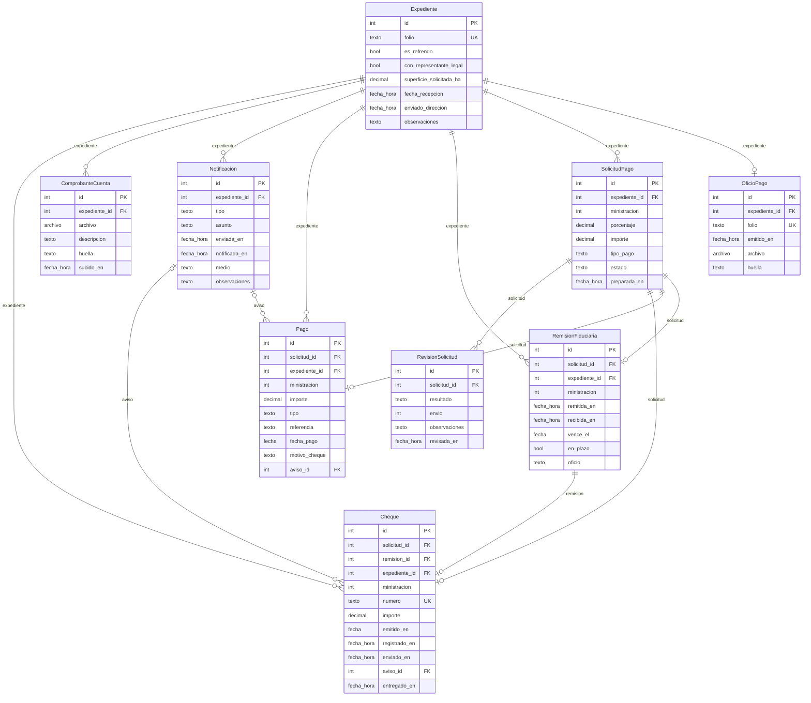

# Modelo de datos

Diagrama entidad-relación del Sistema de programas, generado a partir de los modelos de Django con
`herramientas/diagrama_er.py` (no se dibuja a mano: si cambia un modelo, se vuelve a generar). Son
59 tablas propias en cinco apps (`nucleo`, `recepcion`, `dictamen`, `contrato` y `pagos`) sobre PostgreSQL + PostGIS. El diagrama
completo, con todos los campos, está en [`modelo_datos.mmd`](modelo_datos.mmd).

Para leerlo: `||--o{` es «uno a muchos» obligatorio, `|o--o{` «uno a muchos» opcional, `||--o|` «uno a uno»
y `}o--o{` «muchos a muchos». Aquí cada tabla muestra su llave, sus llaves foráneas y sus campos
principales. No se dibujan las relaciones hacia `Usuario` (casi todas las tablas guardan quién registró)
ni las tablas de historial que crea django-simple-history (una `Historical…` por tabla del trámite).

```bash
docker compose --profile pruebas run --rm --no-deps --entrypoint python pruebas     herramientas/diagrama_er.py > docs/modelo_datos.mmd
```

## 1. Reglas por programa y catálogos (núcleo)

Lo que cambia de un programa a otro vive aquí como datos: requisitos por tipo de persona y modalidad,
plazos, formatos, montos y ministraciones de cada ejercicio; los estados del trámite y sus transiciones
permitidas; las unidades con sus usuarios y los municipios que atiende cada Delegación.



## 2. Expediente y recepción (M1)

El expediente único por predio: la solicitud, la revisión de cada requisito con su documento, los
polígonos (el vigente y los anteriores), la validación con su aviso de faltantes y la observación de la Dirección
en cada requisito (`ObservacionValidacion`), los acuses y la bitácora.
La notificación por conducto de la Delegación (`Notificacion`, con el envío y la notificación a la persona) y
los hitos que arrancan plazos (`Hito`: publicación, firma, entrega del Vale o del cheque) son del núcleo y
los usan todos los módulos.



## 3. Dictamen y Comité (M2)

Un dictamen técnico y uno jurídico por expediente, el Listado de Personas Beneficiarias Incumplidas y los
predios sancionados, las sesiones del Comité con sus documentos, la resolución de cada expediente en la
sesión de aprobación y los acuerdos de seguimiento con su área responsable. Cada dictamen guarda su folio, su
documento PDF (`Documento` de tipo «dictamen») y su huella; el jurídico, la revisión de la propiedad o legal posesión
(`RevisionPropiedad`). Las bajas y reasignaciones quedan en `MovimientoListado` (sin acuerdo cuando el recurso lo liberó
la Dirección por un contrato sin firma en plazo, HU-3.3).



## 4. Publicación y contrato (M3)

La publicación de resultados de una sesión de aprobación con acta (`Publicacion`, con un `ResultadoPublicado` por solicitud: lo que
ve el público), el modelo de contrato por programa con sus versiones validadas por la Unidad Jurídica (`ModeloContrato`,
`VersionModelo`), el contrato elaborado por solicitud (`Contrato`, con su huella y su `Adendum` para ampliar plazos), la firma
con sus elementos de formalización y el señalamiento de las que vencen sin firma (`FirmaContrato`, `ElementoFormalizacion`,
`SinFirma`) y el Vale de Planta con sus renglones y las salidas del vivero (`ValePlanta`, `RenglonVale`, `SalidaPlanta`, con los
catálogos `Especie` y `Vivero`). Los avisos a la persona no tienen tabla propia: son `Notificacion` del núcleo, igual que los hitos
que arrancan los plazos.



## 5. Pagos (M5)

El oficio de la Delegación y el comprobante de la cuenta bancaria (`OficioPago`, `ComprobanteCuenta`), la solicitud de cada
ministración con su lista de soportes (`SolicitudPago`), la revisión de Administración y Finanzas, que acepta o devuelve
(`RevisionSolicitud`), el pago registrado (`Pago`, uno por solicitud aceptada), la remisión a la Fiduciaria en PSAHEM
(`RemisionFiduciaria`) y el cheque de cada ministración (`Cheque`). El aviso de pago a la persona es una `Notificacion`
del núcleo.


